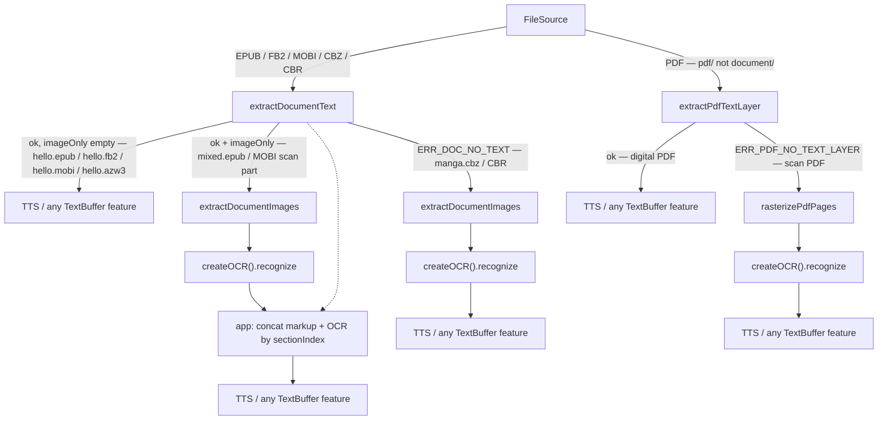

# Offline e-documents (`react-native-sherpa-onnx/document`)

Two APIs, one buffer type per call:

1. **`extractDocumentText`** — markup → `OfflineTextBuffer` (`origin: 'markup'`). **Never OCR.**
2. **`extractDocumentImages`** — image-only sections / CBZ / CBR → `OfflineImageBuffer`.

Source adapter like [`pdf/`](pdf-offline.md): not a reader and not OCR. Recognize stays `createOCR().recognize` on the ImageBuffer. The usual sink is TTS on whatever text the **app** concatenated; any feature that takes an `OfflineTextBuffer` can sit there instead.

libarchive is **default-on**. Disable at build time → `ERR_DOC_ARCHIVE_DISABLED` (no `isLibarchiveEnabled()`). Log tag `[SherpaOnnx:doc]`.

## Formats

Sniff is by file signature / container, not extension. `format` is on the result (no public detect API). Capability only — dispatch is [Typical pipeline](#typical-pipeline).

| Format | `extractDocumentText` | `extractDocumentImages` |
|--------|----------------------|-------------------------|
| EPUB 2 / 3 | Spine XHTML, reading order; `linear="no"` skipped | Spine items **without** extractable text |
| FB2 / FB2.ZIP / FBZ | XML document order (`format: 'fb2'` even inside a zip) | Sections without accompanying text (`<binary>`) |
| CBZ | `ERR_DOC_NO_TEXT` | ZIP images, natural sort of archive paths |
| CBR | `ERR_DOC_NO_TEXT` | Same as CBZ; RAR/RAR5 via libarchive |
| MOBI / PRC / AZW / AZW3 (KF8), no DRM | PalmDOC / HUFF/CDIC HTML in reading order | Image-only parts (`recindex`), not cover art |

Successful text + empty `imageOnlySections` → later images call is `ERR_DOC_NO_IMAGES`. Successful text + `imageOnlySections.length > 0` is a **mixed book**, not an error. Whole-document no markup (CBZ/CBR, scan EPUB) → `ERR_DOC_NO_TEXT`; images still work (undecodable files skipped).

Out of scope: PDF ([`pdf/`](pdf-offline.md)), KFX / AZW4 / Topaz, DRM Kindle files (`ERR_DOC_DRM`), Office, TXT, loose HTML, DjVu, audio/dictionary MOBI. Font-only EPUB `encryption.xml` is **not** DRM.

## Typical pipeline

The SDK does not sniff-then-dispatch. Start with `extractDocumentText` unless you already know it is a comic. Every branch ends on an `OfflineTextBuffer` (markup, OCR, or app-joined). **Typical goal is TTS** (`createTTS().synthesize`). Because buffers are the pipeline contract, any other feature that takes that TextBuffer works the same way — offline punctuation, alignment, and so on. See [feature-pipelines.md](feature-pipelines.md).

Example **Read aloud** follows the `document/` branch into TTS; scan-PDF raster lives on Vision → OCR.



`extractDocumentImages` first is valid for a known CBZ/CBR. Pure-text books must not take that shortcut (`ERR_DOC_NO_IMAGES`).

## Quick start — text

```ts
import { createEmptyOfflineTextBuffer } from 'react-native-sherpa-onnx/textbuffer';
import { extractDocumentText } from 'react-native-sherpa-onnx/document';

// textOut must be empty (populate-once, same ownership as extractPdfTextLayer).
const textOut = await createEmptyOfflineTextBuffer();
const result = await extractDocumentText(
  { kind: 'fs', path: '/path/to/book.epub' },
  textOut
);
// result.buffer === textOut. origin on spans is 'markup'.
console.log(result.format, result.sectionCount, result.imageOnlySections.length);
// imageOnlySections.length > 0 → mixed book: also run extractDocumentImages (below).
// CBZ/CBR throw ERR_DOC_NO_TEXT here — catch and go to images, not a generic failure.
```

## Quick start — images

```tsx
import {
  getOfflineImageBufferFrameInfo,
  OfflineImageBufferFrameView,
  releaseOfflineImageBuffer,
} from 'react-native-sherpa-onnx/imagebuffer';
import { extractDocumentImages } from 'react-native-sherpa-onnx/document';

// Returns a result, not a buffer: images.buffer is the OfflineImageBuffer handle.
const images = await extractDocumentImages(
  { kind: 'fs', path: '/path/to/book.cbz' },
  { maxSide: 2048 } // longest-edge cap; default 4096, <= 0 disables
);
// CBZ/CBR: one frame per decodable page (natural sort). EPUB: only image-only spine items.
const f0 = await getOfflineImageBufferFrameInfo(images.buffer, 0);
console.log(images.format, images.frameCount, f0.href, f0.pageNumber);

<OfflineImageBufferFrameView
  buffer={images.buffer}
  frameIndex={0}
  resizeMode="contain"
  style={{ width: '100%', height: 240 }}
/>

// Optional: await ocr.recognize(images.buffer, ocrOut); then TTS on OCR text.
await releaseOfflineImageBuffer(images.buffer);
```

## Mixed books (app, not SDK)

A **mixed book** is an EPUB/FB2/MOBI whose spine has flowing markup **and** image-only items (scan chapters). Impact:

- `extractDocumentText` **succeeds**. The markup buffer contains only text chapters. Scan chapters are **absent** from that buffer — TTS on markup alone skips them.
- `imageOnlySections` is the gap list (`sectionIndex` + `href`). That is the signal to also extract images; it is not an error.
- `extractDocumentImages` returns **exactly those sections**, not every `` in a text chapter (no cover harvest, no decorative art).
- OCR writes a **second** TextBuffer (`origin: 'ocr'`). The SDK does not merge, interleave, or speak. The app concatenates markup + OCR slices by `sectionIndex`, then TTS that string.
- There is no `interleaveDocumentText`. AnnotatedView draws `ocr` quads, not `markup` (null quads).

```ts
const markupOut = await createEmptyOfflineTextBuffer();
const text = await extractDocumentText(src, markupOut);

if (text.imageOnlySections.length === 0) {
  // Pure text: TTS markupOut. extractDocumentImages would be ERR_DOC_NO_IMAGES.
} else {
  // Mixed: markupOut is incomplete for read-aloud until OCR fills the gaps.
  const images = await extractDocumentImages(src);
  const ocrOut = await createEmptyOfflineTextBuffer();
  await ocr.recognize(images.buffer, ocrOut);
  // Join markup + OCR blocks by sectionIndex in the app, then createTTS().synthesize(joined).
}
```

## API reference

From `react-native-sherpa-onnx/document`.

#### `extractDocumentText(source, textOut, options?)`

```ts
function extractDocumentText(
  source: FileSource,
  textOut: OfflineTextBufferIdSource,
  options?: ExtractDocumentTextOptions
): Promise<ExtractDocumentTextResult>;
```

`source` is a `FileSource` (path or Android PFD after resolve; see [fileio.md § Seekable sources](fileio.md#seekable-sources-document-and-pdf)). Android `apkAsset` copies into app cache on first open. Streams → `ERR_DOC_OPEN_FAILED`. Options: `signal`, `onProgress`.

```ts
type ExtractDocumentTextResult = {
  buffer: OfflineTextBufferHandle; // === textOut
  format: 'epub' | 'fb2' | 'mobi';
  sectionCount: number;
  sections: DocumentSectionInfo[];
  imageOnlySections: DocumentSectionInfo[];
  spatialSpanCount: number;
};

type DocumentSectionInfo = {
  sectionIndex: number; // 0-based reading order
  href?: string;
  kind: 'text' | 'image';
};
```

`sectionCount` / `sections` are linear spine items (`linear="yes"` or missing). `imageOnlySections` is a subset. Whole document without markup → `ERR_DOC_NO_TEXT`. Mixed EPUB is not an error.

Progress: `SherpaOnnxDocProgress` `{ done, total, phase }` (`open` / `section` / `entry` / `done`).

#### `extractDocumentImages(source, options?)`

```ts
function extractDocumentImages(
  source: FileSource,
  options?: ExtractDocumentImagesOptions
): Promise<ExtractDocumentImagesResult>;
```

```ts
type ExtractDocumentImagesResult = {
  buffer: OfflineImageBufferHandle;
  format: 'epub' | 'fb2' | 'mobi' | 'cbz' | 'cbr';
  frameCount: number;
};
```

| Option | Default | Notes |
|--------|---------|--------|
| `maxSide` | `4096` | longest-edge cap after decode; `<= 0` disables |
| `signal` / `onProgress` | — | cancel / progress |

| Input | Frames |
|-------|--------|
| CBZ / CBR | Image files, natural sort; skip `ComicInfo.xml` / thumbs / `.` files; skip undecodable codecs |
| EPUB / FB2 / MOBI image-only sections | Those sections only, order = `sectionIndex` |
| Pure text document | `ERR_DOC_NO_IMAGES` |

Text extract first is optional. After a successful text extract with empty `imageOnlySections`, images still return `ERR_DOC_NO_IMAGES`. Zero decodable frames after skips → `ERR_DOC_NO_IMAGES`.

CBZ/CBR `pageNumber` is 1-based **after** sort; `href` is the archive path. EPUB/FB2 frames use `sectionIndex` + `href`. MOBI image frames use `href` like `recindex:1`.

## Markup spans

One span per block (`p`, `h1`–`h6`, `li`, `blockquote`, `pre`, `td`). Same `sectionIndex` (+ `href`) on every span of that section.

| Field | Content |
|-------|---------|
| `utf16Start` / `utf16End` | Range in the buffer |
| `level` | `'block'` |
| `origin` | `'markup'` |
| `sectionIndex` | Reading order |
| `href` | EPUB path / FB2 id / MOBI `part-N` or `recindex:N` / archive path when present |
| `sourceImageBufferId` | empty |
| `quad` | Required schema: **null quad** `(0,0,…,0)`. AnnotatedView does not draw `markup` |
| `frameIndex` | `0` |
| `pageNumber` | unused |

Blocks joined with `\n\n`; `<br>` → `\n`; ruby keeps `rb`, drops `rt`/`rp`; `script` / `style` / `head` / `template` dropped. `alt` / `title` / `aria` do **not** count as text (scan chapters stay image-only).

## Errors

| Code | When |
|------|------|
| `ERR_DOC_ARCHIVE_DISABLED` | libarchive built out |
| `ERR_DOC_UNSUPPORTED_FORMAT` | PDF, HTML file, KFX / AZW4 / Topaz / audio / dictionary MOBI, unknown |
| `ERR_DOC_DRM` | Content encryption / password-protected archive |
| `ERR_DOC_OPEN_FAILED` | Unreadable, non-seekable stream, or archive over **10 000** entries / **64 MiB** per file / **512 MiB** uncompressed |
| `ERR_DOC_NO_TEXT` | No markup in the whole document |
| `ERR_DOC_NO_IMAGES` | No image-only sections / no decodable image |
| `ERR_DOC_INVALID_ARGUMENT` | Bad source / missing or already populated `textOut` |
| `ERR_DOC_CANCELLED` | AbortSignal |
| `ERR_DOC_PARSE_FAILED` | Broken OPF / XHTML / FB2 / MOBI |

## See also

- [Offline PDF](pdf-offline.md)
- [Offline OCR](ocr-offline.md)
- [ImageBuffer](imagebuffer-offline.md)
- [TextBuffer](textbuffer-offline.md)
- [Feature pipelines](feature-pipelines.md)
- [Disable libarchive](disable-libarchive.md)
- Example [Read aloud](../example/README.md#documents-read-aloud)
