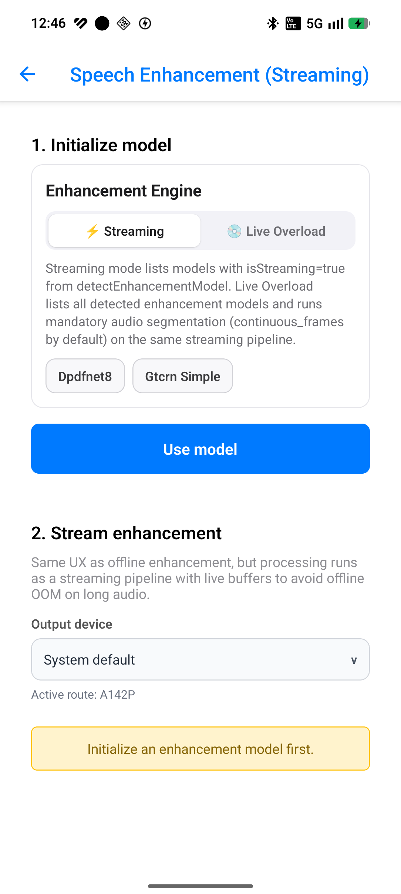
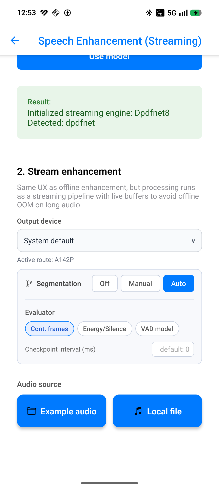
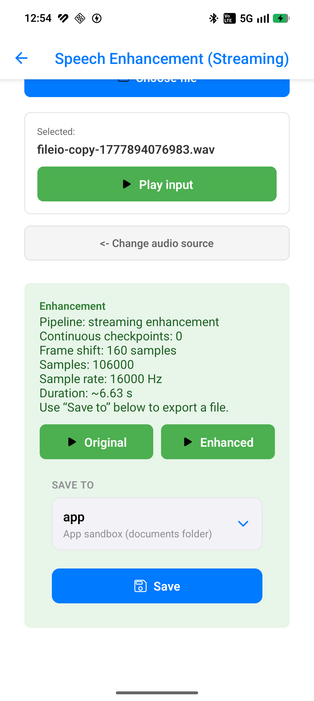

# Speech enhancement (streaming)

## Introduction

On-device streaming speech denoising with a **pipeline-first** API. A native worker drains a live audio input buffer frame-by-frame and appends denoised PCM to a live output buffer — no per-chunk JS bridging for steady-state audio. For offline batch enhancement, see [Speech enhancement (offline)](enhancement-offline.md).

Import path: **`react-native-sherpa-onnx/enhancement`**.

If the enhancement model rate is not `16000`, set live buffer `sampleRate` (or ingest decode target) explicitly to the model rate from `getSampleRate()`.

## Streaming pipeline system

`enhance` registers a **native worker** that drains **`inputBuf`** in frame-sized steps and appends denoised PCM to **`outputBuf`**. Audio enters via buffer producers (mic, append, upstream pipeline); control the worker through **`EnhancementPipelineHandle`**. Shared semantics of **`stop` / `flush` / `reset` / `getStatus` / `completed`** are described in **[Streaming pipelines — shared lifecycle](streaming-pipelines-overview.md)**. **Streaming enhancement** is special in that **finalizing the live input audio buffer** normally causes the worker to **auto-flush and stop**; explicit `flush()` is still available for mid-run tail flush without stopping.

## Quick start

All buffer parameters accept refs directly. Raw string ids are optional; malformed ids are rejected early with `AUDIO_INVALID_ARGUMENT`.

**`inputBuf`** / **`outputBuf`** below are the **input** and **output** live pipeline buffers from the intro; PCM moves natively between them while the worker runs — no per-chunk JS bridging for steady-state audio.

```ts
import { createStreamingEnhancement } from 'react-native-sherpa-onnx/enhancement';
import {
  createEmptyLiveAudioBuffer,
  releasePipelineAudioBuffer,
} from 'react-native-sherpa-onnx/audiobuffer';

const denoiser = await createStreamingEnhancement({
  modelSource: { kind: 'fs', path: '/absolute/path/to/enhancement-model-dir' },
  modelType: 'auto',
});

const sr = await denoiser.getSampleRate();
const inputBuf = await createEmptyLiveAudioBuffer({ sampleRate: sr });
const outputBuf = await createEmptyLiveAudioBuffer({
  sampleRate: sr,
  onFramesAppended: (e) => {
    if (e.source !== 'enhancement') return;
    console.log(
      'enhanced frames',
      e.frameCount,
      'total',
      e.totalSamplesWritten,
      e.sampleRate
    );
  },
});

const pipeline = await denoiser.enhance(inputBuf, outputBuf);

// Mic or other source feeds inputBuf; the pipeline appends to outputBuf and fires onFramesAppended.

await pipeline.stop();
outputBuf.unsubscribeEvents();
inputBuf.unsubscribeEvents();
await releasePipelineAudioBuffer(inputBuf);
await releasePipelineAudioBuffer(outputBuf);
await denoiser.destroy();
```

The pipeline handle supports **`flush()`** / **`reset()`** / **`getStatus()`** while running. When the input buffer **finalizes**, the worker auto-flushes and stops.

## Buffer matrix

| Role | Type | Notes |
| --- | --- | --- |
| **Audio in** | [`LiveAudioBuffer`](audiobuffer-streaming.md) | Ring/spool buffer the denoiser drains (mic, append, or upstream pipeline) |
| **Audio out** | [`LiveAudioBuffer`](audiobuffer-streaming.md) | Separate live buffer; native worker appends denoised PCM |
| **Engine** | `StreamingEnhancementEngine` via `createStreamingEnhancement` | `enhance(audioIn, audioOut)` returns `EnhancementPipelineHandle` |
| **Pipeline handle** | `EnhancementPipelineHandle` | `stop` / `flush` / `reset` / `getStatus` / `completed` |

---

## Segmentation (Optional)

Streaming enhancement can attach segmentation to the input live audio buffer. Useful for deterministic checkpoints or manual boundary control while processing through one streaming pipeline.

**Modes:** `'off'` (default — stream continuously) | `'auto'` (policy-driven checkpoints) | `'manual'` (external boundary control).

| Evaluator | Supported | Notes |
| --- | --- | --- |
| `continuous_frames` | ✅ **Default** | Fixed-interval checkpoints; `checkpointIntervalMs: 1000` |
| `speech_energy_silence` | ✅ | Silence-based boundaries on the live stream |
| Text evaluators | ❌ | Audio-domain input only |

```ts
const pipeline = await denoiser.enhance(inputBuf.bufferId, outputBuf.bufferId, {
  segmentation: {
    mode: 'auto',
    policy: { evaluator: 'continuous_frames', checkpointIntervalMs: 1000 },
  },
});
```

Full policy reference: [segmentation-engine.md](segmentation-engine.md). Memory planning: [memory-and-models.md](memory-and-models.md). Offline path: [enhancement-offline.md](enhancement-offline.md#segmentation-optional).

## Models

Same packs as offline — see [enhancement-offline.md — Models](enhancement-offline.md#models).

## API reference

Signatures from **`react-native-sherpa-onnx/enhancement`**.

### `detectEnhancementModel(source, options?)`

Same as offline. Unified detection: [model-detect.md](model-detect.md).

```ts
function detectEnhancementModel(
  source: FileSource,
  options?: {
    modelType?: EnhancementModelType;
    assetName?: string;
  }
): Promise<EnhancementDetectResult>;
```

```ts
const det = await detectEnhancementModel(
  { kind: 'fs', path: '/absolute/path/to/sherpa-onnx-speech-enhancement-gtcrn' },
  { modelType: 'auto' }
);
if (!det.success) throw new Error(det.error ?? 'Enhancement detection failed');
```

### `createStreamingEnhancement(options)`

Creates an online `StreamingEnhancementEngine`.

```ts
function createStreamingEnhancement(
  options: StreamingEnhancementInitializeOptions
): Promise<StreamingEnhancementEngine>;
```

```ts
const denoiser = await createStreamingEnhancement({
  modelSource: { kind: 'fs', path: '/absolute/path/to/model-dir' },
  modelType: 'auto',
});
```

### `denoiser.enhance(inputBuffer, outputBuffer, options?)`

Starts a native worker that denoises live input into live output.

```ts
enhance(
  inputBufferId: string,
  outputBufferId: string,
  options?: StreamingEnhancementEnhanceOptions
): Promise<EnhancementPipelineHandle>;
```

```ts
const pipeline = await denoiser.enhance(inputBuf.bufferId, outputBuf.bufferId);
```

### `denoiser.setVoiceSample(buffer)`

Locks a VoxLock engine to the speaker in the clip. Narrow with `modelType === 'voxlock'`.

```ts
setVoiceSample(buffer: OfflineAudioBufferIdSource): Promise<void>;
```

```ts
if (denoiser.modelType === 'voxlock') {
  await denoiser.setVoiceSample(voiceBuf);
}
```

### `denoiser.getSampleRate()`

Model output sample rate.

```ts
const sr = await denoiser.getSampleRate();
```

### `denoiser.getFrameShiftInSamples()`

Native frame shift in samples.

```ts
const shift = await denoiser.getFrameShiftInSamples();
```

### `denoiser.destroy()`

Frees the native online denoiser.

```ts
await denoiser.destroy();
```

### Pipeline handle (`EnhancementPipelineHandle`)

Same `stop` / `flush` / `reset` / `getStatus` / `completed` as other streaming pipelines — [streaming-pipelines-overview.md](streaming-pipelines-overview.md). Adds the online denoiser `instanceId`.

```ts
const pipeline = await denoiser.enhance(inputBuf, outputBuf);
const status = await pipeline.getStatus();
await pipeline.flush();
await pipeline.stop();
await pipeline.completed;
```

---

## Pipeline composition

### Typical upstream

| Source / feature | Buffer or handle | Notes |
| --- | --- | --- |
| Mic/file live ingestion | `LiveAudioBuffer` (`live_*`) | Input live buffer remains in recording state while pipeline runs. |
| Pre-existing live chain | `LiveAudioBuffer` (`live_*`) | Can receive audio from upstream live append or ingest handles. |

### Typical downstream

| Destination / feature | Buffer or handle | Notes |
| --- | --- | --- |
| Clean live output | `LiveAudioBuffer` (`live_*`) | Output remains consumable while enhancement is active. |
| Streaming STT | `LiveAudioBuffer` (`live_*`) | Common denoise-first streaming transcription chain. |
| Live playback/finalize | `PcmPlayer` or finalize to offline buffer | Optional playback/export path after pipeline run. |

```mermaid
flowchart LR
  A[LiveAudioBuffer noisy] --> B[createStreamingEnhancement().enhance]
  B --> C[LiveAudioBuffer clean]
  C --> D[Streaming STT or live playback]
```

More end-to-end patterns: [feature-pipelines.md#enhancement-streaming-patterns](feature-pipelines.md#enhancement-streaming-patterns).

## JS Events

No pipeline-level JS event callbacks. Observe the output live audio buffer:

| Callback | Payload | Fires when | Notes |
| --- | --- | --- | --- |
| `onFramesAppended` | live-audio chunk notify (scalars) | denoised frames written to `audioOut` | set on `createEmptyLiveAudioBuffer`; **no PCM on the event** — metadata only (`frameCount`, `totalSamplesWritten`, …) |
| `onSegment` | `LiveAudioBufferSegmentEvent` (notify scalars) | speech segment committed when live segmentation is on | **notify + pull**; map with `liveAudioNotifyToSpeechSegment` or pull SegmentMeta via segmentbuffer |

Feature live overload `enhance(..., { onSegment })` takes a product `SpeechSegment` (already mapped from the notify). Canonical detail: [audiobuffer-streaming](audiobuffer-streaming.md#live-buffer-callbacks-onframesappended-vs-onsegment).

```ts
const audioOut = await createEmptyLiveAudioBuffer({
  sampleRate: 16000,
  onFramesAppended: (e) => {
    // cheap: enough for meters / progress (no PCM materialize on the bridge)
    console.log(e.frameCount, e.totalSamplesWritten, e.appendKind);
  },
  onSegment: (e) => {
    // cheap: enough for UI timing / count
    console.log(`#${e.segmentIndex}`, e.startSample, e.endSample);
  },
});
```

## Types

### Core streaming enhancement types (`react-native-sherpa-onnx/enhancement`)

| Type | Description |
| --- | --- |
| `EnhancementModelType` | `'gtcrn' \| 'dpdfnet' \| 'voxlock' \| 'auto'` |
| `ENHANCEMENT_MODEL_TYPES` | Readonly runtime list including `'auto'` |
| `StreamingEnhancementInitializeOptions` | Alias of `EnhancementInitializeOptions` |
| `StreamingEnhancementEnhanceOptions` | `{ segmentation?: EnhanceSegmentationConfig }` |
| `StreamingEnhancementEngine` | Union of `StreamingEnhancementEngineOf<F>` |
| `StreamingEnhancementEngineOf<F>` | Family-typed online engine |
| `StreamingEnhancementEngineForInit<O>` | Maps `createStreamingEnhancement({ modelType })` onto `StreamingEnhancementEngineOf` |
| `EnhancementPipelineHandle` | `StreamingPipelineHandle` plus online denoiser `instanceId` |
| `EnhancementDetectResult` | Return of `detectEnhancementModel()` |

### Related pipeline types

| Type | Description |
| --- | --- |
| `StreamingPipelineHandle` | Generic pipeline control: `stop`, `flush`, `reset`, `getStatus`, `completed` |
| `StreamingPipelineStatus` | `{ pipelineId, isRunning, chunksProcessed, unitsRead, unitsWritten, error }` |
| `StreamingPipelineCompletion` | Settles when the worker fully stops |

Offline types (`EnhancementEngine`, `EnhancementInitializeOptions`, `EnhanceOptions`, `EnhancementResult`): [enhancement-offline.md](enhancement-offline.md#types).

---

## Error codes

| Error code | Explanation |
| --- | --- |
| `DETECT_ERROR` | Model detection failed or returned no usable result. |
| `ENHANCEMENT_INIT_ERROR` | Offline engine initialization failed (e.g. invalid model path/type or native init failure). |
| `ENHANCEMENT_ERROR` | Generic offline enhancement runtime failure. |
| `ENHANCEMENT_BUFFER_NOT_FOUND` | Referenced audio buffer id was not found (missing or already released). |
| `ENHANCEMENT_BUFFER_KIND_MISMATCH` | Buffer kind does not match expected offline/streaming input contract. |
| `ENHANCEMENT_BUFFER_EMPTY` | Input offline buffer contains no samples. |
| `ENHANCEMENT_OUTPUT_NOT_EMPTY` | Offline output buffer must be empty before `enhance(...)`. |
| `OFFLINE_OOM` | Not enough memory for offline enhancement paths. Prefer streaming enhancement for large inputs, or chunk offline work with the segmentation engine ([segmentation-engine.md](./segmentation-engine.md)). Native reject text references the same doc path. |
| `ONLINE_ENHANCEMENT_INIT_ERROR` | Streaming engine initialization failed (missing ids, detection/init failure, invalid setup). |
| `ONLINE_ENHANCEMENT_ERROR` | Streaming runtime failure (e.g. missing online instance, unload conflict with active pipeline). |
| `PIPELINE_NOT_FOUND` | Pipeline id is not registered (already stopped or never started). |
| `PIPELINE_FLUSH_ERROR` | `flush()` failed for the running pipeline. |
| `PIPELINE_RESET_ERROR` | `reset()` failed for the running pipeline. |

---

## Platform notes

- **Android / iOS:** shared C-API wrapper (`EnhancementWrapper` / `OnlineEnhancementWrapper` in `android/src/main/cpp/enhancement/`). Android JNI and iOS bridges call the same core; there is no Kotlin AAR denoiser.

---

## Live overload on offline enhancement (restricted)

> Mandatory `segmentation.policy`. Commit-only — no partials.

The offline enhancement engine can drive a live pipeline directly. **Warning:** This is a restricted path. Because the offline engine is designed for monolithic processing, it is wrapped in a segmentation loop that processes fixed-size blocks (using the `continuous_frames` policy). This may introduce audible artifacts at segment boundaries.

```ts
const engine = await createEnhancement({ /* offline init */ });
const pipeline = await engine.enhance(inputBuf, outputBuf, {
  segmentation: { 
    mode: 'auto',
    policy: { evaluator: 'continuous_frames', checkpointIntervalMs: 1000 } 
  },
});

// pipeline.stop() / .flush() / .completed as usual
const completion = await pipeline.completed;
console.log(`Denoised ${completion.unitsWritten} samples`);
```

| Aspect | Live overload (`createEnhancement`) | Streaming engine (`createStreamingEnhancement`) |
| --- | --- | --- |
| Weights | Offline-optimized | Streaming-optimized |
| Boundary handling | Hard split (possible clicks) | Seamless stateful streaming |
| Latency | Per-segment (higher) | Per-frame (lower) |
| Recommendation | Use only for short segments | Preferred for live mic |

## Use case examples

<details>
<summary>Real-time denoise feeding downstream streaming STT</summary>

Start enhancement and STT on the clean live ring first, then feed noisy audio. STT partials appear while denoise is still running — await both pipelines only at stop.

```ts
import { createStreamingEnhancement } from 'react-native-sherpa-onnx/enhancement';
import { createStreamingSTT } from 'react-native-sherpa-onnx/stt';
import {
  createEmptyLiveAudioBuffer,
  startMicToLiveAudioBuffer,
  finalizeLiveAudioBuffer,
  releasePipelineAudioBuffer,
} from 'react-native-sherpa-onnx/audiobuffer';
import {
  createLiveTextBuffer,
  readLiveTextSegment,
  releasePipelineTextBuffer,
} from 'react-native-sherpa-onnx/textbuffer';

const denoiser = await createStreamingEnhancement({
  modelSource: { kind: 'fs', path: '/path/to/gtcrn' },
  modelType: 'auto',
});
const stt = await createStreamingSTT({
  modelSource: { kind: 'fs', path: '/path/to/streaming-stt' },
  modelType: 'auto',
});

const sr = await denoiser.getSampleRate();
const noisyIn = await createEmptyLiveAudioBuffer({ sampleRate: sr, channelCount: 1 });
const cleanOut = await createEmptyLiveAudioBuffer({ sampleRate: sr, channelCount: 1 });
const textOut = await createLiveTextBuffer({
  maxSegments: 2048,
  onSegment: async (e) => {
    // cheap: enough for UI timing / count
    console.log(`stt #${e.segmentIndex}`);
    // only when you need richness:
    const seg = await readLiveTextSegment(e);
    console.log('[stt]', seg?.text);
  },
});

const enhPipe = await denoiser.enhance(noisyIn.bufferId, cleanOut.bufferId);
const sttPipe = await stt.transcribe(cleanOut, textOut, { chunkSize: 3200 });
const mic = await startMicToLiveAudioBuffer(noisyIn);

await new Promise((r) => setTimeout(r, 20_000));
await mic.stop();
await finalizeLiveAudioBuffer(noisyIn);
await enhPipe.flush();
await sttPipe.flush();
await enhPipe.completed;
await sttPipe.completed;

await stt.destroy();
await denoiser.destroy();
await releasePipelineTextBuffer(textOut);
await releasePipelineAudioBuffer(cleanOut);
await releasePipelineAudioBuffer(noisyIn);
```

</details>

<details>
<summary>Ingest while enhancing, then snapshot clean audio for early playback</summary>

Denoise overlaps file ingest. After a short wait you can finalize/snapshot the clean live buffer for playback without treating enhancement as a blocking offline job.

```ts
import { createStreamingEnhancement } from 'react-native-sherpa-onnx/enhancement';
import {
  createEmptyLiveAudioBuffer,
  ingestFileToLiveAudioBuffer,
  finalizeLiveAudioBuffer,
  createOfflineAudioBufferFromLive,
  releasePipelineAudioBuffer,
} from 'react-native-sherpa-onnx/audiobuffer';
import { createPcmPlayer } from 'react-native-sherpa-onnx/pcm';

const denoiser = await createStreamingEnhancement({
  modelSource: { kind: 'fs', path: '/path/to/gtcrn' },
  modelType: 'auto',
});
const sr = await denoiser.getSampleRate();
const noisyIn = await createEmptyLiveAudioBuffer({ sampleRate: sr, channelCount: 1 });
const cleanOut = await createEmptyLiveAudioBuffer({ sampleRate: sr, channelCount: 1 });

const pipeline = await denoiser.enhance(noisyIn.bufferId, cleanOut.bufferId);
const ingest = await ingestFileToLiveAudioBuffer(noisyIn, { kind: 'fs', path: '/path/to/noisy.wav' });

await ingest.done;
await finalizeLiveAudioBuffer(noisyIn);
await pipeline.completed;
await finalizeLiveAudioBuffer(cleanOut);

const snapshot = await createOfflineAudioBufferFromLive(cleanOut);
const player = await createPcmPlayer(snapshot);
await player.play();

await denoiser.destroy();
await releasePipelineAudioBuffer(cleanOut);
await releasePipelineAudioBuffer(noisyIn);
```

</details>

<details>
<summary>Optional `continuous_frames` checkpoints on long live sessions</summary>

Enable auto segmentation checkpoints so long mic sessions commit enhanced audio in bounded spans while the pipeline keeps running.

```ts
const pipeline = await denoiser.enhance(noisyIn.bufferId, cleanOut.bufferId, {
  segmentation: {
    mode: 'auto',
    policy: { evaluator: 'continuous_frames', checkpointIntervalMs: 1000 },
  },
});
const mic = await startMicToLiveAudioBuffer(noisyIn);
// ... UI can already play/consume cleanOut ...
await mic.stop();
await finalizeLiveAudioBuffer(noisyIn);
await pipeline.completed;
```

</details>

## Example app


|  |  |  |
| --- | --- | --- |


The monorepo example exposes **Speech enhancement (streaming)** (`example/src/screens/enhancement-streaming/EnhancementStreamingScreen.tsx`) as a developer showcase for this API. See [example/README.md](../example/README.md#speech-enhancement-streaming).

---

## See also

- [Speech enhancement (offline)](enhancement-offline.md)
- [Pipeline audio buffers — live / streaming](audiobuffer-streaming.md) · [offline](audiobuffer-offline.md)
- [Execution providers](execution-providers.md)
- [Model setup](model-setup.md)

## Native crash diagnostics

If native code fails or the app crashes but the tombstone shows only a UI/GPU thread, inspect the SDK **last-activity ring buffer** (enabled by default when the native library loads). Full details: [native-diagnostics.md](./native-diagnostics.md) — Android log tag `SherpaNativeDiag`; iOS subsystem `com.sherpaonnx.diag`. Optional JS: `getNativeDiagnosticSnapshot` / `configureNativeDiagnostics` from `react-native-sherpa-onnx/diagnostics`.
