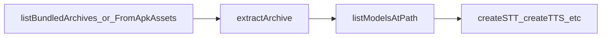

# Extraction API (Compressed Archives)

## Introduction

**Import path:** `react-native-sherpa-onnx/extraction`

List and extract compressed model archives (`.tar.zst` / `.tar.bz2`; extract also accepts `.tar.gz` / `.tar.xz`). After unpack, use `listModelsAtPath` and `{ kind: 'fs', path }` from the main package for discovery and engine init. Delivery (PAD / ODR): [model-delivery-pad-odr.md](./model-delivery-pad-odr.md). Uncompressed folders do not need this API — use [model-setup.md](./model-setup.md).

---

## Quick start

### Filesystem / PAD STORAGE_FILES / ODR / downloads

```ts
import {
  listBundledArchives,
  extractArchive,
} from 'react-native-sherpa-onnx/extraction';
import {
  ensureAssetPackReady,
  getAssetPackPath,
} from 'react-native-sherpa-onnx/utils';
import { DocumentDirectoryPath } from '@dr.pogodin/react-native-fs';

const targetDir = `${DocumentDirectoryPath}/models`;

// PAD/ODR: fetch first; skip ensureAssetPackReady for plain bundle/downloads dirs
await ensureAssetPackReady('core_models');
const packPath = await getAssetPackPath('core_models');
if (!packPath) throw new Error('pack path not ready');

const archives = await listBundledArchives(packPath);
for (const archive of archives) {
  await extractArchive(archive, targetDir, {
    onProgress: (e) => console.log(archive.modelId, e.percent),
  });
}
```

Same pattern for iOS main-bundle `MainBundlePath + '/models'` or a downloads folder: pass that absolute directory to `listBundledArchives`. See [model-delivery-pad-odr.md](./model-delivery-pad-odr.md) for fetch/progress/remove.

### Android APK assets (`fromAsset`)

```ts
import {
  listBundledArchivesFromApkAssets,
  extractArchive,
} from 'react-native-sherpa-onnx/extraction';
import { DocumentDirectoryPath } from '@dr.pogodin/react-native-fs';

const targetDir = `${DocumentDirectoryPath}/models`;

// Install-time / APK_ASSETS: list under app asset root "models/" (not a PAD pack name)
const archives = await listBundledArchivesFromApkAssets('models');
for (const archive of archives) {
  // archive.fromAsset === true → stream extract; no integrity probe
  await extractArchive(archive, targetDir, {
    onProgress: (e) => console.log(archive.modelId, e.percent),
  });
}
```

Android only. Use this when archives live in the APK asset tree and `getAssetPackPath` returns null.

---

## Path expectations

`extractArchive` picks the native path from `fromAsset` / `archivePath` — you do not choose the extractor.

| Source | How to list | `archivePath` | `fromAsset` | `fileSize` | Extract |
| --- | --- | --- | --- | --- | --- |
| **PAD STORAGE_FILES** | `listBundledArchives(await getAssetPackPath(pack))` | Absolute FS path | absent | yes | `extractArchive` |
| **PAD APK_ASSETS** | `listBundledArchivesFromApkAssets('models')` | `models/name.tar.zst` | `true` | no | `extractArchive` |
| **iOS ODR tag** | `listBundledArchives(packPath)` after [fetch](./model-delivery-pad-odr.md) | Absolute FS path | absent | yes | `extractArchive` |
| **iOS main bundle** | `listBundledArchives(MainBundlePath + '/models')` | Absolute FS path | absent | yes | `extractArchive` |
| **Downloaded archive** | `listBundledArchives(…/downloads)` | Absolute FS path | absent | yes | `extractArchive` |
| **Any other directory** | `listBundledArchives(path)` | Absolute FS path | absent | yes | `extractArchive` |

Install-time PAD merges pack assets at app asset root `models/` (not looked up by pack name).

---

## Formats

Sniff is by archive signature (libarchive auto-detect), not extension.

| API | Formats |
| --- | --- |
| `listBundledArchives*` (`BundledArchive.format`) | `.tar.zst`, `.tar.bz2` only |
| `extractArchive` | also `.tar.gz`, `.tar.xz` if you pass a path |

Out of scope: zip, 7z, RAR (RAR is [`document/`](document-offline.md) CBR). Disable libarchive → extract fails.

---

## API reference

```ts
import {
  listBundledArchives,
  listBundledArchivesFromApkAssets,
  probeArchiveIntegrity,
  extractArchive,
} from 'react-native-sherpa-onnx/extraction';
```

### `listBundledArchivesFromApkAssets(assetPrefix?)`

```ts
function listBundledArchivesFromApkAssets(
  assetPrefix?: string
): Promise<BundledArchive[]>;
```

```ts
const archives = await listBundledArchivesFromApkAssets('models');
// archives[0].fromAsset === true
```

**Android only.** Lists `.tar.zst` / `.tar.bz2` under an APK asset prefix (default `models`). Sets `fromAsset: true` for `extractArchive`. Not tied to PAD pack names.

### `listBundledArchives(directoryPath)`

```ts
function listBundledArchives(directoryPath: string): Promise<BundledArchive[]>;
```

```ts
const archives = await listBundledArchives(`${DocumentDirectoryPath}/downloads`);
```

Cross-platform list of `.tar.zst` / `.tar.bz2` in a filesystem directory (PAD STORAGE_FILES, ODR path, main bundle, downloads). Empty array if missing or no matches.

### `probeArchiveIntegrity(filePath, options?)`

```ts
function probeArchiveIntegrity(
  filePath: string,
  options?: {
    expectedBytes?: number;
    throwOnFailure?: boolean; // default true
  }
): Promise<ProbeArchiveIntegrityResult>;
```

```ts
const result = await probeArchiveIntegrity(archivePath, {
  expectedBytes: catalogBytes,
  throwOnFailure: false,
});
if (!result.ok) {
  console.log(result.code, result.message);
}
```

Reject a bad/incomplete **filesystem** archive before extract setup/UI. Call only when you need that earlier than `extractArchive` (which already probes). Not for APK asset streams.

### `extractArchive(archive, targetPath, options?)`

```ts
function extractArchive(
  archive: BundledArchive,
  targetPath: string,
  options?: ExtractArchiveOptions
): Promise<ExtractResult>;
```

```ts
await extractArchive(archive, targetDir, {
  force: true, // default; overwrite under targetDir
  // skipIntegrityProbe: true, // only if you already verified the file
  onProgress: (e) => console.log(archive.modelId, e.percent),
  signal: controller.signal, // per-operation cancel
  showNotificationsEnabled: false, // Android system notification; ignored on iOS
});
```

Unpack one archive into `targetDir` before `listModelsAtPath` / engine init.

| Source | Behavior |
| --- | --- |
| Filesystem path | Probes then extracts (unless `skipIntegrityProbe: true`) |
| APK asset (`fromAsset`) | Stream extract; no probe |

- `archive.fileSize` is **not** catalog expected size — pass `expectedBytes` to `probeArchiveIntegrity` yourself if needed.
- `ExtractResult.sha256` is a computed digest of the source archive (output). SHA verify vs catalog lives on download / `extractModel`.
- Parallelism: Android up to **2** concurrent extracts (queue beyond); iOS multiple via GCD. `AbortSignal` cancels only that operation.

| Option | Type | Default | Description |
| --- | --- | --- | --- |
| `force` | `boolean` | `true` | Overwrite existing files in `targetPath` |
| `skipIntegrityProbe` | `boolean` | `false` | Skip JS + native pre-extract probe (only if already verified) |
| `onProgress` | `(event) => void` | — | `{ bytes, totalBytes, percent, entryIndex? }`; filtered by source / `operationId` |
| `signal` | `AbortSignal` | — | Cancel this extraction (`AbortError`) |
| `showNotificationsEnabled` | `boolean` | `true` | **Android:** system progress notification; **iOS:** ignored |
| `notificationTitle` | `string` | generic | **Android** only |
| `notificationText` | `string` | generic | **Android** only; percent appended |

---

## Pipeline composition

### Typical upstream

| Source | Notes |
| --- | --- |
| PAD / ODR | [ensureAssetPackReady](./model-delivery-pad-odr.md) → `getAssetPackPath` → `listBundledArchives` |
| APK assets | `listBundledArchivesFromApkAssets('models')` |
| Bundle / downloads | `listBundledArchives(absoluteDir)` |

### Typical downstream

| Destination | Notes |
| --- | --- |
| Model discovery | `listModelsAtPath(targetDir)` |
| Engine init | `createSTT` / `createTTS` / … with `{ kind: 'fs', path }` — [model-setup.md](./model-setup.md) |



---

## Types and constants

```ts
import {
  listBundledArchives,
  listBundledArchivesFromApkAssets,
  probeArchiveIntegrity,
  extractArchive,
} from 'react-native-sherpa-onnx/extraction';

import type {
  BundledArchive,
  ExtractArchiveOptions,
  ExtractResult,
  ExtractArchiveResult,
  ExtractProgressEvent,
  ProbeArchiveFormat,
  ProbeArchiveIntegrityOptions,
  ProbeArchiveIntegrityResult,
} from 'react-native-sherpa-onnx/extraction';
```

```ts
type BundledArchive = {
  modelId: string;
  archivePath: string;
  format: 'tar.zst' | 'tar.bz2';
  fileSize?: number;
  fromAsset?: boolean;
};

type ExtractArchiveOptions = {
  force?: boolean;
  skipIntegrityProbe?: boolean;
  onProgress?: (event: ExtractProgressEvent) => void;
  signal?: AbortSignal;
  showNotificationsEnabled?: boolean;
  notificationTitle?: string;
  notificationText?: string;
};

type ExtractResult = {
  success: boolean;
  path?: string;
  sha256?: string; // computed source digest (output)
  reason?: string;
};

type ExtractProgressEvent = {
  bytes: number;
  totalBytes: number;
  percent: number;
  entryIndex?: number;
};

type ProbeArchiveFormat = 'tar.bz2' | 'tar.zst' | 'tar.gz' | 'tar.xz';

type ProbeArchiveIntegrityResult =
  | { ok: true; format: ProbeArchiveFormat | null; fileSize: number }
  | {
      ok: false;
      code: 'DOWNLOAD_INTEGRITY_TRUNCATED' | 'DOWNLOAD_EXTRACT_UNSUPPORTED_FORMAT';
      message: string;
      format: ProbeArchiveFormat | null;
      fileSize: number;
    };
```

Prefer `ExtractResult` in app code; `ExtractArchiveResult` is the native wire shape.

---

## Error codes

| Code | Where |
| --- | --- |
| `DOWNLOAD_INTEGRITY_TRUNCATED` | `probeArchiveIntegrity` / filesystem `extractArchive` |
| `DOWNLOAD_EXTRACT_UNSUPPORTED_FORMAT` | same |
| `AbortError` | `signal` cancel |
| plain `Error` / `FILEIO_*` | native extract / path resolve |

---

## Use case examples

<details>
<summary>PAD STORAGE_FILES or APK_ASSETS (Android)</summary>

```ts
import {
  listBundledArchives,
  listBundledArchivesFromApkAssets,
  extractArchive,
} from 'react-native-sherpa-onnx/extraction';
import { getAssetPackPath, listModelsAtPath } from 'react-native-sherpa-onnx/utils';
import { DocumentDirectoryPath } from '@dr.pogodin/react-native-fs';

const targetDir = `${DocumentDirectoryPath}/models`;
const packPath = await getAssetPackPath('sherpa_models');
const archives = packPath
  ? await listBundledArchives(packPath)
  : await listBundledArchivesFromApkAssets('models');

for (const archive of archives) {
  await extractArchive(archive, targetDir, {
    onProgress: (e) => console.log(archive.modelId, `${e.percent}%`),
  });
}

const models = await listModelsAtPath(targetDir, true);
```

</details>

<details>
<summary>iOS ODR tag archives</summary>

```ts
import {
  ensureAssetPackReady,
  getAssetPackPath,
} from 'react-native-sherpa-onnx/utils';
import { listBundledArchives, extractArchive } from 'react-native-sherpa-onnx/extraction';
import { DocumentDirectoryPath } from '@dr.pogodin/react-native-fs';

const TAG = 'core_models';
const targetDir = `${DocumentDirectoryPath}/models`;

await ensureAssetPackReady(TAG);
const packPath = await getAssetPackPath(TAG);
if (!packPath) throw new Error('ODR tag not ready');

for (const archive of await listBundledArchives(packPath)) {
  await extractArchive(archive, targetDir, {
    onProgress: (e) => console.log(archive.modelId, e.percent),
  });
}
```

</details>

<details>
<summary>iOS main bundle archives</summary>

```ts
import { listBundledArchives, extractArchive } from 'react-native-sherpa-onnx/extraction';
import { MainBundlePath, DocumentDirectoryPath } from '@dr.pogodin/react-native-fs';

const archives = await listBundledArchives(`${MainBundlePath}/models`);
for (const archive of archives) {
  await extractArchive(archive, `${DocumentDirectoryPath}/models`, {
    force: false,
  });
}
```

</details>

<details>
<summary>Downloaded archives then STT init</summary>

```ts
import { listBundledArchives, extractArchive } from 'react-native-sherpa-onnx/extraction';
import { DocumentDirectoryPath } from '@dr.pogodin/react-native-fs';
import { fileModelPath, listModelsAtPath } from 'react-native-sherpa-onnx/utils';
import { createSTT, detectSttModel } from 'react-native-sherpa-onnx/stt';

const downloadsDir = `${DocumentDirectoryPath}/downloads`;
const modelsDir = `${DocumentDirectoryPath}/models`;

for (const archive of await listBundledArchives(downloadsDir)) {
  await extractArchive(archive, modelsDir, {
    force: false,
    onProgress: (e) => console.log(archive.modelId, `${e.percent}%`),
  });
}

const sttModel = (await listModelsAtPath(modelsDir, true)).find(
  (m) => m.hint === 'stt'
);
if (sttModel) {
  const mp = fileModelPath(`${modelsDir}/${sttModel.folder}`);
  const detection = await detectSttModel(mp);
  if (detection.success) {
    const stt = await createSTT({ modelSource: mp, modelType: 'auto' });
  }
}
```

</details>

<details>
<summary>Cancel one extraction without stopping parallel jobs</summary>

```ts
const controller = new AbortController();

const p = extractArchive(archive, targetDir, {
  signal: controller.signal,
  onProgress: (event) => console.log(event.percent),
});

controller.abort();
await p; // AbortError for this job only
```

</details>

---

## See also

- [Ship model delivery (PAD & ODR)](model-delivery-pad-odr.md) — install-time, on-demand, fetch/progress, removal
- [Model setup](model-setup.md) — path helpers, `getAssetPackPath`, `listModelsAtPath`, `bundledModelFileSource`
- [Download manager](download-manager.md) — network download + integrity options
- [STT](stt-offline.md) — Speech-to-Text API
- [TTS](tts-offline.md) — Text-to-Speech API

## Native crash diagnostics

If native code fails or the app crashes but the tombstone shows only a UI/GPU thread, inspect the SDK **last-activity ring buffer** (enabled by default when the native library loads). Full details: [native-diagnostics.md](./native-diagnostics.md) — Android log tag `SherpaNativeDiag`; iOS subsystem `com.sherpaonnx.diag`. Optional JS: `getNativeDiagnosticSnapshot` / `configureNativeDiagnostics` from `react-native-sherpa-onnx/diagnostics`.
