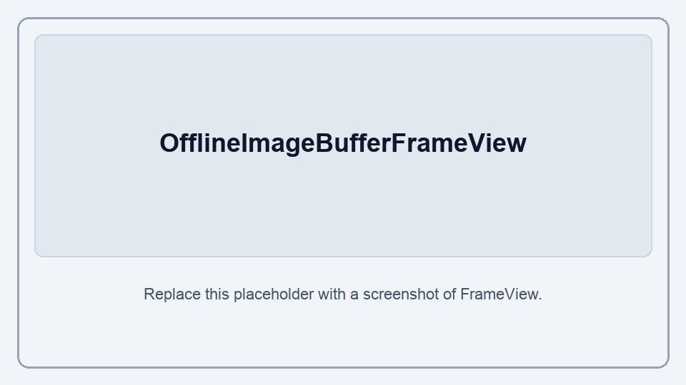
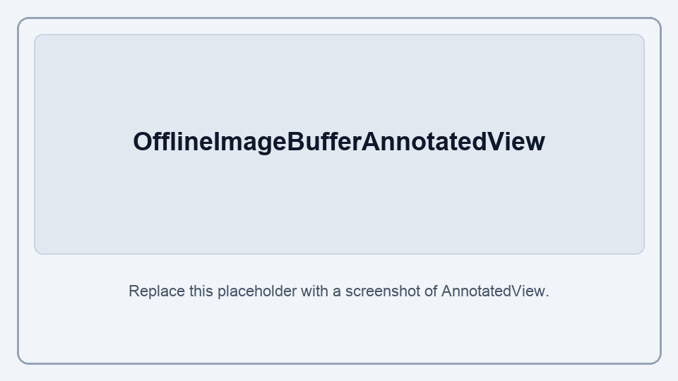

# Pipeline image buffers — offline (`imagebuffer`)

## Introduction

Offline image buffers hold one or more image frames for batch OCR, PDF page rasters ([`rasterizePdfPages`](pdf-offline.md)), and e-document image-only extracts ([`extractDocumentImages`](document-offline.md)).

**Import path:** `react-native-sherpa-onnx/imagebuffer`

Live / streaming ImageBuffer is not implemented yet (types may be reserved). File sources use [fileio.md](fileio.md).

---

## Concepts

| Kind | What it is | Typical use |
| --- | --- | --- |
| **Offline image buffer** | Multi-frame buffer after create. Usually `state: 'immutable'` (all frames ready). PDF [`lazy-lru`](pdf-offline.md#raster-strategies) uses `state: 'lazy'`: call [`ensureOfflineImageBufferFrame`](#ensureofflineimagebufferframebuffer-frameindex) (or FrameView / OCR) before using a cold frame; at most `hotFrames` stay decoded. | Batch OCR `recognize`, multi-page prep / PDF slider. |
| **Live image buffer** | Reserved (`liveImageBuffer` types only). | Future camera / streaming OCR. |

## Opt-in libwebp (default OFF)

Default SDK builds do **not** include libwebp.

| Platform | Enable |
|----------|--------|
| Android | `sherpaOnnxEnableLibwebp=true` in the app (or library) `gradle.properties` |
| iOS | `SHERPA_ONNX_ENABLE_LIBWEBP=1` when installing pods / building |

Prebuilts: [third_party/libwebp_prebuilt/README.md](../third_party/libwebp_prebuilt/README.md).

Without enable, WebP decode (`createOfflineImageBufferFromFiles` / `FromBase64`) and `exportOfflineImageBufferFrame({ format: 'webp' })` reject with `ERR_IMAGE_WEBP_DISABLED`. JPEG/PNG/BMP/GIF are unchanged. The example app opts in (`sherpaOnnxEnableLibwebp=true` / `SHERPA_ONNX_ENABLE_LIBWEBP=1`).

---

## Main API (summary)

- `createEmptyOfflineImageBuffer`
- `createOfflineImageBufferFromFiles`
- `createOfflineImageBufferFromBase64`
- `getOfflineImageBufferInfo`
- `getOfflineImageBufferFrameInfo`
- `ensureOfflineImageBufferFrame` — ensure a frame is ready (`lazy` PDF buffers; no-op for `immutable`)
- `releaseOfflineImageBuffer`
- `exportOfflineImageBufferFrame` — write one frame to a [`FileDestination`](fileio.md) → `ResolvedFileRef`
- `OfflineImageBufferFrameView` — in-app preview of one frame
- `OfflineImageBufferAnnotatedView` — FrameView plus mapped spatial-span boxes
- `mapTextSpatialSpansToFrame` — project `ocr` / `textLayer` quads onto one frame

Create helpers return **`OfflineImageBufferRef`** (`info` + `OfflineImageBufferHandle`). Buffer parameters accept **`OfflineImageBufferIdSource`**: ref, `OfflineImageBufferInfo`, branded handle, or string id.

---

## Quick start

```tsx
import {
  createOfflineImageBufferFromFiles,
  getOfflineImageBufferInfo,
  getOfflineImageBufferFrameInfo,
  OfflineImageBufferFrameView,
  releaseOfflineImageBuffer,
} from 'react-native-sherpa-onnx/imagebuffer';

const fromFiles = await createOfflineImageBufferFromFiles(
  [
    { kind: 'fs', path: '/tmp/page1.jpg' },
    { kind: 'fs', path: '/tmp/page2.webp' },
  ],
  { maxSide: 2048 }
);

const one = await createOfflineImageBufferFromFiles({
  kind: 'contentUri',
  uri: 'content://…',
});

const info = await getOfflineImageBufferInfo(fromFiles);
console.log(info.frameCount, info.storageKind, info.totalBytes);

const f0 = await getOfflineImageBufferFrameInfo(fromFiles, 0);
console.log(f0.width, f0.height, f0.byteSize);

// In-app preview (native RGB; no file materialize)
<OfflineImageBufferFrameView
  buffer={fromFiles}
  frameIndex={0}
  resizeMode="contain"
  maxSide={1024}
  style={{ width: '100%', height: 240 }}
/>

await releaseOfflineImageBuffer(fromFiles);
await releaseOfflineImageBuffer(one);
```

Typical flow: create once → preview and/or pass to [offline OCR](ocr-offline.md) → `releaseOfflineImageBuffer`.

---

## API reference

Exported from `react-native-sherpa-onnx/imagebuffer`. Buffer arguments accept **`OfflineImageBufferIdSource`** unless noted. Prefer the buffer ref; malformed string ids reject with `ERR_IMAGE_INVALID_ARGUMENT`.

### Offline buffer creation

#### `createEmptyOfflineImageBuffer()`

```ts
function createEmptyOfflineImageBuffer(): Promise<OfflineImageBufferRef>;
```

```ts
const empty = await createEmptyOfflineImageBuffer();
console.log(empty.info.frameCount); // 0
console.log(empty.bufferId); // img_off_<uuid>
```

Empty buffer (`frameCount = 0`) for native producers that append frames later.

#### `createOfflineImageBufferFromFiles(sources, options?)`

```ts
function createOfflineImageBufferFromFiles(
  sources: FileSource | FileSource[],
  options?: CreateOfflineImageBufferOptions
): Promise<OfflineImageBufferRef>;
```

```ts
const offline = await createOfflineImageBufferFromFiles(
  { kind: 'fs', path: '/tmp/page.jpg' },
  { maxSide: 2048 }
);

const fromUri = await createOfflineImageBufferFromFiles({
  kind: 'contentUri',
  uri: pickedUri,
});

const controller = new AbortController();
const pages = await createOfflineImageBufferFromFiles(
  [
    { kind: 'fs', path: '/tmp/page1.jpg' },
    { kind: 'fs', path: '/tmp/page2.png' },
  ],
  {
    maxSide: 2048,
    onProgress: (event) => console.log(event.phase, event.done, '/', event.total),
    signal: controller.signal,
  }
);
```

`source` is a `FileSource` (see [fileio.md](fileio.md)).

| Kind | How the file is opened |
| --- | --- |
| `fs` / `app` (`cache`, `files`, …) / `pad` / iOS `appBundle` / iOS `securityScoped` | Direct path; bytes are read into the buffer. |
| Android `app` + `apkAsset` | APK zip entry has no fd. Copied to `<cache>/fileio_apkasset/…` on first open; later opens are a cache hit. |
| Android `contentUri` with ParcelFileDescriptor | Read via `/proc/self/fd/N`. |
| Android `contentUri` stream (no PFD) | Stream is read in memory (not `fileio_nofd`). |

Options (`CreateOfflineImageBufferOptions`):

| Option | Notes |
|--------|--------|
| `maxSide` | Longest-edge cap after decode; default `4096`; `<= 0` disables |
| `onProgress` | `ImageProgressEvent` (`done`, `total`, `phase`) during create |
| `signal` | Abort → `ERR_IMAGE_CANCELLED` |

#### `createOfflineImageBufferFromBase64(base64List, options?)`

```ts
function createOfflineImageBufferFromBase64(
  base64List: string[],
  options?: CreateOfflineImageBufferOptions
): Promise<OfflineImageBufferRef>;
```

```ts
const offline = await createOfflineImageBufferFromBase64([jpegBase64, webpBase64], {
  maxSide: 1024,
});
```

Same options as create-from-files.

### Inspect / release

#### `getOfflineImageBufferInfo(buffer)`

```ts
function getOfflineImageBufferInfo(
  buffer: OfflineImageBufferIdSource
): Promise<OfflineImageBufferInfo>;
```

```ts
const info = await getOfflineImageBufferInfo(offline);
console.log(info.kind, info.state, info.frameCount, info.storageKind);
```

| Field | Values | Notes |
|-------|--------|--------|
| `bufferId` | `img_off_…` | Buffer id |
| `kind` | `'offlineImageBuffer'` | Discriminator |
| `state` | `'immutable'` \| `'lazy'` | `'lazy'` from PDF [`rasterizePdfPages({ strategy: 'lazy-lru' })`](pdf-offline.md) |
| `frameCount` | number | Number of frames (lazy includes not-yet-ensured frames) |
| `totalBytes` | number | Approximate decoded size; for `'lazy'`, currently ensured frames only |
| `storageKind` | `'ram'` \| `'mmap'` | How decoded frames are held |

#### `getOfflineImageBufferFrameInfo(buffer, frameIndex)`

```ts
function getOfflineImageBufferFrameInfo(
  buffer: OfflineImageBufferIdSource,
  frameIndex: number
): Promise<OfflineImageFrameInfo>;
```

```ts
const frame = await getOfflineImageBufferFrameInfo(offline, 0);
console.log(frame.width, frame.height, frame.byteSize, frame.storageKind);
// PDF rasters may also set frame.pageNumber, frame.dpi
```

Per-frame metadata. For `'lazy'` buffers, `width` / `height` may be `0` until [`ensureOfflineImageBufferFrame`](#ensureofflineimagebufferframebuffer-frameindex) (or FrameView / OCR) has run for that index.

#### `ensureOfflineImageBufferFrame(buffer, frameIndex)`

```ts
function ensureOfflineImageBufferFrame(
  buffer: OfflineImageBufferIdSource,
  frameIndex: number
): Promise<OfflineImageFrameInfo>;
```

```ts
const frame = await ensureOfflineImageBufferFrame(offline, 0);
console.log(frame.width, frame.height);
```

Makes frame `frameIndex` ready and returns its info. For `'immutable'` buffers this is a no-op (returns current info). For PDF `'lazy'` buffers, ensures that page is decoded (may drop older decoded pages when over `hotFrames`). Optional before `recognize` if you want explicit control; FrameView and OCR also ensure on access.

#### `releaseOfflineImageBuffer(buffer)`

```ts
function releaseOfflineImageBuffer(
  buffer: OfflineImageBufferIdSource
): Promise<void>;
```

```ts
await releaseOfflineImageBuffer(offline);
```

Releases the buffer. Call when finished.

#### `exportOfflineImageBufferFrame(buffer, frameIndex, output, options?)`

Writes one frame to a [`FileDestination`](fileio.md) (same model as [`saveAudioAsFile`](audio-conversion.md)).

```ts
function exportOfflineImageBufferFrame(
  buffer: OfflineImageBufferIdSource,
  frameIndex: number,
  output: FileDestination,
  options?: {
    format?: 'jpeg' | 'png' | 'webp'; // default jpeg
    quality?: number; // 1..100, jpeg/webp
    maxSide?: number; // export-only downsample; does not change the buffer
  }
): Promise<ResolvedFileRef>;
```

```ts
const ref = await exportOfflineImageBufferFrame(
  offline,
  0,
  { kind: 'app', base: 'cache', path: 'page0.jpg' },
  { format: 'jpeg', quality: 90, maxSide: 1280 }
);
// ref: { kind: 'fs', path: '...' } or { kind: 'contentUri', uri: '...' }
```

#### `OfflineImageBufferFrameView`

React Native view that shows one buffer frame.

<p align="center">
  
</p>

```tsx
import { OfflineImageBufferFrameView } from 'react-native-sherpa-onnx/imagebuffer';

<OfflineImageBufferFrameView
  buffer={offline}
  frameIndex={0}
  resizeMode="contain"
  maxSide={1024}
  style={{ width: '100%', height: 240 }}
/>
```

| Prop | Notes |
|------|--------|
| `buffer` | `OfflineImageBufferIdSource` |
| `frameIndex` | Frame to show (default `0`) |
| `resizeMode` | `'contain'` \| `'cover'` \| `'stretch'` |
| `maxSide` | Optional preview downscale |
| `style` | View style |

For `'lazy'` PDF buffers, changing `buffer` / `frameIndex` ensures that frame before display.

#### `mapTextSpatialSpansToFrame(spans, options)`

Project spatial spans onto one decoded ImageBuffer frame. `ocr` quads are already frame pixels (pass through). `textLayer` scales PDF user-space by `frameSize / pageSize` (skipped when page size is missing). Other origins such as `markup` are skipped.

```ts
function mapTextSpatialSpansToFrame(
  spans: TextSpatialSpan[],
  options: MapTextSpatialSpansToFrameOptions
): MappedTextSpatialSpan[];
```

| Option | Notes |
|--------|--------|
| `frameIndex` | Frame to project onto |
| `frameWidth` | Decoded ImageBuffer frame width (pixels). `≤ 0` or non-finite → `[]` |
| `frameHeight` | Decoded ImageBuffer frame height (pixels). `≤ 0` or non-finite → `[]` |
| `origins` | `'ocr'` and/or `'textLayer'` (default both). Other origins such as `markup` are skipped |

Each result row is `{ index, span, quad }`: `index` in the input array, original `span`, `quad` in decoded-frame pixels.

```ts
import { mapTextSpatialSpansToFrame } from 'react-native-sherpa-onnx/imagebuffer';

const projected = mapTextSpatialSpansToFrame(spans, {
  frameIndex: 0,
  frameWidth: 1224,
  frameHeight: 1584,
  origins: ['ocr', 'textLayer'],
});
// projected[i].quad is decoded-frame pixels
```

For a ready-made overlay on `OfflineImageBufferFrameView`, use `OfflineImageBufferAnnotatedView`.

#### `OfflineImageBufferAnnotatedView`

FrameView plus spatial-span boxes. Maps `origin: 'ocr'` (already frame pixels) and `origin: 'textLayer'` (PDF user-space → frame pixels via `pageWidth` / `pageHeight`). Caller still owns `release` on both buffers.

<p align="center">
  
</p>

```tsx
import { OfflineImageBufferAnnotatedView } from 'react-native-sherpa-onnx/imagebuffer';

<OfflineImageBufferAnnotatedView
  buffer={pages}
  text={textOut}
  frameIndex={0}
  origins={['ocr', 'textLayer']}
  levels={['line', 'block']}
  selectedIndex={selected}
  selectedRange={range}
  boxStyle={{ borderWidth: 2 }}
  originBoxStyle={{
    ocr: { borderColor: '#007AFF' },
    textLayer: { borderColor: '#34C759' },
  }}
  selectedBoxStyle={{ borderColor: '#FF3B30' }}
  style={{ width: '100%', height: 280 }}
  onSpanPress={(e) => {
    // e.index, e.utf16Start, e.utf16End, e.origin, e.frameIndex
    // e.quad is decoded-frame pixels
    setSelected(e.index);
  }}
/>
```

| Prop | Notes |
|------|--------|
| `buffer` | `OfflineImageBufferIdSource` |
| `text` | Offline text buffer with spatial spans |
| `frameIndex` | Frame to show (default `0`) |
| `origins` | `'ocr'` and/or `'textLayer'` (default both) |
| `levels` | `'line'` / `'word'` / `'block'` (default all). `selectedIndex` still refers to the full span slice |
| `selectedIndex` | Highlight that slice index |
| `selectedRange` | Also highlight spans whose UTF-16 range overlaps `{ utf16Start, utf16End }` |
| `boxStyle` / `selectedBoxStyle` / `originBoxStyle` | Visual only. Merge: defaults → `boxStyle` → origin → selected defaults → `selectedBoxStyle`. Position and size stay view-owned |
| `onSpanPress` | Tap on a box; `quad` is frame pixels |
| `maxSide` / `resizeMode` / `style` | Forwarded to FrameView. Overlay math follows `resizeMode` (`contain` / `cover` / `stretch`) |

Use `mapTextSpatialSpansToFrame` when drawing your own overlay on `OfflineImageBufferFrameView` (labels, rotated quads, a canvas). Styling, level filters, and selection do not need a custom overlay.

---

## Formats

Sniff is by magic bytes, not extension. Each source becomes **one** packed **RGB8** frame (alpha dropped). Multi-frame buffers are **multiple sources**, not animated files.

| Format | Decode | Notes |
|--------|--------|-------|
| JPEG | yes | EXIF orientation 1–8 |
| PNG | yes | |
| BMP | yes | |
| GIF | yes, **first frame only** | |
| WebP | **opt-in libwebp** | Default off → `ERR_IMAGE_WEBP_DISABLED`. First frame. Enable: [Opt-in libwebp](#opt-in-libwebp-default-off). |
| HEIC / HEIF | platform | Brands `heic` / `heix` / `hevc` / `hevx` / `mif1` / `msf1`. **Android API 28+**; older → `ERR_IMAGE_FORMAT_UNSUPPORTED`. **iOS** ImageIO, index 0. |

| Export (`exportOfflineImageBufferFrame`) | |
|---|---|
| `jpeg` / `jpg` | quality 1–100 (default **85**) |
| `png` | quality ignored |
| `webp` | same libwebp opt-in; quality 1–100 |

PDF pages and e-document images are **not** decoded here — [`rasterizePdfPages`](pdf-offline.md) / [`extractDocumentImages`](document-offline.md).

Out of scope: AVIF, TIFF, SVG, JPEG XL, animated GIF/WebP/HEIC as extra frames.

## JS Events

`OfflineImageBufferAnnotatedView`:

| Callback | Payload | Notes |
| --- | --- | --- |
| `onSpanPress` | `{ index, utf16Start, utf16End, origin, frameIndex, quad }` | `quad` is decoded-frame pixels (textLayer already mapped) |

Create-time only (`createOfflineImageBufferFromFiles` / `FromBase64`):

| Callback / control | Payload | Notes |
| --- | --- | --- |
| `onProgress` | `ImageProgressEvent` | `{ done, total, phase }` (`decode` / `done`) |
| `signal` | `AbortSignal` | Rejects with `ERR_IMAGE_CANCELLED` |

```ts
const controller = new AbortController();
const pages = await createOfflineImageBufferFromFiles(manySources, {
  maxSide: 2048,
  onProgress: (e) => console.log(e.phase, e.done, '/', e.total),
  signal: controller.signal,
});
// controller.abort();
```

## Types and constants

```ts
import type {
  OfflineImageBufferRef,
  OfflineImageBufferInfo,
  OfflineImageBufferState, // 'immutable' | 'lazy'
  OfflineImageBufferIdSource,
  OfflineImageBufferHandle,
  OfflineImageFrameInfo,
  CreateOfflineImageBufferOptions,
  ImageProgressEvent,
  ImageStorageKind, // 'ram' | 'mmap'
  LiveImageBufferInfo, // reserved
  OfflineImageBufferAnnotatedViewProps,
  OfflineImageBufferSpanPressEvent,
  OfflineImageBufferSpanRange,
  FileSource,
  FileDestination,
  ResolvedFileRef,
} from 'react-native-sherpa-onnx/imagebuffer';

import { ImageErrorCode } from 'react-native-sherpa-onnx/imagebuffer';
```

---

## Error codes

| Code | Meaning |
| --- | --- |
| `ERR_IMAGE_INVALID_ARGUMENT` | Invalid buffer id, empty sources, or bad argument |
| `ERR_IMAGE_DECODE_FAILED` | Decode / I/O failure while reading an image |
| `ERR_IMAGE_FORMAT_UNSUPPORTED` | HEIC without platform support |
| `ERR_IMAGE_WEBP_DISABLED` | WebP used without libwebp opted in at build time |
| `ERR_IMAGE_BUFFER_NOT_FOUND` | Unknown buffer id or frame |
| `ERR_IMAGE_CANCELLED` | Create cancelled via `AbortSignal` |
| `ERR_IMAGE_INTERNAL` | Generic failure |

---

## See also

- [Offline OCR](ocr-offline.md)
- [Offline PDF](pdf-offline.md)
- [Offline e-documents](document-offline.md)
- [File I/O (`FileSource` / `FileDestination`)](fileio.md)
- [Pipeline audio buffers — offline](audiobuffer-offline.md)
- [Pipeline text buffers — offline](textbuffer-offline.md)

## Use case examples

<details>
<summary>Decode multi-page images once and reuse for batch OCR</summary>

```ts
const pages = await createOfflineImageBufferFromFiles(
  [
    { kind: 'fs', path: '/tmp/page1.jpg' },
    { kind: 'fs', path: '/tmp/page2.jpg' },
  ],
  { maxSide: 2048 }
);

// Reuse `pages` for offline OCR (createOCR / recognize), then:
await releaseOfflineImageBuffer(pages);
```

</details>

<details>
<summary>Cancel a long multi-file decode</summary>

```ts
const controller = new AbortController();

const createPromise = createOfflineImageBufferFromFiles(manySources, {
  maxSide: 2048,
  onProgress: (e) => console.log(e.done, '/', e.total, e.phase),
  signal: controller.signal,
});

controller.abort();

try {
  await createPromise;
} catch (err) {
  // ERR_IMAGE_CANCELLED
}
```

</details>

<details>
<summary>Large PDF page slider (lazy-lru)</summary>

Use PDF [`strategy: 'lazy-lru'`](pdf-offline.md#raster-strategies) so only a few pages stay decoded while the user pages through a document. Full example: [pdf-offline.md — page slider](pdf-offline.md#use-case-examples).

```tsx
const pages = await rasterizePdfPages(pdfSource, {
  strategy: 'lazy-lru',
  hotFrames: 4,
});

<OfflineImageBufferFrameView
  buffer={pages}
  frameIndex={currentPage}
  resizeMode="contain"
/>
```

</details>

<details>
<summary>Custom span overlay when AnnotatedView is not enough</summary>

Prefer [`OfflineImageBufferAnnotatedView`](#offlineimagebufferannotatedview) for boxes, styling, level filters, and selection. Use `mapTextSpatialSpansToFrame` when you need your own drawing (labels, rotated quads, a canvas). The mapper returns **frame pixels**; you still scale that onto the view for your `resizeMode`.

```tsx
import { useEffect, useMemo, useState } from 'react';
import { View, type LayoutChangeEvent } from 'react-native';
import {
  getOfflineImageBufferFrameInfo,
  mapTextSpatialSpansToFrame,
  OfflineImageBufferFrameView,
  type OfflineImageBufferIdSource,
} from 'react-native-sherpa-onnx/imagebuffer';
import {
  getOfflineTextBufferSpatialSpansSlice,
  getPipelineTextBufferInfo,
  type OfflineTextBufferIdSource,
  type OfflineTextBufferInfo,
  type TextSpatialSpan,
} from 'react-native-sherpa-onnx/textbuffer';

// Axis-aligned box from a mapped quad (x0,y0 … x3,y3). Drop this if you draw the four corners.
function aabb(quad: TextSpatialSpan['quad']) {
  const xs = [quad[0], quad[2], quad[4], quad[6]];
  const ys = [quad[1], quad[3], quad[5], quad[7]];
  const left = Math.min(...xs);
  const top = Math.min(...ys);
  return {
    left,
    top,
    width: Math.max(...xs) - left,
    height: Math.max(...ys) - top,
  };
}

function CustomSpanOverlay({
  buffer,
  text,
  frameIndex = 0,
}: {
  buffer: OfflineImageBufferIdSource;
  text: OfflineTextBufferIdSource;
  frameIndex?: number;
}) {
  // View box (for contain letterboxing) vs decoded frame size vs raw spans.
  const [layout, setLayout] = useState({ width: 0, height: 0 });
  const [frame, setFrame] = useState({ width: 0, height: 0 });
  const [spans, setSpans] = useState<TextSpatialSpan[]>([]);

  // Target space for the mapper: decoded ImageBuffer pixels, not PDF user-space.
  useEffect(() => {
    getOfflineImageBufferFrameInfo(buffer, frameIndex).then((info) =>
      setFrame({ width: info.width, height: info.height })
    );
  }, [buffer, frameIndex]);

  // Spans stay on the text buffer (`ocr` = frame px, `textLayer` = PDF user-space).
  useEffect(() => {
    (async () => {
      const info = (await getPipelineTextBufferInfo(
        text
      )) as OfflineTextBufferInfo;
      if (!info.hasSpatialSpans || info.spatialSpanCount <= 0) {
        setSpans([]);
        return;
      }
      setSpans(
        await getOfflineTextBufferSpatialSpansSlice(
          text,
          0,
          info.spatialSpanCount
        )
      );
    })();
  }, [text]);

  // ocr: pass-through. textLayer: scale by frameSize / pageSize. Other frames/origins dropped.
  const mapped = useMemo(
    () =>
      mapTextSpatialSpansToFrame(spans, {
        frameIndex,
        frameWidth: frame.width,
        frameHeight: frame.height,
      }),
    [frame.height, frame.width, frameIndex, spans]
  );

  // FrameView contain: uniform scale + center offset so boxes sit on the painted image.
  const scale =
    layout.width > 0 && frame.width > 0 && frame.height > 0
      ? Math.min(layout.width / frame.width, layout.height / frame.height)
      : 1;
  const offsetX = (layout.width - frame.width * scale) / 2;
  const offsetY = (layout.height - frame.height * scale) / 2;

  return (
    <View
      style={{ width: '100%', height: 280 }}
      onLayout={(e: LayoutChangeEvent) => {
        const { width, height } = e.nativeEvent.layout;
        setLayout({ width, height });
      }}
    >
      <OfflineImageBufferFrameView
        buffer={buffer}
        frameIndex={frameIndex}
        resizeMode="contain"
        style={{ width: '100%', height: '100%' }}
      />
      {mapped.map((row) => {
        const box = aabb(row.quad); // row.quad is already frame pixels
        return (
          <View
            key={row.index}
            pointerEvents="none"
            style={{
              position: 'absolute',
              left: offsetX + box.left * scale,
              top: offsetY + box.top * scale,
              width: Math.max(1, box.width * scale),
              height: Math.max(1, box.height * scale),
              borderWidth: 1,
              borderColor: '#007AFF',
            }}
          />
        );
      })}
    </View>
  );
}
```

`mapped[i].quad` is already in decoded-frame pixels (`ocr` pass-through, `textLayer` scaled by `frameSize / pageSize`). Replace the `View` boxes with your own primitive if you need the four corners, not an axis-aligned rect.

</details>
