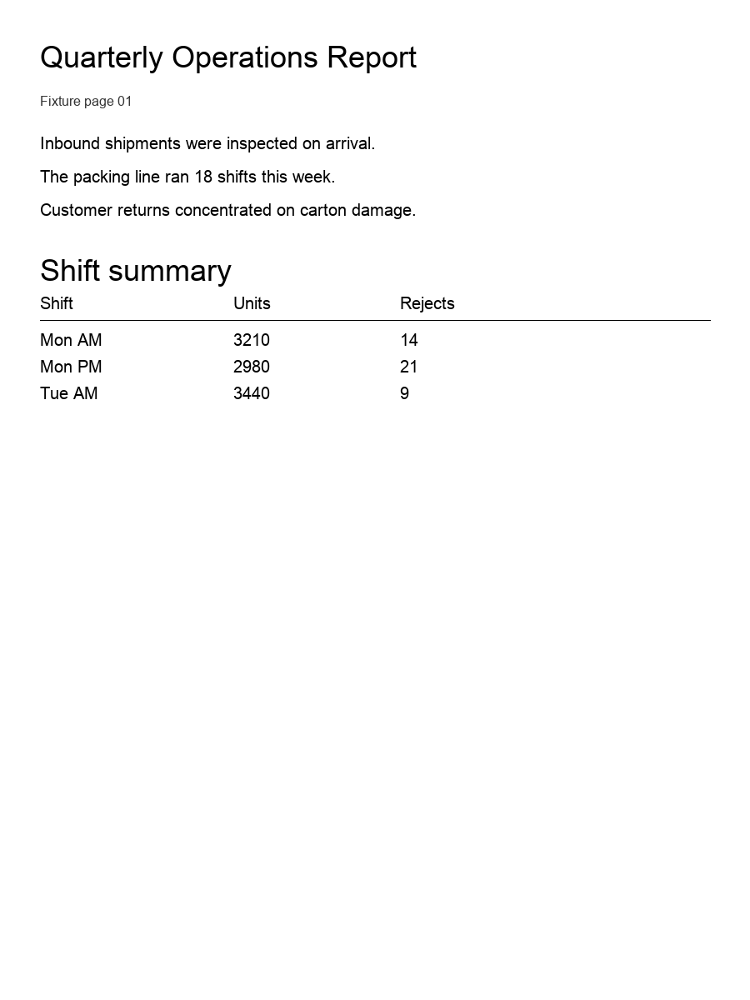
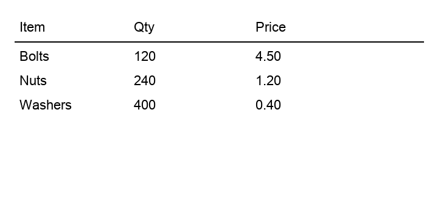
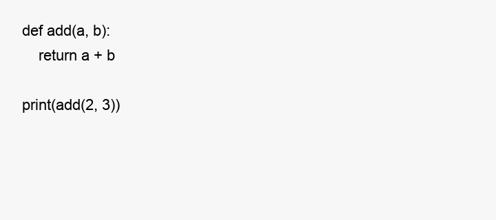
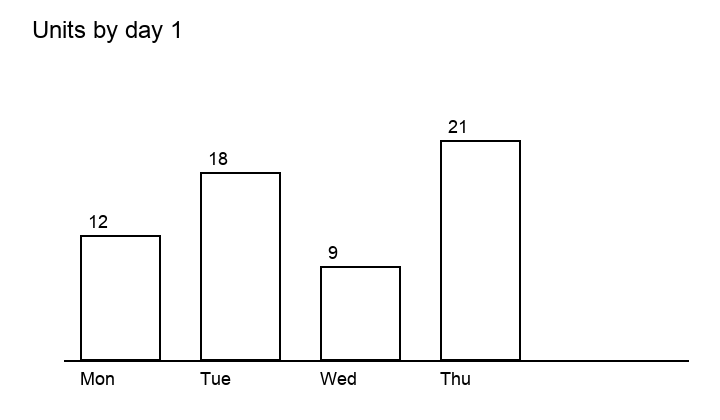
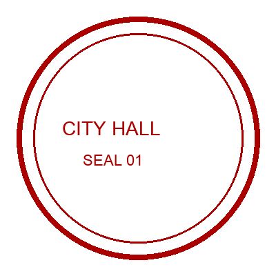
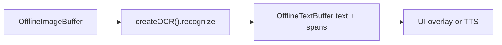

# Offline OCR (`ocr`)

## Introduction

**Offline OCR** runs on decoded image frames held in an [`OfflineImageBuffer`](imagebuffer-offline.md) and writes plain text plus optional [`TextSpatialSpan`](textbuffer-offline.md) metadata into an empty [`OfflineTextBuffer`](textbuffer-offline.md).

Import path: **`react-native-sherpa-onnx/ocr`**. Families and packs: [Models](#models).

Recognize options and tasks are per family: [Recognize options by family](#recognize-options-by-family).

---

## Quick start

`image` is a **populated** offline image buffer; `textOut` is **empty** before the call (populate-once). Raw string ids that are not offline image/text buffers are rejected with **`OCR_*`** / buffer error codes.

### Single image → text + spatial spans

```ts
import {
  createOCR,
  detectOcrModel,
} from 'react-native-sherpa-onnx/ocr';
import {
  createOfflineImageBufferFromFiles,
  releaseOfflineImageBuffer,
} from 'react-native-sherpa-onnx/imagebuffer';
import {
  createEmptyOfflineTextBuffer,
  getOfflineTextBufferTextSlice,
  getOfflineTextBufferSpatialSpansSlice,
  getPipelineTextBufferInfo,
  releasePipelineTextBuffer,
  type OfflineTextBufferInfo,
} from 'react-native-sherpa-onnx/textbuffer';

// Same pack directory for detect and init (FileSource).
// Optional: await ensureModel(ModelCategory.Ocr, 'ppocrv6-tiny') then use model.modelDir.
const modelDir = { kind: 'fs' as const, path: '/absolute/path/to/ppocrv6-tiny' };

// Step 1: pre-flight detect (native ValidateOcrPaths; check result.success)
const det = await detectOcrModel(modelDir, { modelType: 'auto' });
if (!det.success) {
  throw new Error(det.error ?? 'OCR detection failed');
}

// Step 2: create engine
const ocr = await createOCR({
  modelSource: modelDir,
  modelType: 'auto',
  provider: 'cpu',
  numThreads: 2,
});

// Step 3: allocate buffers (populated image in, empty text out)
const image = await createOfflineImageBufferFromFiles([
  { kind: 'fs', path: '/tmp/page.png' },
]);
const textOut = await createEmptyOfflineTextBuffer();

try {
  // Step 4: recognize (line spans; text is always filled)
  const page = await ocr.recognize(image, textOut, { granularity: 'line' });

  // Step 5: read text + optional spatial spans
  const info = (await getPipelineTextBufferInfo(
    textOut
  )) as OfflineTextBufferInfo;
  const text = await getOfflineTextBufferTextSlice(textOut, 0, info.utf16Length);
  const spans = info.hasSpatialSpans
    ? await getOfflineTextBufferSpatialSpansSlice(
        textOut,
        0,
        info.spatialSpanCount
      )
    : [];
  console.log(text, spans.length, page.spanCount);
  // if (page.family === 'doc_vlm' || page.family === 'nemotron_parse' || page.family === 'paddleocr_vl') {
  //   console.log(page.complete, page.stopReason, page.raw, page.content, page.elements, page.instruction);
  // }
} finally {
  // Step 6: release buffers + engine
  await releaseOfflineImageBuffer(image);
  await releasePipelineTextBuffer(textOut);
  await ocr.destroy();
}
```

### Multi-frame + progress + cancel

```ts
const pages = await createOfflineImageBufferFromFiles([
  { kind: 'fs', path: '/tmp/page1.jpg' },
  { kind: 'fs', path: '/tmp/page2.jpg' },
  { kind: 'fs', path: '/tmp/page3.jpg' },
]);
const textOut = await createEmptyOfflineTextBuffer();
const ac = new AbortController();

try {
  const page = await ocr.recognize(pages, textOut, {
    frames: [0, 2], // subset of frame indices; default = all
    onProgress: ({ phase, done, total, frameIndex, frameCount }) =>
      console.log(phase, done, '/', total, 'frame', frameIndex, '/', frameCount),
    signal: ac.signal, // abort at phase / decode / box hooks → OCR_CANCELLED
  });
  console.log(page.family, page.spanCount);
} finally {
  await releaseOfflineImageBuffer(pages);
  await releasePipelineTextBuffer(textOut);
}
```

---

## Buffer matrix

| Role | Type | Notes |
| --- | --- | --- |
| **Image in** | [`OfflineImageBuffer`](imagebuffer-offline.md) | Populated frames (`img_off_*`); decode once, reuse across recognizes |
| **Text out** | [`OfflineTextBuffer`](textbuffer-offline.md) | Empty before the call; filled once with plain text + spatial spans |
| **Engine** | `OcrEngine` via `createOCR` | `recognize` resolves `OcrRecognizeResult` (extras are not on the text buffer); `destroy`; readonly `instanceId` |

---

## Models

| `modelType` | Required files | Optional | When to use |
| --- | --- | --- | --- |
| `ppocr` | `det`, `rec`, `rec_dict` | `cls` | Phone default. Fast line OCR with overlay boxes on signs, receipts, and scans. Start with `ppocrv6-tiny`; step up to `ppocrv6-small` / `ppocrv6-medium` for accuracy. |
| `doctr` | `det`, `rec`, `manifest` | — | Same job as ppocr (detect + recognize + boxes) when the pack language set matches. `doctr-mobile` is the small `en`/`fr` pack; `doctr-default` is the larger Latin pack. |
| `doc_vlm` | `vision_encoder`, `vision_encoder_data`, `embed_tokens`, `embed_tokens_data`, `decoder`, `decoder_data`, `tokenizer`, `manifest` | — | Structured documents: page markdown, a table / formula / code block, or a pixel region. Needs more RAM. Smallest published pack: `docvlm-granite-258m-q4f16`. |
| `nemotron_parse` | granite octet plus `patch_embed`, `pos_embed` | `patch_embed_data` | Full-page markdown from a document photo. Larger VLM. Prefer `nemotron-3.5-parse-int8`. Alias `nemotron-parse` only (never bare `nemotron`). |
| `paddleocr_vl` | `vision_encoder`, `embedding`, `decoder`, `tokenizer` | `*_data`, `manifest` | One loaded session, pick a task per run (page, table, formula, chart, seal, spotting with boxes). Largest pack: `paddleocr-vl-1.6-fp16`. Alias `paddleocr-vl` only (never bare `paddleocr`). |
| `auto` | Resolves family from pack layout (manifest `family`, then layout heuristics) | — | When you do not want to hard-code `modelType`. Result extras follow the resolved family. |

Validate category: **`ocr`**. Detection: [model-detect.md](model-detect.md) · languages: [model-languages.md](model-languages.md) · downloads: [download-manager.md](download-manager.md) (`ModelCategory.Ocr`).

---

## Recognize options by family

`engine.recognize(image, textOut, options?)` takes `OcrRecognizeOptionsOf<F>` for the loaded family. Omit `instruction` → `OCR_DEFAULT_INSTRUCTIONS[family]`.

Shared on every family (`OcrRecognizeOptionsBase`):

| Option | Effect |
| --- | --- |
| `frames` | Frame indices in the image buffer. Omit = all frames. |
| `crop` | `{ x, y, width, height }` in decoded-frame pixels. The engine crops first; span and element quads are translated back to the full frame. Omit = full frame. Outside the frame → `OCR_INVALID_REGION`. |
| `granularity` | Span level filter. Must be in `engine.capabilities.granularities` or `OCR_UNSUPPORTED_GRANULARITY`. |
| `onProgress` | Phase callbacks (`OCR_PROGRESS_PHASES`). |
| `progressMinIntervalMs` | Coalesce interval for progress events. Default `200`. `0` = unthrottled. |
| `signal` | Abort at the same hooks as progress → `OCR_CANCELLED`. |

### `ppocr`

```ts
type OcrRecognizeOptionsOf<'ppocr'> = {
  frames?: number[];
  granularity?: 'line';
  crop?: { x: number; y: number; width: number; height: number };
  onProgress?: (progress: OcrProgress) => void;
  progressMinIntervalMs?: number;
  signal?: AbortSignal;
};
```

| Option | Effect |
| --- | --- |
| `granularity` | `'line'` only. Line boxes land on `textOut` as spatial spans. |
| `crop` | Run detect/recognize on a pixel cutout. |
| *(no `instruction`)* | Line OCR. Init-time `ppocr` DB knobs (`detUnclipRatio` default `1.5`, `detBoxThresh` / `detBoxScoreThresh` default `0.3` / `0.5`) change box tightness; they are not recognize options. Omit a thresh to keep the family default; an explicit value is never remapped. |

### `doctr`

```ts
type OcrRecognizeOptionsOf<'doctr'> = {
  frames?: number[];
  granularity?: 'line';
  crop?: { x: number; y: number; width: number; height: number };
  onProgress?: (progress: OcrProgress) => void;
  progressMinIntervalMs?: number;
  signal?: AbortSignal;
};
```

| Option | Effect |
| --- | --- |
| `granularity` | `'line'` only. Line boxes land on `textOut` as spatial spans. |
| `crop` | Run detect/recognize on a pixel cutout. |
| *(no `instruction`)* | Line OCR. Init-time `doctr` DB knobs match ppocr except thresh defaults `0.15` / `0.15`. |

### `doc_vlm`

```ts
type OcrRecognizeOptionsOf<'doc_vlm'> = {
  frames?: number[];
  granularity?: 'line' | 'block';
  crop?: { x: number; y: number; width: number; height: number };
  onProgress?: (progress: OcrProgress) => void;
  progressMinIntervalMs?: number;
  signal?: AbortSignal;
  instruction?:
    | { task: 'page' }
    | { task: 'element'; element: 'table' | 'formula' | 'code' }
    | { task: 'regionText'; region: { x: number; y: number; width: number; height: number } }
    | { task: 'identifyElement'; region: { x: number; y: number; width: number; height: number } };
  raw?: 'accepted' | 'full';
};
```

| Option | Effect |
| --- | --- |
| `granularity` | `'line'` for titles/tables with locs; `'block'` for picture/chart media. |
| `crop` | Allowed with `page` and `element`. Rejected with `regionText` / `identifyElement` (`OCR_INSTRUCTION_UNSUPPORTED`). |
| `raw` | `'accepted'` (default): stop decode on the first DocTags / prompt-only reject so the SDK parser does not wait on a stream it will not use. `'full'`: keep generating through EOS / `maxNewTokens` so a custom parser can read the complete model answer on `result.raw`. |

| | `page` | `element: 'table'` |
| --- | --- | --- |
| Image |  |  |
| `instruction` | `{ task: 'page' }` (default) | `{ task: 'element', element: 'table' }` |
| Format | `markdown` | `markdown` |
| Output | Quarterly Operations Report, shift summary, … | `\| Item \| Qty \| Price \|` |

| | `element: 'formula'` | `element: 'code'` |
| --- | --- | --- |
| Image |  |  |
| `instruction` | `{ task: 'element', element: 'formula' }` | `{ task: 'element', element: 'code' }` |
| Format | `latex` | `code` |
| Output | `E = m c ^ { \wedge } 2` | `def add(a, b): …` |

| | `regionText` | `identifyElement` |
| --- | --- | --- |
| Image |  |  |
| `instruction` | `{ task: 'regionText', region }` | `{ task: 'identifyElement', region }` |
| Format | `plain` | `plain` |
| Output | text inside `region` | short label for what is in `region` |

### `nemotron_parse`

```ts
type OcrRecognizeOptionsOf<'nemotron_parse'> = {
  frames?: number[];
  granularity?: 'line';
  crop?: { x: number; y: number; width: number; height: number };
  onProgress?: (progress: OcrProgress) => void;
  progressMinIntervalMs?: number;
  signal?: AbortSignal;
  instruction?: {
    task: 'page';
    output: { text: 'markdown'; layout: 'none'; textInPictures: true };
  };
};
```

| Option | Effect |
| --- | --- |
| `granularity` | `'line'` only. |
| `crop` | Run the page parse on a pixel cutout. |

| | `page` |
| --- | --- |
| Image |  |
| `instruction` | `{ task: 'page', output: { text: 'markdown', layout: 'none', textInPictures: true } }` (default) |
| Format | `markdown` |
| Output | Quarterly Operations Report, shift summary, … |

### `paddleocr_vl`

Use **`provider: 'cpu'`** for `paddleocr-vl-1.6-fp16` (`createOCR` rejects `xnnpack`).

```ts
type OcrRecognizeOptionsOf<'paddleocr_vl'> = {
  frames?: number[];
  granularity?: 'line';
  crop?: { x: number; y: number; width: number; height: number };
  onProgress?: (progress: OcrProgress) => void;
  progressMinIntervalMs?: number;
  signal?: AbortSignal;
  instruction?: {
    task: 'ocr' | 'table' | 'formula' | 'chart' | 'seal' | 'spotting';
  };
};
```

| Option | Effect |
| --- | --- |
| `granularity` | `'line'` only. |
| `crop` | Run the chosen task on a pixel cutout. |

Init-only (not recognize): `maxNewTokens`, `paddleocrVl.maxPixels` (area cap; omit/`0` → task default).

| | `ocr` | `table` | `formula` |
| --- | --- | --- | --- |
| Image |  |  |  |
| `instruction` | `{ task: 'ocr' }` (default) | `{ task: 'table' }` | `{ task: 'formula' }` |
| Format | `markdown` | `markdown` | `latex` |
| Output | Quarterly Operations Report, … | `\| Item \| Qty \| Price \|` | `E = m c^{2}` |

| | `chart` | `seal` | `spotting` |
| --- | --- | --- | --- |
| Image |  |  |  |
| `instruction` | `{ task: 'chart' }` | `{ task: 'seal' }` | `{ task: 'spotting' }` |
| Format | `markdown` | `plain` | `plain` |
| Output | `\| Month \| Units \|` | `CITY HALL` / `SEAL 01` | `Hello World`, `Dock 12`, `Gate B` + line spans |

---

## API reference

Signatures from **`react-native-sherpa-onnx/ocr`**.

### `detectOcrModel(source, options?)`

File-based detection without initializing the engine. Unified detection: [model-detect.md](model-detect.md).

```ts
function detectOcrModel(
  source: FileSource,
  options?: { modelType?: OcrModelType; quantization?: QuantizationPreference }
): Promise<OcrDetectModelResult>;
```

```ts
const det = await detectOcrModel(
  { kind: 'fs', path: '/data/models/ppocrv6-tiny' },
  { modelType: 'auto' }
);
if (!det.success) throw new Error(det.error ?? 'OCR detection failed');
```

### `createOCR(options)`

```ts
function createOCR(options: OcrInitializeOptions): Promise<OcrEngine>;
```

```ts
const ocr = await createOCR({
  modelSource: { kind: 'fs', path: '/models/ppocrv6-tiny' },
  modelType: 'auto',
  quantization: 'auto',
  provider: 'cpu',
  numThreads: 2,
});
```

A missing or unusable `provider` logs and stays on CPU (no throw). If the EP attaches but session create fails, `createOCR` rejects `OCR_INTERNAL_ERROR` — it does not silently retry CPU. See [execution-providers.md](execution-providers.md). Init fields: [Types](#types).

### `engine.recognize(imageBuffer, textOut, options?)`

Reads a populated image buffer; writes text (+ spatial spans) into an empty text buffer. Resolves `OcrRecognizeResult` (discriminated on `family`). Per-family `options`: [Recognize options by family](#recognize-options-by-family).

```ts
recognize(
  imageBuffer: OfflineImageBufferIdSource,
  textOut: OfflineTextBufferIdSource,
  options?: OcrRecognizeOptions
): Promise<OcrRecognizeResult>;
```

```ts
const page = await ocr.recognize(image, textOut, {
  granularity: 'line',
  frames: [0],
  crop: { x: 0, y: 0, width: 200, height: 80 },
  onProgress: (p) => console.log(p.phase, p.done, p.total),
  signal: ac.signal,
});
if (ocr.family === 'paddleocr_vl') {
  await ocr.recognize(image, textOut2, {
    instruction: { task: 'spotting' },
  });
} else if (ocr.family === 'doc_vlm') {
  await ocr.recognize(image, textOut2, {
    instruction: { task: 'element', element: 'table' },
  });
}
```

### `engine.destroy()`

```ts
await ocr.destroy();
```

### `engine.instanceId`

```ts
console.log(ocr.instanceId);
```

---

## Pipeline composition

### Typical upstream

| Source / feature | Buffer or handle | Notes |
| --- | --- | --- |
| App image files / URIs | `OfflineImageBuffer` (`img_off_*`) | `createOfflineImageBufferFromFiles` — PNG/JPEG; WebP when libwebp is opted in; HEIC via platform decoder |
| Reused page buffer | `OfflineImageBuffer` | Decode once; run OCR on `frames` subsets |

### Typical downstream

| Destination / feature | Buffer or handle | Notes |
| --- | --- | --- |
| Plain transcript | `OfflineTextBuffer` (`txt_off_*`) | `getOfflineTextBufferTextSlice` |
| Box overlay / layout UI | Spatial spans on same text buffer | Draws spans; does not parse markup. `getOfflineTextBufferSpatialSpansSlice` (`origin: 'ocr'`). Ready-made: [`OfflineImageBufferAnnotatedView`](imagebuffer-offline.md#offlineimagebufferannotatedview); own UI: [`mapTextSpatialSpansToFrame`](imagebuffer-offline.md#maptextspatialspanstoframespans-options) |
| Offline TTS | `OfflineTextBuffer` | Read aloud recognized text |
| Offline punctuation | `OfflineTextBuffer` | Optional cleanup before TTS |



More end-to-end patterns: [feature-pipelines.md#ocr-offline-patterns](feature-pipelines.md#ocr-offline-patterns).

---

## JS Events

| Callback | Payload | Fires when | Notes |
| --- | --- | --- | --- |
| `onProgress` | `{ phase, done, total, frameIndex, frameCount }` | Before/after each backend phase; decode tokens; rec boxes | Native event `SherpaOnnxOcrProgress` filtered by `operationId`. Coalesced at `progressMinIntervalMs` (default 200, same as download). Phase / frame changes and `done === total` always emit. `0` = unthrottled. `total === 0` is indeterminate (no percent). `AbortSignal` is observed at the same hooks (not mid-`Ort::Run`). |

Known `phase` values (`OCR_PROGRESS_PHASES`): `preprocess`, `patch` (nemotron only), `vision`, `embed`, `prefill`, `decode` (VLM), `detect` / `recognize` (ppocr/doctr boxes), `parse` (VLM). Families may emit extra strings; do not switch on an exhaustive enum.

```ts
const page = await ocr.recognize(image, textOut, {
  onProgress: (p) => {
    if (p.total > 0) console.log(p.phase, `${p.done}/${p.total}`);
    else console.log(p.phase, '…');
  },
});
```

---

## Types

### Core OCR types (`react-native-sherpa-onnx/ocr`)

| Type | Description |
| --- | --- |
| `OcrModelType` | `'auto' \| 'ppocr' \| 'doctr' \| 'doc_vlm' \| 'nemotron_parse' \| 'paddleocr_vl'` |
| `OcrConcreteModelType` | Exclude `auto` |
| `OcrFamily` | Concrete backend family after load |
| `OcrGranularity` | `'line' \| 'word' \| 'block'` |
| `OcrInitializeOptions` | Discriminated on `modelType`; shared `provider?`, `numThreads?`; VLM-only `maxNewTokens?` (`0` / omit → 8192) |
| `OcrPaddleocrVlTask` | `'ocr' \| 'table' \| 'formula' \| 'chart' \| 'seal' \| 'spotting'` |
| `OcrInstructionOf<F>` / `OcrTaskOf<F>` | Family-discriminated recognize instruction. Omit → `OCR_DEFAULT_INSTRUCTIONS[family]` |
| `OcrDbDetectorOptions` | Shared `detBoxThresh?` / `detBoxScoreThresh?` / `detUnclipRatio?` for ppocr and doctr |
| `OcrPpocrOptions` / `OcrDoctrOptions` / `OcrVlmOptions` / `OcrPaddleocrVlOptions` | Family init bags (`paddleocrVl.maxPixels` is a cap; task is recognize-time only) |
| `OcrRecognizeOptionsOf<F>` | `frames?`, `granularity?`, `crop?`, `onProgress?`, `progressMinIntervalMs?` (default 200), `signal?`, plus `instruction?` and `raw?` (`'accepted'` \| `'full'`) on instruction families |
| `OcrRecognizeResult` | Discriminated on `family`. VLM families share `raw`/`content`/`elements`/`instruction`/`complete`/`stopReason`. `raw` is the decoded model stream even when our parsers fail (`content`/`elements` then empty). No public `markdown` / `doctags`. `complete` is `true` only on a natural stop (not `maxNewTokens`) |
| `OcrContent` | `{ format: 'markdown' \| 'plain' \| 'latex' \| 'code', value }` (`code` also has `language`) |
| `OcrElement` | `{ kind, frameIndex, quad, utf16Start, utf16End, headingLevel, checked }` |
| `OCR_CAPABILITIES` | Per-family `tasks`, `granularities`, `supportsCrop`, `producesElements` |
| `OcrVlmStopReason` | `'doctag_end' \| 'eos' \| 'max_new_tokens' \| 'invalid_sequence'`. `invalid_sequence` = Granite stream left the DocTags grammar. Default `raw: 'accepted'` stops decode there; `raw: 'full'` continues so `result.raw` is the complete stream |
| `OcrProgress` | `{ phase, done, total, frameIndex, frameCount }`. `total === 0` → indeterminate |
| `OCR_PROGRESS_PHASES` | Known phase names; extra strings are allowed |
| `OcrDetectModelResult` | `detectOcrModel` return |
| `OcrEngine` | `recognize` / `destroy` / `instanceId` |
| `OcrErrorCode` | Error code constants |

### Related buffer types

| Type | Description |
| --- | --- |
| `OfflineImageBufferIdSource` | Image ref or handle passed to `recognize` |
| `OfflineTextBufferIdSource` | Empty text out ref or handle |
| `TextSpatialSpan` | Span with `origin: 'ocr'`, boxes, frame index |

See [imagebuffer-offline.md](imagebuffer-offline.md) and [textbuffer-offline.md](textbuffer-offline.md).

---

## Error codes

| Error code | Explanation |
| --- | --- |
| `OCR_DETECT_FAILED` | `detectOcrModel` failed (native validation / layout). |
| `OCR_MODEL_NOT_FOUND` | Pack / ONNX paths missing at init. |
| `OCR_NOT_INITIALIZED` | Native engine not ready. |
| `OCR_INSTANCE_NOT_FOUND` | `instanceId` missing or already **destroyed**. |
| `OCR_INVALID_ARGUMENT` | Bad options (e.g. invalid frame index, a non-integer / negative `maxNewTokens` or `paddleocrVl.maxPixels`). |
| `OCR_INSTRUCTION_FAMILY_MISMATCH` | Recognize spec family does not match the loaded engine. |
| `OCR_INSTRUCTION_UNSUPPORTED` | Task / combination not in `capabilities.tasks` (or crop + Granite region). |
| `OCR_INVALID_REGION` | Region is empty or outside the (cropped) frame. |
| `OCR_UNSUPPORTED_GRANULARITY` | Requested span level is not in `capabilities.granularities`. |
| `OCR_INVALID_RECOGNIZE_SPEC` | Spec string failed to parse. |
| `OCR_PARSE_UNKNOWN_KIND` | Markup emitted an unmapped element kind. Parsers still throw this in host tests; `recognize` keeps `raw` and leaves `content`/`elements` empty. |
| `OCR_CAPABILITIES_MISMATCH` | Native reported a task TypeScript does not know (init). |
| `OCR_IMAGE_BUFFER_NOT_FOUND` | Image buffer id missing from registry. |
| `OCR_IMAGE_BUFFER_EMPTY` | Image buffer has no frames. |
| `OCR_FRAME_READ_FAILED` | Could not read a requested frame. |
| `OCR_RECOGNIZE_FAILED` | Native recognize / backend failure. |
| `OCR_ALREADY_POPULATED` | `textOut` was already populated; output must be **empty**. |
| `OCR_CANCELLED` | `AbortSignal` aborted at a progress hook (phase / decode step / rec box). |
| `OCR_BUSY` | Concurrent recognize on the same instance. |
| `OCR_INTERNAL_ERROR` | Unexpected native failure. Also a recognize payload missing `family` or a finite `spanCount`; for VLM families, missing `raw` / `complete` / `stopReason`; and a `createOCR` failure when session create fails (unsupported EP ops, missing contrib ops such as `GroupQueryAttention`, `paddleocr-vl-1.6-fp16` + `xnnpack`, OOM). |
| `FILEIO_*` | File / URI resolution for **`FileSource`** before or during model init. |

---

## Use case examples

<details>
<summary>Download pack, detect, then OCR a page (ppocr)</summary>

```ts
import { ModelCategory, ensureModel } from 'react-native-sherpa-onnx/download';
import {
  createOCR,
  detectOcrModel,
} from 'react-native-sherpa-onnx/ocr';

const model = await ensureModel(ModelCategory.Ocr, 'ppocrv6-tiny');
const source = { kind: 'fs' as const, path: model.modelDir };
const det = await detectOcrModel(source);
if (!det.success) {
  throw new Error(det.error ?? 'bad OCR pack');
}
const ocr = await createOCR({ modelSource: source, modelType: 'ppocr' });
// … recognize as in Quick start …
await ocr.destroy();
```

</details>

<details>
<summary>Download pack, detect, then OCR a page (doctr)</summary>

```ts
import { ModelCategory, ensureModel } from 'react-native-sherpa-onnx/download';
import {
  createOCR,
  detectOcrModel,
} from 'react-native-sherpa-onnx/ocr';

const model = await ensureModel(ModelCategory.Ocr, 'doctr-mobile');
const source = { kind: 'fs' as const, path: model.modelDir };
const det = await detectOcrModel(source);
if (!det.success) {
  throw new Error(det.error ?? 'bad DocTR pack');
}
const ocr = await createOCR({ modelSource: source, modelType: 'doctr' });
// … recognize as in Quick start …
await ocr.destroy();
```

</details>

<details>
<summary>Download pack, detect, then read DocTags (doc_vlm)</summary>

```ts
import { ModelCategory, ensureModel } from 'react-native-sherpa-onnx/download';
import {
  createOCR,
  detectOcrModel,
} from 'react-native-sherpa-onnx/ocr';

const model = await ensureModel(ModelCategory.Ocr, 'docvlm-granite-258m-q4f16');
const source = { kind: 'fs' as const, path: model.modelDir };
const det = await detectOcrModel(source);
if (!det.success) {
  throw new Error(det.error ?? 'bad doc_vlm pack');
}
const ocr = await createOCR({
  modelSource: source,
  modelType: 'doc_vlm',
  maxNewTokens: 512,
});
const page = await ocr.recognize(image, textOut, { granularity: 'line' });
if (page.family === 'doc_vlm') {
  console.log(page.complete, page.stopReason, page.raw, page.content, page.elements, page.instruction);
}
await ocr.destroy();
```

</details>

<details>
<summary>Local pack, detect, then read native markup (nemotron_parse)</summary>

```ts
import {
  createOCR,
  detectOcrModel,
} from 'react-native-sherpa-onnx/ocr';

const source = {
  kind: 'fs' as const,
  path: '/data/models/nemotron-3.5-parse-int8',
};
const det = await detectOcrModel(source, { modelType: 'nemotron_parse' });
if (!det.success) {
  throw new Error(det.error ?? 'bad nemotron_parse pack');
}
const ocr = await createOCR({
  modelSource: source,
  modelType: 'nemotron_parse',
  maxNewTokens: 512,
});
const page = await ocr.recognize(image, textOut, { granularity: 'line' });
if (page.family === 'nemotron_parse') {
  console.log(page.complete, page.stopReason, page.raw, page.content, page.elements, page.instruction);
}
await ocr.destroy();
```

</details>

<details>
<summary>Multi-page buffer, OCR selected frames only</summary>

```ts
const pages = await createOfflineImageBufferFromFiles([
  { kind: 'fs', path: '/tmp/p1.png' },
  { kind: 'fs', path: '/tmp/p2.png' },
]);
const textOut = await createEmptyOfflineTextBuffer();
const page = await ocr.recognize(pages, textOut, {
  frames: [1],
  granularity: 'line',
});
console.log(page.spanCount);
```

</details>

<details>
<summary>Read spatial spans for a box overlay</summary>

```tsx
import { OfflineImageBufferAnnotatedView } from 'react-native-sherpa-onnx/imagebuffer';

<OfflineImageBufferAnnotatedView
  buffer={image}
  text={textOut}
  frameIndex={0}
  onSpanPress={(e) => console.log(e.index, e.utf16Start, e.quad)}
/>
```

Or map yourself (`ocr` quads are already frame pixels; `textLayer` needs `mapTextSpatialSpansToFrame`):

```ts
const info = (await getPipelineTextBufferInfo(textOut)) as OfflineTextBufferInfo;
if (info.hasSpatialSpans) {
  const spans = await getOfflineTextBufferSpatialSpansSlice(
    textOut,
    0,
    info.spatialSpanCount
  );
  for (const s of spans) {
    console.log(s.origin, s.frameIndex, s.quad);
  }
}
```

</details>

<details>
<summary>Scan-only PDF (no text layer) → rasterize → recognize</summary>

```ts
import { createEmptyOfflineTextBuffer } from 'react-native-sherpa-onnx/textbuffer';
import { releaseOfflineImageBuffer } from 'react-native-sherpa-onnx/imagebuffer';
import {
  extractPdfTextLayer,
  PdfErrorCode,
  rasterizePdfPages,
} from 'react-native-sherpa-onnx/pdf';

const pdf = { kind: 'fs' as const, path: '/tmp/scan.pdf' };

// 1) Prefer digital text when present (app-owned switch; no SDK auto).
const probeOut = await createEmptyOfflineTextBuffer();
try {
  await extractPdfTextLayer(pdf, probeOut);
  // Digital PDF: text + spans already in probeOut — skip OCR.
} catch (err) {
  const msg = err instanceof Error ? err.message : String(err);
  if (!msg.includes(PdfErrorCode.NO_TEXT_LAYER)) throw err;

  // 2) No glyph layer → page bitmaps into OfflineImageBuffer.
  const pages = await rasterizePdfPages(pdf, {
    pages: 'all',
    dpi: 144,
    maxSide: 2048,
  });

  // 3) Same OCR path as a normal image buffer.
  const textOut = await createEmptyOfflineTextBuffer();
  const page = await ocr.recognize(pages, textOut, { granularity: 'line' });
  console.log(page.spanCount);

  await releaseOfflineImageBuffer(pages);
}
```

Requires opt-in PDFium — see [pdf-offline.md](pdf-offline.md).

</details>

---

## Example app


|  |  |  |
| --- | --- | --- |


The monorepo example exposes **Home → Vision → OCR** (`example/src/screens/ocr/OCRScreen.tsx`) as a developer showcase for this API. See [example/README.md](../example/README.md#ocr-offline).

---

## See also

- [PDF](pdf-offline.md) (text-layer extract + page raster → ImageBuffer; opt-in PDFium; OCR stays explicit)
- [E-documents](document-offline.md) (EPUB/FB2/MOBI markup → TextBuffer; CBZ/CBR / image-only spine → ImageBuffer; OCR stays explicit)
- [ImageBuffer offline](imagebuffer-offline.md) (typical **source** of frames)
- [TextBuffer offline](textbuffer-offline.md) (text + spatial spans)
- [Feature pipelines](feature-pipelines.md#ocr-offline-patterns)
- [Model setup](model-setup.md)
- [Model detection](model-detect.md)
- [Model languages](model-languages.md) (`getPpocrLanguages`, `getDoctrLanguages`, `DOC_VLM_ISO6391_HINTS`, `NEMOTRON_PARSE_ISO6391_HINTS`, `iso6391HintsForOcrModelType`)
- [Download manager](download-manager.md) (`ModelCategory.Ocr`)
- [Execution providers](execution-providers.md)
- [Native diagnostics](native-diagnostics.md)

---

## Native crash diagnostics

If native code fails or the app crashes but the tombstone shows only a UI/GPU thread, inspect the SDK **last-activity ring buffer** (enabled by default when the native library loads). Full details: [native-diagnostics.md](./native-diagnostics.md) — Android log tag `SherpaNativeDiag`; iOS subsystem `com.sherpaonnx.diag`. Optional JS: `getNativeDiagnosticSnapshot` / `configureNativeDiagnostics` from `react-native-sherpa-onnx/diagnostics`.
