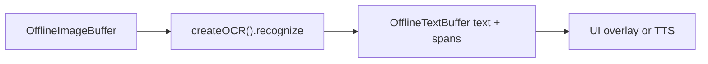

# Offline OCR (`ocr`)

## Introduction

**Offline OCR** runs on decoded image frames held in an [`OfflineImageBuffer`](imagebuffer-offline.md) and writes plain text plus optional [`TextSpatialSpan`](textbuffer-offline.md) metadata into an empty [`OfflineTextBuffer`](textbuffer-offline.md).

Import path: **`react-native-sherpa-onnx/ocr`**.

Family: **`ppocr`** (PP-OCR Det/Rec/optional Cls). `modelType: 'auto' | 'ppocr'`.

---

## Quick start

`image` is a **populated** offline image buffer; `textOut` is **empty** before the call (populate-once). Raw string ids that are not offline image/text buffers are rejected with **`OCR_*`** / buffer error codes.

### Single image → text + spatial spans

```ts
import {
  createOCR,
  detectOcrModel,
  isOcrPpocrDetectSuccess,
} from 'react-native-sherpa-onnx/ocr';
import {
  createOfflineImageBufferFromFiles,
  releaseOfflineImageBuffer,
} from 'react-native-sherpa-onnx/imagebuffer';
import {
  createEmptyOfflineTextBuffer,
  getOfflineTextBufferTextSlice,
  getOfflineTextBufferSpatialSpansSlice,
  getPipelineTextBufferInfo,
  releasePipelineTextBuffer,
  type OfflineTextBufferInfo,
} from 'react-native-sherpa-onnx/textbuffer';

// Same pack directory for detect and init (FileSource).
// Optional: await ensureModel(ModelCategory.Ocr, 'ppocrv6-tiny') then use model.modelDir.
const modelDir = { kind: 'fs' as const, path: '/absolute/path/to/ppocrv6-tiny' };

// Step 1: pre-flight detect (Det+Rec+dict co-occurrence; narrow required paths)
const det = await detectOcrModel(modelDir, { modelType: 'auto' });
if (!isOcrPpocrDetectSuccess(det)) {
  throw new Error(det.error ?? 'OCR detection failed');
}

// Step 2: create engine
const ocr = await createOCR({
  modelSource: modelDir,
  modelType: 'auto',
  provider: 'cpu',
  numThreads: 2,
});

// Step 3: allocate buffers (populated image in, empty text out)
const image = await createOfflineImageBufferFromFiles([
  { kind: 'fs', path: '/tmp/page.png' },
]);
const textOut = await createEmptyOfflineTextBuffer();

try {
  // Step 4: recognize (line spans; text is always filled)
  await ocr.recognize(image, textOut, { granularity: 'line' });

  // Step 5: read text + optional spatial spans
  const info = (await getPipelineTextBufferInfo(
    textOut
  )) as OfflineTextBufferInfo;
  const text = await getOfflineTextBufferTextSlice(textOut, 0, info.utf16Length);
  const spans = info.hasSpatialSpans
    ? await getOfflineTextBufferSpatialSpansSlice(
        textOut,
        0,
        info.spatialSpanCount
      )
    : [];
  console.log(text, spans.length);
} finally {
  // Step 6: release buffers + engine
  await releaseOfflineImageBuffer(image);
  await releasePipelineTextBuffer(textOut);
  await ocr.destroy();
}
```

### Multi-frame + progress + cancel

```ts
const pages = await createOfflineImageBufferFromFiles([
  { kind: 'fs', path: '/tmp/page1.jpg' },
  { kind: 'fs', path: '/tmp/page2.jpg' },
  { kind: 'fs', path: '/tmp/page3.jpg' },
]);
const textOut = await createEmptyOfflineTextBuffer();
const ac = new AbortController();

try {
  await ocr.recognize(pages, textOut, {
    frames: [0, 2], // subset of frame indices; default = all
    onProgress: ({ done, total, phase }) => console.log(phase, done, '/', total),
    signal: ac.signal, // abort between frames → OCR_CANCELLED
  });
} finally {
  await releaseOfflineImageBuffer(pages);
  await releasePipelineTextBuffer(textOut);
}
```

---

## Buffer matrix

| Role | Type | Notes |
| --- | --- | --- |
| **Image in** | [`OfflineImageBuffer`](imagebuffer-offline.md) | Populated frames (`img_off_*`); decode once, reuse across recognizes |
| **Text out** | [`OfflineTextBuffer`](textbuffer-offline.md) | Empty before the call; filled once with plain text + spatial spans |
| **Engine** | `OcrEngine` via `createOCR` | `recognize`, `destroy`; readonly `instanceId` |

---

## Models

| `modelType` | Required files (directory detect) | Optional |
| --- | --- | --- |
| `ppocr` | Det ONNX + Rec ONNX + recognition dictionary (`paths.rec_dict`) | Cls / orientation ONNX (`paths.cls`) |
| `auto` | Same — only known families | — |

Prefer canonical names (`det.onnx`, `rec.onnx`, `rec_inference.yml`, optional `cls.onnx`). Detect also accepts filename tokens (`detection` / `dbnet`, `recognition` / `crnn` / `svtr`, `inference.yml` / `dict.txt` / `ppocr_keys*`, optional `cls` / `ori` / `orientation`). Layout detect only (no ORT online-guard) — same stance as Alignment.

### Official packs (verified)

Release tag [`ocr-models`](https://github.com/XDcobra/react-native-sherpa-onnx/releases/tag/ocr-models) on `XDcobra/react-native-sherpa-onnx` (default source `github_xdcobra`):

| Archive | Tier | Language hints | Notes |
| --- | --- | --- | --- |
| `ppocrv6-tiny.tar.bz2` | tiny | ~48 ISO (`zh`, `en` + 46 Latin; no `ja`) | Fast / low RAM default for phones |
| `ppocrv6-small.tar.bz2` | small | ~49 ISO (`zh`, `en`, `ja` + 46 Latin) | Higher quality |
| `ppocrv6-medium.tar.bz2` | medium | same as small | Best quality, larger download |

Upstream PP-OCRv6 covers ~50 named languages (Simplified + Traditional Chinese counted separately; both map to ISO `zh` in our catalog). Detect hints: basename heuristics → pack CSV (`scripts/ocr-models/sources.csv`) → family `ppocr`. Picker: `getPpocrLanguages()` / `iso6391HintsForOcrModelType` from [`model-languages`](model-languages.md).

Licenses: `apache-2.0` / commercial `yes` via `getModelLicenses()`. Validate category: **`ocr`**. Overview: [model-detect.md](model-detect.md) · downloads: [download-manager.md](download-manager.md) (`ModelCategory.Ocr`).

```ts
import { ModelCategory, ensureModel } from 'react-native-sherpa-onnx/download';
import { createOCR, detectOcrModel } from 'react-native-sherpa-onnx/ocr';

const model = await ensureModel(ModelCategory.Ocr, 'ppocrv6-tiny');
const source = { kind: 'fs' as const, path: model.modelDir };
const det = await detectOcrModel(source, { modelType: 'auto' });
const ocr = await createOCR({ modelSource: source, modelType: 'auto' });
```

---

## API reference

Signatures from **`react-native-sherpa-onnx/ocr`**. Types: **`src/ocr/types.ts`**; detect mirrors **`src/types/modelDetect.ts`**.

### `detectOcrModel(source, options?)`

```ts
function detectOcrModel(
  source: FileSource,
  options?: { modelType?: OcrModelType }
): Promise<OcrDetectModelResult>;
```

```ts
const pre = await detectOcrModel(
  { kind: 'fs', path: '/data/models/ppocrv6-tiny' },
  { modelType: 'auto' }
);
```

File-based detection without loading the engine. On success, `isOcrPpocrDetectSuccess(pre)` narrows `paths` to `{ det, rec, rec_dict }` (`cls` optional). May include `languages`, `sizeTier`, `detectionSources`. See [model-detect.md](model-detect.md).

### `createOCR(options)`

```ts
function createOCR(options: OcrInitializeOptions): Promise<OcrEngine>;
```

```ts
const ocr = await createOCR({
  modelSource: { kind: 'fs', path: '/abs/path/to/ppocrv6-tiny' },
  modelType: 'auto',
  ppocr: { maxSideLen: 960, useOrientationCls: true },
});
```

Creates an `OcrEngine`. Pass `modelSource` plus optional `modelType` / `provider` / `numThreads` / `ppocr` (`maxSideLen`, `useOrientationCls`).

### `engine.recognize(imageBuffer, textOut, options?)`

```ts
recognize(
  imageBuffer: OfflineImageBufferIdSource,
  textOut: OfflineTextBufferIdSource,
  options?: OcrRecognizeOptions
): Promise<void>;
```

```ts
await ocr.recognize(image, textOut, {
  granularity: 'line',
  frames: [0],
  onProgress: (p) => console.log(p.done, p.total),
  signal: ac.signal,
});
```

Reads populated `imageBuffer`, writes text (+ spatial spans, `origin: 'ocr'`) into empty `textOut`. Options: `granularity` (`'line'` recommended — backend emits line spans; `word`/`block` may yield empty span lists but text is still filled), `frames`, `onProgress`, `signal` (cancel between frames → `OCR_CANCELLED`).

### `engine.destroy()`

```ts
destroy(): Promise<void>;
```

```ts
await ocr.destroy();
```

Releases the native engine (idempotent).

### `engine.instanceId`

```ts
readonly instanceId: string;
```

```ts
console.log(ocr.instanceId);
```

Readonly id of the loaded native instance.

---

## Pipeline composition

### Typical upstream

| Source / feature | Buffer or handle | Notes |
| --- | --- | --- |
| App image files / URIs | `OfflineImageBuffer` (`img_off_*`) | `createOfflineImageBufferFromFiles` — PNG/JPEG/WebP; HEIC via platform decoder |
| Reused page buffer | `OfflineImageBuffer` | Decode once; run OCR on `frames` subsets |

### Typical downstream

| Destination / feature | Buffer or handle | Notes |
| --- | --- | --- |
| Plain transcript | `OfflineTextBuffer` (`txt_off_*`) | `getOfflineTextBufferTextSlice` |
| Box overlay / layout UI | Spatial spans on same text buffer | `getOfflineTextBufferSpatialSpansSlice` (`origin: 'ocr'`) |
| Offline TTS | `OfflineTextBuffer` | Read aloud recognized text |
| Offline punctuation | `OfflineTextBuffer` | Optional cleanup before TTS |



More end-to-end patterns: [feature-pipelines.md#ocr-offline-patterns](feature-pipelines.md#ocr-offline-patterns).

---

## JS Events

| Callback | Payload | Fires when | Notes |
| --- | --- | --- | --- |
| `onProgress` | `{ done, total, phase }` | Per frame during `recognize` | Native event `SherpaOnnxOcrProgress` filtered by `operationId` |

```ts
await ocr.recognize(image, textOut, {
  onProgress: (p) => console.log(p.phase, p.done, p.total),
});
```

---

## Types

### Core OCR types (`react-native-sherpa-onnx/ocr`)

| Type | Description |
| --- | --- |
| `OcrModelType` | `'auto' \| 'ppocr'` |
| `OcrConcreteModelType` | `'ppocr'` |
| `OcrFamily` | `'ppocr'` |
| `OcrGranularity` | `'line' \| 'word' \| 'block'` (alias of `TextSpatialSpanLevel`) |
| `OcrInitializeOptions` | `modelSource`, `modelType?`, `provider?`, `numThreads?`, `ppocr?` |
| `OcrPpocrOptions` | `{ maxSideLen?, useOrientationCls? }` |
| `OcrRecognizeOptions` | `frames?`, `granularity?`, `onProgress?`, `signal?` |
| `OcrProgress` | `{ done, total, phase }` |
| `OcrProgressNativeEvent` | Progress + `operationId` from native |
| `OcrDetectModelResult` | Return of `detectOcrModel()` — shared `ModelDetectResultBase` |
| `OcrPpocrSuccessPaths` | `{ det, rec, rec_dict, cls? }` after `isOcrPpocrDetectSuccess` |
| `OcrEngine` | `recognize`, `destroy`; readonly `instanceId` |
| `OcrErrorCode` / `OcrErrorCodeValue` | Error code constants |

### Related buffer types

| Type | Description |
| --- | --- |
| `OfflineImageBufferIdSource` | Image ref or handle passed to `recognize` |
| `OfflineTextBufferIdSource` | Empty text out ref or handle |
| `TextSpatialSpan` | Span with `origin: 'ocr'`, boxes, frame index |

See [imagebuffer-offline.md](imagebuffer-offline.md) and [textbuffer-offline.md](textbuffer-offline.md).

---

## Error codes

| Error code | Explanation |
| --- | --- |
| `OCR_DETECT_FAILED` | `detectOcrModel` failed or success without required ppocr paths. |
| `OCR_MODEL_NOT_FOUND` | Pack / ONNX paths missing at init. |
| `OCR_NOT_INITIALIZED` | Native engine not ready. |
| `OCR_INSTANCE_NOT_FOUND` | `instanceId` missing or already **destroyed**. |
| `OCR_INVALID_ARGUMENT` | Bad options (e.g. invalid frame index). |
| `OCR_IMAGE_BUFFER_NOT_FOUND` | Image buffer id missing from registry. |
| `OCR_IMAGE_BUFFER_EMPTY` | Image buffer has no frames. |
| `OCR_FRAME_READ_FAILED` | Could not read a requested frame. |
| `OCR_RECOGNIZE_FAILED` | Native recognize / backend failure. |
| `OCR_ALREADY_POPULATED` | `textOut` was already populated; output must be **empty**. |
| `OCR_CANCELLED` | `AbortSignal` aborted between frames. |
| `OCR_BUSY` | Concurrent recognize on the same instance. |
| `OCR_INTERNAL_ERROR` | Unexpected native failure. |
| `FILEIO_*` | File / URI resolution for **`FileSource`** before or during model init. |

---

## Use case examples

<details>
<summary>Download pack, detect, then OCR a page</summary>

```ts
import { ModelCategory, ensureModel } from 'react-native-sherpa-onnx/download';
import {
  createOCR,
  detectOcrModel,
  isOcrPpocrDetectSuccess,
} from 'react-native-sherpa-onnx/ocr';

const model = await ensureModel(ModelCategory.Ocr, 'ppocrv6-tiny');
const source = { kind: 'fs' as const, path: model.modelDir };
const det = await detectOcrModel(source);
if (!isOcrPpocrDetectSuccess(det)) {
  throw new Error(det.error ?? 'bad OCR pack');
}
const ocr = await createOCR({ modelSource: source, modelType: 'ppocr' });
// … recognize as in Quick start …
await ocr.destroy();
```

</details>

<details>
<summary>Multi-page buffer, OCR selected frames only</summary>

```ts
const pages = await createOfflineImageBufferFromFiles([
  { kind: 'fs', path: '/tmp/p1.png' },
  { kind: 'fs', path: '/tmp/p2.png' },
]);
const textOut = await createEmptyOfflineTextBuffer();
await ocr.recognize(pages, textOut, { frames: [1], granularity: 'line' });
```

</details>

<details>
<summary>Read spatial spans for a box overlay</summary>

```ts
const info = (await getPipelineTextBufferInfo(textOut)) as OfflineTextBufferInfo;
if (info.hasSpatialSpans) {
  const spans = await getOfflineTextBufferSpatialSpansSlice(
    textOut,
    0,
    info.spatialSpanCount
  );
  for (const s of spans) {
    console.log(s.text, s.boxes, s.frameIndex);
  }
}
```

</details>

---

## See also

- [ImageBuffer offline](imagebuffer-offline.md) (typical **source** of frames)
- [TextBuffer offline](textbuffer-offline.md) (text + spatial spans)
- [Feature pipelines](feature-pipelines.md#ocr-offline-patterns)
- [Model setup](model-setup.md)
- [Model detection](model-detect.md)
- [Model languages](model-languages.md) (`getPpocrLanguages`)
- [Download manager](download-manager.md) (`ModelCategory.Ocr`)
- [Execution providers](execution-providers.md)
- [Native diagnostics](native-diagnostics.md)

---

## Native crash diagnostics

If native code fails or the app crashes but the tombstone shows only a UI/GPU thread, inspect the SDK **last-activity ring buffer** (enabled by default when the native library loads). Full details: [native-diagnostics.md](./native-diagnostics.md) — Android log tag `SherpaNativeDiag`; iOS subsystem `com.sherpaonnx.diag`. Optional JS: `getNativeDiagnosticSnapshot` / `configureNativeDiagnostics` from `react-native-sherpa-onnx/diagnostics`.
