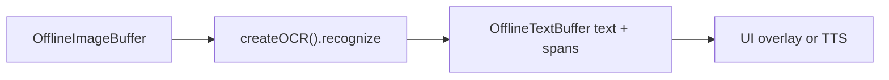

# Offline OCR (`ocr`)

## Introduction

**Offline OCR** runs on decoded image frames held in an [`OfflineImageBuffer`](imagebuffer-offline.md) and writes plain text plus optional [`TextSpatialSpan`](textbuffer-offline.md) metadata into an empty [`OfflineTextBuffer`](textbuffer-offline.md).

Import path: **`react-native-sherpa-onnx/ocr`**.

| `modelType` | Family | Alias | Recognize extras |
| --- | --- | --- | --- |
| `ppocr` | PP-OCR Det/Rec/optional Cls | — | spans on `textOut` |
| `doctr` | OnnxTR Det/Rec | — | spans on `textOut` |
| `doc_vlm` | Granite Docling | — | `raw`, `markdown`, `doctags`, `complete`, `stopReason` |
| `nemotron_parse` | Nemotron-3.5-Parse | `nemotron-parse` only (never bare `nemotron`) | `raw`, `markdown`, `complete`, `stopReason` |
| `paddleocr_vl` | PaddleOCR-VL | `paddleocr-vl` only (never bare `paddleocr`) | `raw`, `markdown`, `complete`, `stopReason`; spotting also writes spans |
| `auto` | Detects from pack layout | — | extras of the resolved family |

VLM `raw` is the native model stream; `markdown` is GFM the SDK produces; `textOut` is plaintext (no tags). `complete` is `true` only on a natural stop (not `maxNewTokens`). Overlay draws spans — it does not parse markup. `maxNewTokens` is VLM-only (`0` / omit → 8192). Pack files and decode details: [Models](#models).

---

## Quick start

`image` is a **populated** offline image buffer; `textOut` is **empty** before the call (populate-once). Raw string ids that are not offline image/text buffers are rejected with **`OCR_*`** / buffer error codes.

### Single image → text + spatial spans

```ts
import {
  createOCR,
  detectOcrModel,
} from 'react-native-sherpa-onnx/ocr';
import {
  createOfflineImageBufferFromFiles,
  releaseOfflineImageBuffer,
} from 'react-native-sherpa-onnx/imagebuffer';
import {
  createEmptyOfflineTextBuffer,
  getOfflineTextBufferTextSlice,
  getOfflineTextBufferSpatialSpansSlice,
  getPipelineTextBufferInfo,
  releasePipelineTextBuffer,
  type OfflineTextBufferInfo,
} from 'react-native-sherpa-onnx/textbuffer';

// Same pack directory for detect and init (FileSource).
// Optional: await ensureModel(ModelCategory.Ocr, 'ppocrv6-tiny') then use model.modelDir.
const modelDir = { kind: 'fs' as const, path: '/absolute/path/to/ppocrv6-tiny' };

// Step 1: pre-flight detect (native ValidateOcrPaths; check result.success)
const det = await detectOcrModel(modelDir, { modelType: 'auto' });
if (!det.success) {
  throw new Error(det.error ?? 'OCR detection failed');
}

// Step 2: create engine (swap createOCR args per family — table below)
const ocr = await createOCR({
  modelSource: modelDir,
  modelType: 'auto',
  provider: 'cpu',
  numThreads: 2,
});

// Step 3: allocate buffers (populated image in, empty text out)
const image = await createOfflineImageBufferFromFiles([
  { kind: 'fs', path: '/tmp/page.png' },
]);
const textOut = await createEmptyOfflineTextBuffer();

try {
  // Step 4: recognize (line spans; text is always filled)
  const page = await ocr.recognize(image, textOut, { granularity: 'line' });

  // Step 5: read text + optional spatial spans
  const info = (await getPipelineTextBufferInfo(
    textOut
  )) as OfflineTextBufferInfo;
  const text = await getOfflineTextBufferTextSlice(textOut, 0, info.utf16Length);
  const spans = info.hasSpatialSpans
    ? await getOfflineTextBufferSpatialSpansSlice(
        textOut,
        0,
        info.spatialSpanCount
      )
    : [];
  console.log(text, spans.length, page.spanCount);
  // if (page.family === 'doc_vlm' || page.family === 'nemotron_parse' || page.family === 'paddleocr_vl') {
  //   console.log(page.complete, page.stopReason, page.raw, page.markdown);
  // }
} finally {
  // Step 6: release buffers + engine
  await releaseOfflineImageBuffer(image);
  await releasePipelineTextBuffer(textOut);
  await ocr.destroy();
}
```

| Family | `createOCR(...)` |
| --- | --- |
| `ppocr` | `createOCR({ modelSource: modelDir, modelType: 'auto', provider: 'cpu', numThreads: 2 })` |
| `doctr` | `createOCR({ modelSource: modelDir, modelType: 'auto', doctr: { detBoxThresh: 0.15, detBoxScoreThresh: 0.15 } })` |
| `doc_vlm` | `createOCR({ modelSource: modelDir, modelType: 'doc_vlm', maxNewTokens: 512 })` |
| `nemotron_parse` | `createOCR({ modelSource: modelDir, modelType: 'nemotron_parse', maxNewTokens: 512 })` |
| `paddleocr_vl` | `createOCR({ modelSource: modelDir, modelType: 'paddleocr_vl', maxNewTokens: 512, paddleocrVl: { maxPixels: 401408 } })` |

### Multi-frame + progress + cancel

```ts
const pages = await createOfflineImageBufferFromFiles([
  { kind: 'fs', path: '/tmp/page1.jpg' },
  { kind: 'fs', path: '/tmp/page2.jpg' },
  { kind: 'fs', path: '/tmp/page3.jpg' },
]);
const textOut = await createEmptyOfflineTextBuffer();
const ac = new AbortController();

try {
  const page = await ocr.recognize(pages, textOut, {
    frames: [0, 2], // subset of frame indices; default = all
    onProgress: ({ phase, done, total, frameIndex, frameCount }) =>
      console.log(phase, done, '/', total, 'frame', frameIndex, '/', frameCount),
    signal: ac.signal, // abort at phase / decode / box hooks → OCR_CANCELLED
  });
  console.log(page.family, page.spanCount);
} finally {
  await releaseOfflineImageBuffer(pages);
  await releasePipelineTextBuffer(textOut);
}
```

---

## Buffer matrix

| Role | Type | Notes |
| --- | --- | --- |
| **Image in** | [`OfflineImageBuffer`](imagebuffer-offline.md) | Populated frames (`img_off_*`); decode once, reuse across recognizes |
| **Text out** | [`OfflineTextBuffer`](textbuffer-offline.md) | Empty before the call; filled once with plain text + spatial spans |
| **Engine** | `OcrEngine` via `createOCR` | `recognize` resolves `OcrRecognizeResult` (extras are not on the text buffer); `destroy`; readonly `instanceId` |

---

## Models

| `modelType` | Required files | Optional |
| --- | --- | --- |
| `ppocr` | `det`, `rec`, `rec_dict` | `cls` |
| `doctr` | `det`, `rec`, `manifest` | — |
| `doc_vlm` | `vision_encoder`, `vision_encoder_data`, `embed_tokens`, `embed_tokens_data`, `decoder`, `decoder_data`, `tokenizer`, `manifest` | — |
| `nemotron_parse` | granite octet plus `patch_embed`, `pos_embed` | `patch_embed_data` |
| `paddleocr_vl` | `vision_encoder`, `embedding`, `decoder`, `tokenizer` | `*_data`, `manifest` |
| `auto` | Resolves family from pack layout (manifest `family`, then layout heuristics) | — |

Published `doc_vlm` packs (self-contained; pack id is the technique, not a Hub `_quantized` filename):

| ID | Weights | Notes |
| --- | --- | --- |
| `docvlm-granite-258m-fp32` | ~1.26 GiB | Canonical. Float KV. |
| `docvlm-granite-258m-q8` | ~320 MB | Hub `_quantized` triple. Float KV. |
| `docvlm-granite-258m-fp16` | ~632 MB | Float16 KV. |
| `docvlm-granite-258m-q4f16` | ~265 MB | Float16 KV + MatMulNBits. |

Each granite archive includes vision, embed, decoder, tokenizer, and manifest. `ppocrv6-tiny` stays the phone default.

### `nemotron_parse` (Nemotron-3.5-Parse)

New family — not `doc_vlm`. Alias **only** `nemotron-parse` (never bare `nemotron`, which is an STT token). Hub: [`XDcobra/Nemotron-3.5-Parse-ONNX`](https://huggingface.co/XDcobra/Nemotron-3.5-Parse-ONNX). GitHub release ids: `nemotron-3.5-parse-fp16`, `nemotron-3.5-parse-int8`.

**Pack layout** (one quant per folder / `.tar.bz2`, flatten to pack root):

| File | Required |
| --- | --- |
| `patch_embed.onnx` (+ optional `.onnx_data`) | yes / data optional |
| `pos_embed.npy` | yes |
| `vision_encoder.onnx` + `.onnx_data` | yes |
| `embed_tokens.onnx` + `.onnx_data` | yes |
| `decoder_model_merged.onnx` + `.onnx_data` | yes |
| `tokenizer.json` | yes |
| `ocr_manifest.json` (`family: "nemotron_parse"`) | yes |

Hub folders `onnx/fp16` and `onnx/int8` flatten to pack ids `nemotron-3.5-parse-fp16` / `nemotron-3.5-parse-int8`. Local export: `build/ocr-models/nemotron-3.5-parse/onnx-{fp16,int8}`. Language hints: NVIDIA MOSCAR (163 language/script entries → 124 ISO codes). MOSCAR is synthetic; IndicVisionBench real pages cover `bn`, `gu`, `hi`, `kn`, `ml`, `mr`, `or`, `pa`, `ta`, `te`.

```ts
const ocr = await createOCR({
  modelSource: { kind: 'fs', path: '/data/models/nemotron-3.5-parse-int8' },
  modelType: 'nemotron_parse',
  maxNewTokens: 512, // omit or 0 → 8192, then clamp to remaining context
});
const page = await ocr.recognize(image, textOut);
if (page.family === 'nemotron_parse') {
  // raw is native <x_*>/<y_*>/<class_*> markup — not DocTags.
  console.log(page.complete, page.stopReason, page.raw, page.markdown);
}
```

Hardcoded control prompt (no Jinja):
`</s><s><predict_bbox><predict_classes><output_markdown><predict_text_in_pic>`.
Decode is greedy + HF repetition penalty 1.1; stop on EOS id `2` (`stopReason: 'eos'`, `complete: true`) or the generation cap (`'max_new_tokens'`, `complete: false`). `markdown` is GFM: bbox/class tags stripped and LaTeX `tabular` converted to pipe tables. `textOut` is the same body flattened to plaintext. Overlay boxes come from line spans on `textOut`, not from parsing `raw`.

Validate category: **`ocr`**. Detection: [model-detect.md](model-detect.md) · languages: [model-languages.md](model-languages.md) · downloads: [download-manager.md](download-manager.md) (`ModelCategory.Ocr`).

### `paddleocr_vl` (PaddleOCR-VL)

New family — not `ppocr`, not `doc_vlm`, not `nemotron_parse`. Alias **only** `paddleocr-vl` (never bare `paddleocr`, which is PP-OCR). Hub: [`XDcobra/PaddleOCR-VL-1.6-ONNX`](https://huggingface.co/XDcobra/PaddleOCR-VL-1.6-ONNX). GitHub release id: `paddleocr-vl-1.6-fp16`.

**Pack layout** (one quant per folder / `.tar.bz2`, flatten to pack root). Detect matches this graph layout by stem, including suffixes such as `_fp16`, not only the 1.6 pack id:

| File | Required |
| --- | --- |
| `vision_encoder.onnx` (+ optional `.onnx_data`) | yes / data optional |
| `embedding.onnx` (+ optional `.onnx_data`) | yes / data optional |
| `decoder.onnx` (+ optional `.onnx_data`) | yes / data optional |
| `tokenizer.json` | yes |
| `ocr_manifest.json` (`family: "paddleocr_vl"`) | optional (trusted when present) |

Canonical names are `embedding.onnx` and `decoder.onnx` — not granite `embed_tokens` / `decoder_model_merged`. No `pos_embed.npy`, no layout model.

Use **`provider: 'cpu'`** for `paddleocr-vl-1.6-fp16`. `xnnpack` attaches, then `createOCR` rejects: vision `FastGelu` (`com.microsoft`) is fp16, the CPU kernel is fp32-only, XNNPACK does not take the node. Fixing that would only make init succeed — this VLM does not get a meaningful XNNPACK speedup (contrib ops and fp16 compute stay on CPU). Same `OCR_INTERNAL_ERROR` if you pass `xnnpack` anyway; there is no silent CPU retry.

`paddleocrVl.maxPixels` is init-only (`smart_resize` area). Omit or `0` → **1 003 520** (official). Clamped to `[112896, 1003520]`. Phones that OOMed at the official ceiling can pass `PADDLEOCR_VL_MOBILE_MAX_PIXELS` (`401408`, 512 visual tokens). `maxNewTokens: 512` is a first-page cap; omit/`0` still means 8192.

`paddleocrVl.task` selects the official control-prompt task. Omit → **`ocr`**. Closed enum only (`'ocr' | 'spotting'`); no free-form prompt. Recognize can override on the same loaded session:

```ts
await ocr.recognize(image, textOut, {
  paddleocrVl: { task: 'spotting' },
});
```

| Task | Prompt suffix | `raw` | `markdown` / `textOut` | spans |
| --- | --- | --- | --- | --- |
| `ocr` (default) | `OCR:` | model stream | unchanged strip | empty |
| `spotting` | `Spotting:` | stream with `<\|LOC_n\|>` | instance texts, LOC stripped | one line span per instance |

Spotting is **one run**: instance text plus boxes, not a GFM page parse. Each instance is text then **eight** `<|LOC_n|>` tokens (`x1 y1 x2 y2 x3 y3 x4 y4`, values **0–1000**). Pixel quad: `(n/1000) * srcWidth/Height`. Passing `paddleocrVl` on a non-`paddleocr_vl` engine is `OCR_INVALID_ARGUMENT`.

Paddle documents spotting `image_max_pixels = 1605632`. This SDK does **not** auto-raise `maxPixels` for spotting; the clamp ceiling stays **1 003 520**. Spotting quality may want a higher cap later — pass it explicitly when that lands; this slice keeps the phone-safe default.

```ts
const ocr = await createOCR({
  modelSource: { kind: 'fs', path: '/data/models/paddleocr-vl-1.6-fp16' },
  modelType: 'paddleocr_vl',
  maxNewTokens: 512, // omit or 0 → 8192, then clamp to remaining context
  paddleocrVl: { maxPixels: 401408, task: 'ocr' }, // omit or 0 → 1003520; omit task → ocr
});
const page = await ocr.recognize(image, textOut);
if (page.family === 'paddleocr_vl') {
  // raw is the native markdown/HTML stream — not DocTags, not Nemotron xy tags.
  console.log(page.complete, page.stopReason, page.raw, page.markdown);
}
```

Control prompt (no Jinja):
`<|begin_of_sentence|>User: <|IMAGE_START|><|IMAGE_PLACEHOLDER|>×N<|IMAGE_END|>OCR:\nAssistant:\n`
(or `Spotting:` when `task` is `'spotting'`).
Decode is greedy argmax with no repetition penalty; stop on EOS id `2` (`stopReason: 'eos'`, `complete: true`) or the generation cap (`'max_new_tokens'`, `complete: false`). Overlay spans are empty for `ocr`; spotting fills line spans from LOC quads.

Validate category: **`ocr`**. Detection: [model-detect.md](model-detect.md) · languages: [model-languages.md](model-languages.md) · downloads: [download-manager.md](download-manager.md) (`ModelCategory.Ocr`).

---

## API reference

Signatures from **`react-native-sherpa-onnx/ocr`**.

### `detectOcrModel(source, options?)`

File-based detection without initializing the engine. Unified detection: [model-detect.md](model-detect.md).

```ts
function detectOcrModel(
  source: FileSource,
  options?: { modelType?: OcrModelType; quantization?: QuantizationPreference }
): Promise<OcrDetectModelResult>;
```

```ts
const det = await detectOcrModel(
  { kind: 'fs', path: '/data/models/ppocrv6-tiny' },
  { modelType: 'auto' }
);
if (!det.success) throw new Error(det.error ?? 'OCR detection failed');
```

### `createOCR(options)`

```ts
function createOCR(options: OcrInitializeOptions): Promise<OcrEngine>;
```

```ts
const ocr = await createOCR({
  modelSource: { kind: 'fs', path: '/models/ppocrv6-tiny' },
  modelType: 'auto',
  quantization: 'auto',
  provider: 'cpu',
  numThreads: 2,
});
```

Family option bags (`ppocr` / `doctr` / `paddleocrVl`) are constrained by `modelType`. VLM cap is top-level `maxNewTokens` on `auto` / `doc_vlm` / `nemotron_parse` / `paddleocr_vl` only.

`provider` and `numThreads` apply to every family, including `doc_vlm`, `nemotron_parse`, and `paddleocr_vl`. The provider string is passed to ONNX Runtime (`cpu`, `nnapi`, `xnnpack`, `coreml`). If that EP is missing or cannot attach, native logs and the session stays on CPU — it does not throw. If the EP attaches but session create fails (unsupported ops, OOM, alignment), `createOCR` rejects with `OCR_INTERNAL_ERROR` and the Ort message. It does not crash and does not silently retry CPU — pass `provider: 'cpu'` to retry. `paddleocr-vl-1.6-fp16` + `xnnpack` is that case (fp16 `FastGelu`); see the family section above. See [execution-providers.md](execution-providers.md).

`ppocr.detUnclipRatio` / `doctr.detUnclipRatio` (default `1.5`) control DB box expansion after detection — lower values tighten spatial quads around glyphs.

### `engine.recognize(imageBuffer, textOut, options?)`

Reads a populated image buffer; writes text (+ spatial spans) into an empty text buffer. Resolves `OcrRecognizeResult` (discriminated on `family`).

```ts
recognize(
  imageBuffer: OfflineImageBufferIdSource,
  textOut: OfflineTextBufferIdSource,
  options?: OcrRecognizeOptions
): Promise<OcrRecognizeResult>;
```

```ts
const page = await ocr.recognize(image, textOut, {
  granularity: 'line',
  frames: [0],
  onProgress: (p) => console.log(p.phase, p.done, p.total),
  signal: ac.signal,
  // paddleocr_vl only; omit → init paddleocrVl.task (default 'ocr')
  paddleocrVl: { task: 'spotting' },
});
```

### `engine.destroy()`

```ts
await ocr.destroy();
```

### `engine.instanceId`

```ts
console.log(ocr.instanceId);
```

---

## Pipeline composition

### Typical upstream

| Source / feature | Buffer or handle | Notes |
| --- | --- | --- |
| App image files / URIs | `OfflineImageBuffer` (`img_off_*`) | `createOfflineImageBufferFromFiles` — PNG/JPEG; WebP when libwebp is opted in; HEIC via platform decoder |
| Reused page buffer | `OfflineImageBuffer` | Decode once; run OCR on `frames` subsets |

### Typical downstream

| Destination / feature | Buffer or handle | Notes |
| --- | --- | --- |
| Plain transcript | `OfflineTextBuffer` (`txt_off_*`) | `getOfflineTextBufferTextSlice` |
| Box overlay / layout UI | Spatial spans on same text buffer | `getOfflineTextBufferSpatialSpansSlice` (`origin: 'ocr'`). Ready-made: [`OfflineImageBufferAnnotatedView`](imagebuffer-offline.md#offlineimagebufferannotatedview); own UI: [`mapTextSpatialSpansToFrame`](imagebuffer-offline.md#maptextspatialspanstoframespans-options) |
| Offline TTS | `OfflineTextBuffer` | Read aloud recognized text |
| Offline punctuation | `OfflineTextBuffer` | Optional cleanup before TTS |



More end-to-end patterns: [feature-pipelines.md#ocr-offline-patterns](feature-pipelines.md#ocr-offline-patterns).

---

## JS Events

| Callback | Payload | Fires when | Notes |
| --- | --- | --- | --- |
| `onProgress` | `{ phase, done, total, frameIndex, frameCount }` | Before/after each backend phase; decode tokens; rec boxes | Native event `SherpaOnnxOcrProgress` filtered by `operationId`. Coalesced at `progressMinIntervalMs` (default 200, same as download). Phase / frame changes and `done === total` always emit. `0` = unthrottled. `total === 0` is indeterminate (no percent). `AbortSignal` is observed at the same hooks (not mid-`Ort::Run`). |

Known `phase` values (`OCR_PROGRESS_PHASES`): `preprocess`, `patch` (nemotron only), `vision`, `embed`, `prefill`, `decode` (VLM), `detect` / `recognize` (ppocr/doctr boxes), `parse` (VLM). Families may emit extra strings; do not switch on an exhaustive enum.

```ts
const page = await ocr.recognize(image, textOut, {
  onProgress: (p) => {
    if (p.total > 0) console.log(p.phase, `${p.done}/${p.total}`);
    else console.log(p.phase, '…');
  },
});
```

---

## Types

### Core OCR types (`react-native-sherpa-onnx/ocr`)

| Type | Description |
| --- | --- |
| `OcrModelType` | `'auto' \| 'ppocr' \| 'doctr' \| 'doc_vlm' \| 'nemotron_parse' \| 'paddleocr_vl'` |
| `OcrConcreteModelType` | Exclude `auto` |
| `OcrFamily` | Concrete backend family after load |
| `OcrGranularity` | `'line' \| 'word' \| 'block'` |
| `OcrInitializeOptions` | Discriminated on `modelType`; shared `provider?`, `numThreads?`; VLM-only `maxNewTokens?` |
| `OcrPaddleocrVlTask` | `'ocr' \| 'spotting'` |
| `OcrPpocrOptions` / `OcrDoctrOptions` / `OcrVlmOptions` / `OcrPaddleocrVlOptions` | Family init bags (`paddleocrVl.maxPixels`, `paddleocrVl.task`) |
| `OcrRecognizeOptions` | `frames?`, `granularity?`, `onProgress?`, `progressMinIntervalMs?` (default 200), `signal?`, `paddleocrVl?: { task? }` (paddleocr_vl only) |
| `OcrRecognizeResult` | Discriminated on `family`. VLM families share `raw`/`markdown`/`complete`/`stopReason`; `doc_vlm` also has `doctags` |
| `OcrVlmStopReason` | `'doctag_end' \| 'eos' \| 'max_new_tokens' \| 'invalid_sequence'` |
| `OcrProgress` | `{ phase, done, total, frameIndex, frameCount }`. `total === 0` → indeterminate |
| `OCR_PROGRESS_PHASES` | Known phase names; extra strings are allowed |
| `OcrDetectModelResult` | `detectOcrModel` return |
| `OcrEngine` | `recognize` / `destroy` / `instanceId` |
| `OcrErrorCode` | Error code constants |

### Related buffer types

| Type | Description |
| --- | --- |
| `OfflineImageBufferIdSource` | Image ref or handle passed to `recognize` |
| `OfflineTextBufferIdSource` | Empty text out ref or handle |
| `TextSpatialSpan` | Span with `origin: 'ocr'`, boxes, frame index |

See [imagebuffer-offline.md](imagebuffer-offline.md) and [textbuffer-offline.md](textbuffer-offline.md).

---

## Error codes

| Error code | Explanation |
| --- | --- |
| `OCR_DETECT_FAILED` | `detectOcrModel` failed (native validation / layout). |
| `OCR_MODEL_NOT_FOUND` | Pack / ONNX paths missing at init. |
| `OCR_NOT_INITIALIZED` | Native engine not ready. |
| `OCR_INSTANCE_NOT_FOUND` | `instanceId` missing or already **destroyed**. |
| `OCR_INVALID_ARGUMENT` | Bad options (e.g. invalid frame index, a non-integer / negative `maxNewTokens` or `paddleocrVl.maxPixels`, `paddleocrVl.task` other than `'ocr' \| 'spotting'`, or those fields / the `paddleocrVl` recognize bag on the wrong family). |
| `OCR_IMAGE_BUFFER_NOT_FOUND` | Image buffer id missing from registry. |
| `OCR_IMAGE_BUFFER_EMPTY` | Image buffer has no frames. |
| `OCR_FRAME_READ_FAILED` | Could not read a requested frame. |
| `OCR_RECOGNIZE_FAILED` | Native recognize / backend failure. |
| `OCR_ALREADY_POPULATED` | `textOut` was already populated; output must be **empty**. |
| `OCR_CANCELLED` | `AbortSignal` aborted at a progress hook (phase / decode step / rec box). |
| `OCR_BUSY` | Concurrent recognize on the same instance. |
| `OCR_INTERNAL_ERROR` | Unexpected native failure. Also a recognize payload missing `family` or a finite `spanCount`; for VLM families, missing `raw` / `markdown` / `complete` / `stopReason` (`doc_vlm` also requires `doctags`); and a `createOCR` failure when session create fails (unsupported EP ops, missing contrib ops such as `GroupQueryAttention`, fp16 `FastGelu` on `paddleocr-vl-1.6-fp16` + `xnnpack`, OOM). |
| `FILEIO_*` | File / URI resolution for **`FileSource`** before or during model init. |

---

## Use case examples

<details>
<summary>Download pack, detect, then OCR a page (ppocr)</summary>

```ts
import { ModelCategory, ensureModel } from 'react-native-sherpa-onnx/download';
import {
  createOCR,
  detectOcrModel,
} from 'react-native-sherpa-onnx/ocr';

const model = await ensureModel(ModelCategory.Ocr, 'ppocrv6-tiny');
const source = { kind: 'fs' as const, path: model.modelDir };
const det = await detectOcrModel(source);
if (!det.success) {
  throw new Error(det.error ?? 'bad OCR pack');
}
const ocr = await createOCR({ modelSource: source, modelType: 'ppocr' });
// … recognize as in Quick start …
await ocr.destroy();
```

</details>

<details>
<summary>Download pack, detect, then OCR a page (doctr)</summary>

```ts
import { ModelCategory, ensureModel } from 'react-native-sherpa-onnx/download';
import {
  createOCR,
  detectOcrModel,
} from 'react-native-sherpa-onnx/ocr';

const model = await ensureModel(ModelCategory.Ocr, 'doctr-mobile');
const source = { kind: 'fs' as const, path: model.modelDir };
const det = await detectOcrModel(source);
if (!det.success) {
  throw new Error(det.error ?? 'bad DocTR pack');
}
const ocr = await createOCR({ modelSource: source, modelType: 'doctr' });
// … recognize as in Quick start …
await ocr.destroy();
```

</details>

<details>
<summary>Download pack, detect, then read DocTags (doc_vlm)</summary>

```ts
import { ModelCategory, ensureModel } from 'react-native-sherpa-onnx/download';
import {
  createOCR,
  detectOcrModel,
} from 'react-native-sherpa-onnx/ocr';

const model = await ensureModel(ModelCategory.Ocr, 'docvlm-granite-258m-fp32');
const source = { kind: 'fs' as const, path: model.modelDir };
const det = await detectOcrModel(source);
if (!det.success) {
  throw new Error(det.error ?? 'bad doc_vlm pack');
}
const ocr = await createOCR({
  modelSource: source,
  modelType: 'doc_vlm',
  maxNewTokens: 512,
});
const page = await ocr.recognize(image, textOut, { granularity: 'line' });
if (page.family === 'doc_vlm') {
  console.log(page.complete, page.stopReason, page.raw, page.markdown);
}
await ocr.destroy();
```

</details>

<details>
<summary>Local pack, detect, then read native markup (nemotron_parse)</summary>

```ts
import {
  createOCR,
  detectOcrModel,
} from 'react-native-sherpa-onnx/ocr';

const source = {
  kind: 'fs' as const,
  path: '/data/models/nemotron-3.5-parse-int8',
};
const det = await detectOcrModel(source, { modelType: 'nemotron_parse' });
if (!det.success) {
  throw new Error(det.error ?? 'bad nemotron_parse pack');
}
const ocr = await createOCR({
  modelSource: source,
  modelType: 'nemotron_parse',
  maxNewTokens: 512,
});
const page = await ocr.recognize(image, textOut, { granularity: 'line' });
if (page.family === 'nemotron_parse') {
  console.log(page.complete, page.stopReason, page.raw, page.markdown);
}
await ocr.destroy();
```

</details>

<details>
<summary>Multi-page buffer, OCR selected frames only</summary>

```ts
const pages = await createOfflineImageBufferFromFiles([
  { kind: 'fs', path: '/tmp/p1.png' },
  { kind: 'fs', path: '/tmp/p2.png' },
]);
const textOut = await createEmptyOfflineTextBuffer();
const page = await ocr.recognize(pages, textOut, {
  frames: [1],
  granularity: 'line',
});
console.log(page.spanCount);
```

</details>

<details>
<summary>Read spatial spans for a box overlay</summary>

```tsx
import { OfflineImageBufferAnnotatedView } from 'react-native-sherpa-onnx/imagebuffer';

<OfflineImageBufferAnnotatedView
  buffer={image}
  text={textOut}
  frameIndex={0}
  onSpanPress={(e) => console.log(e.index, e.utf16Start, e.quad)}
/>
```

Or map yourself (`ocr` quads are already frame pixels; `textLayer` needs `mapTextSpatialSpansToFrame`):

```ts
const info = (await getPipelineTextBufferInfo(textOut)) as OfflineTextBufferInfo;
if (info.hasSpatialSpans) {
  const spans = await getOfflineTextBufferSpatialSpansSlice(
    textOut,
    0,
    info.spatialSpanCount
  );
  for (const s of spans) {
    console.log(s.origin, s.frameIndex, s.quad);
  }
}
```

</details>

<details>
<summary>Scan-only PDF (no text layer) → rasterize → recognize</summary>

```ts
import { createEmptyOfflineTextBuffer } from 'react-native-sherpa-onnx/textbuffer';
import { releaseOfflineImageBuffer } from 'react-native-sherpa-onnx/imagebuffer';
import {
  extractPdfTextLayer,
  PdfErrorCode,
  rasterizePdfPages,
} from 'react-native-sherpa-onnx/pdf';

const pdf = { kind: 'fs' as const, path: '/tmp/scan.pdf' };

// 1) Prefer digital text when present (app-owned switch; no SDK auto).
const probeOut = await createEmptyOfflineTextBuffer();
try {
  await extractPdfTextLayer(pdf, probeOut);
  // Digital PDF: text + spans already in probeOut — skip OCR.
} catch (err) {
  const msg = err instanceof Error ? err.message : String(err);
  if (!msg.includes(PdfErrorCode.NO_TEXT_LAYER)) throw err;

  // 2) No glyph layer → page bitmaps into OfflineImageBuffer.
  const pages = await rasterizePdfPages(pdf, {
    pages: 'all',
    dpi: 144,
    maxSide: 2048,
  });

  // 3) Same OCR path as a normal image buffer.
  const textOut = await createEmptyOfflineTextBuffer();
  const page = await ocr.recognize(pages, textOut, { granularity: 'line' });
  console.log(page.spanCount);

  await releaseOfflineImageBuffer(pages);
}
```

Requires opt-in PDFium — see [pdf-offline.md](pdf-offline.md).

</details>

---

## Example app


|  |  |  |
| --- | --- | --- |


The monorepo example exposes **Home → Vision → OCR** (`example/src/screens/ocr/OCRScreen.tsx`) as a developer showcase for this API. See [example/README.md](../example/README.md#ocr-offline).

---

## See also

- [PDF](pdf-offline.md) (text-layer extract + page raster → ImageBuffer; opt-in PDFium; OCR stays explicit)
- [E-documents](document-offline.md) (EPUB/FB2/MOBI markup → TextBuffer; CBZ/CBR / image-only spine → ImageBuffer; OCR stays explicit)
- [ImageBuffer offline](imagebuffer-offline.md) (typical **source** of frames)
- [TextBuffer offline](textbuffer-offline.md) (text + spatial spans)
- [Feature pipelines](feature-pipelines.md#ocr-offline-patterns)
- [Model setup](model-setup.md)
- [Model detection](model-detect.md)
- [Model languages](model-languages.md) (`getPpocrLanguages`, `getDoctrLanguages`, `DOC_VLM_ISO6391_HINTS`, `NEMOTRON_PARSE_ISO6391_HINTS`, `iso6391HintsForOcrModelType`)
- [Download manager](download-manager.md) (`ModelCategory.Ocr`)
- [Execution providers](execution-providers.md)
- [Native diagnostics](native-diagnostics.md)

---

## Native crash diagnostics

If native code fails or the app crashes but the tombstone shows only a UI/GPU thread, inspect the SDK **last-activity ring buffer** (enabled by default when the native library loads). Full details: [native-diagnostics.md](./native-diagnostics.md) — Android log tag `SherpaNativeDiag`; iOS subsystem `com.sherpaonnx.diag`. Optional JS: `getNativeDiagnosticSnapshot` / `configureNativeDiagnostics` from `react-native-sherpa-onnx/diagnostics`.
