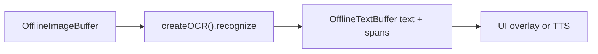

# Offline OCR (`ocr`)

## Introduction

**Offline OCR** runs on decoded image frames held in an [`OfflineImageBuffer`](imagebuffer-offline.md) and writes plain text plus optional [`TextSpatialSpan`](textbuffer-offline.md) metadata into an empty [`OfflineTextBuffer`](textbuffer-offline.md).

Import path: **`react-native-sherpa-onnx/ocr`**.

Families: **`ppocr`** (PP-OCR Det/Rec/optional Cls), **`doctr`** (OnnxTR Det/Rec/manifest), and **`doc_vlm`** (Granite Docling: vision encoder + embed + merged decoder + tokenizer + manifest). `modelType: 'auto' | 'ppocr' | 'doctr' | 'doc_vlm'`.

---

## Quick start

`image` is a **populated** offline image buffer; `textOut` is **empty** before the call (populate-once). Raw string ids that are not offline image/text buffers are rejected with **`OCR_*`** / buffer error codes.

### Single image → text + spatial spans (ppocr)

```ts
import {
  createOCR,
  detectOcrModel,
  isOcrPpocrDetectSuccess,
} from 'react-native-sherpa-onnx/ocr';
import {
  createOfflineImageBufferFromFiles,
  releaseOfflineImageBuffer,
} from 'react-native-sherpa-onnx/imagebuffer';
import {
  createEmptyOfflineTextBuffer,
  getOfflineTextBufferTextSlice,
  getOfflineTextBufferSpatialSpansSlice,
  getPipelineTextBufferInfo,
  releasePipelineTextBuffer,
  type OfflineTextBufferInfo,
} from 'react-native-sherpa-onnx/textbuffer';

// Same pack directory for detect and init (FileSource).
// Optional: await ensureModel(ModelCategory.Ocr, 'ppocrv6-tiny') then use model.modelDir.
const modelDir = { kind: 'fs' as const, path: '/absolute/path/to/ppocrv6-tiny' };

// Step 1: pre-flight detect (Det+Rec+dict co-occurrence; narrow required paths)
const det = await detectOcrModel(modelDir, { modelType: 'auto' });
if (!isOcrPpocrDetectSuccess(det)) {
  throw new Error(det.error ?? 'OCR detection failed');
}

// Step 2: create engine
const ocr = await createOCR({
  modelSource: modelDir,
  modelType: 'auto',
  provider: 'cpu',
  numThreads: 2,
});

// Step 3: allocate buffers (populated image in, empty text out)
const image = await createOfflineImageBufferFromFiles([
  { kind: 'fs', path: '/tmp/page.png' },
]);
const textOut = await createEmptyOfflineTextBuffer();

try {
  // Step 4: recognize (line spans; text is always filled)
  const page = await ocr.recognize(image, textOut, { granularity: 'line' });

  // Step 5: read text + optional spatial spans
  const info = (await getPipelineTextBufferInfo(
    textOut
  )) as OfflineTextBufferInfo;
  const text = await getOfflineTextBufferTextSlice(textOut, 0, info.utf16Length);
  const spans = info.hasSpatialSpans
    ? await getOfflineTextBufferSpatialSpansSlice(
        textOut,
        0,
        info.spatialSpanCount
      )
    : [];
  console.log(text, spans.length, page.spanCount);
} finally {
  // Step 6: release buffers + engine
  await releaseOfflineImageBuffer(image);
  await releasePipelineTextBuffer(textOut);
  await ocr.destroy();
}
```

For ppocr, `page.doctags` and `page.markdown` are `""`. Text and spans stay on `textOut`.

### Single image → text + spatial spans (doctr)

```ts
import {
  createOCR,
  detectOcrModel,
  isOcrDoctrDetectSuccess,
} from 'react-native-sherpa-onnx/ocr';

const modelDir = { kind: 'fs' as const, path: '/absolute/path/to/doctr-mobile' };

const det = await detectOcrModel(modelDir, { modelType: 'auto' });
if (!isOcrDoctrDetectSuccess(det)) {
  throw new Error(det.error ?? 'DocTR detection failed');
}

const ocr = await createOCR({
  modelSource: modelDir,
  modelType: 'auto',
  doctr: { detBoxThresh: 0.15, detBoxScoreThresh: 0.15 },
});

// … recognize as in ppocr example above …
await ocr.destroy();
```

> `ppocr`, `doctr`, and `doc_vlm` share `createOCR` → `recognize`. `modelType: 'auto'` resolves the family from the manifest `family` string, then from pack layout. Use `isOcrPpocrDetectSuccess`, `isOcrDoctrDetectSuccess`, or `isOcrDocVlmDetectSuccess` to narrow the detected paths.

### Single image → DocTags + markdown (`doc_vlm`)

```ts
import {
  createOCR,
  detectOcrModel,
  isOcrDocVlmDetectSuccess,
} from 'react-native-sherpa-onnx/ocr';

const modelDir = {
  kind: 'fs' as const,
  path: '/absolute/path/to/docvlm-granite-258m',
};

const det = await detectOcrModel(modelDir, { modelType: 'auto' });
if (!isOcrDocVlmDetectSuccess(det)) {
  throw new Error(det.error ?? 'doc_vlm detection failed');
}

const ocr = await createOCR({
  modelSource: modelDir,
  modelType: 'doc_vlm',
  docVlm: { maxNewTokens: 512 },
});

// image + textOut: same allocation as the ppocr example.
const page = await ocr.recognize(image, textOut, { granularity: 'line' });
console.log(page.family, page.doctags, page.markdown);
await ocr.destroy();
```

### Multi-frame + progress + cancel

```ts
const pages = await createOfflineImageBufferFromFiles([
  { kind: 'fs', path: '/tmp/page1.jpg' },
  { kind: 'fs', path: '/tmp/page2.jpg' },
  { kind: 'fs', path: '/tmp/page3.jpg' },
]);
const textOut = await createEmptyOfflineTextBuffer();
const ac = new AbortController();

try {
  const page = await ocr.recognize(pages, textOut, {
    frames: [0, 2], // subset of frame indices; default = all
    onProgress: ({ done, total, phase }) => console.log(phase, done, '/', total),
    signal: ac.signal, // abort between frames → OCR_CANCELLED
  });
  console.log(page.family, page.spanCount);
} finally {
  await releaseOfflineImageBuffer(pages);
  await releasePipelineTextBuffer(textOut);
}
```

---

## Buffer matrix

| Role | Type | Notes |
| --- | --- | --- |
| **Image in** | [`OfflineImageBuffer`](imagebuffer-offline.md) | Populated frames (`img_off_*`); decode once, reuse across recognizes |
| **Text out** | [`OfflineTextBuffer`](textbuffer-offline.md) | Empty before the call; filled once with plain text + spatial spans |
| **Engine** | `OcrEngine` via `createOCR` | `recognize` resolves `OcrRecognizeResult` (extras are not on the text buffer); `destroy`; readonly `instanceId` |

---

## Models

| `modelType` | Required files (directory detect) | Optional |
| --- | --- | --- |
| `ppocr` | Det ONNX + Rec ONNX + recognition dictionary (`paths.rec_dict`) | Cls / orientation ONNX (`paths.cls`) |
| `doctr` | Det ONNX + Rec ONNX + `ocr_manifest.json` (`paths.manifest`) | — |
| `doc_vlm` | Eight paths: `vision_encoder`, `vision_encoder_data`, `embed_tokens`, `embed_tokens_data`, `decoder`, `decoder_data`, `tokenizer`, `manifest` | — |
| `auto` | Manifest `"family"` wins when `ocr_manifest.json` has that string (detect does not fall through). Otherwise: eight-file layout → `doc_vlm`, then det+rec+dictionary → `ppocr`, then det+rec+manifest → `doctr` | — |

A doctr manifest stays doctr even if a `vision_encoder.onnx` is dropped beside it.

Canonical names — ppocr: `det.onnx`, `rec.onnx`, `rec_inference.yml`, optional `cls.onnx`. Doctr: `det.onnx`, `rec.onnx`, `ocr_manifest.json`. `doc_vlm`: `vision_encoder.onnx`, `vision_encoder.onnx_data`, `embed_tokens.onnx`, `embed_tokens.onnx_data`, `decoder_model_merged.onnx`, `decoder_model_merged.onnx_data`, `tokenizer.json`, `ocr_manifest.json`. The detect key for the decoder file is `decoder`, not the basename. `vision_encoder.onnx.data` (dot before `data`) does not satisfy `vision_encoder_data`. `tokenizer_config.json`, `vocab.json`, `merges.txt`, and `config.json` ship in the pack and are not required paths.

### Official packs (verified)

Release tag [`ocr-models`](https://github.com/XDcobra/react-native-sherpa-onnx/releases/tag/ocr-models) (`github_xdcobra`):

#### ppocr family

| Archive | Tier | Language hints | Notes |
| --- | --- | --- | --- |
| `ppocrv6-tiny.tar.bz2` | tiny | ~48 ISO (`zh`, `en` + 46 Latin; no `ja`) | Fast / low RAM default for phones |
| `ppocrv6-small.tar.bz2` | small | ~49 ISO (`zh`, `en`, `ja` + 46 Latin) | Higher quality |
| `ppocrv6-medium.tar.bz2` | medium | same as small | Best quality, larger download |

#### doctr family

| Archive | Tier | Language hints | Notes |
| --- | --- | --- | --- |
| `doctr-mobile.tar.bz2` | tiny/small | `en`, `fr` | OnnxTR CRNN-based; fast, Latin-only |
| `doctr-default.tar.bz2` | medium | 15 Latin-European (`en`, `fr`, `pt`, `es`, `de`, `it`, `cs`, `pl`, `da`, `no`, `sv`, `fi`, `nl`, `hu`, `ro`) | OnnxTR PARSeq or CRNN; broader Latin coverage |

#### doc_vlm family

| Archive | Tier | Language hints | Notes |
| --- | --- | --- | --- |
| `docvlm-granite-258m.tar.bz2` | — | `en`, plus experimental `ja`, `ar`, `zh` | Unpacked weights about **1.18 GiB**. Archive about **420 MiB**. A loaded session is on the order of **4 GiB RSS** (weights mmap'd, plus arenas). Not the phone default (`ppocrv6-tiny` stays that). Quantized siblings are not in this release. |

`decoder_model_merged.onnx` (opset 21, domain `com.microsoft`) uses the contrib op `GroupQueryAttention`. The host ONNX Runtime zip this repo uses (1.28.x under `third_party/onnxruntime_prebuilt`) includes it. A mobile ONNX Runtime built without Microsoft contrib ops fails when the decoder `Ort::Session` is created, inside `createOCR`, not on the first generated token. That load failure surfaces as `OCR_INTERNAL_ERROR`. There is no `supportsDocVlm` probe and no separate error code. `provider: 'coreml' | 'nnapi' | 'qnn'` does not move this family onto the GPU: `DocVlmBackend` logs a warning and stays on CPU.

Validate category: **`ocr`**. Language pickers: [`getPpocrLanguages()`](model-languages.md) (ppocr) · [`getDoctrLanguages()`](model-languages.md) (doctr). There is no `getDocVlmLanguages()` picker. `doc_vlm` hints are `DOC_VLM_ISO6391_HINTS` and `iso6391HintsForOcrModelType('doc_vlm')`. Per-pack: `iso6391HintsForOcrModelType('doctr', 'doctr-mobile')`; `iso6391HintsForOcrModelType('doc_vlm', 'docvlm-granite-258m')` returns the same four codes today. Downloads: [download-manager.md](download-manager.md) (`ModelCategory.Ocr`).

#### Download + detect + init (ppocr)

```ts
import { ModelCategory, ensureModel } from 'react-native-sherpa-onnx/download';
import { createOCR, detectOcrModel, isOcrPpocrDetectSuccess } from 'react-native-sherpa-onnx/ocr';

const model = await ensureModel(ModelCategory.Ocr, 'ppocrv6-tiny');
const source = { kind: 'fs' as const, path: model.modelDir };
const det = await detectOcrModel(source, { modelType: 'auto' });
if (!isOcrPpocrDetectSuccess(det)) throw new Error(det.error ?? 'bad OCR pack');
const ocr = await createOCR({ modelSource: source, modelType: 'auto' });
```

#### Download + detect + init (doctr)

```ts
import { ModelCategory, ensureModel } from 'react-native-sherpa-onnx/download';
import { createOCR, detectOcrModel, isOcrDoctrDetectSuccess } from 'react-native-sherpa-onnx/ocr';

const model = await ensureModel(ModelCategory.Ocr, 'doctr-mobile');
const source = { kind: 'fs' as const, path: model.modelDir };
const det = await detectOcrModel(source, { modelType: 'auto' });
if (!isOcrDoctrDetectSuccess(det)) throw new Error(det.error ?? 'bad DocTR pack');
const ocr = await createOCR({ modelSource: source, modelType: 'auto' });
```

#### Download + detect + init (`doc_vlm`)

```ts
import { ModelCategory, ensureModel } from 'react-native-sherpa-onnx/download';
import { createOCR, detectOcrModel, isOcrDocVlmDetectSuccess } from 'react-native-sherpa-onnx/ocr';

const model = await ensureModel(ModelCategory.Ocr, 'docvlm-granite-258m');
const source = { kind: 'fs' as const, path: model.modelDir };
const det = await detectOcrModel(source, { modelType: 'auto' });
if (!isOcrDocVlmDetectSuccess(det)) throw new Error(det.error ?? 'bad doc_vlm pack');
const ocr = await createOCR({ modelSource: source, modelType: 'doc_vlm' });
```

---

## API reference

Signatures from **`react-native-sherpa-onnx/ocr`**. Types: **`src/ocr/types.ts`**; detect mirrors **`src/types/modelDetect.ts`**.

### `detectOcrModel(source, options?)`

```ts
function detectOcrModel(
  source: FileSource,
  options?: { modelType?: OcrModelType }
): Promise<OcrDetectModelResult>;
```

```ts
// ppocr
const pre = await detectOcrModel(
  { kind: 'fs', path: '/data/models/ppocrv6-tiny' },
  { modelType: 'auto' }
);
// doctr
const pre = await detectOcrModel(
  { kind: 'fs', path: '/data/models/doctr-mobile' },
  { modelType: 'auto' }
);
// doc_vlm
const pre = await detectOcrModel(
  { kind: 'fs', path: '/data/models/docvlm-granite-258m' },
  { modelType: 'auto' }
);
```

File-based detection without loading the engine. On success:

- `isOcrPpocrDetectSuccess(pre)` narrows `paths` to `{ det, rec, rec_dict }` (`cls` optional).
- `isOcrDoctrDetectSuccess(pre)` narrows `paths` to `{ det, rec, manifest }`.
- `isOcrDocVlmDetectSuccess(pre)` narrows `paths` to the eight keys (`vision_encoder`, `vision_encoder_data`, `embed_tokens`, `embed_tokens_data`, `decoder`, `decoder_data`, `tokenizer`, `manifest`). `cls` and `rec_dict` are not part of a `doc_vlm` success. `det` and `rec` stay empty.

May include `languages`, `sizeTier`, `detectionSources`. See [model-detect.md](model-detect.md).

### `createOCR(options)`

```ts
function createOCR(options: OcrInitializeOptions): Promise<OcrEngine>;
```

```ts
// ppocr
const ocr = await createOCR({
  modelSource: { kind: 'fs', path: '/abs/path/to/ppocrv6-tiny' },
  modelType: 'auto',
  ppocr: { maxSideLen: 960, useOrientationCls: true },
});

// doctr
const ocr = await createOCR({
  modelSource: { kind: 'fs', path: '/abs/path/to/doctr-mobile' },
  modelType: 'auto',
  doctr: { detBoxThresh: 0.15, detBoxScoreThresh: 0.15, detUnclipRatio: 1.5 },
});

// doc_vlm
const ocr = await createOCR({
  modelSource: { kind: 'fs', path: '/abs/path/to/docvlm-granite-258m' },
  modelType: 'doc_vlm',
  docVlm: { maxNewTokens: 512 },
});
```

Creates an `OcrEngine`. Pass `modelSource` plus optional `modelType` / `provider` / `numThreads`. `OcrInitializeOptions` is a discriminated union:

- `modelType: 'ppocr'` allows `ppocr?` only (`doctr?` and `docVlm?` are `never`).
- `modelType: 'doctr'` allows `doctr?` only.
- `modelType: 'doc_vlm'` allows `docVlm?` only (`ppocr?` and `doctr?` are `never`).
- `modelType` omitted or `'auto'` may pass all three bags; the backend that loads reads its own.

Family bags:

- **ppocr**: `ppocr: { maxSideLen?, useOrientationCls? }`
- **doctr**: `doctr: { detBoxThresh?, detBoxScoreThresh?, detUnclipRatio? }`
- **doc_vlm**: `docVlm: { maxNewTokens?: number }` — init-time only, not a field of `OcrRecognizeOptions`. Omit or `0` → backend default 8192. A non-integer or a negative value is `OCR_INVALID_ARGUMENT` at `createOCR`, before native load.

Aliases `docvlm`, `doc-vlm`, `granite-docling`, and `docling` are accepted by `createOCR` and rewritten to `'doc_vlm'`. They are not members of `OcrModelType`. `isOcrModelType('docling')` is false.

### `engine.recognize(imageBuffer, textOut, options?)`

```ts
recognize(
  imageBuffer: OfflineImageBufferIdSource,
  textOut: OfflineTextBufferIdSource,
  options?: OcrRecognizeOptions
): Promise<OcrRecognizeResult>;
```

```ts
const page = await ocr.recognize(image, textOut, {
  granularity: 'line',
  frames: [0],
  onProgress: (p) => console.log(p.done, p.total),
  signal: ac.signal,
});
```

Reads populated `imageBuffer`, writes text (+ spatial spans, `origin: 'ocr'`) into empty `textOut`. DocTags and markdown are **not** written into that buffer. They come back on the promise:

| Field | Meaning |
| --- | --- |
| `family` | Concrete `OcrBackend::Family()`: `'ppocr' \| 'doctr' \| 'doc_vlm'`. `createOCR({ modelType: 'auto' })` still echoes `'auto'` from `initializeOcr`. This field is the family that actually ran. |
| `spanCount` | Spans written to `textOut` after the granularity filter. |
| `doctags` | Raw DocTags after ASCII lstrip. `""` for ppocr and doctr. For `doc_vlm`, the decoded generation with specials kept (`<doctag>` … `</doctag>`). |
| `markdown` | Lossy markdown from the same DocTags walk. `""` for ppocr and doctr. For `doc_vlm`, empty only when the plain text is empty. |

`""` is a valid extra. Failures still reject (`OCR_CANCELLED`, `OCR_RECOGNIZE_FAILED`, …). A native payload missing `family`, `doctags`, `markdown`, or a finite `spanCount` rejects `OCR_INTERNAL_ERROR`.

Default `granularity` is `'line'`. Backends emit `line` spans. `doc_vlm` also emits `block` for `title` / `section_header_level_*`. The default filter drops those title quads from `textOut`; their text is still inside the buffer text, `doctags`, and `markdown`. `'block'` keeps titles and drops lines. `'word'` can yield an empty span list while text is still filled.

Multi-frame: non-empty `doctags` / `markdown` chunks are joined with one `\n`. That newline does not shift span UTF-16 offsets. The newline between non-empty plain-text chunks does.

Options: `granularity`, `frames`, `onProgress`, `signal` (cancel between frames → `OCR_CANCELLED`). `maxNewTokens` is not a recognize option.

### `engine.destroy()`

```ts
destroy(): Promise<void>;
```

```ts
await ocr.destroy();
```

Releases the native engine (idempotent).

### `engine.instanceId`

```ts
readonly instanceId: string;
```

```ts
console.log(ocr.instanceId);
```

Readonly id of the loaded native instance.

---

## Pipeline composition

### Typical upstream

| Source / feature | Buffer or handle | Notes |
| --- | --- | --- |
| App image files / URIs | `OfflineImageBuffer` (`img_off_*`) | `createOfflineImageBufferFromFiles` — PNG/JPEG/WebP; HEIC via platform decoder |
| Reused page buffer | `OfflineImageBuffer` | Decode once; run OCR on `frames` subsets |

### Typical downstream

| Destination / feature | Buffer or handle | Notes |
| --- | --- | --- |
| Plain transcript | `OfflineTextBuffer` (`txt_off_*`) | `getOfflineTextBufferTextSlice` |
| Box overlay / layout UI | Spatial spans on same text buffer | `getOfflineTextBufferSpatialSpansSlice` (`origin: 'ocr'`) |
| Offline TTS | `OfflineTextBuffer` | Read aloud recognized text |
| Offline punctuation | `OfflineTextBuffer` | Optional cleanup before TTS |



`doc_vlm` also returns `doctags` and `markdown` on the promise.

More end-to-end patterns: [feature-pipelines.md#ocr-offline-patterns](feature-pipelines.md#ocr-offline-patterns).

---

## JS Events

| Callback | Payload | Fires when | Notes |
| --- | --- | --- | --- |
| `onProgress` | `{ done, total, phase }` | Per frame during `recognize` | Native event `SherpaOnnxOcrProgress` filtered by `operationId` |

```ts
const page = await ocr.recognize(image, textOut, {
  onProgress: (p) => console.log(p.phase, p.done, p.total),
});
```

---

## Types

### Core OCR types (`react-native-sherpa-onnx/ocr`)

| Type | Description |
| --- | --- |
| `OcrModelType` | `'auto' \| 'ppocr' \| 'doctr' \| 'doc_vlm'` |
| `OcrConcreteModelType` | `'ppocr' \| 'doctr' \| 'doc_vlm'` |
| `OcrFamily` | `'ppocr' \| 'doctr' \| 'doc_vlm'` |
| `OcrGranularity` | `'line' \| 'word' \| 'block'` (alias of `TextSpatialSpanLevel`) |
| `OcrInitializeOptions` | Discriminated union: `modelSource`, `modelType?`, `provider?`, `numThreads?`, and `ppocr?` / `doctr?` / `docVlm?` as allowed by `modelType` |
| `OcrPpocrOptions` | `{ maxSideLen?, useOrientationCls? }` |
| `OcrDoctrOptions` | `{ detBoxThresh?, detBoxScoreThresh?, detUnclipRatio? }` |
| `OcrDocVlmOptions` | `{ maxNewTokens? }` — init-time generation cap |
| `OcrRecognizeOptions` | `frames?`, `granularity?`, `onProgress?`, `signal?` |
| `OcrRecognizeResult` | `{ family, spanCount, doctags, markdown }` resolved by `recognize` |
| `OcrProgress` | `{ done, total, phase }` |
| `OcrProgressNativeEvent` | Progress + `operationId` from native |
| `OcrDetectModelResult` | Return of `detectOcrModel()` — shared `ModelDetectResultBase` |
| `OcrPpocrSuccessPaths` | `{ det, rec, rec_dict, cls? }` after `isOcrPpocrDetectSuccess` |
| `OcrDoctrSuccessPaths` | `{ det, rec, manifest }` after `isOcrDoctrDetectSuccess` |
| `OcrDocVlmSuccessPaths` | Eight keys: `vision_encoder`, `vision_encoder_data`, `embed_tokens`, `embed_tokens_data`, `decoder`, `decoder_data`, `tokenizer`, `manifest` |
| `OcrEngine` | `recognize` → `Promise<OcrRecognizeResult>`, `destroy`; readonly `instanceId` |
| `OcrErrorCode` / `OcrErrorCodeValue` | Error code constants |

### Detect narrowing guards

| Guard | Narrows to |
| --- | --- |
| `isOcrPpocrDetectSuccess(result)` | `{ success: true, modelType: 'ppocr', paths: OcrPpocrSuccessPaths }` |
| `isOcrDoctrDetectSuccess(result)` | `{ success: true, modelType: 'doctr', paths: OcrDoctrSuccessPaths }` |
| `isOcrDocVlmDetectSuccess(result)` | `{ success: true, modelType: 'doc_vlm', paths: OcrDocVlmSuccessPaths }` |

### Related buffer types

| Type | Description |
| --- | --- |
| `OfflineImageBufferIdSource` | Image ref or handle passed to `recognize` |
| `OfflineTextBufferIdSource` | Empty text out ref or handle |
| `TextSpatialSpan` | Span with `origin: 'ocr'`, boxes, frame index |

See [imagebuffer-offline.md](imagebuffer-offline.md) and [textbuffer-offline.md](textbuffer-offline.md).

---

## Error codes

| Error code | Explanation |
| --- | --- |
| `OCR_DETECT_FAILED` | `detectOcrModel` failed or success without required paths. |
| `OCR_MODEL_NOT_FOUND` | Pack / ONNX paths missing at init. |
| `OCR_NOT_INITIALIZED` | Native engine not ready. |
| `OCR_INSTANCE_NOT_FOUND` | `instanceId` missing or already **destroyed**. |
| `OCR_INVALID_ARGUMENT` | Bad options (e.g. invalid frame index, or a non-integer / negative `docVlm.maxNewTokens`). |
| `OCR_IMAGE_BUFFER_NOT_FOUND` | Image buffer id missing from registry. |
| `OCR_IMAGE_BUFFER_EMPTY` | Image buffer has no frames. |
| `OCR_FRAME_READ_FAILED` | Could not read a requested frame. |
| `OCR_RECOGNIZE_FAILED` | Native recognize / backend failure. |
| `OCR_ALREADY_POPULATED` | `textOut` was already populated; output must be **empty**. |
| `OCR_CANCELLED` | `AbortSignal` aborted between frames. |
| `OCR_BUSY` | Concurrent recognize on the same instance. |
| `OCR_INTERNAL_ERROR` | Unexpected native failure. Also a recognize payload missing `family`, `doctags`, `markdown`, or a finite `spanCount`, and a `createOCR` failure when the decoder Session cannot load `GroupQueryAttention`. |
| `FILEIO_*` | File / URI resolution for **`FileSource`** before or during model init. |

---

## Use case examples

<details>
<summary>Download pack, detect, then OCR a page (ppocr)</summary>

```ts
import { ModelCategory, ensureModel } from 'react-native-sherpa-onnx/download';
import {
  createOCR,
  detectOcrModel,
  isOcrPpocrDetectSuccess,
} from 'react-native-sherpa-onnx/ocr';

const model = await ensureModel(ModelCategory.Ocr, 'ppocrv6-tiny');
const source = { kind: 'fs' as const, path: model.modelDir };
const det = await detectOcrModel(source);
if (!isOcrPpocrDetectSuccess(det)) {
  throw new Error(det.error ?? 'bad OCR pack');
}
const ocr = await createOCR({ modelSource: source, modelType: 'ppocr' });
// … recognize as in Quick start …
await ocr.destroy();
```

</details>

<details>
<summary>Download pack, detect, then OCR a page (doctr)</summary>

```ts
import { ModelCategory, ensureModel } from 'react-native-sherpa-onnx/download';
import {
  createOCR,
  detectOcrModel,
  isOcrDoctrDetectSuccess,
} from 'react-native-sherpa-onnx/ocr';

const model = await ensureModel(ModelCategory.Ocr, 'doctr-mobile');
const source = { kind: 'fs' as const, path: model.modelDir };
const det = await detectOcrModel(source);
if (!isOcrDoctrDetectSuccess(det)) {
  throw new Error(det.error ?? 'bad DocTR pack');
}
const ocr = await createOCR({ modelSource: source, modelType: 'doctr' });
// … recognize as in Quick start …
await ocr.destroy();
```

</details>

<details>
<summary>Download pack, detect, then read DocTags (doc_vlm)</summary>

```ts
import { ModelCategory, ensureModel } from 'react-native-sherpa-onnx/download';
import {
  createOCR,
  detectOcrModel,
  isOcrDocVlmDetectSuccess,
} from 'react-native-sherpa-onnx/ocr';

const model = await ensureModel(ModelCategory.Ocr, 'docvlm-granite-258m');
const source = { kind: 'fs' as const, path: model.modelDir };
const det = await detectOcrModel(source);
if (!isOcrDocVlmDetectSuccess(det)) {
  throw new Error(det.error ?? 'bad doc_vlm pack');
}
const ocr = await createOCR({
  modelSource: source,
  modelType: 'doc_vlm',
  docVlm: { maxNewTokens: 512 },
});
const page = await ocr.recognize(image, textOut, { granularity: 'line' });
console.log(page.doctags, page.markdown);
await ocr.destroy();
```

</details>

<details>
<summary>Multi-page buffer, OCR selected frames only</summary>

```ts
const pages = await createOfflineImageBufferFromFiles([
  { kind: 'fs', path: '/tmp/p1.png' },
  { kind: 'fs', path: '/tmp/p2.png' },
]);
const textOut = await createEmptyOfflineTextBuffer();
const page = await ocr.recognize(pages, textOut, {
  frames: [1],
  granularity: 'line',
});
console.log(page.spanCount);
```

</details>

<details>
<summary>Read spatial spans for a box overlay</summary>

```ts
const info = (await getPipelineTextBufferInfo(textOut)) as OfflineTextBufferInfo;
if (info.hasSpatialSpans) {
  const spans = await getOfflineTextBufferSpatialSpansSlice(
    textOut,
    0,
    info.spatialSpanCount
  );
  for (const s of spans) {
    console.log(s.text, s.boxes, s.frameIndex);
  }
}
```

</details>

---

## Example app

The monorepo example exposes **Home → Vision → OCR** (`example/src/screens/ocr/OCRScreen.tsx`). It is a developer showcase (not a production UI): download an OCR pack, `createOCR` / `detectOcrModel`, load bundled `test_images/` or a picked file via shared `OfflineImageBufferWidget`, run `recognize` with progress/cancel, then show plain text, **spatial `quad` overlays** on the image, and Markdown/DocTags for `doc_vlm`. See [example/README.md](../example/README.md).

---

## See also

- [ImageBuffer offline](imagebuffer-offline.md) (typical **source** of frames)
- [TextBuffer offline](textbuffer-offline.md) (text + spatial spans)
- [Feature pipelines](feature-pipelines.md#ocr-offline-patterns)
- [Model setup](model-setup.md)
- [Model detection](model-detect.md)
- [Model languages](model-languages.md) (`getPpocrLanguages`, `getDoctrLanguages`, `DOC_VLM_ISO6391_HINTS`, `iso6391HintsForOcrModelType('doc_vlm')`)
- [Download manager](download-manager.md) (`ModelCategory.Ocr`)
- [Execution providers](execution-providers.md)
- [Native diagnostics](native-diagnostics.md)

---

## Native crash diagnostics

If native code fails or the app crashes but the tombstone shows only a UI/GPU thread, inspect the SDK **last-activity ring buffer** (enabled by default when the native library loads). Full details: [native-diagnostics.md](./native-diagnostics.md) — Android log tag `SherpaNativeDiag`; iOS subsystem `com.sherpaonnx.diag`. Optional JS: `getNativeDiagnosticSnapshot` / `configureNativeDiagnostics` from `react-native-sherpa-onnx/diagnostics`.
