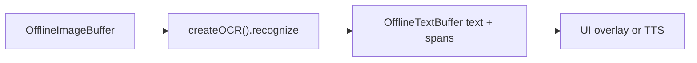
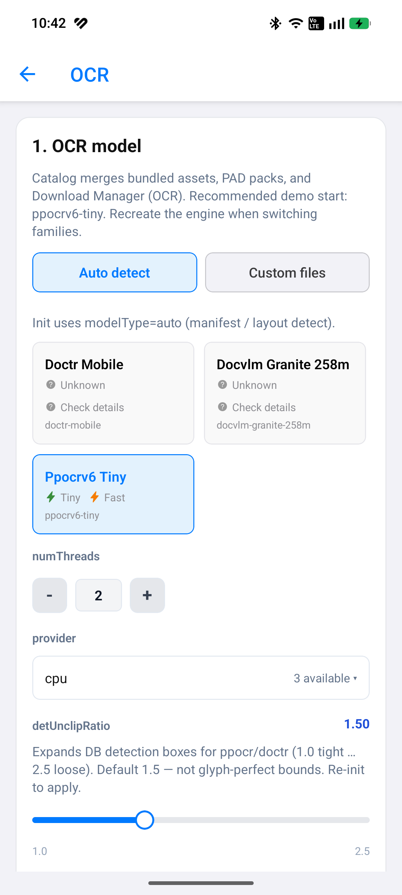
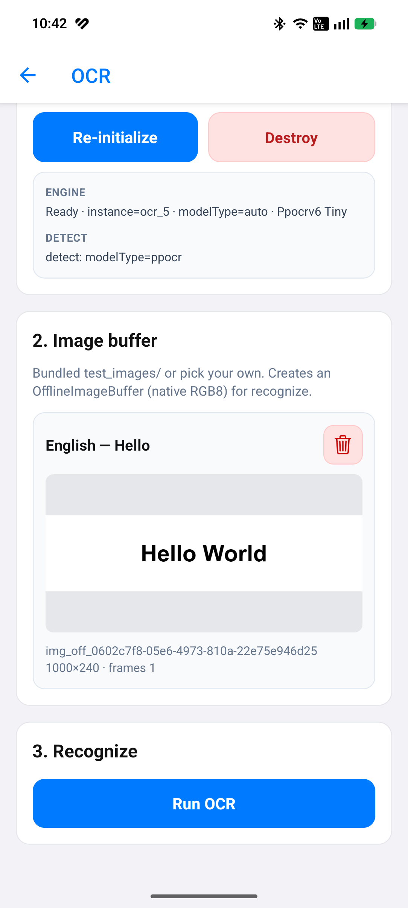
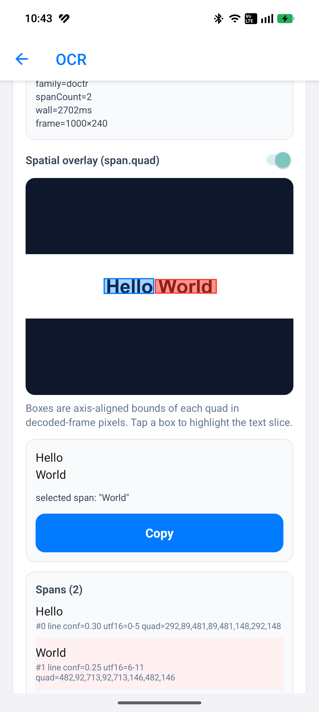

# Offline OCR (`ocr`)

## Introduction

**Offline OCR** runs on decoded image frames held in an [`OfflineImageBuffer`](imagebuffer-offline.md) and writes plain text plus optional [`TextSpatialSpan`](textbuffer-offline.md) metadata into an empty [`OfflineTextBuffer`](textbuffer-offline.md).

Import path: **`react-native-sherpa-onnx/ocr`**.

Families: **`ppocr`** (PP-OCR Det/Rec/optional Cls), **`doctr`** (OnnxTR Det/Rec/manifest), and **`doc_vlm`** (Granite Docling: vision encoder + embed + merged decoder + tokenizer + manifest). `modelType: 'auto' | 'ppocr' | 'doctr' | 'doc_vlm'`. For `doc_vlm`, `markdown` may include GFM tables reconstructed from OTSL cells; raw DocTags stay on `doctags`. `complete` is `true` only after a generated `</doctag>`; hitting `maxNewTokens` or an illegal prefix is not a finished document (`stopReason` says why). Recognize does not invent plaintext by stripping tags.

---

## Quick start

`image` is a **populated** offline image buffer; `textOut` is **empty** before the call (populate-once). Raw string ids that are not offline image/text buffers are rejected with **`OCR_*`** / buffer error codes.

### Single image → text + spatial spans

```ts
import {
  createOCR,
  detectOcrModel,
} from 'react-native-sherpa-onnx/ocr';
import {
  createOfflineImageBufferFromFiles,
  releaseOfflineImageBuffer,
} from 'react-native-sherpa-onnx/imagebuffer';
import {
  createEmptyOfflineTextBuffer,
  getOfflineTextBufferTextSlice,
  getOfflineTextBufferSpatialSpansSlice,
  getPipelineTextBufferInfo,
  releasePipelineTextBuffer,
  type OfflineTextBufferInfo,
} from 'react-native-sherpa-onnx/textbuffer';

// Same pack directory for detect and init (FileSource).
// Optional: await ensureModel(ModelCategory.Ocr, 'ppocrv6-tiny') then use model.modelDir.
const modelDir = { kind: 'fs' as const, path: '/absolute/path/to/ppocrv6-tiny' };

// Step 1: pre-flight detect (native ValidateOcrPaths; check result.success)
const det = await detectOcrModel(modelDir, { modelType: 'auto' });
if (!det.success) {
  throw new Error(det.error ?? 'OCR detection failed');
}

// Step 2: create engine (swap createOCR args per family — table below)
const ocr = await createOCR({
  modelSource: modelDir,
  modelType: 'auto',
  provider: 'cpu',
  numThreads: 2,
});

// Step 3: allocate buffers (populated image in, empty text out)
const image = await createOfflineImageBufferFromFiles([
  { kind: 'fs', path: '/tmp/page.png' },
]);
const textOut = await createEmptyOfflineTextBuffer();

try {
  // Step 4: recognize (line spans; text is always filled)
  const page = await ocr.recognize(image, textOut, { granularity: 'line' });

  // Step 5: read text + optional spatial spans
  const info = (await getPipelineTextBufferInfo(
    textOut
  )) as OfflineTextBufferInfo;
  const text = await getOfflineTextBufferTextSlice(textOut, 0, info.utf16Length);
  const spans = info.hasSpatialSpans
    ? await getOfflineTextBufferSpatialSpansSlice(
        textOut,
        0,
        info.spatialSpanCount
      )
    : [];
  console.log(text, spans.length, page.spanCount);
  // if (page.family === 'doc_vlm') {
  //   console.log(page.complete, page.stopReason, page.doctags, page.markdown);
  // }
} finally {
  // Step 6: release buffers + engine
  await releaseOfflineImageBuffer(image);
  await releasePipelineTextBuffer(textOut);
  await ocr.destroy();
}
```

| Family | `createOCR(...)` |
| --- | --- |
| `ppocr` | `createOCR({ modelSource: modelDir, modelType: 'auto', provider: 'cpu', numThreads: 2 })` |
| `doctr` | `createOCR({ modelSource: modelDir, modelType: 'auto', doctr: { detBoxThresh: 0.15, detBoxScoreThresh: 0.15 } })` |
| `doc_vlm` | `createOCR({ modelSource: modelDir, modelType: 'doc_vlm', docVlm: { maxNewTokens: 512 } })` |

### Multi-frame + progress + cancel

```ts
const pages = await createOfflineImageBufferFromFiles([
  { kind: 'fs', path: '/tmp/page1.jpg' },
  { kind: 'fs', path: '/tmp/page2.jpg' },
  { kind: 'fs', path: '/tmp/page3.jpg' },
]);
const textOut = await createEmptyOfflineTextBuffer();
const ac = new AbortController();

try {
  const page = await ocr.recognize(pages, textOut, {
    frames: [0, 2], // subset of frame indices; default = all
    onProgress: ({ done, total, phase }) => console.log(phase, done, '/', total),
    signal: ac.signal, // abort between frames → OCR_CANCELLED
  });
  console.log(page.family, page.spanCount);
} finally {
  await releaseOfflineImageBuffer(pages);
  await releasePipelineTextBuffer(textOut);
}
```

---

## Buffer matrix

| Role | Type | Notes |
| --- | --- | --- |
| **Image in** | [`OfflineImageBuffer`](imagebuffer-offline.md) | Populated frames (`img_off_*`); decode once, reuse across recognizes |
| **Text out** | [`OfflineTextBuffer`](textbuffer-offline.md) | Empty before the call; filled once with plain text + spatial spans |
| **Engine** | `OcrEngine` via `createOCR` | `recognize` resolves `OcrRecognizeResult` (extras are not on the text buffer); `destroy`; readonly `instanceId` |

---

## Models

| `modelType` | Required files | Optional |
| --- | --- | --- |
| `ppocr` | `det`, `rec`, `rec_dict` | `cls` |
| `doctr` | `det`, `rec`, `manifest` | — |
| `doc_vlm` | `vision_encoder`, `vision_encoder_data`, `embed_tokens`, `embed_tokens_data`, `decoder`, `decoder_data`, `tokenizer`, `manifest` | — |
| `auto` | Resolves family from pack layout (manifest `family`, then layout heuristics) | — |

Published `doc_vlm` packs (self-contained; pack id is the technique, not a Hub `_quantized` filename):

| ID | Weights | Notes |
| --- | --- | --- |
| `docvlm-granite-258m-fp32` | ~1.26 GiB | Canonical. Float KV. |
| `docvlm-granite-258m-q8` | ~320 MB | Hub `_quantized` triple. Float KV. |
| `docvlm-granite-258m-fp16` | ~632 MB | Float16 KV. |
| `docvlm-granite-258m-q4f16` | ~265 MB | Float16 KV + MatMulNBits. |

Each archive includes vision, embed, decoder, tokenizer, and manifest. `ppocrv6-tiny` stays the phone default.

Validate category: **`ocr`**. Detection: [model-detect.md](model-detect.md) · languages: [model-languages.md](model-languages.md) · downloads: [download-manager.md](download-manager.md) (`ModelCategory.Ocr`).

```ts
import { createOCR } from 'react-native-sherpa-onnx/ocr';

const ocr = await createOCR({
  modelSource: { kind: 'fs', path: '/data/models/ppocrv6-tiny' },
  modelType: 'auto',
});
```

---

## API reference

Signatures from **`react-native-sherpa-onnx/ocr`**.

### `detectOcrModel(source, options?)`

File-based detection without initializing the engine. Unified detection: [model-detect.md](model-detect.md).

```ts
function detectOcrModel(
  source: FileSource,
  options?: { modelType?: OcrModelType; quantization?: QuantizationPreference }
): Promise<OcrDetectModelResult>;
```

```ts
const det = await detectOcrModel(
  { kind: 'fs', path: '/data/models/ppocrv6-tiny' },
  { modelType: 'auto' }
);
if (!det.success) throw new Error(det.error ?? 'OCR detection failed');
```

### `createOCR(options)`

```ts
function createOCR(options: OcrInitializeOptions): Promise<OcrEngine>;
```

```ts
const ocr = await createOCR({
  modelSource: { kind: 'fs', path: '/models/ppocrv6-tiny' },
  modelType: 'auto',
  quantization: 'auto',
  provider: 'cpu',
  numThreads: 2,
});
```

Family option bags (`ppocr` / `doctr` / `docVlm`) are constrained by `modelType` on `OcrInitializeOptions`.

`ppocr.detUnclipRatio` / `doctr.detUnclipRatio` (default `1.5`) control DB box expansion after detection — lower values tighten spatial quads around glyphs.

### `engine.recognize(imageBuffer, textOut, options?)`

Reads a populated image buffer; writes text (+ spatial spans) into an empty text buffer. Resolves `OcrRecognizeResult` (discriminated on `family`).

```ts
recognize(
  imageBuffer: OfflineImageBufferIdSource,
  textOut: OfflineTextBufferIdSource,
  options?: OcrRecognizeOptions
): Promise<OcrRecognizeResult>;
```

```ts
const page = await ocr.recognize(image, textOut, {
  granularity: 'line',
  frames: [0],
  onProgress: (p) => console.log(p.done, p.total),
  signal: ac.signal,
});
```

### `engine.destroy()`

```ts
await ocr.destroy();
```

### `engine.instanceId`

```ts
console.log(ocr.instanceId);
```

---

## Pipeline composition

### Typical upstream

| Source / feature | Buffer or handle | Notes |
| --- | --- | --- |
| App image files / URIs | `OfflineImageBuffer` (`img_off_*`) | `createOfflineImageBufferFromFiles` — PNG/JPEG; WebP when libwebp is opted in; HEIC via platform decoder |
| Reused page buffer | `OfflineImageBuffer` | Decode once; run OCR on `frames` subsets |

### Typical downstream

| Destination / feature | Buffer or handle | Notes |
| --- | --- | --- |
| Plain transcript | `OfflineTextBuffer` (`txt_off_*`) | `getOfflineTextBufferTextSlice` |
| Box overlay / layout UI | Spatial spans on same text buffer | `getOfflineTextBufferSpatialSpansSlice` (`origin: 'ocr'`). Ready-made: [`OfflineImageBufferAnnotatedView`](imagebuffer-offline.md#offlineimagebufferannotatedview); own UI: [`mapTextSpatialSpansToFrame`](imagebuffer-offline.md#maptextspatialspanstoframespans-options) |
| Offline TTS | `OfflineTextBuffer` | Read aloud recognized text |
| Offline punctuation | `OfflineTextBuffer` | Optional cleanup before TTS |



More end-to-end patterns: [feature-pipelines.md#ocr-offline-patterns](feature-pipelines.md#ocr-offline-patterns).

---

## JS Events

| Callback | Payload | Fires when | Notes |
| --- | --- | --- | --- |
| `onProgress` | `{ done, total, phase }` | Per frame during `recognize` | Native event `SherpaOnnxOcrProgress` filtered by `operationId` |

```ts
const page = await ocr.recognize(image, textOut, {
  onProgress: (p) => console.log(p.phase, p.done, p.total),
});
```

---

## Types

### Core OCR types (`react-native-sherpa-onnx/ocr`)

| Type | Description |
| --- | --- |
| `OcrModelType` | `'auto' \| 'ppocr' \| 'doctr' \| 'doc_vlm'` |
| `OcrConcreteModelType` | Exclude `auto` |
| `OcrFamily` | Concrete backend family after load |
| `OcrGranularity` | `'line' \| 'word' \| 'block'` |
| `OcrInitializeOptions` | Discriminated on `modelType` for option bags; shared `provider?`, `numThreads?` |
| `OcrPpocrOptions` / `OcrDoctrOptions` / `OcrDocVlmOptions` | Family init bags |
| `OcrRecognizeOptions` | `frames?`, `granularity?`, `onProgress?`, `signal?` |
| `OcrRecognizeResult` | Discriminated on `family` (`doctags`/`markdown`/`complete`/`stopReason` only for `doc_vlm`) |
| `OcrDocVlmStopReason` | `'doctag_end' \| 'eos' \| 'max_new_tokens' \| 'invalid_sequence'` |
| `OcrProgress` | `{ done, total, phase }` |
| `OcrDetectModelResult` | `detectOcrModel` return |
| `OcrEngine` | `recognize` / `destroy` / `instanceId` |
| `OcrErrorCode` | Error code constants |

### Related buffer types

| Type | Description |
| --- | --- |
| `OfflineImageBufferIdSource` | Image ref or handle passed to `recognize` |
| `OfflineTextBufferIdSource` | Empty text out ref or handle |
| `TextSpatialSpan` | Span with `origin: 'ocr'`, boxes, frame index |

See [imagebuffer-offline.md](imagebuffer-offline.md) and [textbuffer-offline.md](textbuffer-offline.md).

---

## Error codes

| Error code | Explanation |
| --- | --- |
| `OCR_DETECT_FAILED` | `detectOcrModel` failed (native validation / layout). |
| `OCR_MODEL_NOT_FOUND` | Pack / ONNX paths missing at init. |
| `OCR_NOT_INITIALIZED` | Native engine not ready. |
| `OCR_INSTANCE_NOT_FOUND` | `instanceId` missing or already **destroyed**. |
| `OCR_INVALID_ARGUMENT` | Bad options (e.g. invalid frame index, or a non-integer / negative `docVlm.maxNewTokens`). |
| `OCR_IMAGE_BUFFER_NOT_FOUND` | Image buffer id missing from registry. |
| `OCR_IMAGE_BUFFER_EMPTY` | Image buffer has no frames. |
| `OCR_FRAME_READ_FAILED` | Could not read a requested frame. |
| `OCR_RECOGNIZE_FAILED` | Native recognize / backend failure. |
| `OCR_ALREADY_POPULATED` | `textOut` was already populated; output must be **empty**. |
| `OCR_CANCELLED` | `AbortSignal` aborted between frames. |
| `OCR_BUSY` | Concurrent recognize on the same instance. |
| `OCR_INTERNAL_ERROR` | Unexpected native failure. Also a recognize payload missing `family` or a finite `spanCount`; for `doc_vlm`, missing `doctags` / `markdown` / `complete` / `stopReason`; and a `createOCR` failure when the decoder Session cannot load `GroupQueryAttention`. |
| `FILEIO_*` | File / URI resolution for **`FileSource`** before or during model init. |

---

## Use case examples

<details>
<summary>Download pack, detect, then OCR a page (ppocr)</summary>

```ts
import { ModelCategory, ensureModel } from 'react-native-sherpa-onnx/download';
import {
  createOCR,
  detectOcrModel,
} from 'react-native-sherpa-onnx/ocr';

const model = await ensureModel(ModelCategory.Ocr, 'ppocrv6-tiny');
const source = { kind: 'fs' as const, path: model.modelDir };
const det = await detectOcrModel(source);
if (!det.success) {
  throw new Error(det.error ?? 'bad OCR pack');
}
const ocr = await createOCR({ modelSource: source, modelType: 'ppocr' });
// … recognize as in Quick start …
await ocr.destroy();
```

</details>

<details>
<summary>Download pack, detect, then OCR a page (doctr)</summary>

```ts
import { ModelCategory, ensureModel } from 'react-native-sherpa-onnx/download';
import {
  createOCR,
  detectOcrModel,
} from 'react-native-sherpa-onnx/ocr';

const model = await ensureModel(ModelCategory.Ocr, 'doctr-mobile');
const source = { kind: 'fs' as const, path: model.modelDir };
const det = await detectOcrModel(source);
if (!det.success) {
  throw new Error(det.error ?? 'bad DocTR pack');
}
const ocr = await createOCR({ modelSource: source, modelType: 'doctr' });
// … recognize as in Quick start …
await ocr.destroy();
```

</details>

<details>
<summary>Download pack, detect, then read DocTags (doc_vlm)</summary>

```ts
import { ModelCategory, ensureModel } from 'react-native-sherpa-onnx/download';
import {
  createOCR,
  detectOcrModel,
} from 'react-native-sherpa-onnx/ocr';

const model = await ensureModel(ModelCategory.Ocr, 'docvlm-granite-258m-fp32');
const source = { kind: 'fs' as const, path: model.modelDir };
const det = await detectOcrModel(source);
if (!det.success) {
  throw new Error(det.error ?? 'bad doc_vlm pack');
}
const ocr = await createOCR({
  modelSource: source,
  modelType: 'doc_vlm',
  docVlm: { maxNewTokens: 512 },
});
const page = await ocr.recognize(image, textOut, { granularity: 'line' });
if (page.family === 'doc_vlm') {
  console.log(page.complete, page.stopReason, page.doctags, page.markdown);
}
await ocr.destroy();
```

</details>

<details>
<summary>Multi-page buffer, OCR selected frames only</summary>

```ts
const pages = await createOfflineImageBufferFromFiles([
  { kind: 'fs', path: '/tmp/p1.png' },
  { kind: 'fs', path: '/tmp/p2.png' },
]);
const textOut = await createEmptyOfflineTextBuffer();
const page = await ocr.recognize(pages, textOut, {
  frames: [1],
  granularity: 'line',
});
console.log(page.spanCount);
```

</details>

<details>
<summary>Read spatial spans for a box overlay</summary>

```tsx
import { OfflineImageBufferAnnotatedView } from 'react-native-sherpa-onnx/imagebuffer';

<OfflineImageBufferAnnotatedView
  buffer={image}
  text={textOut}
  frameIndex={0}
  onSpanPress={(e) => console.log(e.index, e.utf16Start, e.quad)}
/>
```

Or map yourself (`ocr` quads are already frame pixels; `textLayer` needs `mapTextSpatialSpansToFrame`):

```ts
const info = (await getPipelineTextBufferInfo(textOut)) as OfflineTextBufferInfo;
if (info.hasSpatialSpans) {
  const spans = await getOfflineTextBufferSpatialSpansSlice(
    textOut,
    0,
    info.spatialSpanCount
  );
  for (const s of spans) {
    console.log(s.origin, s.frameIndex, s.quad);
  }
}
```

</details>

<details>
<summary>Scan-only PDF (no text layer) → rasterize → recognize</summary>

```ts
import { createEmptyOfflineTextBuffer } from 'react-native-sherpa-onnx/textbuffer';
import { releaseOfflineImageBuffer } from 'react-native-sherpa-onnx/imagebuffer';
import {
  extractPdfTextLayer,
  PdfErrorCode,
  rasterizePdfPages,
} from 'react-native-sherpa-onnx/pdf';

const pdf = { kind: 'fs' as const, path: '/tmp/scan.pdf' };

// 1) Prefer digital text when present (app-owned switch; no SDK auto).
const probeOut = await createEmptyOfflineTextBuffer();
try {
  await extractPdfTextLayer(pdf, probeOut);
  // Digital PDF: text + spans already in probeOut — skip OCR.
} catch (err) {
  const msg = err instanceof Error ? err.message : String(err);
  if (!msg.includes(PdfErrorCode.NO_TEXT_LAYER)) throw err;

  // 2) No glyph layer → page bitmaps into OfflineImageBuffer.
  const pages = await rasterizePdfPages(pdf, {
    pages: 'all',
    dpi: 144,
    maxSide: 2048,
  });

  // 3) Same OCR path as a normal image buffer.
  const textOut = await createEmptyOfflineTextBuffer();
  const page = await ocr.recognize(pages, textOut, { granularity: 'line' });
  console.log(page.spanCount);

  await releaseOfflineImageBuffer(pages);
}
```

Requires opt-in PDFium — see [pdf-offline.md](pdf-offline.md).

</details>

---

## Example app


|  |  |  |
| --- | --- | --- |


The monorepo example exposes **Home → Vision → OCR** (`example/src/screens/ocr/OCRScreen.tsx`) as a developer showcase for this API. See [example/README.md](../example/README.md#ocr-offline).

---

## See also

- [PDF](pdf-offline.md) (text-layer extract + page raster → ImageBuffer; opt-in PDFium; OCR stays explicit)
- [ImageBuffer offline](imagebuffer-offline.md) (typical **source** of frames)
- [TextBuffer offline](textbuffer-offline.md) (text + spatial spans)
- [Feature pipelines](feature-pipelines.md#ocr-offline-patterns)
- [Model setup](model-setup.md)
- [Model detection](model-detect.md)
- [Model languages](model-languages.md) (`getPpocrLanguages`, `getDoctrLanguages`, `DOC_VLM_ISO6391_HINTS`, `iso6391HintsForOcrModelType('doc_vlm')`)
- [Download manager](download-manager.md) (`ModelCategory.Ocr`)
- [Execution providers](execution-providers.md)
- [Native diagnostics](native-diagnostics.md)

---

## Native crash diagnostics

If native code fails or the app crashes but the tombstone shows only a UI/GPU thread, inspect the SDK **last-activity ring buffer** (enabled by default when the native library loads). Full details: [native-diagnostics.md](./native-diagnostics.md) — Android log tag `SherpaNativeDiag`; iOS subsystem `com.sherpaonnx.diag`. Optional JS: `getNativeDiagnosticSnapshot` / `configureNativeDiagnostics` from `react-native-sherpa-onnx/diagnostics`.
