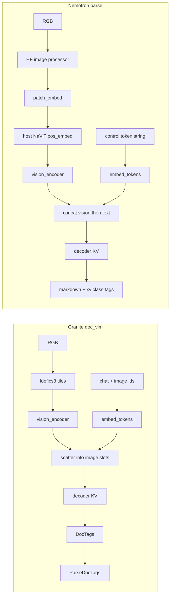

# Nemotron-3.5-Parse — SDK findings

> Branch: `feat/add-ocr-support-nemotron-parser`
> Status: research done; Q1–Q7 locked. Implementation plan: [`nemotron-parse-sdk-plan.md`](nemotron-parse-sdk-plan.md)
> Export scripts: [`scripts/ocr-models/nemotron-parse/`](../../scripts/ocr-models/nemotron-parse/)
> Granite reference: [`phase2-doc-vlm-backend-plan.md`](phase2-doc-vlm-backend-plan.md)

Nemotron-3.5-Parse is a second document VLM (C-RADIOv4-SO400M + 10-layer causal-prefix mBART), already exported to local ONNX. This note records whether the existing OCR backends can load it, and what a new family must own.

---

## Decision

**New `OcrBackend` and a new public family.** Do not reuse `DocVlmBackend`, and do not add `if (nemotron)` inside it. PP-OCR and DocTR are detection/recognition graphs; they do not apply.

Reuse the **pattern** only: `OcrBackend` + `CreateOcrBackend`, ORT session load / `ApplyOrtProvider`, greedy prefill/step + KV past, text-buffer spatial spans, detect token/quant picker for a **new** pack family.

Do not reuse `ParseDocTags`, `DocVlmDocTagsPrefix`, `DocVlmImageOps`, `DocVlmPrompt`, `DocVlmTokenizer`, or the granite `ocr_manifest.json` require list.

### Locked

| # | Topic | Decision |
|---|--------|----------|
| 1 | Family / `modelType` | **`nemotron_parse`**. Same token for detect `family`, `createOCR({ modelType })`, and `OcrRecognizeResult.family`. Pack ids: `nemotron-3.5-parse-<quant>` (never `docvlm-…`). Optional alias: `nemotron-parse` → `nemotron_parse`. Never alias bare `nemotron` (STT collision) or `doc_vlm` / `docling`. Export / HF-stage still write `"family": "doc_vlm"` today — change that before any pack ships. |
| 2 | Tokenizer | C++ reads **`tokenizer.json` only**. No `tokenizer_config.json` / SentencePiece / `vocab.json` on device. New family codec — do not reuse `DocVlmTokenizer`. |
| 3 | Image processor | Official **LongestMaxSizeHW 2048×1664** (shrink only) + top-left white pad `H%16` / `W%64` + `/255` + OpenAI CLIP mean/std + 16×16 unfold. New C++ ops — do not reuse `DocVlmImageOps`. `--max-side 1024` is desktop OmniDoc only, not the SDK default. Optional later: recognize-time `maxSide`. |
| 4 | SDK archive | **One quant per `.tar.bz2`**, flatten to pack root (like granite). Ids `nemotron-3.5-parse-fp16` / `nemotron-3.5-parse-int8`. Hub `onnx/fp16`+`onnx/int8` twins stay desktop-only; packer reads a variant folder. Detect keeps the generic token/quant picker; no `onnx/fp16` walker. |
| 5 | Decode | **Greedy + HF `repetition_penalty` 1.1** over prompt ∪ generated (CTRL sign rule, then argmax). Bake in C++. No public sampling knobs. Do not port NVIDIA `TableInsertion` / `RepetitionStop`. |
| 6 | `pos_embed` | Keep **`pos_embed.npy`**. C++ reads `<f4>`/`<f2>`, reject bad shape/Fortran. Expand f16→f32 once at `Load`. Compact pack stays f16 on disk. No pack-time `.bin`. |
| 7 | Result extras | New `nemotron_parse` arm: **`raw`** + native **`markdown`** + `complete` / `stopReason` (`eos` \| `max_new_tokens`). New C++ `raw_utf8`. Never write this stream into `doctags`. |

---

## Why `DocVlmBackend` cannot load this pack

Both families are “vision + embed + greedy decoder”, but almost every contract differs.

| Contract | Granite `doc_vlm` | Nemotron-3.5-Parse |
|---|---|---|
| Vision graph | One `vision_encoder.onnx` on Idefics3 NCHW tiles | `patch_embed.onnx` then host NaViT `pos_embed.npy` then `vision_encoder` on `[1, rows, cols, 1152]` |
| Image tokens | Scatter features into `<image>` slots in the prompt | No image token ids. Vision embeddings **concatenated in front of** text embeds |
| Prompt | Chat roles + tile placeholders + `Convert this page to docling.` | `</s><s><predict_bbox><predict_classes><output_markdown><predict_text_in_pic>` |
| KV geometry | Hard-checked: 3 KV heads, dim 64, max 8192 | 10 layers, 8 KV heads, head dim 64, vocab 72512 |
| Tokenizer | GPT-2 byte BPE (`DocVlmTokenizer` over `tokenizer.json`) | mBART / `AutoProcessor` (BOS 0, PAD 1, EOS 2) |
| Output | DocTags / OTSL | Native markdown + `<x_*>` `<y_*>` `<class_*>` (+ LaTeX tables) |
| Stop | `</doctag>` + prefix stack | EOS `2` (+ desktop repetition penalty 1.1) |
| Pack files | Granite octet (vision/embed/decoder + `_data`, `tokenizer.json`, `ocr_manifest.json`) | Octet **plus** `patch_embed.onnx` (+ `_data`), `pos_embed.npy`, preprocessor JSON |

`DocVlmBackend::Load` rejects packs whose KV heads / head dim / max positions are not the granite spike. A Nemotron folder that happens to contain `vision_encoder.onnx` would fail there even if detect mis-labeled it `doc_vlm`.



---

## Pack layout (export vs detect)

Local variant dirs (`build/ocr-models/nemotron-3.5-parse/onnx-{fp16,int8,…}`) write the graphs in [`quantize_onnx.py`](../../scripts/ocr-models/nemotron-parse/quantize_onnx.py):

| File | Role |
|---|---|
| `patch_embed.onnx` (+ `_data`) | Linear `768 → 1152` |
| `pos_embed.npy` | RADIO 128×128 positional field (host interpolate) |
| `vision_encoder.onnx` (+ `_data`) | 27-layer ViT + neck |
| `embed_tokens.onnx` (+ `_data`) | scaled mBART embeddings |
| `decoder_model_merged.onnx` (+ `_data`) | 10-layer GQA + KV |
| `tokenizer.json` + tokenizer/processor/generation JSON | HF sidecars |
| `ocr_manifest.json` | written by `write_manifest` |

HF stage ([`prepare_hf_repo.py`](../../scripts/ocr-models/nemotron-parse/prepare_hf_repo.py)) is **two variants in one repo** (`onnx/fp16`, `onnx/int8`), not the SDK “one quant per archive” flatten used for granite.

### Manifest collision (must fix before any SDK pack)

`write_manifest` and the HF-stage root manifest today set:

```json
"family": "doc_vlm",
"id": "docvlm-nemotron-3.5-parse-<dtype>",
"arch": "nemotron_parse"
```

Detect reads `"family"` first ([`ReadManifestFamily`](../../android/src/main/cpp/jni/model_detect/ocr/sherpa-onnx-model-detect-ocr.cpp)). `doc_vlm` is a known kind, so a Nemotron folder would be classified as granite. `FillDocVlmPaths` then fills the granite octet (it will find `vision_encoder` / `embed_tokens` / `decoder` / `tokenizer.json`) and **ignores** `patch_embed` and `pos_embed.npy`. `DocVlmBackend` would then fail granite contract checks.

Validate (`kDocVlmReqs`) has no slots for patch embed or `pos_embed`.

**Before a public pack:** change `family` to `nemotron_parse` (or the chosen id), stop using the `docvlm-` pack-id prefix, and add detect + validate fields for `patch_embed` (+ data) and `pos_embed`.

---

## Host work the granite backend does not cover

### Image preprocess + NaViT

See **Image processor (Q3)** below. After that host preprocess: `patch_embed` → `add_navit_positions_*` → reshape `[1, rows, cols, 1152]` → `vision_encoder`. No Idefics3 tiles. `.npy` for `pos_embed` is Q6.

### Tokenizer

Locked in Q2: `tokenizer.json` only, new codec. Sidecars `tokenizer_config.json` / `special_tokens_map.json` / `chat_template.jinja` are HF-only.

### Decode extras

See **Repetition penalty (Q5)**. Granite stays pure argmax; Nemotron’s official generate is greedy **plus** HF `repetition_penalty` 1.1.

Stop is EOS id `2`. There is no `</doctag>` and no prefix stack. `invalid_sequence` from `DocTagsPrefix` must not run on this family.

---

## Output → text, markdown, spans

The model emits markup in-stream, for example:

```text
<x_0.0><y_0.0>Hello World<x_0.9961><y_0.9938><class_Text></s>
```

| Piece | Meaning |
|---|---|
| `<x_a><y_b>…<x_c><y_d>` | Axis-aligned box, **normalized 0–1** (not granite `loc_0…499`) |
| `<class_Text>` / heading / table / … | Layout class after the box |
| Body | Markdown when the prompt includes `<output_markdown>` (native, not reconstructed) |
| Tables | Model emits LaTeX `tabular`. Public `markdown` converts those to GFM pipe tables; `raw` keeps `tabular`. |

So:

- **Markdown** is GFM we produce from the VLM body (tags stripped, `tabular` → pipe tables), not granite `MarkdownFor`.
- **Plaintext** on `textOut` is that body flattened (no tags, no LaTeX, no pipes).
- **Spans** are one box per tagged run. Map `(x,y)` pairs × frame width/height → `OcrQuad`. Default level `line`; headings/tables can be `line` as well so `granularity: 'line'` keeps them (same lesson as granite titles/tables).
- **Do not** run `ParseDocTags` on this stream. `page_header` in granite DocTags is unrelated to Nemotron `<class_*>` names.

Public extras: see **Result extras (Q7)**. Do not put this stream in `doctags`.

---

## What to reuse from the SDK

| Piece | Reuse |
|---|---|
| `OcrBackend` / `OcrEngine::RecognizeMulti` / text-buffer populate | Yes |
| Factory + `OcrModelType` union | Yes — add a new id |
| ORT env, provider, external `*.onnx_data` next to the graph | Yes |
| Greedy loop shape (prefill embeds → step embed → take KV) | Yes as a copy, not a shared granite class |
| Detect `MatchesQuantization` / suffix groups | Yes, once family + extra path keys exist |
| `OfflineImageBufferAnnotatedView` | Yes — it draws whatever spans land on the buffer |
| Granite DocTags / Idefics3 / GPT-2 tokenizer | No |

---

## Tokenizer (Q2)

Local pack `build/ocr-models/nemotron-3.5-parse/onnx/tokenizer.json` (7.6 MB, HF `tokenizers` 1.0):

| Field | Value |
|-------|--------|
| `model.type` | **`BPE`** (not Unigram / SentencePiece) |
| `model.vocab` | 50 000 |
| `model.merges` | 49 721 pair arrays |
| `added_tokens` | 22 528 (ids `0`–`22` and `50000`–`72504`) |
| Specials | 34 (`<s>`=0, `<pad>`=1, `</s>`=2, `<unk>`=3, plus predict/output control tokens from 50000) |
| Bbox / class added | 1024 `<x_*>`, 1280 `<y_*>`, 15 `<class_*>` |
| `normalizer` | **NFKC** |
| `pre_tokenizer` | Sequence: drop `SPL1T-TH1S-Pl3A5E` → individual digits → isolated punct → isolated `\n` → **ByteLevel** (`add_prefix_space=false`, `use_regex=true`) |
| `decoder` | ByteLevel (`add_prefix_space=true`) |
| `post_processor` | Template `<s> A </s>` — unused if encode matches `infer_ort.py` (`add_special_tokens=False` on an already-wrapped prompt) |

`constants.py` `VOCAB_SIZE = 72512` is the logit row count; highest added id is 72504.

**On device: `tokenizer.json` alone is enough.** No `sentencepiece.model`, `vocab.json`, or `merges.txt`. `tokenizer_config.json` only duplicates `added_tokens_decoder` for Hugging Face; the C++ codec should not require it.

**Do not reuse `DocVlmTokenizer`.** It is granite-hardcoded: `model.type == BPE`, vocab exactly 100352, merges exactly 100000, added tokens only in `100256–100351`, no NFKC, no pretokenizer Sequence (GPT-2 ByteLevel only). Nemotron’s prompt encode is mostly added-token lookup (`</s><s><predict_bbox>…`), but decode of generated markdown + `<x_*>/<y_*>/<class_*>` needs the full BPE + ByteLevel + all 22k added tokens.

New family-owned codec (same *pattern* as granite: tiny JSON walker, no HF C++). Encode: longest-match added tokens, then NFKC + Sequence + BPE. Decode: id → token, ByteLevel unescape, keep specials (`skip_special_tokens=False`).

---

## Image processor (Q3)

Official JSON: pack `preprocessor_config.json` (`NemotronParseImageProcessor`). `processor_config.json` is only an AutoProcessor pointer — not needed on device.

| Field | Value | Used by `infer_ort.py` path? |
|-------|--------|------------------------------|
| `do_normalize` | true | yes |
| `image_mean` / `image_std` | OpenAI CLIP `[0.48145466, 0.4578275, 0.40821073]` / `[0.26862954, 0.26130258, 0.27577711]` | yes |
| `do_rescale` / `rescale_factor` | true / `1/255` | yes (via `ToTensor`) |
| `size` / `final_size` | **H 2048 × W 1664** (`longest_edge: [2048, 1664]`) | yes — **max canvas, not a square longest-edge** |
| `navit_packing` | true | yes |
| `navit_padding_mode` | `top_left_white` | yes |
| `navit_coordinate_frame` | `content_normalized` | yes (feeds Q6 pos interpolate) |
| `virtual_canvas_*` | 1664×2048 `aligned_center` | **no** — leftover JSON; code does not center-pad when packing |

Desktop `AutoProcessor.image_processor(image)` (no `content_hw`) does:

1. RGB.
2. **LongestMaxSizeHW** (shrink only, bilinear): if `H > 2048` scale H to 2048; then if `W > 1664` scale W to 1664. No upscale.
3. `content_sizes = [H, W]` **after this resize, before pad**.
4. **NaViT pad** bottom/right, white `255`: `H → ⌈H/16⌉·16`, `W → ⌈W/64⌉·64`. Not granite 512-tiles, not center-pad to 2048×1664.
5. `/255` then CLIP `(x − mean) / std`.
6. Unfold **16×16** patches → `[N, 768]` (`pixel_values`). `image_sizes` = padded `[H, W]`.

Max official canvas is already 16/64-aligned: **128 × 104 = 13 312 patches**. Vision neck then emits `[1, rows·(cols/4)+1, 1024]`.

**`--max-side 1024` is not the model.** Only `test_parity.py` / OmniDoc experiments shrink the *source* PIL so 2000×1500 pages fit 16 GB CPU. After that shrink the official processor still applies 2048×1664 (usually a no-op).

**Do not reuse `DocVlmImageOps`.** Granite: square longest-edge (incl. upscale), Idefics3 512 tiles, Lanczos, mean/std from granite manifest.

Recommend: new C++ ops matching the packing path above. Bake CLIP + 2048×1664 + 16/64 pad (JSON is custom-class, not a generic CLIP processor). Optional later: recognize-time `maxSide` like the desktop CLI — default stays official canvas, not 1024.

---

## SDK archive shape (Q4)

Two layouts already exist — they are different products.

| Surface | Layout | Why it exists |
|---------|--------|----------------|
| Local export / quant dirs (`onnx-fp16`, `onnx-int8`, …) | **One dtype per folder**, canonical names at the root (`patch_embed.onnx` + `_data`, …) | Closest to granite / ppocr / doctr packs |
| HF stage (`prepare_hf_repo.py`) | **Twins** in one repo: `onnx/fp16` + `onnx/int8`, root manifest with a `variants` map | Desktop Hub / ORT card (1.44 GB + 753 MB) |

First-party SDK release is the granite rule: **one `.tar.bz2` = one technique**, pack root, no nested `onnx/`, no Hub suffixes. Catalog / download / detect all assume that. A twins tree extracted as one “model dir” would hide graphs under `onnx/fp16` — detect would not walk that unless we add Hub-specific nesting (we should not).

GitHub asset cap 2 GiB. FP16 ~1.44 GB unpacked, INT8 ~753 MB — each archive fits; a combined twins archive would not be one id and would fight the picker.

Recommend:

- **SDK:** flatten like granite. Ids `nemotron-3.5-parse-fp16` / `nemotron-3.5-parse-int8` (and later quants only if we publish them). Root members: the four graphs + `_data`, `pos_embed.npy`, `tokenizer.json`, `ocr_manifest.json` (`family: nemotron_parse`), `LICENSE`. `preprocessor_config.json` optional (C++ bakes Q3). Other HF JSON / `navit_pos.py` stay Hub-only.
- **Hub:** may keep twins for desktop. Do not feed that tree to `createOCR`. Packer reads a **variant folder**, not the repo root.
- **Detect:** keep the generic token/quant picker for third-party mixed folders. No `onnx/fp16` walker.

Which variants to ship (card today: FP16 + INT8 compact; Q4F16 rejected) is a publish list, not this shape lock.

---

## Repetition penalty (Q5)

Official `generation_config.json`: `do_sample: false`, `num_beams: 1`, **`repetition_penalty: 1.1`**. [`infer_ort.py`](../../scripts/ocr-models/nemotron-parse/infer_ort.py) default is the same; OmniDoc / Hello goldens used it.

HF / ORT rule (CTRL): for each **unique** id in `prompt ∪ generated so far`, if logit `< 0` multiply by 1.1 else divide by 1.1; then **argmax**. First step uses prompt ids only (`</s><s><predict_bbox>…`). Penalty `1.0` is a no-op.

Granite (`DocVlmBackend`) is argmax with no penalty — its anti-garbage is `DocTagsPrefix`, which this family must not run.

NVIDIA also ships `hf_logits_processor.py` (`TableInsertionLogitsProcessor`, `RepetitionStopProcessor`). **That is not a hole in `infer_ort.py`.** They are unused serving extras:

| Path | Uses them? |
|------|------------|
| `generation_config.json` | no — only `repetition_penalty: 1.1`, greedy, 1 beam |
| `NemotronParseForConditionalGeneration.generate` (`GenerationMixin`) | no — no `logits_processor` override, not in `auto_map` |
| `NemotronParseProcessor` | no |
| `test_parity.py` HF `model.generate(...)` | no — same 1.1 / greedy / 1 beam as ORT |
| `infer_ort.py` | no — matches that generate |

Porting them would **diverge** from NVIDIA’s published generate and from our goldens, not complete it.

`TableInsertionLogitsProcessor` forces `\begin{tabular}` after **every** start `<x_><y_>` pair (class comes later, so it cannot gate on `<class_Table>`). As a default that would inject table markup into titles and paragraphs. `RepetitionStopProcessor` is a serving guard (ngram loop → force an `<x_*>` to close the object), closer to granite’s `DocTagsPrefix` than to the model card. Add a guard later only if device logs show a real loop — that is a decode safety patch, not a missing family contract.

Cost of 1.1 is a unique-id walk of a ≤8k sequence on a 72512-logit row — cheap vs the decoder. Skipping 1.1 would miss desktop goldens and the HF config.

Recommend (this is the correct v1, not a stub): family default **greedy + 1.1** baked in C++ (no `generation_config.json` on device). No public `repetitionPenalty` / temperature / top-p (granite has none; only `maxNewTokens`). `1.0` stays an internal no-op if we ever need a debug switch. Do not port the two NVIDIA processors.

---

## `pos_embed.npy` (Q6)

Every local / Hub variant already ships NumPy v1.0, C-order, little-endian:

| Pack | dtype | file size | shape |
|------|--------|----------|--------|
| export, `onnx-fp16`, HF `onnx/fp16` | `<f4` | **72.0 MiB** | `(1, 16384, 1152)` = `1 × 128×128 × 1152` |
| `onnx-int8` / e5 compact / HF `onnx/int8` | `<f2` | **36.0 MiB** | same |

`navit_pos.py` always interpolates in **float32**. The payload offset in our files is **128** (16-byte aligned, good for NEON; not 4 KiB-page aligned — irrelevant next to a 36–72 MiB read).

**npy vs raw bin is not a runtime fork.** Flash I/O of the table + one 72 MiB f32 working set + per-page bilinear/`grid_sample` dominate. Header parse is microseconds, once at `Load`.

| Choice | Disk (INT8 pack) | RAM after Load | Per page | Robustness |
|--------|------------------|----------------|----------|------------|
| Keep `.npy`, accept `<f2>`/`<f4>`, expand f16→f32 **once** | **36 MiB** | 72 MiB f32 | interpolate only | Self-describing; reject wrong shape/endian/Fortran; Hub drop-in |
| Pack-time raw **f16** `.bin` | 36 MiB | 72 MiB f32 | same | Silent if dtype/shape drift; second filename; Hub still ships `.npy` → dual loader |
| Pack-time raw **f32** `.bin` | **72 MiB** | 72 MiB | mmap, no expand | Worse download/flash on the mobile pack; e1 already proved f16-on-disk is enough |

A raw f32 bin in the compact pack would **hurt** edge devices (double `pos_embed` download) for a one-shot convert we can do in a few ms. A raw f16 bin is the same I/O/RAM as npy, less safe.

What actually matters on phone (independent of container):

1. Compact pack keeps **f16 on disk** (already e5).
2. **One** f32 copy for interpolate — do not expand every page.
3. Interpolate in C++ (the real cost). Format does not change that math.

Recommend (performance + robustness + edge): **keep `pos_embed.npy`**. Small C++ walker (magic `\x93NUMPY`, v1/v2, `<f4`/`<f2` only, `fortran_order` false, shape 16384×1152 after squeeze). Expand f16→f32 once at `Load`. No cnpy, no pack-time rewrite, no second filename.

---

## Result extras (Q7)

Today `OcrRecognizeResult` is a discriminant on `family`:

| `family` | Extra fields |
|----------|----------------|
| `ppocr` / `doctr` | `spanCount` only (text/spans on `textOut`) |
| `doc_vlm` | `doctags`, `markdown` (lossy from DocTags), `complete` (`</doctag>`), `stopReason`: `doctag_end` \| `eos` \| `max_new_tokens` \| `invalid_sequence` |

Nemotron’s stream is **not DocTags**. Stuffing it into `doctags` would lie to every consumer (example “DocTags” tab, VoiceLab parsers, `ParseDocTags`). Unpublished SDK is not an excuse to alias.

**Locked:** a **new arm**, new C++ `raw_utf8` (do not reuse `doctags_utf8`):

```ts
{
  family: 'nemotron_parse';
  spanCount: number;
  raw: string;       // generated markup: <x_*> <y_*> body <class_*>; strip trailing </s>
  markdown: string;  // native model markdown (prompt flag); strip coord/class tags + </s>
  complete: boolean; // stopReason === 'eos'
  stopReason: 'eos' | 'max_new_tokens';
}
```

| Field | Meaning |
|-------|---------|
| `raw` | `infer_ort` decode, `skip_special_tokens=False`, EOS stripped. Overlay/debug/copy. |
| `markdown` | GFM we produce: tags stripped, LaTeX `tabular` → pipe tables. |
| `textOut` | Flattened plaintext (no tags, no LaTeX, no pipes) + `line` spans from boxes. |
| `complete` | Natural stop (EOS id 2). `false` on token cap. No `doctag_end` / `invalid_sequence`. |

TS / Kotlin extras checks must branch on family: granite still requires `doctags`; Nemotron requires `raw` and must **not** accept `doctags`. Example tabs: `Spans \| Markdown \| Raw`.

Span `class` metadata is out of scope (current `OcrSpan` has no class). Classes stay in `raw`.

---

## Open questions

None. Q1–Q7 are locked.

---

## Non-goals (this note)

- Implementing the backend, detect, catalog, or example wiring.
- Publishing HF / GitHub release packs.
- Sharing a “generic VLM backend” base class. Extract that only after a second family is shipping and the loops have actually converged.
