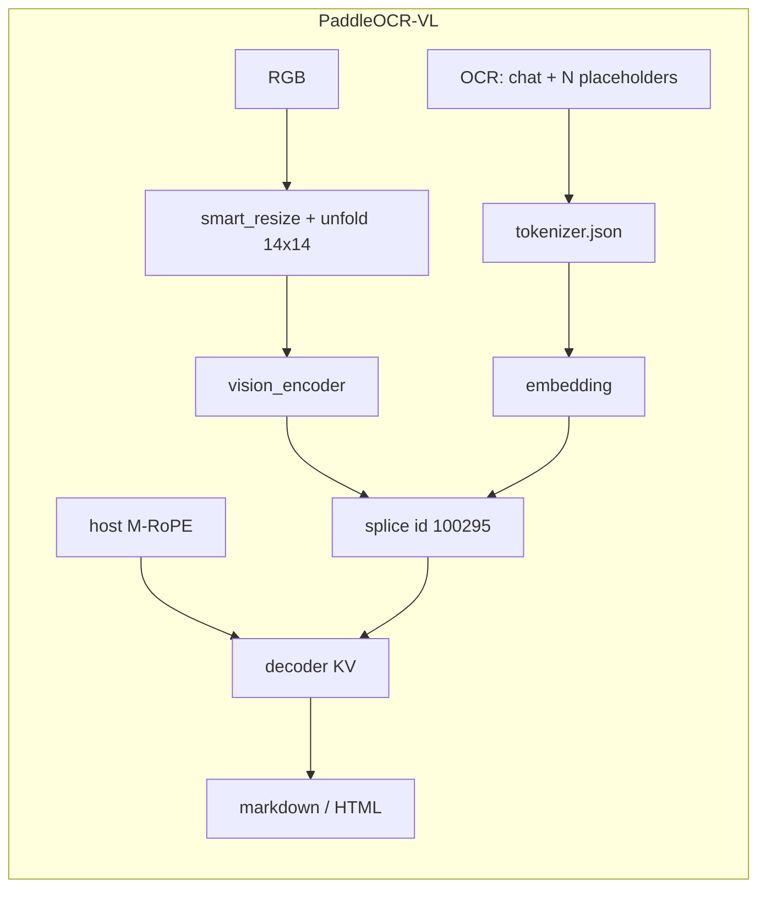

# PaddleOCR-VL-1.6 — SDK findings

> Status: research done; Q1–Q7 locked. Implementation plan: [`paddleocr-vl-sdk-plan.md`](paddleocr-vl-sdk-plan.md)
> Export scripts: [`scripts/ocr-models/paddleocr-vl/`](../../scripts/ocr-models/paddleocr-vl/)
> Official weights: [`PaddlePaddle/PaddleOCR-VL-1.6`](https://huggingface.co/PaddlePaddle/PaddleOCR-VL-1.6)
> Granite pattern (do not copy classes): [`phase2-doc-vlm-backend-plan.md`](phase2-doc-vlm-backend-plan.md)
> Nemotron pattern (do not copy classes): [`nemotron-parse-sdk-findings.md`](nemotron-parse-sdk-findings.md)

PaddleOCR-VL-1.6 is a third document VLM (NaViT-style dynamic-resolution vision encoder + ERNIE-4.5-0.3B). Architecture is compatible with 1.5; 1.6 is a data/post-train upgrade, not a new graph layout. Local ONNX export (three graphs, dynamo opset 21) is already in this repo and was still running when this note was written.

This note records whether the existing OCR backends can load it, and what a new family must own.

---

## Decision

**New `OcrBackend` and a new public family — one backend class per family.** Do not reuse `DocVlmBackend` or `NemotronParseBackend`, and do not add `if (paddleocr_vl)` inside either. PP-OCR / DocTR are detection/recognition graphs; they do not apply. Official **PP-DocLayoutV3** (two-stage crop-then-VLM) is out of this family — the export is VLM-only.

**Avoid duplicating code and logic when it is actually the same**, by extracting **helpers** (ORT session-from-path + external `*.onnx_data`, `ApplyOrtProvider`, empty-KV alloc, last-row argmax). Do **not** extract a shared “VLM backend” base that subclasses override with family `if`s. Tokenizer, image ops, RoPE, prompt, markup, and graph I/O stay in the family tree.

Do not copy `ParseDocTags`, `DocVlmImageOps`, `NemotronParseImageOps`, `NemotronParseNavit`, `DocVlmTokenizer`, or `NemotronParseTokenizer` into this family.

### Unpublished SDK — public API may break

This SDK has **not been published**. There is no installed-base contract. If a change makes the public API cleaner (shared VLM extras, one `maxNewTokens`, drop `@deprecated` aliases, rename confusing keys), **do it**. Do not keep a worse shape for “backward compatibility,” and do not add a third copy of an already-awkward union.

Native C++ **backends stay one class per family** (Q1). Shared C++ is helpers, not a mega-backend. The unpublished-API freedom is the **JS / Kotlin / Swift surface** and shared types (`OcrRecognizeResult`, init options, custom-config keys, detect aliases). Example app follows the new API; VoiceLab is still out of this plan.

### Locked

| # | Topic | Decision |
|---|--------|----------|
| 1 | Family / `modelType` | **`paddleocr_vl`**. Same token for detect `family`, `createOCR({ modelType })`, and `OcrRecognizeResult.family`. Pack ids: `paddleocr-vl-1.6-<quant>`. Optional alias: `paddleocr-vl` → `paddleocr_vl`. **Never** alias bare `paddleocr` / `ppocr` / `pp-ocr` (those already mean PP-OCR Det/Rec). Never `doc_vlm` / `nemotron_parse`. Export already writes `"family": "paddleocr_vl"`. |
| 2 | Tokenizer | C++ reads **`tokenizer.json` only**. New family codec. HF class is `LlamaTokenizer`; JSON is **BPE** with SentencePiece `▁` + **byte_fallback**, not GPT-2 ByteLevel and not Nemotron mBART. |
| 3 | Image processor | Official **smart_resize** (`factor=28`, `min_pixels=112896`, `max_pixels=1003520`) + bicubic + `/255` + mean/std **0.5** + 14×14 unfold + `temporal_patch_size=1`. New C++ ops. No recognize-time `maxPixels` in v1. |
| 4 | SDK archive | **One quant per `.tar.bz2`**, flatten to pack root. Canonical names: `vision_encoder.onnx`, **`embedding.onnx`** (not `embed_tokens.onnx`), **`decoder.onnx`** (not `decoder_model_merged.onnx`), plus `*_data`, `tokenizer.json`, `ocr_manifest.json`. Hub twins stay desktop. |
| 5 | Decode | **Greedy argmax**. No repetition penalty (unlike Nemotron). Stop EOS id **`2`** (`</s>`). Host computes **3D M-RoPE** `position_ids` `[3, B, S]` (port `rope_index.py`). Image tokens **splice** at id `100295`. |
| 6 | Vision positions | **Inside `vision_encoder.onnx`** (`Resize` of the 27×27 field). No `pos_embed.npy`, no host NaViT interpolate. Dynamo export is required so that resize stays dynamic. |
| 7 | Result extras | New `paddleocr_vl` arm: **`raw`** + **`markdown`** + `complete` / `stopReason` (`eos` \| `max_new_tokens`). Never `doctags`. v1 prompt is **`OCR:`** (page parse). **Spans stay empty** in v1 (`Spotting:` / `<LOC_*>` later). |

Prompt (hardcoded, no Jinja). One `<|IMAGE_PLACEHOLDER|>` is expanded to **N** copies *before* encode, `N = t·h·w / 4`:

```text
<|begin_of_sentence|>User: <|IMAGE_START|><|IMAGE_PLACEHOLDER|>×N<|IMAGE_END|>OCR:
Assistant:
```

`max_new_tokens`: `0` → 8192, then clamp to remaining context. Reuse the shared createOCR field `maxNewTokens` (same as granite / Nemotron). Do **not** nest a third options object.

---

## Why existing backends cannot load this pack

All three VLMs are “vision + embed + greedy decoder”, but the contracts differ.

| Contract | Granite `doc_vlm` | Nemotron-3.5-Parse | PaddleOCR-VL-1.6 |
|---|---|---|---|
| Graphs | `vision_encoder` + `embed_tokens` + `decoder_model_merged` | those **plus** `patch_embed` + host `pos_embed.npy` | `vision_encoder` + **`embedding`** + **`decoder`** |
| Vision input | Idefics3 NCHW tiles | `[N, 768]` patches after host unfold | **`pixel_values` `[1, P, 3, 14, 14]`** + `image_grid_thw` `[1, 3]` |
| Image tokens | scatter into `<image>` slots | concat vision **in front of** text embeds | **splice** into `100295` slots (Qwen-VL style) |
| Positions | 1D RoPE inside decoder | 1D RoPE inside decoder | **Host 3D M-RoPE** `position_ids` `[3,B,S]`, sections `(16,24,24)`, θ `500000` |
| KV geometry | 3 KV heads, dim 64 | 10 layers, 8 KV heads, dim 64, vocab 72512 | **18 layers, 2 KV heads, dim 128, vocab 103424**, hidden 1024 |
| Tokenizer | GPT-2 byte BPE | mBART BPE + NFKC Sequence | Llama BPE + `▁` + byte_fallback |
| Prompt | `Convert this page to docling.` | control tokens `<predict_bbox>…` | chat + **`OCR:`** |
| Output | DocTags / OTSL | markdown + `<x_*>` `<y_*>` `<class_*>` | native markdown / HTML (OCR:). Spotting `<LOC_*>` not in v1 |
| Stop | `</doctag>` + prefix stack | EOS `2` + repetition 1.1 | EOS `2`, **no** penalty |

`DocVlmBackend::Load` / `NemotronParseBackend::Load` hard-check their own KV / vocab / file names. A PaddleOCR-VL folder that happens to contain `vision_encoder.onnx` would fail those checks even if detect mis-labeled it.



Do **not** use [`iaa2005/PaddleOCR-VL-1.6-ONNX`](https://huggingface.co/iaa2005/PaddleOCR-VL-1.6-ONNX). That int8-only pack collapses Cyrillic→Latin and loops on full pages (~1300 image tokens). This repo’s export keeps the embedding table in FP32 and only publishes a quantized vision/decoder pair when the long-page gate still passes.

---

## Pack layout (export vs detect)

Local variant dirs (`build/ocr-models/paddleocr-vl-1.6/onnx-{fp16,int8,…}`) from [`export_onnx.py`](../../scripts/ocr-models/paddleocr-vl/export_onnx.py) / [`quantize_onnx.py`](../../scripts/ocr-models/paddleocr-vl/quantize_onnx.py):

| File | Role |
|---|---|
| `vision_encoder.onnx` (+ `_data`) | NaViT tower + 2×2 projector |
| `embedding.onnx` (+ `_data`) | token table. Quantization **leaves this FP32** |
| `decoder.onnx` (+ `_data`) | 18-layer ERNIE-4.5 GQA + KV |
| `tokenizer.json` | BPE + added specials |
| `ocr_manifest.json` | `family: paddleocr_vl` (already correct) |
| preprocessor / chat JSON | HF sidecars; **not required on device** if C++ bakes Q3 + prompt |

### Manifest (already correct — unlike Nemotron Phase 0)

```json
"family": "paddleocr_vl",
"id": "paddleocr-vl-1.6-<dtype>",
"arch": "paddleocr_vl"
```

Detect today does **not** know `paddleocr_vl`. Until that lands, a complete pack is either unsupported or, worse, the folder name `paddleocr-vl-1.6-*` matches the existing **`paddleocr` → `ppocr`** heuristic (`InferOcrModelTypeFromKey`, `InferPpocrNameOnly`, `ParseOcrModelType`). That collision is Q1 work, not a family-string rewrite in export.

HF stage ([`prepare_hf_repo.py`](../../scripts/ocr-models/paddleocr-vl/prepare_hf_repo.py)) is twins under `onnx/fp16` / `onnx/int8` / `onnx/q4f16`. SDK flatten stays one quant per archive.

Graph I/O (C++ must match; quant keeps I/O float32):

| Graph | Input | Output |
|-------|--------|--------|
| `vision_encoder.onnx` | `pixel_values` `[1, P, 3, 14, 14]` f32, `image_grid_thw` `[1, 3]` i64 | `image_embeds` `[P/4, 1024]` f32 |
| `embedding.onnx` | `input_ids` `[1, S]` i64 | `embeddings` `[1, S, 1024]` f32 |
| `decoder.onnx` | `inputs_embeds` `[1, S, 1024]`, `attention_mask` `[1, past+S]` f32, `position_ids` `[3, 1, S]` i64, `past_key_values.{0..17}.{key,value}` `[1, 2, past, 128]` | `logits` `[1, S, 103424]`, `present.{0..17}.{key,value}` |

Empty past: `past = 0`. Prefill: splice image embeds into placeholder slots, run full `S`. Step: last-token embed only; append one to the mask; `decode_position_ids(past_len, rope_delta)`.

Hard-check at Load: 18 layers, 2 KV heads, head dim 128, vocab 103424, hidden 1024. Log and reject otherwise.

---

## Host work no current backend covers

### Image preprocess (Q3)

Official [`preprocessor_config.json`](https://huggingface.co/PaddlePaddle/PaddleOCR-VL-1.6/raw/main/preprocessor_config.json):

| Field | Value |
|-------|--------|
| `do_resize` / `resample` | true / **BICUBIC** (PIL 3) |
| `do_rescale` / `rescale_factor` | true / `1/255` |
| `do_normalize` / mean / std | true / **`[0.5, 0.5, 0.5]`** (not OpenAI CLIP) |
| `patch_size` / `merge_size` | 14 / 2 |
| `temporal_patch_size` | **1** (preprocessor JSON; ignore `vision_config` default 2) |
| `min_pixels` / `max_pixels` | **112896** / **1003520** |
| smart_resize `factor` | `patch_size * merge_size` = **28** |

`PaddleOCRVLImageProcessor._preprocess`:

1. RGB.
2. `smart_resize(H, W, factor=28, min_pixels, max_pixels)` — both sides divisible by 28, pixel count in range, aspect preserved. Tiny sides are lifted to `factor`. Aspect `> 200` is an error.
3. Bicubic resize to that `H_bar × W_bar`.
4. `/255`, then `(x − 0.5) / 0.5`.
5. Tile temporal dim to `temporal_patch_size` (1 → no-op), unfold to `[P, 3, 14, 14]` with `P = t·h·w`, `h = H/14`, `w = W/14`.
6. `image_grid_thw = [t, h, w]`. Merged image-token count `N = t·h·w / 4`.

Official max canvas ≈ **1280 image tokens** (`1003520 / 196 / 4`). That is the phone default — do not silently shrink to 1024 long-side like desktop OmniDoc experiments.

**Do not reuse `DocVlmImageOps` or `NemotronParseImageOps`.** Granite: square 2048 + Idefics3 tiles + CLIP + Lanczos. Nemotron: LongestMaxSizeHW 2048×1664 + CLIP + 16×16 unfold.

### Tokenizer (Q2)

Official `tokenizer.json` (HF snapshot, 2026-10-28):

| Field | Value |
|-------|--------|
| `model.type` | **BPE** |
| `model.vocab` | **100295** |
| `model.merges` | **182926** pair arrays |
| `byte_fallback` | **true** |
| `fuse_unk` | true |
| `unk_token` | `<unk>` (id **0**) |
| `normalizer` | Sequence: replace `" "` → `"▁"` |
| `pre_tokenizer` | **null** |
| `decoder` | Replace `▁` → space, **ByteFallback**, Fuse |
| `post_processor` | identity TemplateProcessing (`A` only) — encode with `add_special_tokens=false` |
| `added_tokens` | **1041** (ids `0–12` plus `100272–101315`) |

Specials the prompt needs:

| Token | Id |
|-------|----|
| `<unk>` / `<s>` / `</s>` | 0 / 1 / **2** (EOS) |
| `<|end_of_sentence|>` | 100272 |
| `<|begin_of_sentence|>` | **100273** |
| `<|IMAGE_PLACEHOLDER|>` | **100295** |
| `<|IMAGE_START|>` / `<|IMAGE_END|>` | **101305** / **101306** |

`OCR:` is **not** an added token — it goes through BPE.

**Do not reuse `DocVlmTokenizer`.** It hard-codes GPT-2 ByteLevel, vocab 100352, no `▁`, no byte_fallback. **Do not reuse `NemotronParseTokenizer`.** It hard-codes NFKC + Sequence pretok + ByteLevel and Nemotron added-token ranges.

New family codec: longest-match added tokens, then space→`▁`, BPE with byte_fallback, decode via `▁` + byte fallback + fuse. Keep specials on decode (`skip_special_tokens=false` for `raw`; strip leftover specials for `markdown` / `text`).

`tokenizer_config.json` / `chat_template.jinja` are HF-only.

### M-RoPE (Q5)

[`rope_index.py`](../../scripts/ocr-models/paddleocr-vl/rope_index.py) is host-side and **must** ship in C++. The decoder graph does **not** compute 3D indices.

Prefill: `rope_index_numpy(input_ids, image_grid_thw, attention_mask)` → `position_ids [3,B,S]` + scalar `rope_delta`.

Decode step: `decode_position_ids(past_len, rope_delta, seq=1)` — same t/h/w, offset by delta.

`vision_start_token_id` (101305) is unused in the numpy port (span scan on `100295` is enough). Keep the same.

`generation_config.json` is greedy, `eos_token_id: 2`, **no** `repetition_penalty`. [`infer_ort.py`](../../scripts/ocr-models/paddleocr-vl/infer_ort.py) is argmax. Do not copy Nemotron 1.1.

---

## Output → text, markdown, spans

v1 task prompt is **`OCR:`** (document parse). The model emits markdown and/or light HTML. [`test_parity.py`](../../scripts/ocr-models/paddleocr-vl/test_parity.py) `layout_text` strips `<[^>]+>` and markdown ticks — that is the plaintext recipe.

| Piece | v1 |
|---|---|
| `raw_utf8` | tokenizer decode of generated ids, keep specials, strip trailing `</s>` |
| `markdown_utf8` | that body with leftover `<|…|>` / BOS/EOS stripped; keep model markdown/HTML |
| `text_utf8` | `layout_text(markdown)` — tags and ticks removed, whitespace collapsed |
| spans | **empty** |

**Spotting** (`Spotting:` prompt, eight `<LOC_*>` coords, 4-point quads) is a second task in the 1.5/1.6 papers. It is **not** what `infer_ort.py` / the HF card default does. Do not invent boxes from the OCR: stream. A later recognize option can add spotting; `OcrSpan` already has quads.

Never run `ParseDocTags` or Nemotron xy/class markup on this family.

Public extras: see **Result extras (Q7)**.

---

## What to reuse from the SDK

| Piece | How |
|---|---|
| `OcrBackend` interface / factory / `RecognizeMulti` / text-buffer populate | Call into; new `PaddleocrVlBackend` |
| ORT env, provider, session-from-path + `*.onnx_data` | **Helper** if granite/Nemotron already do the same; do not copy-paste a third `CreateSession` block |
| Empty KV past + last-row argmax | **Helper** when signatures match; this family’s decoder still owns `position_ids` / splice |
| Shared `maxNewTokens` / VLM extras types | Yes — one public shape |
| Detect `MatchesQuantization` / suffix groups | Yes, **new** complete group (`embedding.onnx` + `decoder.onnx`) |
| `IsOcrVlmKind` | Yes — add this kind |
| `OfflineImageBufferAnnotatedView` | Yes — overlay is a no-op until spotting |
| Granite / Nemotron **backend**, image, tokenizer, NaViT, DocTags, markup | **No** — family-owned |
| Generic `VlmBackend` base with `if (family)` | **No** |

---

## Detect collisions (must fix in the same change as the family)

1. **`paddleocr` already means PP-OCR.** `ParseOcrModelType("paddleocr")`, `InferOcrModelTypeFromKey`, and `InferPpocrNameOnly` all treat the substring `paddleocr` as `ppocr`. Pack id `paddleocr-vl-1.6-fp16` contains that substring. Match **`paddleocr_vl` / `paddleocr-vl` / `paddleocr-vl-1.6` first**, then the ppocr heuristics. Never add a `paddleocr` alias for this family.
2. **Granite octet filenames differ.** `TryCompleteDocVlmGroup` looks for `embed_tokens*.onnx` + `decoder_model_merged*.onnx`. A PaddleOCR-VL folder will not complete that group. Add a **new** complete group: `vision_encoder`, `embedding`, `decoder` (+ `_data`) + `tokenizer.json` + `ocr_manifest.json`.
3. **`vision_encoder.onnx` is shared with granite.** Manifest `family` wins. If the manifest says `paddleocr_vl`, do not fill granite paths.
4. **Unified detect.** `decoder.onnx` / `embedding.onnx` are generic names. `IsOcrVlmKind` must include `kPaddleocrVl` so a successful OCR detect wins over STT / enhancement, same as granite + Nemotron.

Custom-config keys for this family: `vision_encoder`, `vision_encoder_data`, `embedding`, `embedding_data`, `decoder`, `decoder_data`, `tokenizer`, `manifest`. Do **not** reuse the granite `embed_tokens` key name (wrong file).

`OcrLoadOptions` can grow `path_embedding` / `path_embedding_data`, or detect can map `embedding.onnx` into `path_embed_tokens` internally. Prefer **explicit `embedding` keys** so custom init matches pack filenames.

---

## SDK archive shape (Q4)

Same granite rule as Nemotron:

| Surface | Layout |
|---------|--------|
| Local export / quant dirs | One dtype per folder, canonical names at root |
| HF stage | Twins under `onnx/<dtype>` — desktop Hub only |
| SDK `.tar.bz2` | One technique, flatten, no nested `onnx/` |

Ids: `paddleocr-vl-1.6-fp16` / `paddleocr-vl-1.6-int8` / `paddleocr-vl-1.6-q4f16` **only for variants the export parity suite still ships**. The backend must load any of those folders; which ones we publish is a later ask.

On-device pack members: the three graphs + `_data`, `tokenizer.json`, `ocr_manifest.json`, `LICENSE`. Bake image constants + prompt in C++. `preprocessor_config.json` / `chat_template.jinja` / `rope_index.py` stay Hub/desktop.

---

## Result extras (Q7)

Today `OcrRecognizeResult` discriminates on `family`. Prefer **one shared VLM extras shape** (`raw` + `markdown` + `complete` + `stopReason`) with family-only extras (`doctags` on granite) over a third near-identical arm. Unpublished: reshape the union if that is cleaner. Stream for this family:

```ts
{
  family: 'paddleocr_vl';
  spanCount: number; // 0 in v1
  raw: string;
  markdown: string;
  complete: boolean; // stopReason === 'eos'
  stopReason: 'eos' | 'max_new_tokens';
}
```

Do not put this stream in `doctags`. Kotlin / TS extras checks branch on family: granite still needs `doctags`; this family needs `raw` and must not treat missing `doctags` as failure.

Example tabs: `Spans | Markdown | Raw` (Spans empty until spotting).

---

## Open questions

None. Q1–Q7 are locked. Quant variant to **publish** first is not a backend contract — wait for the export gates; the C++ loader is dtype-agnostic (I/O stay f32).

---

## Non-goals (this note)

- Implementing the backend, detect, catalog, or example wiring (see the plan).
- Publishing HF / GitHub release packs.
- PP-DocLayoutV3 two-stage pipeline.
- `Spotting:` / chart / seal task prompts.
- Recognize-time `maxPixels` / `maxSide`.
- A generic `VlmBackend` base (helpers are fine; one class per family is not optional).
- Using the community `iaa2005` int8 graphs.
