# Reader (`react-native-sherpa-onnx/reader`)

## Introduction

Show a book (EPUB, FB2, MOBI / AZW3, PDF) or a comic in a native, virtualized reading view and build a reading app around it: positions that stay valid, your own React Native views inside the text, highlights, search, progress and read-aloud with sentence and word highlighting.

Import from `react-native-sherpa-onnx/reader`.

| 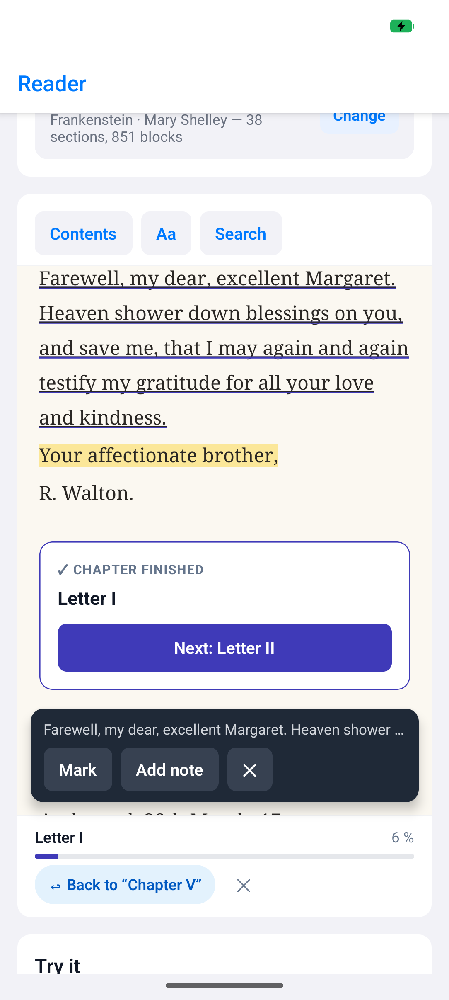 | 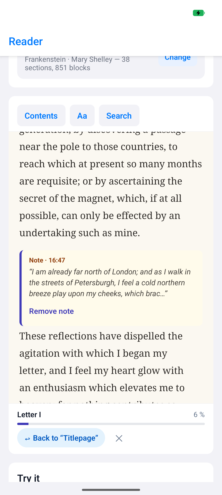 | 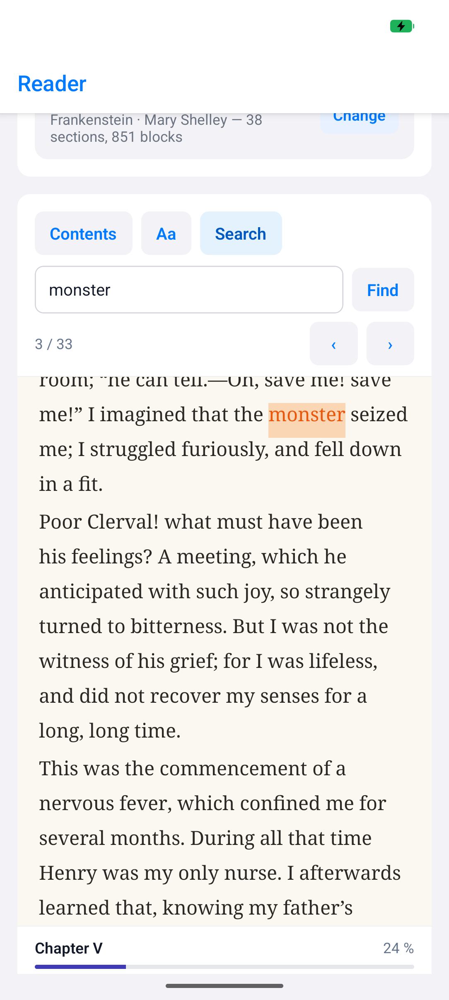 |
| --- | --- | --- |
| Highlights · chapter-end insert · progress | Note insert after a paragraph | Search with all hits marked |

The screenshots are from the [example app](../example/README.md#reader) (`ReaderScreen`). Cards, notes, toolbar, panels and selection bar are app UI built with the public API; the SDK draws the text, page images and highlights.

What the SDK gives you:

- **`ReaderDocument`**: a book as sections and blocks (paragraphs, headings, images, separators, pages) with **stable IDs**. The same file gives the same IDs on every device, so stored positions, notes and analytics match.
- **`ReaderView`**: a native list (`UITableView` on iOS, `RecyclerView` on Android) that reads the book text from native memory. Book text does not cross the JS bridge unless you ask for it.
- **Inserts**: any React Native view placed between blocks, for example chapter-end cards, notes, quizzes or ads. They scroll with the text and stay interactive.
- **App sections**: text that is not in the file (a preface, a reading guide, generated content), inserted between the book's sections.
- **Reading events**: visible range, furthest position, section end, jumps and taps, computed by one shared C++ tracker on both platforms.
- **Highlights and follow scrolling**: any number of marked ranges in three styles; one of them can be kept in view.
- **Read aloud**: maps a TTS timeline onto the reader for sentence and word highlights.

Requirements:

- **New Architecture (Fabric) only.** `ReaderView` is a Fabric component.
- **EPUB and MOBI need lexbor:** `sherpaOnnxEnableLexbor=true` (Android `gradle.properties`) and `SHERPA_ONNX_ENABLE_LEXBOR=1` (iOS), the same as `extractDocumentText` ([document-offline.md](document-offline.md)). **PDF needs PDFium** ([pdf-offline.md](pdf-offline.md)).
- Scroll mode. Scanned pages and comics are shown as page images; their text comes from an OCR engine ([Text for scans and comics](#text-for-scans-and-comics)).

## Quick start

### Open a book and show it

```tsx
import { useEffect, useRef, useState } from 'react';
import {
  loadReaderDocument,
  releaseReaderDocument,
  ReaderView,
  type ReaderDocument,
  type ReaderViewHandle,
} from 'react-native-sherpa-onnx/reader';

function Book({ source }: { source: FileSource }) {
  const [doc, setDoc] = useState<ReaderDocument | null>(null);
  const reader = useRef<ReaderViewHandle>(null);

  useEffect(() => {
    let current: ReaderDocument | null = null;
    loadReaderDocument(source).then((d) => setDoc((current = d)));
    return () => {
      if (current) releaseReaderDocument(current);
    };
  }, [source]);

  return (
    <ReaderView
      ref={reader}
      document={doc}
      theme={{ lineHeight: 1.6, colors: { background: '#FBF8F1', text: '#2A2724' } }}
      onVisibleRangeChange={(r) => r.settled && savePosition(r.first, r.firstOffset)}
      style={{ flex: 1 }}
    />
  );
}
```

### Highlights and an insert

```tsx
<ReaderView
  document={doc}
  highlights={[
    { id: 'note-1', from: { sectionId: 's7', blockId: 's7.b3' }, to: { sectionId: 's7', blockId: 's7.b3' } },
  ]}
  inserts={[{ key: 'end-s7', at: { sectionEnd: 's7' } }]}
  renderInsert={(key) => <ChapterEndCard id={key} />}
/>
```

### Read aloud

```ts
const result = await tts.synthesize(textIn, audioOut, { segmentation: { mode: 'auto' }, timeline: true });
const timeline = await createReadAloudTimeline(doc, { text: textIn, tts: result.timeline! });
const highlights = useReadAloudHighlights(timeline, positionMs); // positionMs from PcmPlayer onPosition
```

Details: [Read aloud](#read-aloud).

## Concepts

### From file to view

```
EPUB ──extractDocumentText──▶ text buffer + structure ─┐
     ──extractDocumentImages(scope: 'all')──▶ images ──┼─▶ ReaderDocument ──▶ <ReaderView>
     ──computeDocumentKey──▶ documentKey ─────────────┘   (stable IDs, app sections)
```

`loadReaderDocument(source)` runs all three steps. Use `createReaderDocument` when you already extracted the text, for example to synthesize it as well.

PDFs and comics are page-based:

```
PDF ──extractPdfTextLayer(layout: 'paragraphs')──▶ text buffer + structure ─┐
    ──rasterizePdfPages(strategy: 'lazy-lru')──▶ page images ───────────────┼─▶ ReaderDocument
CBZ ──extractDocumentImages(strategy: 'lazy-lru')──▶ page images ──▶ createReaderDocument({ pages })
```

Each page is a section (`kind: 'page'`) whose first block, `s{n}.b0`, is the page image (`type: 'page'`); the page's text blocks follow. `pageDisplay` on the view chooses what is shown: the text, the page images, or both ([Pages](#pages)).

### Stable IDs and locators

| Field | Example | Purpose |
|---|---|---|
| `documentKey` | SHA-256 of the file (hex) | Same file → same document on every device |
| `structureVersion` | `1` | Version of the [structure rules](#structure-rules); IDs only change when it changes |
| `textHashVersion` | `1` | Version of the [textHash](#texthash) normalization |
| `revision` | `1`, `2`, … | Increases with every `insertSection` / `removeSection` |
| `blockId` | `s11.b42` | Section 11, block 42 (both 0-based); short, readable, ordered |
| `textHash` | `9f2c41d07a3be511` | Finds a stored block again if `structureVersion` changes |

A **locator** is `{ sectionId, blockId, offset? }`. `offset` is a UTF-16 offset inside the block. Store positions with `documentKey`, `structureVersion` and the block's `textHash`; then a position survives a later structure version (see [remapLocator](#remaplocatordoc-stored-hint)).

### App sections and inserts

| | App section | Insert |
|---|---|---|
| What | Text blocks that are not in the file | A React Native view |
| Rendered by | The reader, like book text | React Native (your component) |
| Positions, highlights, events | Yes, like file blocks | Reported in `visibleInserts` only |
| IDs | `app:<id>`, blocks `app:<id>.<key>` | Your `key` |
| Typical use | Preface, reading guide, generated chapter | Chapter-end card, note, quiz, banner |

## API reference

### Documents

#### `loadReaderDocument(source, options?)`

```ts
function loadReaderDocument(
  source: FileSource,
  options?: { imagesMaxSide?: number; pdfDpi?: number; password?: string }
): Promise<ReaderDocument>;
```

```ts
const doc = await loadReaderDocument({ kind: 'fs', path: '/books/frankenstein.epub' });
```

Opens a book in one call, by the file's content. EPUB, FB2 and MOBI / AZW3: text, images (`scope: 'all'`) and `documentKey`. PDF: reading text from the text layer and every page as a lazily rendered image (`pdfDpi`, default 144; `password` for encrypted files). CBZ / CBR: a page document over lazily decoded pages. `imagesMaxSide` caps images and pages (default 2048). The document owns the image buffer; release it with `releaseReaderDocument`.

#### `createReaderDocument(options)`

```ts
function createReaderDocument(
  options:
    | { text: OfflineTextBufferIdSource; images?: string | { bufferId: string } | null; documentKey: string }
    | { pages: string | { bufferId: string }; documentKey: string }
): Promise<ReaderDocument>;
```

```ts
await extractDocumentText(source, textBuffer);
const doc = await createReaderDocument({ text: textBuffer, documentKey: await computeDocumentKey(source) });
```

Builds a document from a text buffer with a reading structure (`extractDocumentText`, or `extractPdfTextLayer(…, { layout: 'paragraphs' })` with the PDF's page buffer as `images`), or with `pages` from an image buffer: one page section per frame (`format: 'pages'`). Use it when the app keeps the buffers, for example to read the text aloud. The document keeps the text alive; your image buffers stay yours and must outlive the document.

#### `attachReaderPageText(doc, { text })`

```ts
function attachReaderPageText(
  doc: ReaderDocument,
  options: { text: OfflineTextBufferIdSource }
): Promise<ReaderDocument>;
```

```ts
await ocr.recognize(pagesBuffer, ocrText, { frames: [4] });
doc = await attachReaderPageText(doc, { text: ocrText });
```

Attaches OCR text to the pages it was recognized from. `text` is a buffer filled by an OCR engine's `recognize` on the document's own image buffer. Each recognized page gets text blocks after its page block, and text recognized earlier for that page is replaced. Resolves the new document value (higher `revision`). See [Text for scans and comics](#text-for-scans-and-comics).

#### `recognizeReaderPages(doc, ocr, options?)`

```ts
function recognizeReaderPages(
  doc: ReaderDocument,
  ocr: OcrEngine,
  options?: RecognizeReaderPagesOptions
): Promise<ReaderDocument>;
```

```ts
doc = await recognizeReaderPages(doc, ocr, { scope: 'around', at: position, onDocument: setDoc });
```

Recognizes page images one page per `recognize` call and attaches each page's text as it is done. `scope: 'around'` (default) does the page at `at`, `ahead` pages after it (default 2) and `behind` pages before it (default 1). `'all'` does the whole book from the first page, and `{ sections }` does the pages you name. Pages that already have text are skipped unless `force` is set. `onDocument` receives new document values at most every `updateIntervalMs` (default 300) and once at the end. `recognize` passes options such as `readingDirection: 'rtl'` (manga) or a VLM `instruction` to every call. `onProgress` reports `{ done, total, sectionId, hasText }` after each page; `hasText: false` means the model returned no text for the page, which keeps showing only its image. With `signal`, the run stops after the page in progress, and recognized pages keep their text. Run one at a time per document.

#### `saveReaderRecognition(doc, destination, options?)` / `loadReaderRecognition(doc, source, options?)`

```ts
function saveReaderRecognition(
  doc: ReaderDocument,
  destination: FileDestination,
  options?: { modelId?: string; overwrite?: boolean; createParentDirectories?: boolean }
): Promise<{ pages: number; outputPath: string }>;

function loadReaderRecognition(
  doc: ReaderDocument,
  source: FileSource,
  options?: { modelId?: string }
): Promise<ReaderDocument>;
```

```ts
await saveReaderRecognition(doc, { kind: 'app', base: 'documents', path: 'book.ocr' }, { modelId, createParentDirectories: true });
doc = await loadReaderRecognition(doc, { kind: 'app', base: 'documents', path: 'book.ocr' });
```

Saves the document's recognized pages to a sidecar file, and loads them back in a later session without running OCR again. The file holds each page's text blocks with their type, place, line boxes and text. Encoding, writing, reading and attaching happen natively, so no text crosses the bridge. Loading rejects a file of another book (`documentKey`), of another model (when you pass `modelId` on save and load and they differ), and one with pages this document does not have (`ERR_READER_SIDECAR_MISMATCH`). It also rejects a corrupt file (`ERR_READER_SIDECAR_INVALID`).

#### `computeDocumentKey(source)`

```ts
function computeDocumentKey(source: FileSource): Promise<string>;
```

```ts
const key = await computeDocumentKey(source); // 64 hex characters
```

SHA-256 of the file, computed natively. Use it as the key for stored positions, notes and highlights.

#### `insertSection(doc, section)`

```ts
function insertSection(doc: ReaderDocument, section: ReaderAppSection): Promise<ReaderDocument>;
```

```ts
const next = await insertSection(doc, { after: 's2', id: 'app:guide', title: 'Reading guide', blocks: [{ key: 'p1', type: 'paragraph', text: '…' }] });
```

Adds text that is not in the file after an existing section. Returns a new document value with a higher `revision`; pass it to the view, which keeps the reading position.

#### `removeSection(doc, sectionId)`

```ts
function removeSection(doc: ReaderDocument, sectionId: string): Promise<ReaderDocument>;
```

```ts
const next = await removeSection(doc, 'app:guide');
```

Removes an app section and returns a new document value.

#### `releaseReaderDocument(doc)`

```ts
function releaseReaderDocument(doc: ReaderDocument): Promise<void>;
```

```ts
await releaseReaderDocument(doc);
```

Frees the native document (and the image buffer `loadReaderDocument` created). Call it when the book is closed.

### Blocks and positions

#### `getReaderBlocks(doc, start?, count?, options?)`

```ts
function getReaderBlocks(
  doc: ReaderDocument,
  start?: number,
  count?: number,
  options?: { includeText?: boolean }
): Promise<ReaderBlock[]>;
```

```ts
const blocks = await getReaderBlocks(doc, 0, doc.blockCount, { includeText: true });
```

Blocks in reading order with ID, type, `textHash`, `textRange` and optionally the text. Use it for search, quotes, word counts or your own table of contents. Large ranges are paged natively in chunks of 4096.

#### `mapTextRanges(doc, ranges, options?)`

```ts
function mapTextRanges(
  doc: ReaderDocument,
  ranges: ReadonlyArray<readonly [number, number]>,
  options?: { slice?: ReaderTextSlice | null }
): Promise<Array<ReaderRange | null>>;
```

```ts
const [range] = await mapTextRanges(doc, [[17456, 17520]]);
```

Turns UTF-16 ranges of the document's text buffer into reader ranges, in one native call. Use it when another pipeline (TTS, alignment, your own analysis) produced offsets in the text buffer. With `slice`, the ranges are in that slice's buffer instead. A start in the gap between two blocks moves to the next block, an end moves back; `null` when a range covers no text block.

#### `createReaderTextSlice(doc, options)`

```ts
function createReaderTextSlice(
  doc: ReaderDocument,
  options: { from: ReaderLocator; to?: ReaderLocator | null; maxLength?: number }
): Promise<ReaderTextSlice>;
```

```ts
const slice = await createReaderTextSlice(doc, { from: position, maxLength: 4000 });
```

Puts the text the reader shows from `from` on into a new offline text buffer, to read it aloud. It takes paragraphs and headings from the file, OCR text and app sections, leaves out running headers, footers and page numbers, and joins the blocks with a blank line. It ends after the block of `to`, or before the first block that would make it longer than `maxLength` UTF-16 units. Pass the slice to `createReadAloudTimeline` and `mapTextRanges`, and release `slice.buffer` when done.

#### `locatorAtTextOffset(doc, offset)`

```ts
function locatorAtTextOffset(doc: ReaderDocument, offset: number): Promise<ReaderLocator | null>;
```

```ts
const at = await locatorAtTextOffset(doc, 17456);
```

Locator of one text-buffer offset; short form of `mapTextRanges`.

#### `remapLocator(doc, stored, hint?)`

```ts
function remapLocator(
  doc: ReaderDocument,
  stored: { textHash: string; offset?: number },
  hint?: ReaderLocator | null
): Promise<ReaderLocator | null>;
```

```ts
const at = await remapLocator(doc, { textHash: saved.textHash, offset: saved.offset }, saved.locator);
```

Finds a stored position again when `structureVersion` changed since it was saved: the block with the same `textHash` nearest to `hint`. `null` if the text no longer exists.

#### `compareLocators(a, b)`

```ts
function compareLocators(a: ReaderLocator, b: ReaderLocator): number | null;
```

```ts
const ahead = (compareLocators(position, furthest) ?? 0) > 0;
```

Orders two file locators (negative: `a` first). Returns `null` when one of them is in an app section; use the block order from `getReaderBlocks` there.

#### `formatBlockId(sectionIndex, blockIndex)` / `parseBlockId(blockId)`

```ts
function formatBlockId(sectionIndex: number, blockIndex: number): string;
function parseBlockId(blockId: string): { sectionId: string; key: string; sectionIndex?: number; blockIndex?: number } | null;
```

```ts
formatBlockId(11, 42); // 's11.b42'
parseBlockId('app:guide.p1'); // { sectionId: 'app:guide', key: 'p1' }
```

Helpers for block IDs, for example to group stored notes by section.

### ReaderView

#### `<ReaderView>`

```tsx
<ReaderView ref={reader} document={doc} theme={theme} highlights={highlights} inserts={inserts} renderInsert={render} />
```

The native reading view. All props:

| Prop | Type | Default | Description |
|---|---|---|---|
| `document` | `ReaderDocument \| null` | required | Value from `loadReaderDocument` / `createReaderDocument` / `insertSection`. A new `revision` keeps the reading position. |
| `initialLocator` | `ReaderLocator \| null` | start | Applied once, on the first layout of a document; `onReady` fires afterwards. |
| `furthestLocator` | `ReaderLocator \| null` | start | Starting frontier for `onFurthestPositionChange`. Set it to accept a jump as read. |
| `theme` | `ReaderTheme` | see [Theme](#theme) | Font, size, spacing, margins, alignment, colors. |
| `inserts` | `ReaderInsert[]` | `[]` | React Native views in the reading flow; see [Inserts](#inserts). |
| `renderInsert` | `(key: string) => ReactNode` | — | Renders the insert with that key. |
| `highlights` | `ReaderHighlight[]` | `[]` | Marked ranges; see [Highlights](#highlights). |
| `follow` | `ReaderFollowOptions` | `{ mode: 'keepVisible' }` | Keeps the highlight with `follow: true` in view; see [Follow scrolling](#follow-scrolling). |
| `jumpThreshold` | `number` | `20` | Blocks; a larger move is reported as `onJump`. |
| `pageDisplay` | `'auto' \| 'text' \| 'image' \| 'imageAndText'` | `'auto'` | How pages of PDFs, comics and scans are shown; see [Pages](#pages). |
| `mode` | `'scroll'` | `'scroll'` | Layout mode. |
| `style`, `testID` | | | As for `View`. |
| `onReady`, `onVisibleRangeChange`, `onFurthestPositionChange`, `onSectionEnd`, `onJump`, `onTap`, `onFollowChange`, `onError` | | | See [JS Events](#js-events). |

#### `reader.scrollTo(locator, options?)`

```ts
scrollTo(locator: ReaderLocator, options?: { animated?: boolean }): void;
```

```ts
reader.current?.scrollTo({ sectionId: 's8', blockId: 's8.b0' }, { animated: true });
```

Puts the block, and the line holding `offset`, at the top of the reading area. Use it for a table of contents, search results and "back" buttons. If `blockId` is unknown, `sectionId` is used. A stored `{ blockId, offset }` from a settled `onVisibleRangeChange` lands on the same line.

#### `reader.resumeFollow()`

```ts
resumeFollow(): void;
```

```ts
reader.current?.resumeFollow();
```

Resumes follow scrolling after the user scrolled away, and places the followed highlight at the anchor. Use it for a "back to the reading position" button while reading aloud.

### Read aloud

#### `createReadAloudTimeline(doc, options)`

```ts
function createReadAloudTimeline(
  doc: ReaderDocument,
  options: CreateReadAloudTimelineOptions
): Promise<ReadAloudTimeline>;
```

```ts
const timeline = await createReadAloudTimeline(doc, { slice, tts: result.timeline! });
```

Turns the timeline of one synthesis (`tts.synthesize(…, { timeline: true })`) into sentences and words with reader ranges and playback times. The synthesized text is a `slice` from `createReaderTextSlice` (its buffer is `text`), or `text` with `textOffset` for a part of the document's text buffer. Options: `granularity` (`'sentence'`, `'word'`, `'both'`), `words.timing` for exact word times, `words.split` for your own word splitter.

#### `timeline.at(ms)`

```ts
at(ms: number): { sentence: ReadAloudUnit | null; word: ReadAloudUnit | null };
```

```ts
const { sentence, word } = timeline.at(positionMs);
```

The sentence and word being spoken at a playback position, for your own logic (captions, analytics, a "repeat sentence" button).

#### `useReadAloudHighlights(timeline, positionMs, options?)`

```ts
function useReadAloudHighlights(
  timeline: ReadAloudTimeline | null,
  positionMs: number | null,
  options?: ReadAloudHighlightOptions
): ReaderHighlight[];
```

```ts
const spoken = useReadAloudHighlights(timeline, positionMs, { show: 'both', wordStyle: { style: 'underline' } });
```

React hook that returns the highlights for the units being spoken. The array only changes when the sentence or word changes, so the view updates at word rate, not at the rate of the position callback.

#### `splitWords(sentence)`

```ts
function splitWords(sentence: string): Array<[number, number]>;
```

```ts
splitWords('“Hello,” she said.'); // [[1, 6], [9, 12], [13, 17]]
```

The default word splitter: whitespace-separated words without surrounding punctuation. Wrap or replace it for `words.split`.

## Theme

`theme` (`ReaderTheme`) styles the book text. All fields are optional.

| Field | Default | Meaning |
|---|---|---|
| `fontFamily` | system serif | Font family, resolved as for `<Text>` (custom fonts work the same way). |
| `fontSize` | `18` | Base size in pt / dp. |
| `fontScale` | `'system'` | `'system'` follows Dynamic Type / the Android font scale; a number multiplies `fontSize`. |
| `maxFontScale` | `0` (no limit) | Upper limit for `'system'`. |
| `lineHeight` | `1.5` | Line-height multiplier. |
| `paragraphSpacing` | `0.75` | Space between blocks, in em. |
| `margins` | `{ horizontal: 20, vertical: 24 }` | Text inset inside the view. |
| `textAlign` | `'start'` | `'start'` or `'justify'`. |
| `hyphenation` | `true` | Uses the book's `language`. |
| `colors` | system text color, transparent background, system blue accent | `{ background, text, accent }`; `accent` is the default highlight color. |

When the theme changes, the first visible line stays in place. The same holds for a width change (rotation) and a new `revision`.

## JS Events

| Callback | Payload | Fires when |
|---|---|---|
| `onReady` | `{ blockCount, sectionCount }` | The first layout of a document is done and `initialLocator` is applied. |
| `onVisibleRangeChange` | `ReaderVisibleRange` | The first or last visible block changes, and once more with `settled: true` when scrolling stops. `firstOffset` (settled only) is the UTF-16 offset of the first visible line. |
| `onFurthestPositionChange` | `ReaderLocator` | The frontier advanced while reading continuously. |
| `onSectionEnd` | `{ sectionId, blockId }` | The last block of a section came into view while reading continuously. Fires once per transition into view. |
| `onJump` | `ReaderJump` | The position moved more than `jumpThreshold` blocks. The app decides whether the jump counts as read. |
| `onTap` | `{ blockId }` | A tap on text (not on inserts), for example to select a paragraph or toggle toolbars. |
| `onFollowChange` | `{ following, reason }` | Follow scrolling paused (`'user'`) or resumed (`'resumed'`, `'command'`). |
| `onError` | `{ code, message }` | For example `ERR_READER_NOT_FOUND` for a released document, or `ERR_READER_INVALID_ARGUMENT` for a highlight with unknown block IDs. |

Rules (shared C++ tracker, identical on iOS and Android):

- **Visible:** a block counts when at least 50 % of `min(blockHeight, viewportHeight)` is on screen. Inserts are listed in `visibleInserts`, not as blocks.
- **Furthest position:** advances only while the visible range touches the current frontier. A jump does not move it; set `furthestLocator` to accept one.
- **Jump causes** (`ReaderJump.cause`):
  - `'scroll'`: the visible range moved more than `jumpThreshold` blocks without continuous visibility, for example by dragging the scroll indicator.
  - `'fling'`: a fling landed more than `jumpThreshold` blocks away.
  - `'scrollTo'`: the command moved the view; always reported, whatever the distance.
  - `'follow'`: follow scrolling moved far, for example when read-aloud restarted elsewhere. Shorter follow moves count as continuous reading.

## Highlights

<p align="center">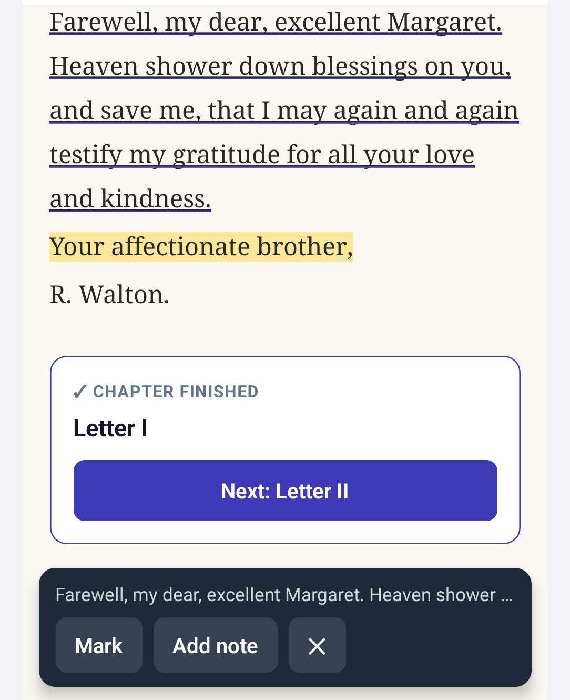</p>

`highlights` marks any number of ranges at the same time: search hits, the sentence being read, notes, the user's selection.

- **Styles:** `'background'` (default), `'underline'`, `'textColor'`. `color` defaults to the theme's `accent` (backgrounds at 30 % opacity). Use translucent colors for backgrounds so the text stays readable.
- **Ranges:** `from` is inclusive, `to` exclusive. Without `offset`, `from` is the start and `to` the end of the block, so `{ from: at, to: at }` marks one whole block. A range may span blocks; blocks in between are marked whole. Image and separator blocks are skipped.
- **On page images** (`pageDisplay: 'image'`), highlights of a page's text are drawn over the page: background as a translucent area, underline as a line under the text, text color as a frame. They are placed on the text's lines (PDF text layer, OCR line boxes). A part of a line, such as a word, is placed by its characters' share of the line, an estimate. Without line boxes the paragraph's area is marked, and without any position (`nemotron_parse`, `paddleocr_vl` Markdown) the whole page. Follow scrolling keeps the marked line in view.
- **Order:** highlights may overlap and are drawn in array order; a later `textColor` wins over an earlier one.
- **IDs:** keep `id` stable; the same `id` with a new range moves a highlight.
- **Cost:** a change redraws only the affected rows. The text layout does not change, so the reading position stays.
- Offsets are clamped to the block and never split a surrogate pair. A highlight with an unknown block ID is skipped and reported through `onError`.

## Follow scrolling

The first highlight with `follow: true` is kept in view while it moves, for example the word being read aloud.

| `follow` option | Default | Meaning |
|---|---|---|
| `mode` | `'keepVisible'` | `'keepVisible'`: scroll only when the highlight leaves the comfort zone (10 %–85 % of the height), then place it at `anchor`. `'center'`: keep it centered on every change. `'off'`: never scroll. |
| `anchor` | `0.3` | 0..1: where `keepVisible` places the highlight. |
| `pauseOnUserScroll` | `true` | A drag by the user pauses following (`onFollowChange({ following: false, reason: 'user' })`). It resumes when the highlight is back in the comfort zone, or with `resumeFollow()`. |

Follow scrolling counts as continuous reading: no `onJump` for short moves, and the furthest position and section ends advance.

## Inserts

An insert is a React Native view placed between blocks. It is full width, takes the height Yoga gives it, scrolls with the text and keeps presses, accessibility and state.

| `at` | Position |
|---|---|
| `{ sectionEnd: 's7' }` | After the last block of a section |
| `{ beforeBlock: 's7.b3' }` | Before a block |
| `{ afterBlock: 's7.b3' }` | After a block |

```tsx
const inserts = notes.map((n) => ({ key: n.id, at: { afterBlock: n.blockId } }));
<ReaderView inserts={inserts} renderInsert={(key) => <NoteCard note={byId[key]} />} />;
```

- Change `inserts` at any time; the reading position stays. Height changes of an insert (for example an expanding card) keep the visible text in place.
- Keep `renderInsert` cheap; it runs for every insert in the list. Pass changing data through props or context.
- Inserts are not blocks: they have no locator and do not count for jumps or the furthest position.

## Read aloud

<p align="center">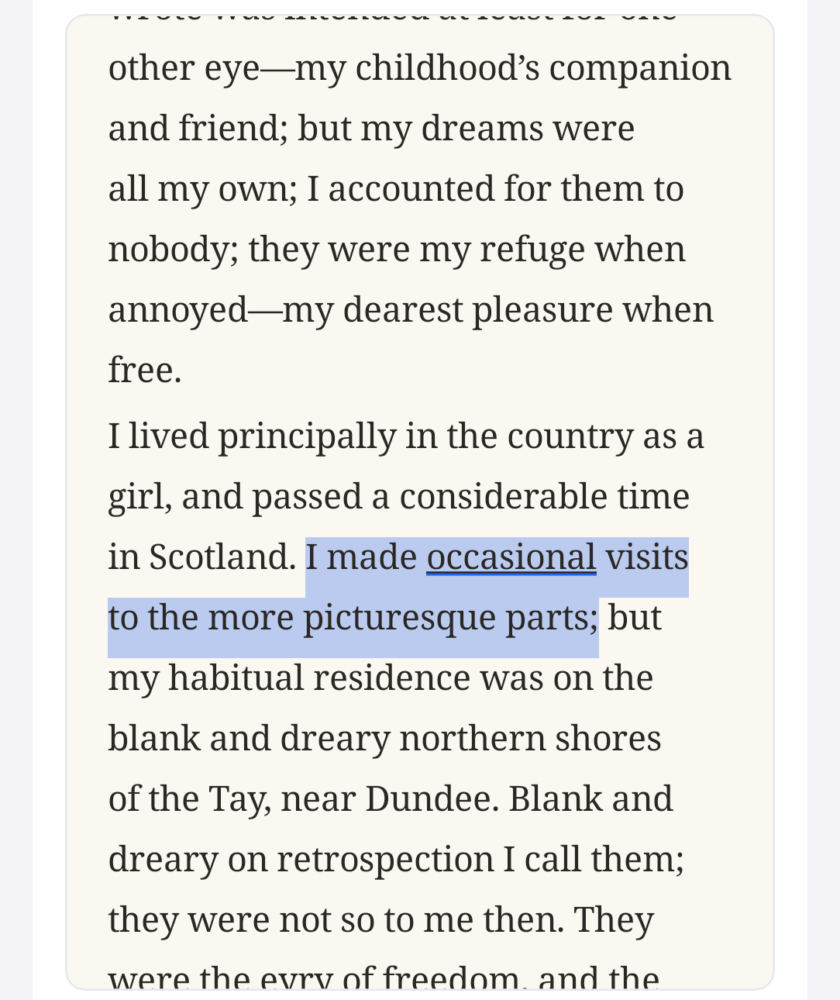</p>

The SDK maps synthesized speech onto the reader, so the sentence or word being spoken can be highlighted and followed.

1. **Synthesize with a timeline:** `tts.synthesize(textIn, audioOut, { segmentation: { mode: 'auto' }, timeline: true })`. `result.timeline` lists each text segment with its UTF-16 range in `textIn` and its sample range in `audioOut` ([tts-offline.md](tts-offline.md#ttssynthesizetextin-audioout-options)).
2. **Map it onto the reader:** `createReadAloudTimeline(doc, { slice, tts: result.timeline })` when you synthesized a [text slice](#createreadertextslicedoc-options) (any book, also PDF and OCR pages, across page breaks), or `createReadAloudTimeline(doc, { text: textIn, tts: result.timeline, textOffset })` for a part of the document's text buffer.
   - **Sentences** are the TTS segments; their times are exact.
   - **Words** are estimated by default: each sentence's duration is spread over its words by length, with a pause after punctuation. With `words: { timing: { aligned } }` the times come from word alignment; words without a match keep their estimate.
   - `textOffset` is where `textIn` starts in the document's text buffer when you synthesized a part of it. Read block ranges from `getReaderBlocks(…).textRange`. With `slice`, positions are in the slice and `textOffset` is not used.
3. **Play and highlight:** pass the `PcmPlayer` position to `useReadAloudHighlights`, and the result to `highlights`. By default the word is followed when words are shown, else the sentence.

Long books: synthesize in chunks (text slices of ~1500 characters, whole blocks) and prepare the next chunk while one plays; see [use case examples](#use-case-examples). Pass `errorRecovery: 'skip'` to `synthesize` so a word the voice cannot speak (OCR noise) becomes a short silence instead of stopping the chunk.

Limits:

- The default word splitter needs spaces between words. For Chinese, Japanese or Thai pass `words.split`; otherwise each sentence is one unit.
- `result.timeline.exact` is `false` when a segmentation policy rewrote the text (`overlapChars > 0`, `text_punctuation_assisted`); ranges may then be off by a few characters.

## Pages

Page sections (PDF pages, comic pages) start with their page image; `pageDisplay` decides what the view shows. Other sections are not affected.

| `pageDisplay` | Shows | Hidden |
| --- | --- | --- |
| `'text'` | The page's text; the page image only when the page has no text (a scan, a plate) | Running headers, footers and page numbers, the page image of pages with text |
| `'image'` | One full-width page image per page | The page's text blocks: they count as visible where they are on the page |
| `'imageAndText'` | The page image, then its text | Running headers, footers and page numbers |
| `'auto'` (default) | `'image'` for page documents (`format: 'pages'`), else `'text'` | |

Hidden blocks still count for reading progress: they belong to the row that shows them (the page, or the nearest text row), so `onFurthestPositionChange` and `onSectionEnd` see every block. In `'image'`, a block counts as visible when at least half of it (or of the viewport) is on screen, from its rectangle on the page; `scrollTo` a block puts its place on the page at the top. Pages are full width without margins, and their height comes from the page size before the page is rendered.

## Text for scans and comics

A page without a text layer (a scanned PDF page, a comic page, an image-only section of an EPUB) gets its text from an OCR engine (`react-native-sherpa-onnx/ocr`). Text grows page by page while the user reads, or a full run does the whole book:

```ts
const ocr = await createOCR({ modelSource });         // an OCR pack folder
const doc = await loadReaderDocument(scanPdf);       // pages show as images
const next = await recognizeReaderPages(doc, ocr, {
  scope: 'around',                                    // or 'all'
  at: position,                                       // from onVisibleRangeChange
  recognize: { readingDirection: 'rtl' },             // manga
  onDocument: setDoc,                                 // the view updates as pages are done
});
```

Each recognized page gets text blocks `s{n}.b0.t{j}` (for an image block, `{imageBlockId}.t{j}`) right after its page block. The blocks are built from what the model returns:

| | `ppocr`, `doctr`, `paddleocr_vl` spotting | `doc_vlm` | `nemotron_parse`, `paddleocr_vl` (Markdown) |
| --- | --- | --- | --- |
| Paragraphs | From the line boxes: reading order, columns, gaps, indents, line ends | The model's items | The Markdown blocks |
| Headings | — (a clearly larger line is its own paragraph) | Title → level 1, section header → its level | `#` → title / section header |
| Running headers, page numbers | A lone page number at the top or bottom of the page | Page header / footer elements | — |
| Place on the page | Union of the paragraph's line boxes | The element's box | — (the whole page) |

The same scanned page with each model, from the example app (iOS simulator on an Apple M4, one page). Top: `'text'` mode. Bottom: `'image'` mode after searching for "lighthouse"; the hit is drawn over the page image, on its line where the model returns positions and over the whole page where it does not.

| `ppocrv6-tiny` | `doctr-mobile` | `docvlm-granite-258m-fp32` | `nemotron-3.5-parse-int8` | `paddleocr-vl-1.6-fp16` |
| --- | --- | --- | --- | --- |
| 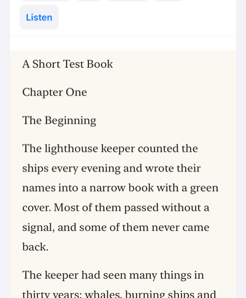 | 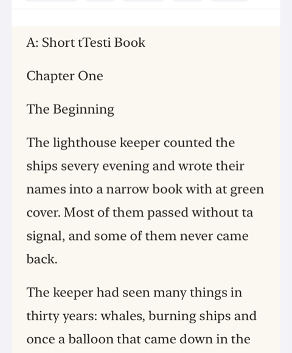 | 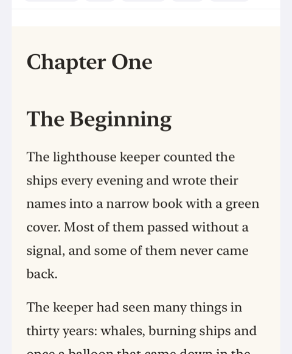 | 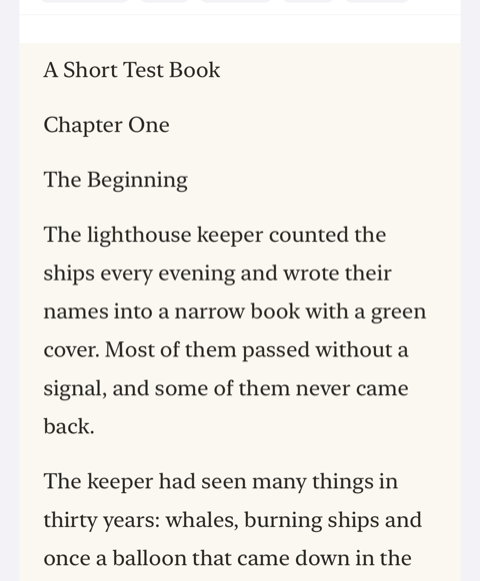 |  |
| 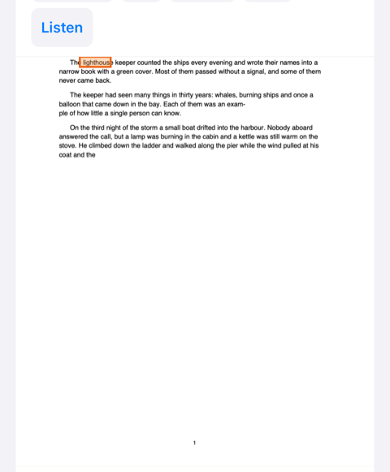 | 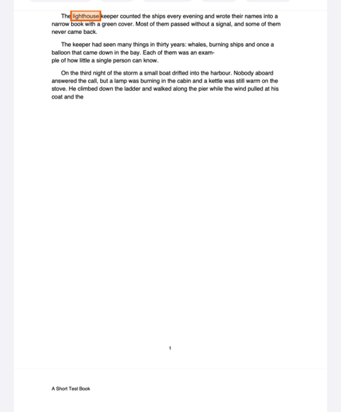 |  | 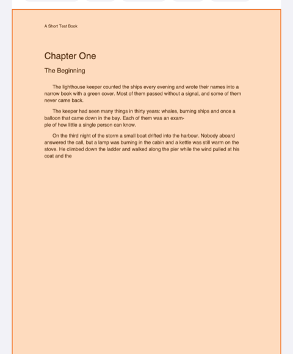 |  |
| 2 s | 2 s | 31 s | 18 min | 67 s |

Times are for the simulator and only show the order of magnitude; phones differ. For `doc_vlm`, use the `fp32` pack: `q8` is smaller and faster but can repeat a line until `maxNewTokens`, and `fp16` / `q4f16` currently return no text (see [Offline OCR](./ocr-offline.md)). When a model returns nothing for a page, `onProgress` reports `hasText: false` and the page keeps showing its image.

The blocks are text blocks like any other: they show in `'text'` mode (the page image is then hidden), count for reading progress, can be highlighted and searched. In `'image'` mode they count as visible where they are on the page. A page's first heading becomes the section title when the section has none.

To keep the recognized text between sessions, save it with `saveReaderRecognition` and load it with `loadReaderRecognition`; the document then has the same blocks as after OCR.

Block IDs of OCR text are stable for the same model and settings only; recognizing a page again replaces its blocks. Store positions on OCR pages by the page block (`s{n}.b0`) or keep the `textHash` (see [remapLocator](#remaplocatordoc-stored-hint)).

## Structure rules

`structureVersion` describes how an EPUB is split into sections and blocks. The rules below change only together with that number; a golden file in the native tests guards them.

- **Sections** are the linear spine items, numbered from 0. Items with `linear="no"` are skipped.
- **Block-forming tags:** `p`, `h1`–`h6`, `li`, `blockquote`, `pre`, `td`.
  - `hr` produces a `separator` block.
  - `img` and SVG `<image>` produce an `image` block. An image inside an open block is emitted after that block, so a paragraph is never split.
- **Block type** comes from the tag that closes the block: `h1`–`h6` → `heading` with `headingLevel` 1–6; everything else → `paragraph`.
- **Whitespace:** runs of space, tab and newline collapse to one space; `<br>` becomes `\n`; block ends are trimmed; `pre` keeps its text.
- **Text buffer layout:** the buffer holds text blocks only, joined by `\n\n`. Image and separator blocks have an empty range; `alt` text is not part of the buffer.
- **Titles:** the EPUB 3 nav document (`nav[epub:type=toc]`, else the first `nav`), then the EPUB 2 NCX; the first entry per file wins (`titleSource: 'toc'`). Fallback: the section's first heading (`'heading'`).
- **Image-only sections** (raw image spine items, or XHTML with only images) get one `image` block per image.
- **Metadata:** `title`, `creator` and `language` from the OPF `dc:` fields.

## textHash

`textHash` identifies a block's text independent of its position. Backends can compute it with the reference below (matches the native code byte for byte).

1. Decode UTF-8 to code points (invalid bytes → U+FFFD).
2. Remove U+00AD, U+200B–U+200D, U+2060 and U+FEFF.
3. Quotes: U+2018, U+2019, U+201A, U+201B, U+2032, U+02BC, U+0060, U+00B4, U+2039, U+203A → `'`; U+201C–U+201F, U+2033, U+00AB, U+00BB → `"`.
4. U+2010–U+2015 and U+2212 → `-`; U+2026 → `...`.
5. Unicode whitespace (U+0009–U+000D, U+0020, U+0085, U+00A0, U+1680, U+2000–U+200A, U+2028, U+2029, U+202F, U+205F, U+3000): each run becomes one U+0020; both ends are trimmed.
6. No case folding, no Unicode normalization.
7. `textHash` = lowercase hex of the first 8 bytes of SHA-256 over the normalized UTF-8.
8. Image blocks hash `"\x1Fimage:" + href`, separators `"\x1Fseparator"`. The block type is not part of the hash.

```python
import hashlib

DROP = {0x00AD, 0x200B, 0x200C, 0x200D, 0x2060, 0xFEFF}
SQ = {0x2018, 0x2019, 0x201A, 0x201B, 0x2032, 0x02BC, 0x0060, 0x00B4, 0x2039, 0x203A}
DQ = {0x201C, 0x201D, 0x201E, 0x201F, 0x2033, 0x00AB, 0x00BB}
WS = (set(range(0x09, 0x0E)) | set(range(0x2000, 0x200B))
      | {0x20, 0x85, 0xA0, 0x1680, 0x2028, 0x2029, 0x202F, 0x205F, 0x3000})

def normalize(text: str) -> str:
    out, space = [], False
    for ch in text:
        cp = ord(ch)
        if cp in DROP:
            continue
        if cp in WS:
            space = bool(out)  # leading whitespace is dropped
            continue
        if space:
            out.append(" ")
            space = False
        if cp in SQ:
            out.append("'")
        elif cp in DQ:
            out.append('"')
        elif 0x2010 <= cp <= 0x2015 or cp == 0x2212:
            out.append("-")
        elif cp == 0x2026:
            out.append("...")
        else:
            out.append(ch)
    return "".join(out)  # trailing whitespace never emits a space

def text_hash(text: str) -> str:
    return hashlib.sha256(normalize(text).encode("utf-8")).hexdigest()[:16]

def image_hash(href: str) -> str:
    return hashlib.sha256(("\x1fimage:" + href).encode("utf-8")).hexdigest()[:16]

SEPARATOR_HASH = hashlib.sha256(b"\x1fseparator").hexdigest()[:16]
```

## Accessibility

- VoiceOver and TalkBack read the blocks in order; inserts sit between them and stay accessible.
- Headings carry the header trait (`accessibilityHeading` on Android).
- Image blocks use `alt`; images without `alt` are hidden from screen readers.
- `fontScale: 'system'` follows Dynamic Type and the Android font size.

## Limits

- Scroll mode only; no zoom and no text selection (use `onTap` and highlights for paragraph-level selection).
- On page images, a highlight inside a line (a word) is placed by estimate; OCR models without positions mark the whole page.
- Inline formatting (italics, bold, links) is not kept; each block has one text style.
- An image is scaled to the text width and is at most 90 % of the viewport high.

## Types and constants

```ts
import {
  ReaderView, // native reading view (Fabric)
  loadReaderDocument, // book file → ReaderDocument in one call
  createReaderDocument, // ReaderDocument from a text buffer or page images
  attachReaderPageText, // OCR text buffer → text blocks on its pages
  createReaderTextSlice, // text from a position on, for reading aloud
  saveReaderRecognition, // recognized pages → sidecar file
  loadReaderRecognition, // sidecar file → recognized pages again
  recognizeReaderPages, // OCR pages around the reading position or the whole book
  computeDocumentKey, // SHA-256 of a file
  insertSection, // add an app section
  removeSection, // remove an app section
  releaseReaderDocument, // free the native document
  getReaderBlocks, // blocks in reading order (optionally with text)
  mapTextRanges, // text-buffer ranges → reader ranges
  locatorAtTextOffset, // text-buffer offset → locator
  remapLocator, // find a stored block again by textHash
  compareLocators, // order two locators
  formatBlockId, // 's11.b42'
  parseBlockId, // block ID → section ID + key
  createReadAloudTimeline, // TTS timeline → sentences / words on the reader
  useReadAloudHighlights, // spoken units → highlights (React hook)
  splitWords, // default word splitter
  ReaderErrorCode, // error code object
  READER_STRUCTURE_VERSION, // current structure rules version
  READER_TEXT_HASH_VERSION, // current textHash version
} from 'react-native-sherpa-onnx/reader';

import type {
  ReaderDocument, ReaderSectionInfo, ReaderDocumentMetadata, ReaderBlock, ReaderBlockType,
  ReaderLocator, ReaderRange, ReaderAppSection, ReaderAppBlock, ReaderInsert, ReaderInsertTarget,
  ReaderTheme, ReaderHighlight, ReaderHighlightStyle, ReaderFollowOptions, ReaderFollowChange,
  ReaderVisibleRange, ReaderJump, ReaderJumpCause, ReaderViewProps, ReaderViewHandle, ReaderPageDisplay,
  CreateReaderDocumentOptions, LoadReaderDocumentOptions, RecognizeReaderPagesOptions, ReaderTextSlice,
  ReadAloudTimeline, ReadAloudUnit, ReadAloudPosition, ReadAloudAlignedWord,
  CreateReadAloudTimelineOptions, ReadAloudHighlightOptions, ReaderErrorCodeValue,
} from 'react-native-sherpa-onnx/reader';
```

| Type | Description |
| --- | --- |
| `ReaderDocument` | `{ id, revision, documentKey, format, structureVersion, textHashVersion, blockCount, sections, metadata }` (immutable value); `format`: `'epub' \| 'fb2' \| 'mobi' \| 'pdf' \| 'pages'` |
| `ReaderSectionInfo` | `{ id, sectionIndex?, origin: 'file' \| 'app', kind: 'text' \| 'image' \| 'page', href?, title?, titleSource, label?, blockCount, firstBlockId, lastBlockId }`; `label`: printed PDF page label |
| `ReaderDocumentMetadata` | `{ title?, creator?, language? }` |
| `ReaderBlock` | `{ id, sectionId, index, type, headingLevel?, textHash, text?, imageHref?, imageFrameIndex?, alt?, textRange? }` |
| `ReaderBlockType` | `'paragraph' \| 'heading' \| 'image' \| 'separator' \| 'page'` |
| `ReaderLocator` | `{ sectionId, blockId, offset? }` |
| `ReaderRange` | `{ from, to }` (`to` exclusive) |
| `ReaderAppSection` / `ReaderAppBlock` | `{ after, id, title?, blocks }` / `{ key, type: 'paragraph' \| 'heading' \| 'separator', text?, level? }` |
| `ReaderInsert` / `ReaderInsertTarget` | `{ key, at }` / `{ sectionEnd } \| { beforeBlock } \| { afterBlock }` |
| `ReaderTheme` | See [Theme](#theme) |
| `ReaderHighlight` | `{ id, from, to, style?, color?, follow? }` |
| `ReaderHighlightStyle` | `'background' \| 'underline' \| 'textColor'` |
| `ReaderFollowOptions` / `ReaderFollowChange` | `{ mode?, anchor?, pauseOnUserScroll? }` / `{ following, reason }` |
| `ReaderVisibleRange` | `{ first, last, firstOffset, settled, visibleInserts }` |
| `ReaderJump` / `ReaderJumpCause` | `{ from, to, distance, cause }` / `'scroll' \| 'fling' \| 'scrollTo' \| 'follow'` |
| `ReaderViewProps` / `ReaderViewHandle` | View props / ref: `scrollTo`, `resumeFollow` |
| `ReaderPageDisplay` | `'auto' \| 'text' \| 'image' \| 'imageAndText'` ([Pages](#pages)) |
| `CreateReaderDocumentOptions` / `LoadReaderDocumentOptions` | Options of `createReaderDocument` / `loadReaderDocument` |
| `ReaderTextSlice` | `{ buffer, length, from, to }` (see `createReaderTextSlice`) |
| `RecognizeReaderPagesOptions` | `{ scope?, at?, ahead?, behind?, force?, recognize?, onDocument?, updateIntervalMs?, onProgress?, signal? }` |
| `ReadAloudTimeline` | `{ durationMs, sentences, words, at(ms) }` |
| `ReadAloudUnit` | `{ kind, index, sentenceIndex, range, textStart, textEnd, startMs, endMs }` |
| `ReadAloudPosition` | `{ sentence, word }` (each `ReadAloudUnit \| null`) |
| `ReadAloudAlignedWord` | `{ text, startSample, endSample }` (exact word times) |
| `CreateReadAloudTimelineOptions` | `{ text?, slice?, tts, textOffset?, granularity?, words?: { timing?, split? } }` |
| `ReadAloudHighlightOptions` | `{ show?, sentenceStyle?, wordStyle?, follow?, idPrefix? }` |

## Error codes

| Code | Meaning |
| --- | --- |
| `ERR_READER_NOT_FOUND` | Document or text buffer not found, for example after `releaseReaderDocument`. |
| `ERR_READER_NO_STRUCTURE` | The text buffer has no reading structure. Extract an EPUB with `extractDocumentText` first. |
| `ERR_READER_UNSUPPORTED_STRUCTURE` | The structure was made with other structure rules than this SDK supports. |
| `ERR_READER_SIDECAR_INVALID` | `loadReaderRecognition`: not a reader OCR sidecar, or a corrupt one. |
| `ERR_READER_SIDECAR_MISMATCH` | `loadReaderRecognition`: the sidecar is for another book or model, or has pages this document does not have. |
| `ERR_READER_INVALID_ARGUMENT` | Invalid app section ID or block key, a highlight with an unknown block ID (`onError`), or OCR text without an OCR layout or from another image buffer (`attachReaderPageText`). |

Errors from extraction (`ERR_DOC_*`, for example `ERR_DOC_DRM`) and file access (`FILEIO_*`) surface unchanged from `loadReaderDocument`.

## Use case examples

<details>
<summary>Resume where the reader left off</summary>

Store the settled position per book and pass it back as `initialLocator`. Store the frontier too, so progress continues from there.

```tsx
const saved = await store.get(doc.documentKey); // { at, furthest } | undefined

<ReaderView
  document={doc}
  initialLocator={saved?.at}
  furthestLocator={saved?.furthest}
  onVisibleRangeChange={(r) => {
    if (r.settled) store.patch(doc.documentKey, { at: { ...r.first, offset: r.firstOffset } });
  }}
  onFurthestPositionChange={(l) => store.patch(doc.documentKey, { furthest: l })}
/>;
```

</details>

<details>
<summary>Keep stored positions valid across SDK updates</summary>

Save `structureVersion` and the block's `textHash` with each position. When the version differs, find the block again by its text.

```ts
const block = (await getReaderBlocks(doc)).find((b) => b.id === locator.blockId)!;
const record = { documentKey: doc.documentKey, structureVersion: doc.structureVersion, locator, textHash: block.textHash };

// later
const at =
  record.structureVersion === doc.structureVersion
    ? record.locator
    : await remapLocator(doc, { textHash: record.textHash, offset: record.locator.offset }, record.locator);
```

</details>

<details>
<summary>Chapter-end card with a "next chapter" button</summary>

```tsx
const inserts = doc.sections
  .filter((s, i) => s.origin === 'file' && doc.sections[i + 1])
  .map((s) => ({ key: s.id, at: { sectionEnd: s.id } }));

const renderInsert = (sectionId: string) => {
  const i = doc.sections.findIndex((s) => s.id === sectionId);
  const next = doc.sections[i + 1]!;
  return (
    <Button
      title={`Next: ${next.title ?? 'Continue'}`}
      onPress={() => reader.current?.scrollTo({ sectionId: next.id, blockId: next.firstBlockId }, { animated: true })}
    />
  );
};
```

</details>

<details>
<summary>Notes attached to a paragraph</summary>

Select a paragraph with `onTap`, underline it while selected, and show each note as an insert after its block.

```tsx
const [selected, setSelected] = useState<ReaderLocator | null>(null);
const [notes, setNotes] = useState<Array<{ id: string; at: ReaderLocator; text: string }>>([]);

<ReaderView
  document={doc}
  onTap={({ blockId }) => setSelected({ sectionId: parseBlockId(blockId)!.sectionId, blockId })}
  highlights={selected ? [{ id: 'selection', from: selected, to: selected, style: 'underline' }] : []}
  inserts={notes.map((n) => ({ key: n.id, at: { afterBlock: n.at.blockId } }))}
  renderInsert={(key) => <NoteCard note={notes.find((n) => n.id === key)!} />}
/>;
```

</details>

<details>
<summary>Search with all hits marked</summary>

```ts
const blocks = await getReaderBlocks(doc, 0, doc.blockCount, { includeText: true });
const hits: ReaderHighlight[] = [];
for (const b of blocks) {
  const re = /monster/gi;
  for (let m = re.exec(b.text ?? ''); m; m = re.exec(b.text ?? '')) {
    const at = { sectionId: b.sectionId, blockId: b.id };
    hits.push({ id: `hit:${hits.length}`, from: { ...at, offset: m.index }, to: { ...at, offset: m.index + m[0].length }, style: 'textColor', color: '#EA580C' });
  }
}
setHighlights(hits);
reader.current?.scrollTo(hits[0]!.from); // the line with the first hit at the top
```

</details>

<details>
<summary>Add a preface or generated chapter (app section)</summary>

```ts
const withGuide = await insertSection(doc, {
  after: doc.sections[0]!.id,
  id: 'app:guide',
  title: 'Reading guide',
  blocks: [
    { key: 'h', type: 'heading', level: 2, text: 'Reading guide' },
    { key: 'p1', type: 'paragraph', text: 'Look out for the letters at the start…' },
  ],
});
setDoc(withGuide); // the view keeps the reading position

// later
setDoc(await removeSection(withGuide, 'app:guide'));
```

</details>

<details>
<summary>Chapter title and progress in a footer</summary>

```tsx
const starts = new Map<string, number>();
doc.sections.reduce((n, s) => (starts.set(s.id, n), n + s.blockCount), 0);

onVisibleRangeChange={(r) => {
  if (!r.settled) return;
  const section = doc.sections.find((s) => s.id === r.first.sectionId);
  const blockIndex = (starts.get(r.first.sectionId) ?? 0) + (parseBlockId(r.first.blockId)?.blockIndex ?? 0);
  setFooter({ title: section?.title, percent: Math.round((100 * (blockIndex + 1)) / doc.blockCount) });
}}
```

</details>

<details>
<summary>Offer a way back after a jump, or count it as read</summary>

```tsx
<ReaderView
  document={doc}
  furthestLocator={furthest}
  onJump={(j) => {
    setBackTarget(j.from); // show "Back" → reader.current?.scrollTo(j.from)
    if (j.cause === 'scrollTo' && userConfirmedSkip) setFurthest(j.to); // accept as read
  }}
/>
```

</details>

<details>
<summary>Read a book aloud from the tapped paragraph</summary>

Synthesize one chunk (whole blocks, up to ~1500 characters) from a text slice, map it with the slice, and prepare the next chunk while it plays. Slices run across sections and page breaks and include OCR text, so this works for every format.

```ts
async function prepare(from: ReaderLocator) {
  const slice = await createReaderTextSlice(doc, { from, maxLength: 1500 });
  const audioOut = await createEmptyOfflineAudioBuffer(await tts.getSampleRate());
  const result = await tts.synthesize(slice.buffer, audioOut, {
    segmentation: { mode: 'auto' },
    errorRecovery: 'skip', // OCR text can hold words a voice cannot speak
    timeline: true,
  });
  const timeline = await createReadAloudTimeline(doc, { slice, tts: result.timeline! });
  await releasePipelineTextBuffer(slice.buffer);
  return { audioOut, timeline, next: slice.to }; // the next chunk starts after `slice.to`
}

const first = await prepare({ sectionId, blockId: tappedBlockId });
const player = await createPcmPlayer(first.audioOut, { onPosition: (e) => setPositionMs(e.positionMs), onEnded: playNextChunk });

// in the component
const spoken = useReadAloudHighlights(timeline, positionMs);
<ReaderView document={doc} highlights={spoken} follow={{ mode: 'keepVisible' }} onFollowChange={(c) => setPaused(!c.following)} />;
```

At the end of the book `createReaderTextSlice` throws `ERR_READER_INVALID_ARGUMENT` (no text from `from` on). The example app's `useReaderReadAloud.ts` (`example/src/screens/reader/`) has the full chunk loop.

</details>

<details>
<summary>Exact word timing from alignment</summary>

```ts
await alignment.alignTextToAudio(textIn, audioOut, segmentsOut, { mode: 'accurate', granularity: 'word' /* + model config */ });
const aligned = (await getOfflineSegmentBufferSegments(segmentsOut, 0, 100_000))
  .filter((s) => s.kind === 'alignment')
  .map((s) => ({ text: s.payload?.text ?? '', startSample: s.startSample, endSample: s.endSample }));

const timeline = await createReadAloudTimeline(doc, { text: textIn, tts: result.timeline!, words: { timing: { aligned } } });
```

See [alignment-offline.md](alignment-offline.md).

</details>

<details>
<summary>Word highlights for languages without spaces</summary>

```ts
const segmenter = new Intl.Segmenter('ja', { granularity: 'word' });
const split = (sentence: string) =>
  [...segmenter.segment(sentence)].filter((s) => s.isWordLike).map((s) => [s.index, s.index + s.segment.length] as [number, number]);

const timeline = await createReadAloudTimeline(doc, { text: textIn, tts: result.timeline!, words: { split } });
```

`Intl.Segmenter` needs a JS engine that ships it; any splitter returning UTF-16 `[start, end)` ranges works.

</details>

<details>
<summary>Follow the system dark mode</summary>

```tsx
const dark = useColorScheme() === 'dark';
<ReaderView
  document={doc}
  theme={{ colors: dark ? { background: '#15171A', text: '#E4E0D8', accent: '#8AB4F8' } : { background: '#FBF8F1', text: '#2A2724', accent: '#3F3AB8' } }}
/>;
```

The first visible line stays in place when the theme changes.

</details>

## Example app

|  |  |  |
| --- | --- | --- |

The monorepo example exposes **Reader** (`example/src/screens/reader/ReaderScreen.tsx`) as a developer showcase for this API: a book picker for every format, appearance and page display, contents, an app section, chapter-end and note inserts, marks, search, progress, jump back and resume, an **OCR** panel (model, reading order, this page / around here / whole book, save and load) and **Listen** (read-aloud with sentence and word highlights, `useReaderReadAloud.ts`). See [example/README.md](../example/README.md#reader).

---

## See also

- [Offline e-documents](document-offline.md): `extractDocumentText`, `extractDocumentImages`
- [TTS (offline)](tts-offline.md): `timeline` option
- [PCM player](pcm-player.md): playback position for read-aloud
- [Alignment](alignment-offline.md): exact word times
- [Text buffers (offline)](textbuffer-offline.md)
- [Reader internals](internal/reader/reader-internal.md) (maintainers)

## Native crash diagnostics

If native code fails or the app crashes but the tombstone shows only a UI/GPU thread, inspect the SDK last-activity ring buffer (enabled by default when the native library loads). Full details: [native-diagnostics.md](./native-diagnostics.md) - Android log tag `SherpaNativeDiag`; iOS subsystem `com.sherpaonnx.diag`. Optional JS: `getNativeDiagnosticSnapshot` / `configureNativeDiagnostics` from `react-native-sherpa-onnx/diagnostics`.
