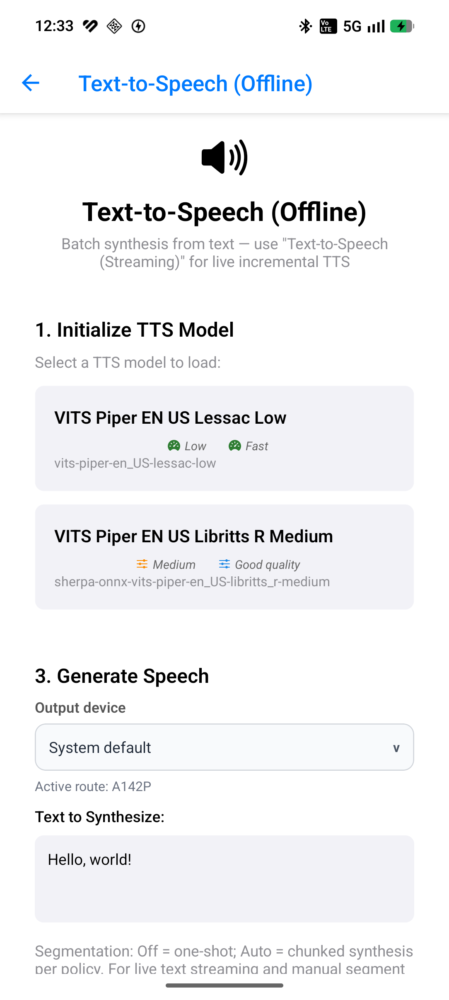
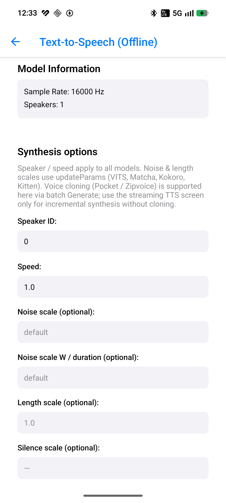
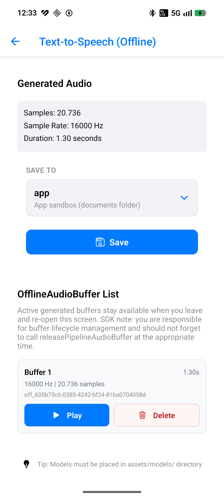

# Offline Text-to-Speech (TTS)

## Introduction

On-device **batch** synthesis with a **pipeline-first** API. Supports VITS, Matcha, Kokoro, Kitten, Pocket, Zipvoice, and Supertonic model families with optional voice cloning (Zipvoice / Pocket). For live synthesis with PCM playback (offline weights on live buffers), see [tts-live.md](tts-live.md).

Import path: **`react-native-sherpa-onnx/tts`**.

Buffer helpers: `react-native-sherpa-onnx/audiobuffer`, `react-native-sherpa-onnx/textbuffer`, `react-native-sherpa-onnx/audio`.

## Quick start

All buffer parameters accept refs directly. Prefer refs over raw string ids. If you pass raw ids, malformed values are rejected early with `AUDIO_INVALID_ARGUMENT` or `TEXT_INVALID_ARGUMENT`.

### 1) Synthesize and save to WAV

```ts
import { createTTS, detectTtsModel } from 'react-native-sherpa-onnx/tts';
import { createOfflineTextBufferFromText, releasePipelineTextBuffer } from 'react-native-sherpa-onnx/textbuffer';
import {
  createEmptyOfflineAudioBuffer,
  getPipelineAudioBufferInfo,
  releasePipelineAudioBuffer,
} from 'react-native-sherpa-onnx/audiobuffer';
import { saveAudioAsFile } from 'react-native-sherpa-onnx/audio';

const modelPath = { kind: 'app', base: 'apkAsset', path: 'models/vits-piper-en_US-lessac-medium' };

// Detect without loading the engine — cheap pre-check that gives you `modelType` and model info.
const det = await detectTtsModel({ kind: 'app', base: 'apkAsset', path: 'models/vits-piper-en_US-lessac-medium' });
if (!det.success || det.modelType !== 'vits') throw new Error(det.error ?? 'Expected VITS model');

// Create engine. Explicit modelType required when you want modelOptions.
const tts = await createTTS({
  modelSource: modelPath,
  modelType: 'vits',
  numThreads: 2,
  modelOptions: { vits: { noiseScale: 0.667, noiseScaleW: 0.8, lengthScale: 1.0 } },
});

// Step 1: get model sample rate (audioOut must match exactly)
const sr = await tts.getSampleRate(); // e.g. 22050

// Step 2: allocate buffers
const textBuf = await createOfflineTextBufferFromText('Hello, world.');
const audioBuf = await createEmptyOfflineAudioBuffer(sr); // empty output target

// Step 3: synthesize (buffer-to-buffer, no JS round-trip)
await tts.synthesize(textBuf, audioBuf, { sid: 0, speed: 1.0 });

// Step 4: inspect result
const info = await getPipelineAudioBufferInfo(audioBuf);
console.log(info.numSamples, info.sampleRate); // e.g. 44100, 22050

// Step 5: save to WAV
await saveAudioAsFile(audioBuf, { kind: 'fs', path: '/path/to/output.wav' }, 'wav');

// Step 6: release buffers (free native memory)
await releasePipelineTextBuffer(textBuf);
await releasePipelineAudioBuffer(audioBuf);

await tts.destroy();
```

### 2) Voice cloning (Zipvoice / Pocket)

```ts
import { createOfflineAudioBufferFromFile } from 'react-native-sherpa-onnx/audiobuffer';

// Load reference audio into a buffer first
const refAudio = await createOfflineAudioBufferFromFile({
  kind: 'fs',
  path: '/path/to/reference.wav',
});

const textBuf = await createOfflineTextBufferFromText('Clone this voice.');
const audioBuf = await createEmptyOfflineAudioBuffer(sr);

await tts.synthesize(textBuf, audioBuf, {
  voiceClone: {
    kind: 'zipvoice',
    referenceAudio: refAudio, // OfflineAudioBufferRef — not raw samples
    referenceText: 'Transcript of the reference recording.', // required for Zipvoice
  },
  // silenceScale applies with voiceClone; numSteps also applies with Zipvoice/Pocket cloning
  silenceScale: 0.2,
  numSteps: 5,
});

await releasePipelineAudioBuffer(refAudio);
await releasePipelineTextBuffer(textBuf);
// keep audioBuf until you've saved/played it, then release
```

**ZipVoice lexicons.** ZipVoice reads text only through its lexicons and skips every word that is in none of them, without an error. The distilled zh-en packs ship a Chinese `lexicon.txt` only, so English text and English reference transcripts need an English lexicon too, or the output is short and unintelligible. The model download puts [`lexicon-en-us.txt`](https://github.com/k2-fsa/sherpa-onnx/releases/download/tts-models/lexicon-en-us.txt) into the model folder ([supplement files](download-manager.md#supplement-files)); for a pack installed before that, `ensureModel` fetches it. For ZipVoice, auto init loads **every** detected lexicon (unless `lexiconLanguageId` picks one) and fails with `TTS_LEXICON_MISSING` when none of them is English. With `initMode: 'custom'`, pass both: `customConfig.lexicon: [zhLexicon, enLexicon]`.

### 2b) Supertonic `numSteps` without voice cloning

```ts
import { supportsNumSteps } from 'react-native-sherpa-onnx/tts';

// Diffusion steps without reference audio (batch or live)
if (supportsNumSteps('supertonic')) {
  await tts.synthesize(textBuf, audioBuf, { sid: 0, numSteps: 8 });
}
```

Zipvoice/Pocket require `voiceClone` when `numSteps` is set (`TTS_NUM_STEPS_REQUIRES_VOICE_CLONE` otherwise). Unsupported models throw `TTS_NUM_STEPS_UNSUPPORTED`.

### 3) Multi-speaker model

```ts
// Get speaker count from model info
const { numSpeakers } = await tts.getModelInfo(); // e.g. { sampleRate: 22050, numSpeakers: 8 }

const textBuf = await createOfflineTextBufferFromText('Speaker two here.');
const audioBuf = await createEmptyOfflineAudioBuffer(22050);

await tts.synthesize(textBuf, audioBuf, { sid: 2, speed: 1.0 }); // sid 0..numSpeakers-1

await releasePipelineTextBuffer(textBuf);
// save / play audioBuf, then:
await releasePipelineAudioBuffer(audioBuf);
```

### 4) Buffer lifecycle & cleanup pattern

```ts
// Always release what you allocate.
// Best practice: try/finally to avoid leaks on error.

const textBuf = await createOfflineTextBufferFromText(inputText);
const audioBuf = await createEmptyOfflineAudioBuffer(modelSampleRate);
try {
  await tts.synthesize(textBuf, audioBuf);
  await saveAudioAsFile(audioBuf, { kind: 'fs', path: outputPath }, 'wav');
} finally {
  await releasePipelineTextBuffer(textBuf).catch(() => {});
  await releasePipelineAudioBuffer(audioBuf).catch(() => {});
}
```

## Buffer matrix

| Role | Type | Notes |
| --- | --- | --- |
| **Text in** | [`OfflineTextBuffer`](textbuffer-offline.md) | Populated text buffer |
| **Audio out** | [`OfflineAudioBuffer`](audiobuffer-offline.md) | Empty buffer at model sample rate; synthesis fills it once |
| **Engine** | `TtsEngine` via `createTTS` | `synthesize`, `updateParams`, `getModelInfo`, `getSampleRate`, `getNumSpeakers`, `destroy` |

## Segmentation (Optional)

Long text in one `synthesize` call can exhaust device RAM. Auto mode splits the text buffer into chunks, synthesizes each offline, and stitches PCM in order — lower peak RAM with a small quality tradeoff at boundaries.

**Modes:** `'off'` (default — whole text in one pass) | `'auto'` (policy-driven chunks). `'manual'` is not supported.

| Evaluator | Supported | Notes |
| --- | --- | --- |
| `text_synthetic_auto` | ✅ **Default** | Sentence / length splits; `maxLengthChars` default 500 |
| `text_punctuation_assisted` | ✅ | Needs `policy.punctuationInstanceId`; then same split as synthetic |
| Speech / frame evaluators | ❌ | Audio-domain policies are not used for offline TTS |

```ts
await tts.synthesize(textBuf, audioBuf, {
  segmentation: {
    mode: 'auto',
    // policy defaults to text_synthetic_auto + maxLengthChars: 500
  },
});
```

Full policy reference: [segmentation-engine.md](segmentation-engine.md). Live path: [tts-live.md](tts-live.md#segmentation-mandatory).

With segmentation on, a failing segment does not reject the call: the result has `status: 'failed'` (or `'partial'` / a skipped segment, per `errorRecovery`). `failedSegment.error` holds the message and `failedSegment.code` the native code (for example `OFFLINE_OOM` or `TTS_EMPTY_OUTPUT`, see [Error codes](#error-codes)); `skippedSegments[i].code` works the same way.

### Cancel

Pass an `AbortSignal` as `signal`. It is checked before the call starts and before each segment and retry. A segment that is already running in native code stops at the model's next chunk boundary (ZipVoice: a group of up to 20 words; Pocket and most other models: a sentence), with `segmentation.mode: 'off'` too. The model cannot stop inside a chunk, so a long chunk still runs to its end first. On abort the promise rejects with an error whose `name` is `'AbortError'` and `code` is `'ORCHESTRATION_CANCELLED'` (check with `isOrchestrationCancelledError`), the SDK releases its temporary buffers and `audioOut` stays empty. If the signal aborts while the last segment runs, the call still resolves.

```ts
const controller = new AbortController();
const run = tts.synthesize(textBuf, audioBuf, {
  segmentation: { mode: 'auto' },
  signal: controller.signal,
});
// elsewhere: controller.abort();
```

## Models

| `modelType` | Required files | Custom-init keys |
| --- | --- | --- |
| `vits` | `ttsModel`, `tokens` | `ttsModel`, `tokens` (+ optional `lexicon`) |
| `matcha` | `acousticModel`, `vocoder`, `tokens` | `acousticModel`, `vocoder`, `tokens` (+ optional `lexicon`) |
| `kokoro`, `kitten` | `ttsModel`, `tokens`, `voices` | same as required (+ optional `lexicon`) |
| `pocket` | `lmFlow`, `lmMain`, `encoder`, `decoder`, `textConditioner`, `vocabJson`, `tokenScoresJson` | same as required |
| `zipvoice` | `encoder`, `decoder`, `vocoder`, `tokens` | same as required (+ optional `lexicon`, one `FileSource` or an array; all are loaded) |
| `supertonic` | `durationPredictor`, `textEncoder`, `vectorEstimator`, `vocoder`, `ttsJson`, `unicodeIndexer`, `voiceStyle` | same as required |

Raw English Piper / Kitten / Matcha-EN / Kokoro-EN text needs a lexicon at init. Two supported ways:

1. **Auto / `modelSource`:** put `lexicon.txt`, `lexicon-en-us.txt`, or another `lexicon-*.txt` **inside** the model folder. Detect fills `lexiconLanguages`; `createTTS` loads it via `lexiconLanguageId` (default: first after sort, `lexicon.txt` first; ZipVoice loads all of them). The shared US-English file is [`lexicon-en-us.txt`](https://github.com/k2-fsa/sherpa-onnx/releases/download/tts-models/lexicon-en-us.txt); the model download adds it to the packs above ([supplement files](download-manager.md#supplement-files)). `en_GB` Piper voices then read US pronunciations.
2. **Custom:** set `customConfig.lexicon` to any `FileSource` (including a file outside the model folder). Auto-init does **not** mix in a lexicon from outside `modelSource`.

`espeak-ng-data` is ignored. Packs may still contain it. Without a lexicon and without `phonemeCodepoints` / `tokens` at synthesize time, init still succeeds; raw text yields empty audio → `TTS_EMPTY_OUTPUT`. ZipVoice auto init is the exception: without an English lexicon it fails with `TTS_LEXICON_MISSING`.

Validate category: **`tts`**. Overview: [README — TTS](../README.md#supported-model-types) · detection: [model-detect.md](model-detect.md) · downloads: [download-manager.md](download-manager.md) (`ModelCategory.Tts`).

```ts
import { createTTS } from 'react-native-sherpa-onnx/tts';

const tts = await createTTS({
  initMode: 'custom',
  modelType: 'vits',
  customConfig: {
    ttsModel: { kind: 'fs', path: '/data/models/model.onnx' },
    tokens: { kind: 'fs', path: '/data/models/tokens.txt' },
    lexicon: { kind: 'fs', path: '/data/models/lexicon.txt' },
  },
  modelOptions: { vits: { noiseScale: 0.667, noiseScaleW: 0.8, lengthScale: 1.0 } },
});
```

## API reference

### `detectTtsModel(source, options?)`

File-based detection **without** initializing the engine. Use before `createTTS` to get `modelType` and init the right `modelOptions`. Unified cross-feature detection: [model-detect.md](model-detect.md).

For `FileSource` resolution problems, this promise can reject with `FILEIO_*` errors before native model detection runs.

```ts
function detectTtsModel(
  source: FileSource,
  options?: { modelType?: TTSModelType }
): Promise<TtsDetectModelResult>
```

```ts
const det = await detectTtsModel({ kind: 'fs', path: '/absolute/path/to/kokoro' });
if (!det.success) throw new Error(det.error ?? 'TTS detection failed');
```

**Voice count before loading.** `det.numSpeakers` is the number of voices (speaker ids `0 .. numSpeakers - 1`), read from the model files without loading the engine, so a picker can show "voice n of N" before `createTTS`. It is the same value `tts.getNumSpeakers()` returns later; `0` or `1` means one voice.

| Model type | Source of `numSpeakers` |
| --- | --- |
| `vits`, `kokoro`, `kitten` | `n_speakers` metadata of the model `.onnx` |
| `matcha` | `n_speakers` metadata of the acoustic model `.onnx` |
| `supertonic` | header of `voice.bin` |
| `zipvoice`, `pocket` | omitted: the voice is cloned from reference audio, there are no speaker ids |

It is also omitted for name-only detection (no model folder on disk) and when the files cannot be read.

### `createTTS(options)`

```ts
function createTTS(options: TTSInitializeOptions | FileSource): Promise<TtsEngine>
```

```ts
// With explicit modelType (required for modelOptions):
const tts = await createTTS({
  modelSource: { kind: 'fs', path: '/models/vits-piper-en' },
  modelType: 'vits',
  numThreads: 2,
  modelOptions: { vits: { noiseScale: 0.667 } },
});

// With auto-detect (no modelOptions available):
const tts = await createTTS({ kind: 'app', base: 'apkAsset', path: 'models/vits-piper-en' });
```

### `tts.synthesize(textIn, audioOut, options?)`

Buffer-to-buffer synthesis. Reads text from `textIn`, writes PCM into the empty `audioOut`. The `audioOut` must be created with `createEmptyOfflineAudioBuffer(sampleRate)` where `sampleRate` exactly matches the model output rate.

```ts
synthesize(
  textIn: OfflineTextBufferRef | OfflineTextBufferHandle,
  audioOut: OfflineAudioBufferRef | OfflineBufferHandle,
  options?: TtsSynthesisOptions
): Promise<void>
```

The model runs on a native background thread, so other SDK calls (buffers, player, `destroy()` of another engine) are not blocked while it generates. Batch syntheses still run one at a time, in call order.

```ts
await tts.synthesize(textBuf, audioBuf);                          // defaults
await tts.synthesize(textBuf, audioBuf, { sid: 1, speed: 0.9 }); // speaker + speed

// Power-user: app-phonemized Unicode codepoints (vits / matcha / kokoro / kitten).
// Text is ignored. ZipVoice ignores this field — use `tokens` instead.
await tts.synthesize(emptyTextBuf, audioBuf, {
  sid: 0,
  phonemeCodepoints: [[116, 601, 100, 101, 618]],
});

// ZipVoice (and pinyin-like frontends): phoneme strings, not tokens.txt IDs.
await tts.synthesize(textBuf, audioBuf, {
  tokens: [['ð', 'ə'], ['h', 'ɛ', 'l', 'oʊ']],
  voiceClone: { kind: 'zipvoice', referenceAudio, referenceText: 'the' },
});
```

`phonemeCodepoints` and `tokens` are exclusive on the TypeScript type. Runtime does not extra-guard a conflict — upstream then yields empty audio / `TTS_EMPTY_OUTPUT`.

**Timeline.** With `timeline: true` the result also says where each text segment landed in the audio, for example to highlight the sentence being spoken:

```ts
const result = await tts.synthesize(textBuf, audioBuf, {
  segmentation: { mode: 'auto' },
  timeline: true,
});
// result.timeline: { sampleRate, exact, segments: [{ utf16Start, utf16End, startSample, numSamples, skipped }] }
```

- `utf16Start` / `utf16End` are offsets into `textIn`; `startSample` / `numSamples` into `audioOut`.
- With `segmentation.mode: 'off'` there is one segment for the whole text.
- Segments skipped by `errorRecovery: 'skip'` have `skipped: true` (their audio is a short silence).
- `exact` is `false` when the spoken text differs from the buffer (`overlapChars > 0` or a text-rewriting policy such as `text_punctuation_assisted`); ranges are then approximate.
- The reader turns a timeline into sentence and word highlights: see [reader.md](reader.md#read-aloud).

### `tts.updateParams(options)`

Update noise/length scales without re-creating the engine. Pass `{}` for a no-op.

```ts
updateParams(options: TtsUpdateOptions): Promise<{ success: boolean; detectedModels: DetectedModelEntry[] }>
```

```ts
await tts.updateParams({ modelType: 'vits', modelOptions: { vits: { lengthScale: 1.2 } } });
```

### `tts.getModelInfo()`

```ts
getModelInfo(): Promise<TTSModelInfo>  // { sampleRate: number; numSpeakers: number }
```

```ts
const { sampleRate, numSpeakers } = await tts.getModelInfo();
```

### `tts.getSampleRate()` / `tts.getNumSpeakers()`

```ts
const sr = await tts.getSampleRate();    // e.g. 22050
const n  = await tts.getNumSpeakers();  // 0 or 1 = single-speaker
```

### `tts.destroy()`

```ts
await tts.destroy(); // frees native TTS engine; do not call any method after this
```

## Buffer helpers (audiobuffer / textbuffer)

These are imported from their own sub-paths, not from `react-native-sherpa-onnx/tts`.

### `createOfflineTextBufferFromText(text, options?)`

```ts
// react-native-sherpa-onnx/textbuffer
createOfflineTextBufferFromText(
  text: string,
  options?: { lang?: string; emotion?: string; event?: string }
): Promise<OfflineTextBufferRef>
```

```ts
const buf = await createOfflineTextBufferFromText('Hello.');
// buf.bufferId → 'txt_off_...'
// buf.info.utf16Length → character count
await releasePipelineTextBuffer(buf); // when done
```

### `createEmptyOfflineAudioBuffer(sampleRate)`

```ts
// react-native-sherpa-onnx/audiobuffer
createEmptyOfflineAudioBuffer(sampleRate: number, channelCount?: 1): Promise<OfflineAudioBufferRef>
```

```ts
const buf = await createEmptyOfflineAudioBuffer(22050);
// buf.info.numSamples === 0 — synthesis fills it exactly once
```

> The output buffer's `sampleRate` must equal the model output rate — read it with `tts.getSampleRate()` before allocating. Each `createTTS()` has a unique `instanceId`; do not use it after `destroy()`. Voice cloning (Zipvoice / Pocket only) requires an `OfflineAudioBuffer` reference, not raw samples.

### Convert output buffer to file

Use audio save helpers from `react-native-sherpa-onnx/audio`:

```ts
import { saveAudioAsFile, saveAudioAsWav16k } from 'react-native-sherpa-onnx/audio';

await saveAudioAsFile(audioBuf, { kind: 'fs', path: `${DocumentDirectoryPath}/speech.wav` }, 'wav');
await saveAudioAsFile(
  audioBuf,
  { kind: 'fs', path: `${DocumentDirectoryPath}/speech.mp3` },
  'mp3',
  { outputSampleRateHz: 44100 }
);
await saveAudioAsWav16k(audioBuf, { kind: 'fs', path: `${DocumentDirectoryPath}/speech_16k.wav` });
```

### `createOfflineAudioBufferFromFile(source, options?)`

```ts
createOfflineAudioBufferFromFile(
  source: FileSource,
  options?: AudioDecodeOptions
): Promise<OfflineAudioBufferRef>
```

```ts
// Load reference audio for voice cloning
const refBuf = await createOfflineAudioBufferFromFile({
  kind: 'fs',
  path: '/path/to/ref.wav',
});
await releasePipelineAudioBuffer(refBuf); // after synthesize
```

### `getPipelineAudioBufferInfo(bufferId)`

```ts
getPipelineAudioBufferInfo(bufferId: PipelineAudioBufferIdSource): Promise<PipelineAudioBufferInfo>
```

```ts
const info = await getPipelineAudioBufferInfo(audioBuf);
// info.numSamples, info.sampleRate, info.durationMs, info.channelCount
```

### `releasePipelineAudioBuffer(bufferId)` / `releasePipelineTextBuffer(bufferId)`

```ts
await releasePipelineAudioBuffer(audioBuf); // frees native audio buffer
await releasePipelineTextBuffer(textBuf);   // frees native text buffer
```

## Pipeline composition

### Typical upstream

| Source / feature | Buffer or handle | Notes |
| --- | --- | --- |
| App-authored script | `OfflineTextBuffer` (`txt_off_*`) | Typical source via `createOfflineTextBufferFromText(...)`. |
| Offline STT output | `OfflineTextBuffer` (`txt_off_*`) | Common speech-to-speech and narration workflows. |
| Offline punctuation output | `OfflineTextBuffer` (`txt_off_*`) | Improves readability/prosody before synthesis. |

### Typical downstream

| Destination / feature | Buffer or handle | Notes |
| --- | --- | --- |
| Synthesized output | `OfflineAudioBuffer` (`off_*`) | `audioOut` must be empty and sample-rate matched to the model. |
| Audio save/export | `saveAudioAsFile(...)` | Persist WAV/MP3/Opus after synthesis. |
| Offline STT/alignment loopback | `OfflineAudioBuffer` (`off_*`) | Optional QA/transcript verification loop. |

```mermaid
flowchart LR
  A[OfflineTextBuffer] --> B[createTTS().synthesize]
  B --> C[OfflineAudioBuffer]
  C --> D[Playback or saveAudioAsFile]
```

More end-to-end patterns: [feature-pipelines.md#tts-offline-patterns](feature-pipelines.md#tts-offline-patterns).

## JS Events

| Callback | Payload | Fires when | Notes |
| --- | --- | --- | --- |
| `onProgress` | `TtsSynthesisProgress` | throughout offline synthesize | `mode: 'off'` and `mode: 'auto'` |

### Progress semantics

One event drives the UI bar. Composition is always:

```text
fraction = (segmentIndex + clamp01(generateFraction)) / segmentCount
```

| Mode | Meaning |
| --- | --- |
| `off` | `segmentCount === 1` → `fraction === generateFraction` (Sherpa batch progress) |
| `auto` | Segment `i` owns bar slice `[i/N, (i+1)/N]`; Sherpa fills the slice |

- `fraction` is monotonic; the SDK emits `generateFraction: 1` after each segment and finishes at `1.0`.
- Optional label: `Segment ${segmentIndex + 1} / ${segmentCount}`.
- Sherpa `generateFraction` is **batch/sentence** based (`maxNumSentences`), not sample-exact. Short one-batch segments often jump `0 → 1` within their slice. Use `maxNumSentences: 1` at init for finer steps when needed.

```ts
const result = await tts.synthesize(textBuf, audioBuf, {
  segmentation: { mode: 'auto' },
  onProgress: (p) => {
    console.log(
      `${Math.round(p.fraction * 100)}% · segment ${p.segmentIndex + 1}/${p.segmentCount}`
    );
  },
});
```

Live overload uses `onSegment` only (no offline `onProgress`) — see [tts-live.md](tts-live.md#js-events).

## Types

### Core TTS types (`react-native-sherpa-onnx/tts`)

`FileSource` (used in `createTTS` / init options) is imported from **`react-native-sherpa-onnx/fileio`**, not from the TTS entry.

| Type | Description |
| --- | --- |
| `TTSModelType` | `'vits' \| 'matcha' \| 'kokoro' \| 'kitten' \| 'pocket' \| 'zipvoice' \| 'supertonic' \| 'auto'` |
| `TTS_MODEL_TYPES` | Readonly runtime list |
| `isTtsModelType` | Runtime guard |
| `TTSInitializeOptions` | Discriminated union: concrete `modelType` required for `modelOptions` |
| `TTSInitializeOptionsBase` | Shared fields: `modelSource`, `provider?`, `numThreads?`, `debug?`, `ruleFsts?`, `ruleFars?`, `maxNumSentences?`, `silenceScale?` |
| `TtsUpdateOptions` | Arg to `updateParams()` — same per-`modelType` coupling as init |
| `TtsSynthesisOptions` | `{ sid?, speed?, silenceScale?, numSteps?, lang?, extra?, voiceClone?, phonemeCodepoints?, tokens?, segmentation?, onProgress?, signal?, … }` — `numSteps` for **supertonic** (no clone), **zipvoice**, **pocket** (with `voiceClone`); `phonemeCodepoints` (vits/matcha/kokoro/kitten) or `tokens` (ZipVoice) are exclusive; see `supportsNumSteps` / `requiresVoiceCloneForNumSteps` |
| `OrchestrationErrorCode`, `isOrchestrationCancelledError` | Cancel error code (`ORCHESTRATION_CANCELLED`) and a guard for it |
| `TtsSynthesisProgress` | `{ fraction, segmentIndex, segmentCount, generateFraction, elapsedMs }` — composed offline progress; see [JS Events](#js-events) |
| `TtsPhonemeInput` | `{ phonemeCodepoints: number[][] } \| { tokens: string[][] }` — Unicode codepoints vs ZipVoice phoneme strings; not `tokens.txt` |
| `TtsKittenCustomConfig` | `{ ttsModel, tokens, voices, lexicon? }` — no `dataDir` |
| `TtsVoiceClone` | `TtsVoiceCloneZipvoice \| TtsVoiceClonePocket` |
| `TtsVoiceCloneZipvoice` | `{ kind: 'zipvoice'; referenceAudio: OfflineAudioBufferRef \| OfflineBufferHandle; referenceText: string }` |
| `TtsVoiceClonePocket` | `{ kind: 'pocket'; referenceAudio: OfflineAudioBufferRef \| OfflineBufferHandle; referenceText?: string }` |
| `TtsExecutionProvider` | `'cpu' \| 'coreml' \| 'xnnpack' \| 'nnapi' \| 'qnn' \| (string & {})` |
| `TtsModelOptions` | Aggregate for native flattening — prefer init/update unions in app code |
| `TtsVitsModelOptions` | `{ noiseScale?, noiseScaleW?, lengthScale? }` |
| `TtsMatchaModelOptions` | `{ noiseScale?, lengthScale? }` |
| `TtsKokoroModelOptions` / `TtsKittenModelOptions` | `{ lengthScale? }` |
| `TtsEngine` | `synthesize`, `updateParams`, `getModelInfo`, `getSampleRate`, `getNumSpeakers`, `destroy` |
| `TTSModelInfo` | `{ sampleRate: number; numSpeakers: number }` |
| `TtsDetectModelResult` | Return of `detectTtsModel()` |
| `DetectedModelEntry` | `{ type: string; modelDir: string }` |
| `DetectionSource` | Trace literals from native detection |
| `SubtitleMode` | `'off' \| 'proportional' \| 'estimated' \| 'accurate'` (streaming path only) |
| `SubtitleGranularity` | `'sentence' \| 'word' \| 'character'` (streaming path only) |
| `SaveAudioTarget` / `SaveAudioTargetFile` / `SaveAudioTargetAndroidContent` | File-path or Android SAF targets used by app-level persistence flows |

### Buffer types (`react-native-sherpa-onnx/audiobuffer` / `react-native-sherpa-onnx/textbuffer`)

| Type | Description |
| --- | --- |
| `OfflineAudioBufferRef` | `{ info: OfflineAudioBufferInfo; bufferId: OfflineBufferHandle }` |
| `OfflineAudioBufferInfo` | `{ bufferId, sampleRate, channelCount, numSamples, durationMs }` |
| `OfflineBufferHandle` | Branded string `off_*` |
| `OfflineTextBufferRef` | `{ info: OfflineTextBufferInfo; bufferId: OfflineTextBufferHandle }` |
| `OfflineTextBufferHandle` | Branded string `txt_off_*` |
| `PipelineAudioBufferInfo` | Union of offline + live info |

## Error codes

| Code | Thrown by | Cause |
| --- | --- | --- |
| `TTS_TEXT_BUFFER_NOT_FOUND` | `synthesize` | `textInBufferId` not in registry — buffer was released or never created |
| `TTS_TEXT_BUFFER_KIND_MISMATCH` | `synthesize` | Buffer ID does not start with `txt_off_` — wrong buffer type passed |
| `TTS_TEXT_BUFFER_EMPTY` | `synthesize` | Text buffer has no text content, and neither `phonemeCodepoints` nor `tokens` was set |
| `TTS_AUDIO_OUT_NOT_FOUND` | `synthesize` | `audioOutBufferId` not in registry — released too early or never created |
| `TTS_AUDIO_OUT_KIND_MISMATCH` | `synthesize` | Buffer ID does not start with `off_` or is file-backed (must be in-memory) |
| `TTS_AUDIO_OUT_ALREADY_POPULATED` | `synthesize` | `audioOut` already has samples — create a new `createEmptyOfflineAudioBuffer` each call |
| `TTS_OUTPUT_SAMPLE_RATE_MISMATCH` | `synthesize` | `audioOut.sampleRate` ≠ model output rate — use `tts.getSampleRate()` to allocate |
| `TTS_REFERENCE_AUDIO_BUFFER_NOT_FOUND` | `synthesize` (voice clone) | `referenceAudioBufferId` not in registry — released before synthesis |
| `TTS_REFERENCE_AUDIO_BUFFER_KIND_MISMATCH` | `synthesize` (voice clone) | Reference buffer is not an offline audio buffer |
| `TTS_GENERATE_ERROR` | `synthesize` | Model-level synthesis failed (the message carries the native error text), or voice clone on unsupported model type |
| `TTS_LEXICON_MISSING` | `createTTS` (auto init) | A `zipvoice` model has no English lexicon (`lexicon-en*.txt` / `lexicon-*-en.txt`), so every English word would be skipped. The message names the file (`lexicon-en-us.txt`). Run `ensureModel` for a catalog model, or add the file to the model folder. Setting `lexiconLanguageId` skips the check |
| `TTS_EMPTY_OUTPUT` | `synthesize` | The model ran without an error but returned no audio for non-empty input. Upstream skips text it cannot speak without saying why, so the message names the usual causes per model (for ZipVoice: words missing from the loaded lexicons, or text too short for the reference audio and speed) |
| `ORCHESTRATION_CANCELLED` | `synthesize` | `signal` aborted; `name` is `'AbortError'` |
| `TTS_CANCELLED` | native `synthesizeTts` | The call was stopped through `cancelTtsSynthesis(operationId)`. `synthesize` reports it as `ORCHESTRATION_CANCELLED` |
| `OFFLINE_OOM` | `synthesize`, `createTTS` (Android) | Not enough memory for offline synthesis (also when the model fails to allocate memory during generation), or to load the model. Prefer streaming TTS for large inputs, or chunk offline work with the segmentation engine ([segmentation-engine.md](./segmentation-engine.md)). Native reject text references the same doc path. |

## Troubleshooting

| Symptom | Cause | Fix |
| --- | --- | --- |
| `TTS_OUTPUT_SAMPLE_RATE_MISMATCH` | Wrong sample rate on `createEmptyOfflineAudioBuffer` | Call `tts.getSampleRate()` first and pass that value |
| `TTS_AUDIO_OUT_ALREADY_POPULATED` | Reusing the same `audioBuf` for a second call | Create a fresh buffer per `synthesize` call |
| `TTS_TEXT_BUFFER_NOT_FOUND` | Buffer released before `synthesize` | Release **after** synthesis in a `finally` block |
| `TTS_GENERATE_ERROR` + Zipvoice | `referenceText` empty or missing | `voiceClone.referenceText` must be non-empty for Zipvoice |
| `TTS_GENERATE_ERROR` + cloning | Non-Zipvoice/Pocket model with `voiceClone` | Only Zipvoice and Pocket support voice cloning |
| `TTS_EMPTY_OUTPUT` + Zipvoice | No word of the text is in the loaded lexicons (English text without an English lexicon), or the text is very short for the reference clip | Add `lexicon-en-us.txt` (see [ZipVoice lexicons](#2-voice-cloning-zipvoice--pocket)); use a longer text, a shorter reference clip or a lower `speed` |
| ZipVoice output short and unintelligible | English words missing from the lexicons are skipped, in the text and in `referenceText` | Add `lexicon-en-us.txt` next to the zh lexicon |
| `TTS_LEXICON_MISSING` on `createTTS` | ZipVoice pack installed without the English lexicon | `ensureModel(ModelCategory.Tts, id)` downloads it; or add `lexicon-en-us.txt` to the model folder |
| `TTS_NUM_STEPS_UNSUPPORTED` | `numSteps` on vits/matcha/kokoro/kitten | Use Supertonic, Zipvoice, or Pocket; or omit `numSteps` |
| `TTS_NUM_STEPS_REQUIRES_VOICE_CLONE` | `numSteps` on Zipvoice/Pocket without `voiceClone` | Pass `voiceClone.referenceAudio` |
| Memory grows over time | Buffers not released | Always call `releasePipelineAudioBuffer` / `releasePipelineTextBuffer` after use |
| Init throws with `modelOptions` | `modelType: 'auto'` or omitted | Set explicit `modelType` before passing `modelOptions` |
| Methods throw after `destroy` | Engine already released | Create a new engine via `createTTS()` |

## Use case examples

<details>
<summary>Synthesize and save to WAV (standard flow)</summary>

Create a text buffer, synthesize into an offline audio buffer, then export WAV for sharing or playback.

```ts
import { createTTS } from 'react-native-sherpa-onnx/tts';
import { createOfflineTextBufferFromText, releasePipelineTextBuffer } from 'react-native-sherpa-onnx/textbuffer';
import { createEmptyOfflineAudioBuffer, releasePipelineAudioBuffer } from 'react-native-sherpa-onnx/audiobuffer';
import { saveAudioAsFile } from 'react-native-sherpa-onnx/audio';

const tts = await createTTS({
  modelSource: { kind: 'fs', path: '/path/to/kokoro' },
  modelType: 'kokoro',
  numThreads: 2,
});
const sr = await tts.getSampleRate();

const textBuf = await createOfflineTextBufferFromText('Good morning, how can I help you today?');
const audioBuf = await createEmptyOfflineAudioBuffer(sr);
try {
  await tts.synthesize(textBuf, audioBuf, { sid: 0, speed: 1.0 });
  await saveAudioAsFile(audioBuf, { kind: 'fs', path: '/output/speech.wav' }, 'wav');
} finally {
  await releasePipelineTextBuffer(textBuf);
  await releasePipelineAudioBuffer(audioBuf);
}
await tts.destroy();
```

</details>

<details>
<summary>Synthesize a long document with segmentation (OOM mitigation)</summary>

Split a large text buffer into sentence-level chunks and synthesize each with the offline engine, keeping peak RAM bounded. Quality may degrade slightly at segment boundaries.

```ts
const tts = await createTTS({ modelSource: { kind: 'fs', path: '/path/to/vits' }, modelType: 'vits' });
const sr = await tts.getSampleRate();

const longText = '...'; // several hundred words
const textBuf = await createOfflineTextBufferFromText(longText);
const audioBuf = await createEmptyOfflineAudioBuffer(sr);
try {
  const result = await tts.synthesize(textBuf, audioBuf, {
    segmentation: { mode: 'auto' }, // default policy: text_synthetic_auto, maxLengthChars: 500
    errorRecovery: 'skip',
    onProgress: (p) =>
      console.log(
        `${Math.round(p.fraction * 100)}% · segment ${p.segmentIndex + 1}/${p.segmentCount}`
      ),
  });
  console.log(result.status, result.totalSegments);
  await saveAudioAsFile(audioBuf, { kind: 'fs', path: '/output/long.wav' }, 'wav');
} finally {
  await releasePipelineTextBuffer(textBuf);
  await releasePipelineAudioBuffer(audioBuf);
}
await tts.destroy();
```

See [segmentation-engine.md](segmentation-engine.md) for policy tuning.

</details>

<details>
<summary>Voice cloning with Pocket model</summary>

Pass a reference WAV via `voiceClone` so Pocket synthesizes the prompt text in that speaker's timbre.

```ts
import { createTTS } from 'react-native-sherpa-onnx/tts';
import { createOfflineTextBufferFromText, releasePipelineTextBuffer } from 'react-native-sherpa-onnx/textbuffer';
import {
  createEmptyOfflineAudioBuffer,
  createOfflineAudioBufferFromFile,
  releasePipelineAudioBuffer,
} from 'react-native-sherpa-onnx/audiobuffer';

const tts = await createTTS({ modelSource: { kind: 'fs', path: '/path/to/pocket' }, modelType: 'pocket' });
const sr = await tts.getSampleRate();

const refAudio = await createOfflineAudioBufferFromFile({ kind: 'fs', path: '/path/to/reference.wav' });
const textBuf = await createOfflineTextBufferFromText('Cloning this voice for the demo.');
const audioBuf = await createEmptyOfflineAudioBuffer(sr);
try {
  await tts.synthesize(textBuf, audioBuf, {
    voiceClone: { kind: 'pocket', referenceAudio: refAudio },
  });
} finally {
  await releasePipelineAudioBuffer(refAudio);
  await releasePipelineTextBuffer(textBuf);
  await releasePipelineAudioBuffer(audioBuf);
}
await tts.destroy();
```

</details>

## Example app


|  |  |  |
| --- | --- | --- |


The monorepo example exposes **Text-to-Speech (offline)** (`example/src/screens/tts/OfflineTTSScreen.tsx`) as a developer showcase for this API. See [example/README.md](../example/README.md#text-to-speech-offline).

---

## See also

- [tts-live.md](tts-live.md) — live overload (offline weights on live text/audio buffers)
- [android-system-tts.md](android-system-tts.md) — register as an Android system TTS engine (Kotlin-only)
- [alignment-offline.md](alignment-offline.md) — `alignTextToAudio`, subtitle timing, alignment models
- [execution-providers.md](execution-providers.md) — ORT execution providers
- [download-manager.md](download-manager.md) — downloading TTS models (`ModelCategory.Tts`)
- [model-languages.md](model-languages.md) — language hint helpers and `detectTtsModel(...).languages`
- [README — Breaking changes](../README.md#breaking-changes-upgrading-to-100)


## Native crash diagnostics

If native code fails or the app crashes but the tombstone shows only a UI/GPU thread, inspect the SDK **last-activity ring buffer** (enabled by default when the native library loads). Full details: [native-diagnostics.md](./native-diagnostics.md) — Android log tag `SherpaNativeDiag`; iOS subsystem `com.sherpaonnx.diag`. Optional JS: `getNativeDiagnosticSnapshot` / `configureNativeDiagnostics` from `react-native-sherpa-onnx/diagnostics`.

