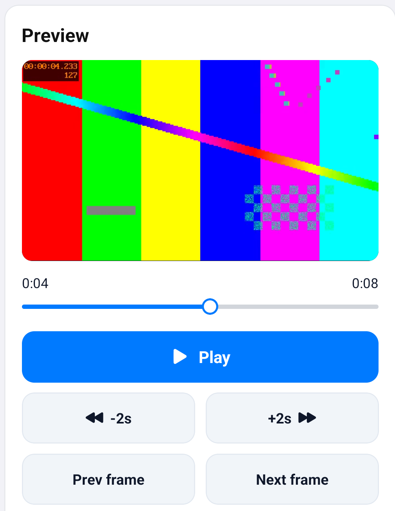

# Video preview (`react-native-sherpa-onnx/videopreview`)

| |  | |
| --- | --- | --- |

Preview a `VideoBuffer` (offline or live) with play, pause, seek, frame step, and optional synced audio.

Import from `react-native-sherpa-onnx/videopreview`. The player object is independent of the view: create it first, then attach `<VideoPreviewView player={player} />`.

## Create

```ts
import {
  createVideoPreviewPlayer,
  VideoPreviewView,
} from 'react-native-sherpa-onnx/videopreview';

const player = await createVideoPreviewPlayer(video, {
  audio: { source: 'track' }, // default; use { source: 'none' } for silent video
  onAudioUnavailable: (e) => {
    if (e.reason === 'unsupportedCodec') {
      // show a hint — video keeps playing
    }
  },
});
```

`player.initialSnapshot.audio` already reflects create-time audio (absent / unsupported / playing). Playback rate is `1.0` in v1. Reverse playback is not supported; seek backwards instead.

## Controls

| UI | API |
|---|---|
| Play / resume / restart after ended | `player.play()` |
| Pause | `player.pause()` |
| Seek | `player.seekTo(ms)` / `player.seekBy(deltaMs)` |
| Scrub | `seekTo(ms, { mode: 'closestKeyframe' })` while dragging, `seekTo(ms)` on release |
| Frame step | `player.stepFrame(1)` / `player.stepFrame(-1)` (playing pauses) |
| Live edge | `player.seekToLiveEdge()` |

## Audio unavailable

When the buffer has no track, an unsupported codec (for example AC-3), or decode/output fails, **video continues**. You get:

1. `initialSnapshot.audio.status === 'unavailable'`
2. `options.onAudioUnavailable` (registered before native create)
3. `player.addListener('audioUnavailable', …)`

Strict mode: `audio: { source: 'track', required: true }` rejects create instead.

## View

| |  | |
| --- | --- | --- |

```tsx
<VideoPreviewView
  player={player}
  resizeMode="contain"
  androidViewType="surfaceView"
/>
```

`androidViewType: 'textureView'` is for overlays, animations, and rounded corners. iOS ignores it.

## Export audio into AudioBuffer

Use `createOfflineAudioBufferFromVideo` / `createLiveAudioBufferFromLiveVideo` from `react-native-sherpa-onnx/videobuffer` for STT and other pipeline features ([offline](videobuffer-offline.md), [live](videobuffer-streaming.md)). Preview does not play through an AudioBuffer.

## API reference

### `createVideoPreviewPlayer(source, options?)`

```ts
export function createVideoPreviewPlayer(
  source: PipelineVideoBufferIdSource,
  options?: VideoPreviewPlayerOptions
): Promise<VideoPreviewPlayer>;
```

```ts
const player = await createVideoPreviewPlayer(video, { audio: { source: 'track' } });
```

Opens a preview session on an offline or live `VideoBuffer`. Returns a `VideoPreviewPlayer`; `initialSnapshot` already has position, seekable range, and audio status. Default audio is the clip track (video continues if audio is missing). `required: true` rejects create instead. Pass `decodePolicy` to override the display decoder.

### `useVideoPreviewPlayer(source, options?)`

```ts
export function useVideoPreviewPlayer(
  source: PipelineVideoBufferIdSource | null,
  options?: VideoPreviewPlayerOptions
): VideoPreviewPlayer | null;
```

```ts
const player = useVideoPreviewPlayer(video, { loop: true });
```

Creates the player when `source` is set and `release()`s it on unmount or when the buffer id changes. `null` source yields `null`. Create failures go to `options.onError`.

### `useVideoPreviewStatus(player, options?)`

```ts
export function useVideoPreviewStatus(
  player: VideoPreviewPlayer | null,
  options?: { smoothPosition?: boolean }
): VideoPreviewSnapshot | null;
```

```ts
const snap = useVideoPreviewStatus(player);
```

React snapshot for UI: `state`, `positionMs`, `durationMs`, `seekableRange`, `liveEdgeMs`, `audio`. Subscribes to `stateChanged` / `progress` / seek / `ended`. `smoothPosition: true` interpolates between native progress ticks.

### `useVideoPreviewProgress(player)`

```ts
export function useVideoPreviewProgress(
  player: VideoPreviewPlayer | null
): { positionMs: number; durationMs: number | null };
```

```ts
const { positionMs, durationMs } = useVideoPreviewProgress(player);
```

Thin wrapper over `useVideoPreviewStatus` for a scrubber: current position and clip duration (`null` while live duration is unknown).

### `VideoPreviewView`

```ts
export function VideoPreviewView(props: VideoPreviewViewProps): JSX.Element;
```

```tsx
<VideoPreviewView player={player} resizeMode="contain" />
```

Native surface bound to `player`. `resizeMode` is `contain` | `cover` | `stretch`. Android `androidViewType` is `surfaceView` (default) or `textureView` (overlays / rounded corners); iOS ignores it. `player={null}` renders an empty `View`.

### `player.play()`

```ts
play(): Promise<void>;
```

```ts
await player.play();
```

Starts or resumes playback. After `ended`, restarts from the beginning (or loops when `setLoop(true)`).

### `player.pause()`

```ts
pause(): Promise<void>;
```

```ts
await player.pause();
```

Pauses at the current position. No-op if already paused or released.

### `player.seekTo(positionMs, options?)`

```ts
seekTo(
  positionMs: number,
  options?: { mode?: VideoPreviewSeekMode }
): Promise<VideoPreviewSeekResult>;
```

```ts
await player.seekTo(1500, { mode: 'closestKeyframe' });
```

Seeks to `positionMs`. Modes: `exact` (default), `keyframe`, `closestKeyframe` (use while scrubbing; `exact` on release). Result is `completed`, `clamped` to the seekable window, or `superseded` by a later seek.

### `player.seekBy(deltaMs, options?)`

```ts
seekBy(
  deltaMs: number,
  options?: { mode?: VideoPreviewSeekMode }
): Promise<VideoPreviewSeekResult>;
```

```ts
await player.seekBy(-2000);
```

Relative seek from the current position (negative is backward). Same modes and result as `seekTo`.

### `player.seekToLiveEdge()`

```ts
seekToLiveEdge(): Promise<VideoPreviewSeekResult>;
```

```ts
await player.seekToLiveEdge();
```

Jumps to the live ring edge. Offline clips clamp to the last seekable millisecond.

### `player.stepFrame(direction)`

```ts
stepFrame(direction: 1 | -1): Promise<VideoPreviewSeekResult>;
```

```ts
await player.stepFrame(1);
```

Steps one decoded frame forward (`1`) or back (`-1`). Pauses if playing. `direction` must be `1` or `-1`.

### `player.setVolume(volume)`

```ts
setVolume(volume: number): Promise<void>;
```

```ts
await player.setVolume(0.5);
```

Linear gain `0…1` on preview audio. Does not change `muted`.

### `player.setMuted(muted)`

```ts
setMuted(muted: boolean): Promise<void>;
```

```ts
await player.setMuted(true);
```

Mutes or unmutes preview audio. Video keeps playing.

### `player.setLoop(loop)`

```ts
setLoop(loop: boolean): Promise<void>;
```

```ts
await player.setLoop(true);
```

When `true`, reaching EOS seeks to start and plays again instead of emitting `ended`. If already `ended`, starts a replay immediately.

### `player.getSnapshot()`

```ts
getSnapshot(): Promise<VideoPreviewSnapshot>;
```

```ts
const snap = await player.getSnapshot();
```

Fresh native snapshot (state, position, audio, stats). Prefer `useVideoPreviewStatus` in React; use this for a one-shot read.

### `player.addListener(type, listener)`

```ts
addListener<T extends VideoPreviewEventType>(
  type: T,
  listener: (e: VideoPreviewEventOf<T>) => void
): () => void;
```

```ts
const off = player.addListener('progress', (e) => console.log(e.positionMs));
```

Subscribes to one event type. Returns an unsubscribe. Create-time `onAudioUnavailable` / `onError` avoid a listener race; see [JS Events](#js-events).

### `player.release()`

```ts
release(): Promise<void>;
```

```ts
await player.release();
```

Destroys the native session and frees the display decoder slot. Idempotent. Release the player before `releaseVideoBuffer`.

## JS Events

Native channel `SherpaOnnxVideoPreviewEvent`. Subscribe with `player.addListener(type, handler)` (returns an unsubscribe). `useVideoPreviewStatus(player)` already listens for UI state.

Create-time (no listener race): `onAudioUnavailable`, `onError` on `createVideoPreviewPlayer`.

| `type` | When | Notes |
| --- | --- | --- |
| `stateChanged` | idle → preparing → ready / playing / paused / seeking / buffering / ended / error / released | `state`, `previousState`, `positionMs` |
| `progress` | while playing (interval `progressIntervalMs`, default 250) | `positionMs`, `seekableRange`, `liveEdgeMs` |
| `firstFrameRendered` | first decoded frame after create or seek | `positionMs` |
| `seekCompleted` | seek finished | `result`, `mode` |
| `seekClamped` | request was clamped to the seekable window | `requestedMs`, `actualMs`, `reason` |
| `positionEvicted` | live ring dropped the current PTS | `previousMs`, `newMs` |
| `liveEdgeResync` | live play jumped to stay near the edge | `lagMs`, `newMs` |
| `audioUnavailable` | no track / unsupported codec / decode or output failed | video continues; also `onAudioUnavailable` |
| `audioInterrupted` | focus / session interruption | `reason` |
| `ended` | playhead reached EOS and `loop` is off | with `loop: true` the player seeks to start instead |
| `error` | renderer / invalid state | `code`, `message`; also `onError` |

```ts
const off = player.addListener('progress', (e) => {
  console.log(e.positionMs, e.seekableRange);
});
const offEnded = player.addListener('ended', () => {
  /* show Restart; loop already handled natively when setLoop(true) */
});
// …
off();
offEnded();
```

Buffer ingest events (live ring) are on the videobuffer API: [videobuffer-streaming.md — JS Events](videobuffer-streaming.md#js-events).

## Decoder budget

Preview takes one **display** slot (`hwVideoDisplay`). OCR, image-from-video, and `exportVideo` take **decode** slots (`hwVideoDecode`). RAM class and both caps: [videobuffer-offline.md — Budgets](videobuffer-offline.md#budgets). Policies: [codecs.md](./codecs.md).

| Job | Slot | Default `max` | Override |
| --- | --- | --- | --- |
| Preview (`createVideoPreviewPlayer`) | `hwVideoDisplay` | `1` (every RAM class) | `configureCodecs({ budgets: { hwVideoDisplay } })` **1–4**, or `decodePolicy` on create |
| OCR / `createOfflineImageBufferFromVideo` / `exportVideo` decode | `hwVideoDecode` | `1` low/mid, `2` high / veryHigh | `configureCodecs({ budgets: { hwVideoDecode } })` **1–4** |

`getCodecInfo()` reports `ramClass` and slot `max` / `inUse`. Raising a slot does not raise the decoded-frame MiB cap.

| `decodePolicy` | Android | iOS |
| --- | --- | --- |
| `preferHardware` (default) | Platform HW, then platform SW | `SampleBufferVideoRenderer` when VT reports HW; else fall back |
| `hardware` | Display HW only | System `SampleBufferVideoRenderer` |
| `software` | Platform / bundled SW | `DecodedSampleBufferRenderer` (NV12 frames from the selected SW decoder) |

| Code | Means | What to do |
| --- | --- | --- |
| `VIDEO_PREVIEW_DECODER_BUSY` | Display slot full (`inUse === max`) | `release()` the other preview, wait for `subscribeCodecEvents` `slotFreed`, or raise `hwVideoDisplay` (still 1–4). **Audio-only play is still allowed.** |
| `VIDEO_DECODER_UNAVAILABLE` | No usable display decoder for the policy | Do not retry the same `decodePolicy`. Default `preferHardware` already falls back. Strict `hardware` fails on SW-only devices. |
| `VIDEO_MEMORY_BUDGET_EXCEEDED` | Decoded-frame RAM cap (process-wide) | Release other clips / ImageBuffers. Preview itself is usually small; parallel export / `'all'` sampling is the usual trigger. |

## Error codes

Thrown / rejected as `VideoPreviewError` (`code` + message `VIDEO_…: …`, native reject code the same). Budget codes: [Decoder budget](#decoder-budget). Clip open / ingest: [videobuffer-offline.md — Error codes](videobuffer-offline.md#error-codes).

Missing or unsupported **audio** does not reject `create` / `play` unless `audio: { source: 'track', required: true }`. Those cases emit `audioUnavailable` (and `initialSnapshot.audio.status === 'unavailable'`) while video continues.

| Code | Typical cause |
| --- | --- |
| `VIDEO_PREVIEW_INVALID_ARGUMENT` | Bad options: non-finite `startAtMs` / seek, `volume` outside `0…1`, `progressIntervalMs` outside `50…5000`, `maxLatencyMs <= targetLatencyMs`, `stepFrame` not `1` / `-1`. |
| `VIDEO_PREVIEW_NOT_FOUND` | Unknown `playerId` (already released, or never created). |
| `VIDEO_PREVIEW_RELEASED` | Any method after `release()` except another `release()` (idempotent). |
| `VIDEO_PREVIEW_INVALID_STATE` | Command not legal in the current state (e.g. `seekToLiveEdge` on offline, `stepFrame` while the controller rejects it). Also the JS fallback when native returns an untyped code. |
| `VIDEO_PREVIEW_DECODER_BUSY` | Display slot full. `play()` rejects; `videoAttached` stays `false`. Audio-only play is still allowed. See [Decoder budget](#decoder-budget). |
| `VIDEO_PREVIEW_RENDER_FAILED` | Surface / layer / sample submit failed (Android `MediaCodec` surface, iOS `SampleBuffer` / pixel pool). |
| `VIDEO_PREVIEW_AUDIO_UNSUPPORTED` | `audio.required: true` at create and the track is absent, not decodable, or output cannot open. |
| `VIDEO_PREVIEW_AUDIO_OUTPUT_FAILED` | AudioTrack / renderer cannot open or died. Default: video continues, `audioUnavailable` / `audioInterrupted`. With `required: true` this becomes `error`. |
| `VIDEO_NO_AUDIO_TRACK` | Clip has no audio. Event `audioUnavailable` `reason: 'absent'`; create reject only if `required: true`. |
| `VIDEO_AUDIO_CODEC_UNSUPPORTED` | Track codec not in the SDK FFmpeg build (e.g. AC-3). Event `reason: 'unsupportedCodec'`; create reject only if `required: true`. |
| `VIDEO_AUDIO_DECODE_FAILED` | Preview audio decode died. Event `reason: 'decodeFailed'`; video continues unless `required: true`. |
| `VIDEO_BUFFER_NOT_FOUND` | `createVideoPreviewPlayer` on a released or unknown `VideoBuffer`. |
| `VIDEO_BUFFER_INVALID_STATE` | Preview command against a live buffer in a state the controller rejects. |
| `VIDEO_DECODER_UNAVAILABLE` | No usable display decoder for the resolved `decodePolicy`. Do not retry the same policy. See [Decoder budget](#decoder-budget). |
| `VIDEO_SW_DECODER_DISABLED` | `software` / bundled SW requested but `ffmpeg-vsw` is not present. |
| `VIDEO_CODEC_UNSUPPORTED` | Video codec not H.264/HEVC, or the display path cannot build format extras (e.g. HEVC/AVC params on iOS). |
| `VIDEO_FRAME_EVICTED` | Live ring dropped the PTS under the playhead (`positionEvicted`). Raise `ringSeconds` or use `retention: 'session'`. |
| `VIDEO_MEMORY_BUDGET_EXCEEDED` | Process decoded-frame cap. Unusual for preview alone. See [Decoder budget](#decoder-budget). |
