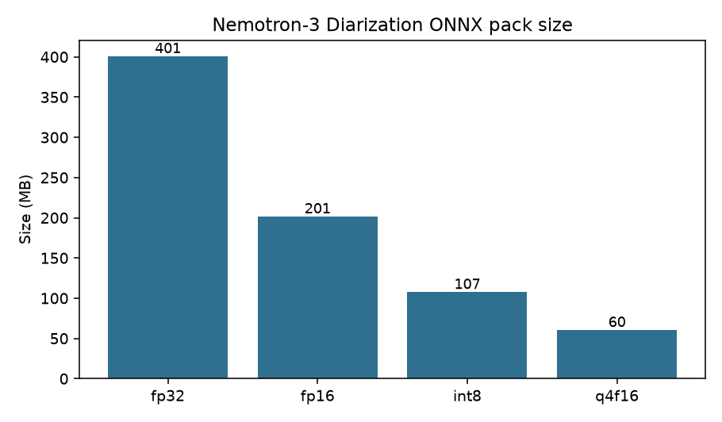
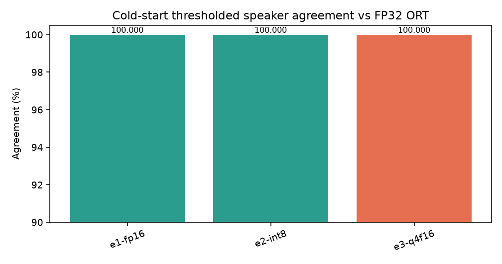
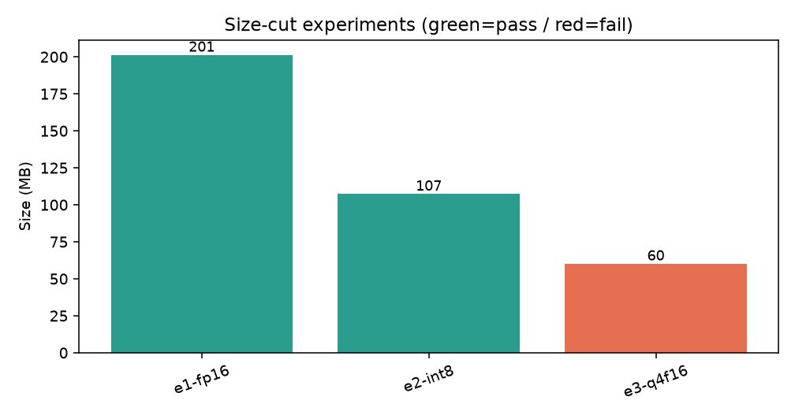
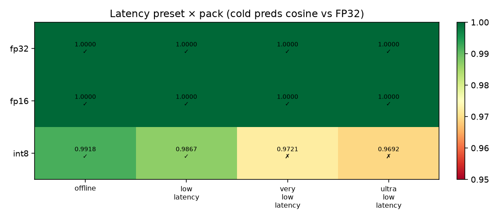

# Nemotron-3-Diarization ONNX

ONNX Runtime export of [`nvidia/Nemotron-3-Diarization`](https://huggingface.co/nvidia/Nemotron-3-Diarization)
for the mobile SDK **[react-native-sherpa-onnx](https://github.com/XDcobra/react-native-sherpa-onnx)**.

Graph contract matches the existing Sortformer streaming runner
(`SortformerStreamingModel`): Mel frontend + AOSC/FIFO cache stay **host-side**;
the ONNX graph is one streaming step with dynamic time axes.

| I/O | Names |
| --- | --- |
| Inputs | `chunk`, `chunk_lengths`, `spkcache`, `spkcache_lengths`, `fifo`, `fifo_lengths` |
| Outputs | `spkcache_fifo_chunk_preds`, `chunk_pre_encode_embs`, `chunk_pre_encode_lengths` |

Up to **8 speakers**. Same checkpoint covers offline-style (30.4 s buffer) and
low-latency streaming via runtime `metadata.json` presets.

## Try it live in VoiceLab

Download and run these on-device models in your pocket — anytime, anywhere — in the mobile app **VoiceLab**:

- Android: [VoiceLab on Google Play](https://play.google.com/store/apps/details?id=com.xdcobra.voicelab)
- iOS: [VoiceLab on the App Store](https://apps.apple.com/us/app/voice-lab-stt-tts-more/id6761100598)
- Product page: [https://xdcobra.github.io/voice-lab-offline-tools/](https://xdcobra.github.io/voice-lab-offline-tools/)

## Variants

| Folder | Role | Size | Recipe |
| --- | --- | ---: | --- |
| `onnx/fp16` | Desktop / high-end | **201 MB** | FP16 weights, float32 I/O |
| `onnx/int8` | High-end mobile | **107 MB** | Per-channel dynamic INT8 MatMul |

Local FP32 source pack is **401 MB** (not uploaded by default).

Do **not** ship the Q4F16 cut. Preds cosine vs FP32 ORT collapsed to ~0.66 / ~0.51
(cold / warm) even though a 0.5 decision threshold still matched on the synthetic
fixture — probability mass is not trustworthy enough for release.

## Parity gates (CPU)

Gate: frozen FP32 ORT goldens (themselves matched to NeMo/PyTorch FP32 with
cosine ≈ 1.0) vs ORT on **CPU**. CoreML may be used for local interactive speed
checks only when binary speaker decisions match CPU exactly; **published tables
are always CPU**.

Measured 2026-11-11, offline preset (`chunk_len=340`, `spkcache_len=264`,
`fifo_len=40`), cold + warm cache.

| Pack | Preds cosine (cold) | Emb cosine (cold) | Decision agree (cold) | Preds cosine (warm) | Decision agree (warm) |
| --- | ---: | ---: | ---: | ---: | ---: |
| FP32 | 1.000000 | 1.000000 | **1.000000** | 1.000000 | **1.000000** |
| **FP16** | 0.999999 | 1.000000 | **1.000000** | 0.999999 | **1.000000** |
| **INT8** | 0.991839 | 0.999892 | **1.000000** | 0.988309 | **1.000000** |
| Q4F16 (rejected) | 0.660241 | 0.995526 | 1.000000* | 0.505773 | 1.000000* |

\* Thresholded agreement on the synthetic step fixture only — rejected on preds cosine.

## Size-cut experiments

| ID | Change | Size | Cold preds cos | Cold agree | Pass |
| --- | --- | ---: | ---: | ---: | :---: |
| **e1-fp16 → `onnx/fp16`** | FP16 convert | **201.3 MB** | 0.999999 | 1.000000 | **yes** |
| **e2-int8 → `onnx/int8`** | INT8 MatMul | **107.4 MB** | 0.991839 | 1.000000 | **yes** |
| e3-q4f16 | 4-bit on FP16 | 60.2 MB | 0.660241 | 1.000000* | **no** |

## Latency presets × pack (Parse “instruction” analog)

Same ONNX graph, different streaming geometries from `metadata.json`.
Gate: cold-start preds cosine + thresholded agreement vs FP32 ORT goldens
(CPU). This is the consumer-facing matrix for “which latency mode is safe on
which pack,” and it also documents the **10 ms high-res pred length** the
host runner must index:

`pred_frames = (spkcache_len + fifo_len + chunk_len) × 8`

| Pack | offline 30.4 s | low 1.04 s | very_low 0.64 s | ultra_low 0.32 s |
| --- | ---: | ---: | ---: | ---: |
| FP32 | 1.000 / pass | 1.000 / pass | 1.000 / pass | 1.000 / pass |
| **FP16** | 1.000 / pass | 1.000 / pass | 1.000 / pass | 1.000 / pass |
| **INT8** | 0.992 / pass | 0.987 / pass | 0.972 / soft* | 0.969 / soft* |

\* INT8 still had **100%** thresholded speaker-decision agreement on the step
fixture, but preds cosine fell below the 0.98 ship gate. Prefer **FP16** (or
INT8 only with offline/low_latency) when targeting ≤0.64 s input-buffer latency.

| Configuration | Latency | `spkcache_len` | `fifo_len` | `chunk_len` | `right_context` | `spkcache_update_period` | Pred frames (cold) |
| --- | ---: | ---: | ---: | ---: | ---: | ---: | ---: |
| offline | 30.4 s | 264 | 40 | 340 | 40 | 300 | 5152 |
| low_latency | 1.04 s | 264 | 264 | 9 | 4 | 222 | 4296 |
| very_low_latency | 0.64 s | 264 | 264 | 6 | 2 | 222 | 4272 |
| ultra_low_latency | 0.32 s | 264 | 264 | 3 | 1 | 222 | 4248 |

## Files

Each variant folder:

| File | Role |
| --- | --- |
| `model.onnx` (+ `model.onnx_data`) | Streaming Sortformer step |
| `metadata.json` | Geometry + 8-speaker defaults for the SDK |
| `diarization_manifest.json` | Pack id / dtype notes |
| `LICENSE` | OpenMDW-1.1 |

## License

Governing terms: [OpenMDW-1.1](https://openmdw.ai/license/1-1/).
Weights by NVIDIA; this distribution keeps the upstream license text when available.

## Source

- Base: [`nvidia/Nemotron-3-Diarization`](https://huggingface.co/nvidia/Nemotron-3-Diarization)
- Export: NeMo Speech (`SortformerEncLabelModel`) → Sortformer streaming ONNX (opset 17),
  encoder `for_export=True` (SDPA attn mask; FlexAttention is not ONNX-traceable)
- Quant: `onnxruntime` FP16 convert + dynamic INT8 MatMul; Q4F16 measured and rejected
