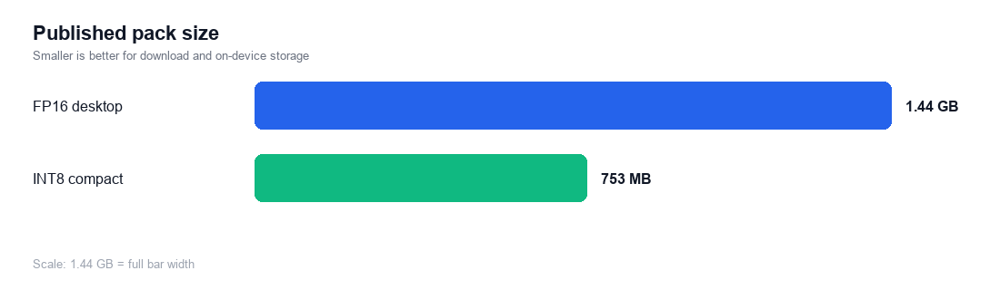
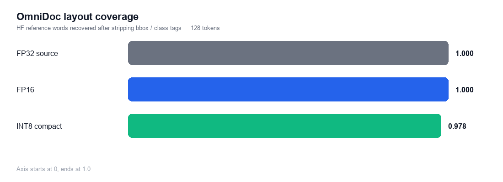
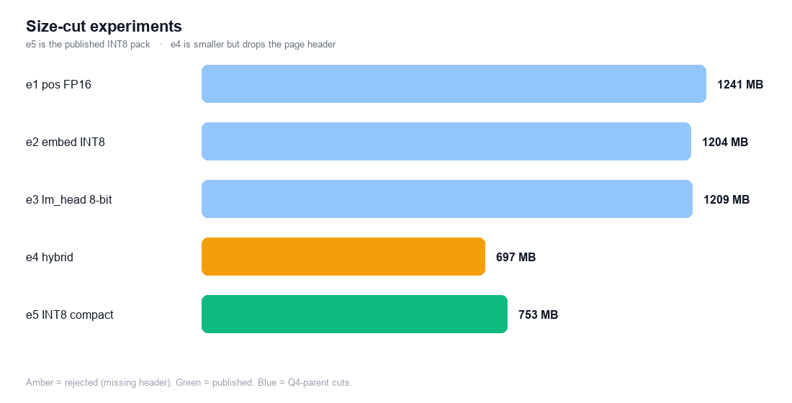

# Nemotron-3.5-Parse ONNX

ONNX Runtime export of [`nvidia/Nemotron-3.5-Parse`](https://huggingface.co/nvidia/Nemotron-3.5-Parse)
(C-RADIOv4-SO400M + 10-layer causal-prefix mBART). Two release variants:
desktop **FP16** and compact **INT8** for high-end mobile.

These weights were prepared for the mobile SDK
**[react-native-sherpa-onnx](https://github.com/XDcobra/react-native-sherpa-onnx)**
(offline speech and document tooling for React Native / Android / iOS)

## Try it live in VoiceLab

Download and run these on-device models in your pocket — anytime, anywhere — in the mobile app **VoiceLab**:

- Android: [VoiceLab on Google Play](https://play.google.com/store/apps/details?id=com.xdcobra.voicelab)
- iOS: [VoiceLab on the App Store](https://apps.apple.com/us/app/voice-lab-stt-tts-more/id6761100598)
- Product page: [https://xdcobra.github.io/voice-lab-offline-tools/](https://xdcobra.github.io/voice-lab-offline-tools/)

## Variants

| Folder | Role | Size | Recipe |
| --- | --- | ---: | --- |
| `onnx/fp16` | Desktop default | **1.44 GB** | Full FP16 graphs, I/O stay float32, `pos_embed` FP32 |
| `onnx/int8` | High-end mobile / compact desktop | **753 MB** | INT8 vision + INT8 decoder, INT8 embed, 8-bit `lm_head`, `pos_embed` FP16 |



Do not use a 4-bit C-RADIO vision graph. Uniform / MLP-only Q4 on the 27-layer
ViT dropped encoder cosine to ~0.87–0.91 and flipped bounding-box tokens.

## Instruction parity (CPU HF fp32 greedy ≡ `onnx/int8`)

Gate: same image, same control-token profile, greedy decode, **CPU**.
Hugging Face Transformers 5.14.1 fp32 vs ONNX Runtime on **`onnx/int8`**.
A row is **identical** when every generated token matches. Three page
fixtures per profile. 14 profiles × 3 = 42 runs. CUDA is not this gate.

| Profile | Identical |
| --- | ---: |
| `markdown_none_pic` | **3/3** |
| `markdown_none_nopic` | 2/3 |
| `plain_none_nopic` | 2/3 |
| `plain_none_pic` | 1/3 |
| all 10 `boxes` / `boxesAndClasses` profiles (includes the NVIDIA card default `markdown_boxesAndClasses_nopic`) | **0/3** |

**8/42** token-identical overall. Only **`markdown_none_pic`** matches on all
three fixtures. Recommended control prompt for this INT8 pack:

```text
</s><s><no_bbox><no_classes><output_markdown><predict_text_in_pic>
```

The Hello World / OmniDoc numbers below used a layout-token prompt (boxes +
classes). Those profiles are **not** token-identical to HF on `onnx/int8`.
This 14-profile gate was not re-run on `onnx/fp16`.

## Quality tests (ORT CPU vs Transformers 5.14.1)

Same two pages for every pack. **Layout coverage** is the share of Hugging Face
reference words recovered after stripping bbox and class markup tags.

### Hello World (synthetic page, 16 tokens)

| Pack | Vision cosine | Logits cosine | Greedy tokens |
| --- | ---: | ---: | --- |
| FP32 (local source, not uploaded) | 1.00 | 1.00 | 9/9 exact |
| **FP16** | 0.99997 | 1.00 | **9/9 exact** |
| **INT8 compact** | 0.963 | 0.998 | **9/9 exact** |

Both published packs decode:

```text
<x_0.0><y_0.0>Hello World<x_0.9961><y_0.9938><class_Text></s>
```

### OmniDocBench page (max-side 1024, 128 tokens)

Slide `PPT_8076_MEYER_Chapter_2_-_Language_Change_page_014.png`
(from `opendatalab/OmniDocBench`; NVIDIA does not ship quick20 images).

| Pack | Vision cosine | Logits cosine | Exact tokens | Layout coverage | Page header |
| --- | ---: | ---: | --- | ---: | --- |
| FP32 | 1.00 | 1.00 | 128/128 | 1.00 | yes |
| **FP16** | 0.9998 | 1.00 | 127/128 (one bbox bin `0.21`→`0.209`) | **1.00** | yes |
| **INT8 compact** | 0.955 | 0.998 | bbox bin + extra `#` heading | **0.978** | **yes** |



INT8 still emits the CAMBRIDGE header, title, italic source line, footer,
table caption, and the LaTeX tabular / Latin columns.

## Size-cut experiments

Isolated cuts on the FP16 / Q4 / INT8 graphs (2026-10-26, same parity suite).
Only the two published folders above are in this repo; the rest stayed local.

| ID | Change | Size | Hello | OmniDoc layout | Page header |
| --- | --- | ---: | --- | ---: | --- |
| e1 | `pos_embed` FP16 | 1.24 GB | exact | 0.978 | no (Q4 parent) |
| e2 | per-row INT8 `embed_tokens` | 1.20 GB | exact | 0.978 | no (Q4 parent) |
| e3 | 8-bit MatMulNBits `lm_head` | 1.21 GB | exact | 0.978 | no (Q4 parent) |
| e4 | INT8 vision + Q4 decoder + e1–e3 | 697 MB | exact | 0.978 | **no** |
| **e5 → `onnx/int8`** | INT8 vision/decoder + e1–e3 | **753 MB** | exact | 0.978 | **yes** |



`pos_embed` FP16, INT8 embeddings, and 8-bit `lm_head` did not add visible
loss beyond the parent decoder. **Q4 on the decoder** is what drops the
page header. That is why the compact release is e5 (INT8 decoder), not e4.

Rejected (not uploaded): local FP32 2.81 GB, first-pass INT8 1.08 GB
(FP32 `lm_head`), and Q4F16 1.28 GB (FP16 vision).

## Files

Each variant folder is a complete pack (graphs + tokenizer + processor):

| File | Role |
| --- | --- |
| `patch_embed.onnx` | Linear `768 → 1152` |
| `pos_embed.npy` | RADIO 128×128 positional field (host NaViT) |
| `vision_encoder.onnx` | 27-layer ViT + neck |
| `embed_tokens.onnx` | scaled mBART embeddings |
| `decoder_model_merged.onnx` | 10-layer GQA decoder with KV cache |
| `tokenizer.json` / `tokenizer_config.json` | 72,512-row multilingual tokenizer |
| `preprocessor_config.json` / `processor_config.json` | official NaViT / CLIP preprocess |
| `ocr_manifest.json` | pack id, dtypes, file map |
| `LICENSE` | OpenMDW-1.1 (weights); tokenizer is MIT, see NVIDIA card |

Repo root also has `navit_pos.py` (content-normalized interpolation) so image
size stays dynamic without baking a canvas into the vision graph.

## License

Governing terms for the weights: [OpenMDW-1.1](https://openmdw.ai/license/1-1/).
Tokenizer: MIT, see [`TOKENIZER_ATTRIBUTION.md`](https://huggingface.co/nvidia/Nemotron-3.5-Parse/blob/main/TOKENIZER_ATTRIBUTION.md)
on the NVIDIA card. This distribution keeps the upstream `LICENSE`.

Ready for commercial or non-commercial use under those terms.

## Source

- Base: [`nvidia/Nemotron-3.5-Parse`](https://huggingface.co/nvidia/Nemotron-3.5-Parse) (2026-10-17)
- Export: custom split (host NaViT, merged KV decoder), opset 18, ORT 1.31
- Quant: `onnxruntime` FP16 convert, dynamic INT8 MatMul, MatMulNBits 8-bit `lm_head`
