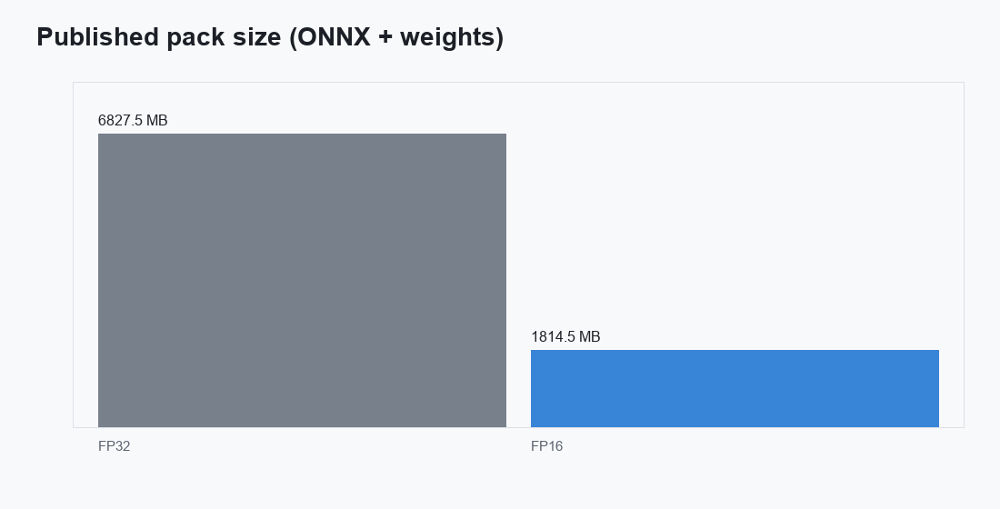
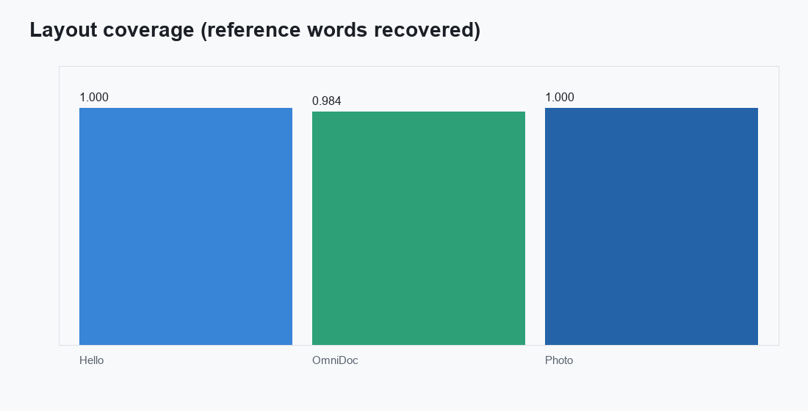
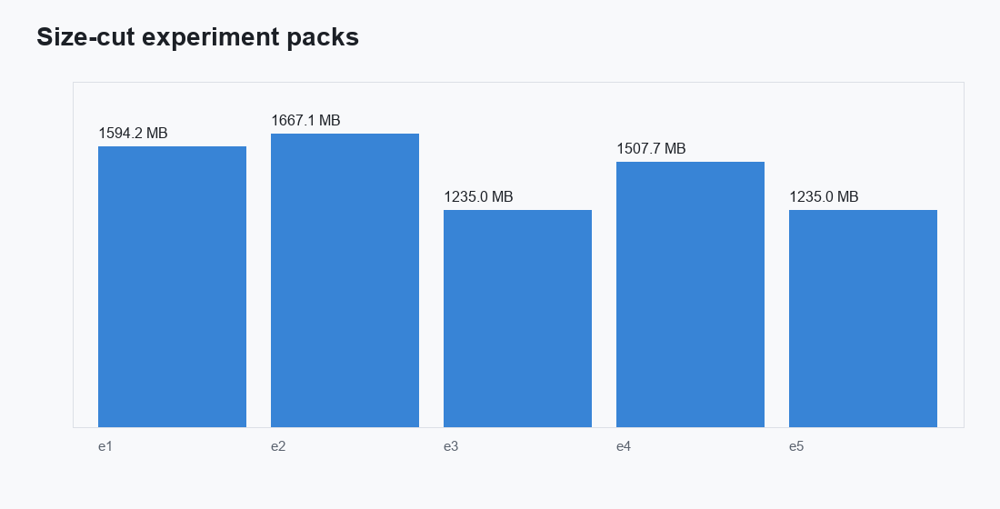

# PaddleOCR-VL-1.6 ONNX

ONNX Runtime export of [`PaddlePaddle/PaddleOCR-VL-1.6`](https://huggingface.co/PaddlePaddle/PaddleOCR-VL-1.6)
(NaViT vision tower + ERNIE-4.5-0.3B). VLM-only three-graph layout (no PP-DocLayout).
The published pack is **FP16**. INT8 and 4-bit decoder recipes were measured and
**rejected**: they loop or flip script on a warped camera photo even when Hello World
still matches.

These weights were prepared for the mobile SDK
**[react-native-sherpa-onnx](https://github.com/XDcobra/react-native-sherpa-onnx)**
(offline speech and document tooling for React Native / Android / iOS).

## Try it live in VoiceLab

Download and run these on-device models in your pocket — anytime, anywhere — in the mobile app **VoiceLab**:

- Android: [VoiceLab on Google Play](https://play.google.com/store/apps/details?id=com.xdcobra.voicelab)
- iOS: [VoiceLab on the App Store](https://apps.apple.com/us/app/voice-lab-stt-tts-more/id6761100598)
- Product page: [https://xdcobra.github.io/voice-lab-offline-tools/](https://xdcobra.github.io/voice-lab-offline-tools/)

## Variants

| Folder | Role | Size | Recipe |
| --- | --- | ---: | --- |
| `onnx/fp16` | Desktop default | **1.81 GB** | FP16 weights/compute, I/O float32 |



Do **not** use [`iaa2005/PaddleOCR-VL-1.6-ONNX`](https://huggingface.co/iaa2005/PaddleOCR-VL-1.6-ONNX)
int8-only graphs on full pages. The author reports Cyrillic→Latin collapse and loops
once the image-token count grows. This export keeps the embedding table in FP32 when
quantizing, and still **does not publish** INT8 / Q4: the photo fixture loops (`-T-T-T…`).

## Instruction parity (CPU HF fp32 greedy ≡ this pack)

Gate: same image, same official control prompt, greedy decode, **CPU**.
Hugging Face Transformers 4.57 fp32 vs ONNX Runtime on **`onnx/fp16`**.
A row is **identical** when every generated token matches. Three fixtures
per prompt (18 runs). CUDA is not this gate.

| Prompt | Identical |
| --- | ---: |
| `OCR:` | **3/3** |
| `Table Recognition:` | **3/3** |
| `Formula Recognition:` | **3/3** |
| `Chart Recognition:` | **3/3** |
| `Seal Recognition:` | **3/3** |
| `Spotting:` | **3/3** |

**18/18** token-identical. These six prompts are the supported control set
for the published FP16 pack.

## Quality tests (ORT CPU vs Transformers 4.57.6)

Same three pages for every pack. **Layout coverage** is the share of Hugging Face
reference words recovered after stripping markdown/HTML markup.

### Hello World (synthetic page, 16 tokens)

| Pack | Vision cosine | Logits cosine | Greedy tokens |
| --- | ---: | ---: | --- |
| FP32 (local source, not uploaded) | 1.00 | 1.00 | 3/3 exact |
| **FP16** | 0.99994 | 0.99984 | **3/3 exact** |
| INT8 (local, rejected) | 0.985 | 0.913 | 3/3 exact |
| Q4F16 (local, rejected) | 0.99994 | 0.916 | 3/3 exact |

Both FP32 and FP16 decode:

```text
Hello World</s>
```

Hello World alone is not a ship gate.

### OmniDocBench page (max-side 1024, 128 tokens)

Slide `PPT_8076_MEYER_Chapter_2_-_Language_Change_page_014.png`
(from `opendatalab/OmniDocBench`). Comparable to the Nemotron-3.5-Parse card.

| Pack | Vision cosine | Logits cosine | Exact tokens | Layout coverage | Page header |
| --- | ---: | ---: | ---: | ---: | --- |
| FP32 | 1.00 | 1.00 | 128/128 | 1.00 | yes |
| **FP16** | 0.9998 | 0.9988 | 108/128 | **0.984** | **yes** |
| INT8 | 0.982 | 0.907 | 72/128 | 0.952 | yes |
| Q4F16 | 0.9998 | 0.936 | 78/128 | 1.00 | yes |

FP16 still emits the CAMBRIDGE header, title, table caption, and the Latin / Romance
person-ending columns. One table cell picks up an extra `0` and the last row truncates
`-TIS` → `-`. Tables and formulas on this page survive in the FP16 text.

### Camera / warp photo (max-side 1024, 64 tokens)

Perspective-skewed copy of the same page (`meyer_page_014_warp.jpg`). This is the
gap vs Granite/Nemotron on handheld photos.

| Pack | Vision cosine | Layout coverage | Notes |
| --- | ---: | ---: | --- |
| FP32 | 1.00 | 1.00 | tokens match Transformers (garbled page, as expected) |
| **FP16** | 0.9992 | **1.00** | **64/64 exact** vs Transformers |
| INT8 | 0.981 | 0.375 | loops `-T-T-T…` |
| Q4F16 | 0.9992 | 0.438 | loops `-` |



## Size-cut experiments

Isolated cuts on the FP16 / INT8 / Q4 graphs (same three fixtures). **None** of the
quantized cuts keep the photo fixture. Only `onnx/fp16` is in this repo; the rest stayed local.

| ID | Change | Size | Hello | OmniDoc layout | Photo |
| --- | --- | ---: | --- | ---: | --- |
| e1 | INT8 vision, FP16 decoder, FP32 embed | 1.59 GB | exact | **1.00 exact** | **collapse** |
| e2 | FP16 vision, INT8 decoder, FP32 embed | 1.67 GB | exact | 0.984 | **collapse** |
| e3 | INT8 vision + INT8 decoder (default INT8) | 1.24 GB | exact | 0.952 | **collapse** |
| e4 | FP16 vision, 4-bit decoder, FP32 embed | 1.51 GB | exact | 1.00 | **collapse** |
| e5 | e3 + 8-bit `lm_head` | 1.24 GB | exact | 0.952 | **collapse** |



INT8 vision alone (e1) can still match the OmniDoc page token-for-token, but every
INT8 / Q4 decoder or INT8 tower **loops on the warped photo**. That is why the
release is FP16 only.

Rejected (not uploaded): local FP32 ~3.3 GB, INT8 1.24 GB, Q4F16 1.30 GB.

## Files

Each variant folder is a complete pack (graphs + tokenizer + processor):

| File | Role |
| --- | --- |
| `vision_encoder.onnx` | NaViT tower + 2×2 projector (`pixel_values`, `image_grid_thw`) |
| `embedding.onnx` | token table (`input_ids` → `[1, S, 1024]`) |
| `decoder.onnx` | 18-layer ERNIE-4.5 with KV cache |
| `tokenizer.json` / `tokenizer_config.json` | 103,424-row tokenizer |
| `preprocessor_config.json` / `processor_config.json` | official NaViT preprocess (`mean/std=0.5`) |
| `ocr_manifest.json` | pack id, dtypes, file map |
| `LICENSE` | Apache-2.0 |

Repo root also has `rope_index.py` (host 3D M-RoPE indices). Image tokens splice
at id **100295**. Prompt follows the official `OCR:` / `<|IMAGE_PLACEHOLDER|>` chat template.

Export used `torch.onnx.export(..., dynamo=True)`, opset 21. TorchScript/`dynamo=False`
bakes one page size into NaViT `Resize`.

## License

Apache-2.0, inherited from [`PaddlePaddle/PaddleOCR-VL-1.6`](https://huggingface.co/PaddlePaddle/PaddleOCR-VL-1.6).
Ready for commercial or non-commercial use under those terms.

## Source

- Base: [`PaddlePaddle/PaddleOCR-VL-1.6`](https://huggingface.co/PaddlePaddle/PaddleOCR-VL-1.6)
- Graph layout: community 1.5 three-graph split (`vision_encoder` / `embedding` / `decoder`)
- Export: dynamo opset 21, ORT CPU greedy decode
- Quant: `onnxruntime` FP16 convert; dynamic INT8 MatMul and MatMulNBits 4-bit decoder were measured and not published
